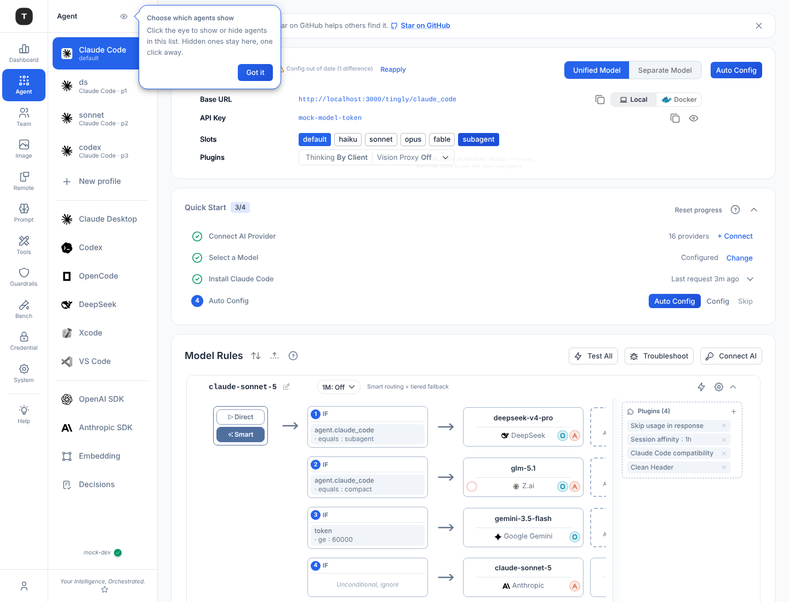

# Claude Code: per-slot rules in unified mode

> Status: implemented. Background: `claude-code-config.md` (env shape, rule ↔ slot mapping).

## Problem

Claude Code has two modes: **unified** (every model slot requests the `cc` rule) and **separate** (every slot has its own rule). The common need sits in between — "unified, but the subagent on another model" — and used to mean switching to separate and keeping five rules identical by hand.

## Design

The modes stay. Unified mode gains per-slot rules, and the state is the rules themselves — there is no separate slot list:

- The **default slot** (`ANTHROPIC_MODEL`) is the unified rule `builtin:<scenario>:cc` and is always there.
- Each other slot — `haiku` `sonnet` `opus` `fable` `subagent` — has its own rule `builtin:<scenario>:<slot>`. **In unified mode, that rule being on means the slot has its own rule**; off means the slot follows the unified rule.
- Routing is untouched: the env carries a rule's `request_model`, which stays the routing key.

UI: in unified mode a **Slots** row sits under Base URL / API Key. `default` is always lit; clicking another slot gives it its own rule (the rules card then shows it) or hands it back. Separate mode, and separate-mode profiles, look and behave as before.

## Why the rule's `Active` is enough

An earlier iteration kept an explicit slot list beside `Active`, because `agent apply` used to switch every Claude Code rule on and so `Active` could not mean "split". Two states then had to be kept in step (whole-record scenario writes, mode changes, profile vs. main storage). Instead the writers were fixed so `Active` is trustworthy:

- Only a **mode change** touches the rules (`syncClaudeCodeRuleModeLocked`, `SetScenarioFlag`): switching to unified switches every tier rule off, i.e. merges all slots. A whole-record write or a repeated "unified" flag that doesn't change the mode leaves them alone.
- `agent apply` in unified mode switches only the main rule on. Tier rules that are on (split slots) are left untouched; the others get the provider but stay off, so a later switch to separate mode still routes.
- Config created before this: a one-time migration (`20261022-claude-code-unified-slot-rules`) switches the tier rules off for unified configs, since old `agent apply` had switched them on without meaning a split.

Other rules:

- Turning a slot on reuses its built-in rule. A rule without routing yet — or a missing rule — starts as a copy of the unified rule's routing, so nothing changes until the user edits it. Turning it off only switches the rule off, so turning it on again restores it.
- Rejected: separate mode (main or profile), unknown profiles, the default slot.
- A profile's slots are its own rules (`builtin:claude_code:<profile>:<slot>`); it never reads the main scenario's.

## Implementation

- `config.SetClaudeCodeSlot` / `ClaudeCodeSlots` (`internal/config/cc_slots.go`); mode sync in `scenario.go`.
- `agent.ClaudeCodeSlotModels`: the one resolver behind the settings file and the tbclient env; a slot with an active rule of its own requests it, otherwise the unified rule.
- API: `GET /api/v1/scenario/:scenario/claude-code/slots`, `PUT …/claude-code/slots/:slot {enabled}`.
- Frontend: `useSlotRouting` (Slots row, unified-mode rule list, fixed mode for profiles); `derivePrefsFromRules({ rules, mode, slots })`.

Changing a slot changes the env: the main page's Client Config status chip offers Reapply; profile settings are rebuilt at launch.
