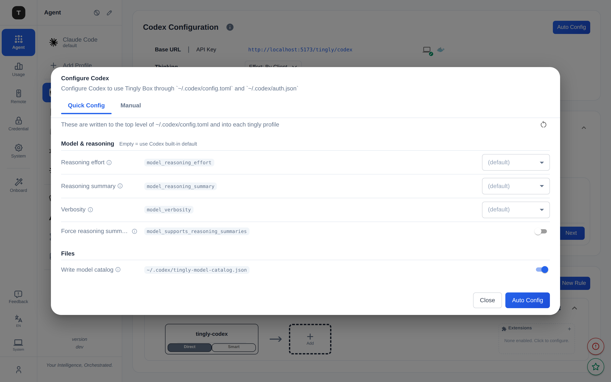
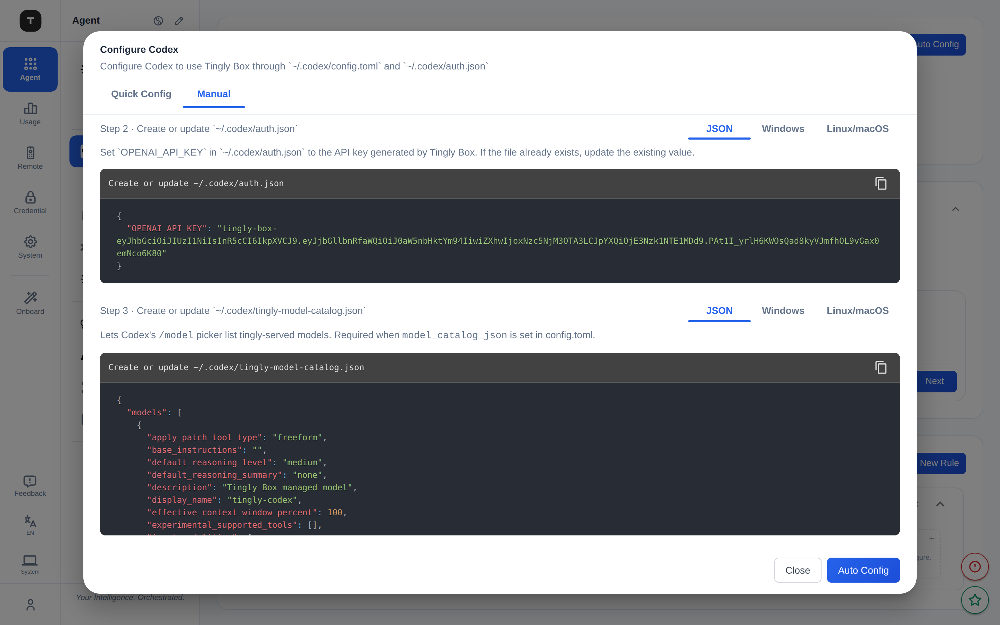
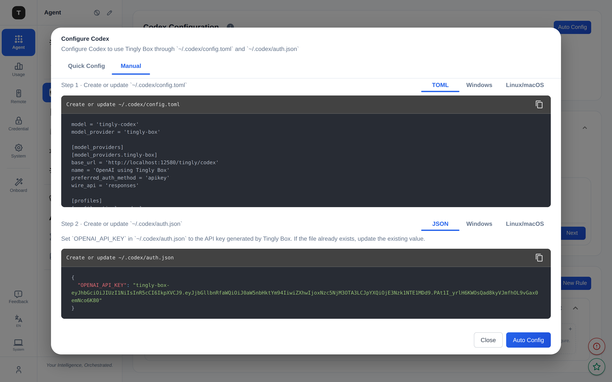

# Codex Quick Config: Design and Decisions

> Audience: tingly-box frontend/backend contributors touching Codex CLI
> setup, or anyone adding a new tunable Codex `config.toml` key.
> This document records why Codex went from a static one-click apply to a
> typed, editable model/reasoning form, how the model catalog became an
> explicit toggle, and why the defaults are deliberately conservative for
> third-party providers.
>
> **Any `config.toml` key we emit must validate against Codex's published schema**
> — <https://developers.openai.com/codex/config-schema.json> (root and
> `[model_providers.*]` are `additionalProperties: false`). See
> `.design/codex-auth.md` §7 for the validated field set and re-check commands.

---

## 1. Background

Codex originally had a *static* config flow: the backend
`ApplyCodexConfig(baseURL, models)` wrote every managed field with
hardcoded values (`model_provider`, `wire_api="responses"`,
`model_reasoning_summary="auto"`, `model_supports_reasoning_summaries=true`,
the `[profiles.*]` blocks), and the `CodexConfigModal` only showed a
read-only preview plus an "Auto Config" button. Users couldn't tune any
Codex option.

This redesign brings Codex up to parity with the Claude Code Quick Config
(see `claude-code-config.md`): the modal now has **Quick** and **Manual**
tabs, the Quick tab is a typed form of model/reasoning knobs, and the
Manual tab previews the real, server-rendered files. Scope is deliberately
limited to **model / reasoning / profile** keys — no `approval_policy` /
`sandbox_mode` safety toggles, no network-retry tuning.

---

## 2. Goals

1. **Editable, discoverable.** Each tunable Codex key is a labeled row with
   a one-line purpose, a hover tooltip (valid values + Codex default + tb
   recommendation), and the literal `config.toml` key shown as a code badge.
2. **Server-rendered preview.** The Manual tab's TOML/JSON comes from the
   backend (`POST /config/preview/codex`), so what the user previews is
   byte-for-byte what Apply writes — including prefs stamped into each
   profile.
3. **Safe for third-party providers.** tingly-box mostly proxies *non-OpenAI*
   models. Defaults must not assert OpenAI-only capabilities the upstream
   model doesn't have.
4. **Catalog is opt-out, and visible.** The model catalog (which makes
   tingly models show up in Codex's `/model` picker) is an explicit toggle,
   and its contents are shown in the Manual tab so copy-paste users aren't
   left with a dangling file reference.

---

## 3. Typed prefs, whitelist by construction

Unlike Claude Code (whose JSON tags are env-var names), Codex prefs map 1:1
to `config.toml` keys. The struct *is* the whitelist — only these four keys
can ever be set from a request, so prefs can never clobber tingly-managed
fields (`model`, `model_provider`, `model_catalog_json`,
`model_providers.*`) or inject arbitrary TOML:

```go
// internal/config/apply_config.go
type CodexPrefs struct {
    ModelReasoningEffort            string `json:"model_reasoning_effort,omitempty"`
    ModelReasoningSummary           string `json:"model_reasoning_summary,omitempty"`
    ModelVerbosity                  string `json:"model_verbosity,omitempty"`
    // Catalog-only (not config.toml keys; see §"Schema alignment" below):
    SupportsReasoningSummaries      string `json:"supports_reasoning_summaries,omitempty"`
    EffectiveContextWindowPercent   string `json:"effective_context_window_percent,omitempty"`
    AutoCompactPercent              string `json:"auto_compact_percent,omitempty"`
}
```

All values are strings; `""` means *omit this key, let Codex use its own
default*. This avoids the "0/false means unset" ambiguity. `toConfig()`
converts to native TOML types with enum-membership validation (invalid →
dropped) and `"true"` → `true` (anything else dropped).

Prefs are written **both** at the top level (global default) and into each
generated `[profiles.<model>]` block, so every tingly profile is
self-contained.



---

## 4. Conservative defaults (the third-party decision)

The original code hardcoded `model_supports_reasoning_summaries = true` (a key
Codex's schema has since dropped; see "Schema alignment") and
`model_reasoning_summary = "auto"`. That is correct for OpenAI o-series
models, which natively return reasoning summaries via the Responses API's
`reasoning.summary` field. It is **wrong by default for third-party models**
proxied through tingly-box:

- Most third-party providers don't implement `reasoning.summary`.
- tingly-box doesn't synthesize that field.
- With `model_supports_reasoning_summaries = true`, Codex requests a summary
  the upstream never returns → broken/odd behavior (this is the class of
  issue users hit in the field).

So `DefaultCodexPrefs()` now returns an **empty** struct — every knob unset,
deferring to Codex's own defaults. The frontend `defaultCodexPrefs()`
matches (`{}`), so the Quick form opens with all selects on `(default)` and
the "Force reasoning summaries" switch **off**. Users with a
reasoning-capable upstream can flip it on explicitly.

The same reasoning applies to the model catalog payload
(`RenderCodexModelCatalog`): per-entry `supports_reasoning_summaries` is
`false` and `default_reasoning_summary` is `"none"`, rather than the old
`true`/`"auto"`.

---

## 5. The model catalog toggle (issue #1027)

`~/.codex/tingly-model-catalog.json` is a tingly-managed file that Codex
reads on startup to populate the `/model` picker with tingly-served models.
`config.toml`'s `model_catalog_json` points at it.

**The bug (#1027):** users who took the Manual path — copying the
`config.toml` snippet or running the platform scripts — got a config that
referenced `model_catalog_json = '…/tingly-model-catalog.json'`, but the
catalog file itself was only written by the full "Auto Config" apply. The
reference dangled.

**The fix — an explicit `writeCatalog` flag, wired end to end:**

- Request: `ApplyCodexConfigRequest.WriteCatalog *bool` (nil → true, the
  backward-compatible default).
- `ApplyCodexConfig(baseURL, models, prefs, writeCatalog)` and
  `RenderCodexConfigTOML(..., writeCatalog)` both take the flag. When false,
  the catalog file is not written **and** `model_catalog_json` is omitted
  from the TOML — no dangling reference is ever produced.
- Preview response carries `catalogJson` (the rendered catalog) so the
  Manual tab can show it as **Step 3**, with TOML/Windows/Unix variants just
  like config.toml and auth.json. Copy-paste users now have the file's
  contents in front of them.

In the Quick tab this is a **switch** ("Write model catalog") under a
**Files** section, with a one-line explanation of what the file is for.

> **Why a toggle and not a separate "write catalog" button?** We considered
> a standalone weak button that writes only the catalog (for re-writing a
> deleted file without a full apply). It was cut as YAGNI: "Auto Config"
> already rewrites the catalog via merge-safe semantics, and the Manual
> Step 3 covers the copy-paste path. The toggle + Step 3 solve #1027 without
> a new endpoint.

Catalog **on** (default) — Manual shows Step 3 with the catalog JSON:



Catalog **off** — switch greyed, no Step 3, and the TOML drops
`model_catalog_json`:




---

## 6. Managed-field protection

`mergeCodexConfig` applies user prefs **first**, then writes the managed
fields, so managed fields always win even if a pref key somehow collided:

```
coerced := prefs.toConfig()      // whitelisted, validated
for k,v := range coerced { cfg[k] = v }

cfg["model"]            = models[0]          // managed, written after
cfg["model_provider"]   = "tingly-box"       // managed
cfg["model_catalog_json"] = catalogPath      // managed (only if writeCatalog)
cfg["model_providers"]["tingly-box"] = {…}    // managed: base_url, wire_api…
```

Everything else the user put in `config.toml` — unrelated top-level keys,
other `[model_providers.*]`, unrelated `[profiles.*]` — is preserved
(MERGE, not overwrite). The previous file is backed up before rewrite;
`agent restore codex` rolls back.

---

## 7. Apply notification completeness

The Apply success alert lists every file touched so the user knows exactly
what changed:

- `✓ Created/Updated ~/.codex/config.toml`
- `✓ Created/Updated ~/.codex/auth.json`
- `✓ Written ~/.codex/tingly-model-catalog.json` (only when the catalog was
  actually written — `ApplyCodexConfigResponse.CatalogWritten`, set to
  `writeCatalog && len(models) > 0`)
- the config backup path, when one was created

---

## 8. Wire shape

```jsonc
// POST /config/apply/codex  and  POST /config/preview/codex
{
  "preferences": {              // null → DefaultCodexPrefs() (all empty)
    "model_reasoning_effort": "high",
    "model_reasoning_summary": "",
    "model_verbosity": "",
    "supports_reasoning_summaries": ""
  },
  "writeCatalog": true          // null → true
}
```

Preview response adds `catalogJson` (present only when `writeCatalog` and
models exist); apply response adds `catalogWritten`.

> Per `CLAUDE.md`, the typed client SDK is codegen'd from swagger. The Codex
> calls in `frontend/src/services/api.ts` are hand-written `uiAPI(...)`
> wrappers (consistent with the existing Codex functions) until the next
> regen picks up the new request/response fields.

---

## 9. Key files

| Layer | File | Role |
|---|---|---|
| Backend | `internal/config/apply_config.go` | `CodexPrefs`, `DefaultCodexPrefs`, `toConfig`, `ApplyCodexConfig`, `RenderCodexConfigTOML`, `RenderCodexModelCatalog`, `mergeCodexConfig` |
| Backend | `internal/server/module/configapply/{types,handler,routes}.go` | request/response shapes, apply + preview handlers, routes |
| Backend | `ai/agent/codex.go` | `CodexParams.{Prefs,WriteCatalog}`, `Apply()` |
| Backend | `internal/agent/rule_bridge.go` | CLI path (defaults + `WriteCatalog: true`) |
| Frontend | `frontend/src/pages/scenario/components/CodexQuickConfig.tsx` | field catalog + bilingual text + `writeCatalog` Files section |
| Frontend | `frontend/src/pages/scenario/components/CodexConfigModal.tsx` | Quick/Manual tabs, debounced preview, Step 3 catalog, apply alerts |
| Frontend | `frontend/src/pages/scenario/UseCodexPage.tsx` | page-level apply wiring |
| Frontend | `frontend/src/services/api.ts` | `applyCodexConfig`, `getCodexConfigPreview` |

---

## 10. Test coverage

| File | Covers |
|---|---|
| `internal/config/apply_config_test.go` | merge preserves user top-level keys / providers / profiles; managed fields overwritten; idempotent apply; colliding profile overwrite; catalog written + `model_catalog_json` set; reasoning presets are objects; no-models skips catalog; **`writeCatalog=false` skips catalog and drops `model_catalog_json`**; prefs applied top-level + per-profile; invalid enum / non-`true` bool dropped; prefs cannot clobber managed fields. |

Real-stack verification: Playwright + Chrome-for-Testing against a live
`tingly-box start --port 12580` backend through the vite dev proxy
confirms — Quick form opens at safe defaults (all `(default)`, force-summary
off, catalog on); changing reasoning effort reflects in the Manual TOML at
both top level and in every `[profiles.*]`; toggling the catalog switch
adds/removes Step 3 and the `model_catalog_json` line.

---

## Context-window headroom defaults (2026-10-19)

The managed model catalog (`tingly-model-catalog.json`) sets
`effective_context_window_percent = 82` (was 92; Codex's own default is 95)
and `auto_compact_token_limit = 75%` of the window (was 85%). Tingly-routed
third-party models spend more of the window on system prompt, tool overhead and
output than Codex's first-party models assume, so we reserve more headroom and
compact earlier. Compaction is always clamped to the effective percent so it
fires before the usable window is exhausted.

Both numbers are user-tunable in Auto Config (Quick tab, "Usable window" and
"Auto-compact at"). They ride in `CodexPrefs` as `effective_context_window_percent`
and `auto_compact_percent` (decimal strings, range 50–100, `""` = default) but are
**catalog-only**: `toConfig()` never writes them to `config.toml`. On reopen,
`ReadCodexConfig` restores non-default values from the applied catalog.

`model_reasoning_effort` accepts `max` and `ultra` in addition to the older
tiers — current Codex models advertise them in `supported_reasoning_levels`.

## Per-model auto-compact (rule flag `codex_compact_percent`)

The two headroom numbers above are shared by every catalog entry. Models differ
(200K vs a 1M rule, different upstreams), so a Codex rule can override the
auto-compact percent for its own model: `RuleFlags.CodexCompactPercent`
(50–100, `0` = follow the shared value). It is **config-only**: it is read when
the catalog is rendered (`BuildCompactPercentsFromRules` → `CodexPrefs.ModelAutoCompactPercent`,
`json:"-"` so a request can never set it) and never enters the request
pipeline, so it is deliberately not in `RuleFlagRegistry` (see `rule-flags.md`).

- **Ceiling.** A catalog entry's compact percent is `min(percent, usable-window
  percent)`. Codex is reported to ignore an auto-compact limit above 90% of the
  window (third-party write-ups, unconfirmed), but that is deliberately not
  enforced: the practical limit in use is lower than that anyway (see below), so
  the warnings carry the guidance and nothing is clamped at 90.
- **Editor.** A `Compact: 75% ▾` chip on the Codex rule header, next to `1M` and
  `Endpoint`, opens a popover with a slider (`CodexCompactChip`). Unset reads
  `Compact: Auto` and the popover shows the Auto Config value it follows; moving
  the slider sets the override, "use Auto Config value" clears it.
- **Slider layout.** The axis is labelled only at its ends (50% / 100%); zone
  boundaries are never placed as labels on the axis, because a boundary close to
  an end (96.4% on 1M) collides with the end label. The zones are painted on the
  slider's own rail so they line up with the thumb at any width: hatched from the
  usable-window percent up (values there still work, they are cut down), amber for
  the "too few tokens left" stretch below it (only when the usable window has been
  raised past it). A legend under the axis names each zone with its numbers.
- **Warning is about tokens left, not a fixed percent.** What compaction needs
  (summary request, system prompt, tool output, the reply) is roughly constant,
  so the popover warns when fewer than 36,000 tokens would remain, using the
  window the rule really has (1M with the `1M` flag, else 200K). 36,000 is the
  empirical limit: 82% of a 200K window. Larger windows reach it at a higher
  percent (96.4% on 1M). It is where warnings start, not a cap. The usable-window
  cut-down is explained instead of silently applied.
  `codexCompact.ts` mirrors the Go constants for the live preview; the server's
  clamp is what is written.
- **Read-back.** With overrides present the catalog no longer has one compact
  value, so `ReadCodexConfig` restores the most common one as the shared value.
- **Auto Config warns about the shared value too.** Under "Auto-compact at" the
  Quick tab shows the same judgement for the shared percent against the default
  200K window (a rule with the `1M` flag is judged on its own chip): an info line
  when the usable window cuts it down, a warning when under 36,000 tokens would
  remain. Typed values only; nothing is rewritten.
- **Not covered.** The agent-apply bridge (`ai/agent`, CLI/IM apply) renders its
  catalog from default prefs; it does carry the rule overrides (compact percent,
  window, ceiling), see "One resolution, every path" below. Whether the 36,000
  threshold is right still wants a real long-session check against Codex.

## Per-model context window (rule flag `codex_context_window`)

The catalog window was 200K for every model, 1M with the rule's `1M` flag.
Real windows vary (128K, 256K, 400K…). Auto now derives them from what the
rule's upstreams accept (#2225), and for models Tingly Box doesn't know a person
must be able to say it. A Codex rule can set
`RuleFlags.CodexContextWindow` (tokens, 8,000–10,000,000, `0` = automatic). It
is config-only like `codex_compact_percent`: `BuildContextWindowsFromRules`
resolves each rule to *own value > the routed upstreams' window (below) > 1M
flag, for a model nothing is known about > default 200K*, so apply, the
out-of-date check and the compact preview all see the same window.

- **Auto uses the catalog first.** Many models already carry limits in the
  built-in provider catalog (`providers.json`), so Auto is never a blind 200K
  for them. `Config.RuleModelInfo` is the one place a rule's model metadata is
  resolved: it looks up the routed model of every upstream the rule can reach
  (active services, plus smart-routing services while smart routing is on;
  services on a disabled or deleted provider never answer and don't count),
  then the request model, on the provider's matched template, keeps the first
  known description and the smallest known limits, so the value is safe
  whichever upstream answers. `/v1/models` reads it, and the Codex window
  (below) reads the same upstreams the same way, so 200K is only for models
  the catalog does not know. A command that runs without the server (CLI,
  TUI) is given the catalog at start (`app.AppManager`): the one the server
  last synced (`~/.tingly-box/provider_catalog.json`, whatever its age: the
  cache TTL only decides when a server syncs again, and a running server keeps
  its synced copy in memory), else the embedded one (`catalog.LastSynced`), so
  both resolve a rule the same. A config with no catalog knows no model. A
  rule with several upstreams keeps `max_context` only per upstream:
  templates count it differently.
- **Window and ceiling, per upstream** (#2131). Each catalog entry gets a window
  (`context_window`, what Codex plans around: its meter and when it compacts)
  and a ceiling (`max_context_window`, the most a `model_context_window`
  override in Codex's `config.toml` may reach; Codex clamps the override to it).
  They used to be written equal. `CodexAutoContextWindow` derives both for each
  reachable upstream and keeps the smallest window and the smallest ceiling,
  since a request can land on any of them:

  | Upstream | Window | Ceiling | Source |
  |---|---|---|---|
  | model the catalog knows | input limit (`max_input_tokens`) | input limit of `max_context`, else the window | `catalog` |
  | same, 1M flag on, `max_context` above `context` | input limit of `max_context` | same | `extended` |
  | same, on a provider with an Anthropic-style endpoint, without the context-1m header | input limit | the window | `catalog` |
  | model the catalog doesn't know | 1M with the flag, else 200K (a guess) | same | `default` |

  `max_context` is a catalog field for the larger window a client may opt
  into, counted like `context` (`ModelInfo.InputCeiling` takes the output share
  off for templates whose window counts output). The `codex` template's
  ChatGPT-backed GPT models carry `context: 272000, max_context: 872000`, as
  Codex's own catalog does; `harness catalog check` rejects a `max_context`
  that isn't above `context`. On a provider with an Anthropic-style endpoint
  `max_context` is the window the context-1m header opens, which the rule's
  1M flag adds: the `claude-code` template's Opus / Sonnet 4.6 carry `context:
  200000, max_context: 1000000` (a subscription gets 1M only with the header,
  which is what Claude Code's `[1m]` variant sends), while on the API Claude
  4.6 and later is 1M without it (`anthropic-com`: `context: 1000000`, no
  `max_context`). No model name or 200K constant is involved. Without the
  header the upstream answers with the standard window, so that is the
  ceiling too: Codex's own `model_context_window` can't open it.
  "Anthropic-style" is the endpoint a Codex (OpenAI-style) request is actually
  sent to: the gateway's choice, shared through `Provider.RequestStyle`
  (`codexSendsContext1M` here, `resolveAttemptStyle` in the gateway), so Claude
  through a dual provider's OpenAI URL stays at its standard window even with
  the flag.
- **What the 1M flag means for Codex.** It used to set every Codex model's
  window to 1M, which is wrong for models that don't have one (a 128K DeepSeek
  model) and for ChatGPT-backed models, whose larger window is 872K, not 1M
  (#2131). It now asks for the routed model's larger window, the catalog's
  `max_context`: 872K on a ChatGPT-backed model, the window the context-1m
  header (which the flag adds) opens on Claude 4.6 through a subscription,
  nothing on a model without one. Only for a model nothing is known about does
  it keep its old meaning, 1M, which stays a guess. The other model lists
  follow the same header rule (`RuleModelInfo`, `sendsContext1M` for the
  list's client style): a Claude subscription rule lists 200K, or 1M with the
  flag.
- **An own window is also its ceiling.** `CodexContextWindowFor` writes
  `codex_context_window` as both: it is set for models whose real window
  Tingly Box doesn't know, where a derived ceiling would only be a guess. Two
  rules sharing a request model share one catalog entry: the smaller window and
  the smaller ceiling, in either order.
- **One resolution, every path.** `BuildContextWindowsFromRules` (non-default
  windows) and `BuildMaxContextWindowsFromRules` (ceilings above the window)
  feed apply, preview and the out-of-date check, which compares
  `max_context_window` too. The CLI / IM / TUI apply (`internal/agent`) uses
  the same maps, plus the compact overrides, and writes the same catalog file.
  `tb agent apply codex --provider … --model …` updates the `tingly-codex` rule
  before writing the files, so the first apply already carries that model's
  window; if the files then fail, the result says the rule already changed.
- **Three numbers, one meaning each.** Vendors publish "context window" in two
  senses: Anthropic's window is shared by input and output, so its Models API
  reports it as `max_input_tokens`; OpenAI's counts output too (gpt-5: 400K =
  272K input + 128K output). Both model listings therefore carry
  `context_window` (the window the vendor publishes, catalog `context`; Tingly
  Box's own field, named so a reader never has to ask which sense),
  `max_input_tokens` (the most input one request may carry) and `max_tokens`
  (the most output), the last two with Anthropic's names and meaning. A
  template whose `context` counts output sets `context_includes_output`
  (`openai-com`, `azure-openai`) and lookups derive `max_input` as
  `context − max_output`; a model may also state `max_input` itself. The
  OpenAI-format list keeps its older `context` / `max_output` for existing
  clients. OpenAI's Model object has no limit fields; OpenRouter's
  `context_length` and Gemini's `inputTokenLimit` are other spellings, only
  for reading upstream lists (#1774).
- **Codex is given the input limit.** Codex's `context_window` is an input
  budget (its own catalog gives gpt-5 272K, not 400K), so Auto resolves to
  `max_input_tokens`, and the editor reads it from `/tingly/codex/v1/models`
  (the list Codex's clients see, matched by request model), so the chip and the
  generated catalog cannot drift. Each entry of that list carries
  `codex_windows` (Tingly Box's own field): `{off, on}`, each a
  `{context_window, max_context_window, source}`, what the rule's Auto writes
  into Codex's catalog with the 1M flag off and on (`ResolveCodexAutoWindows`,
  merged per request model as the catalog entry is). The editor shows it as
  is and works nothing out itself; the standard fields keep their meaning
  (`RuleModelInfo`), the same on every scenario's list. The `codex`
  template's `context` values are already that input budget and do not set
  `context_includes_output`.
- **Codex and Claude Code read the same number.** Both treat a model's window
  as the most input a request may carry, i.e. `max_input_tokens`, not the
  published `context_window`. Codex: its catalog's `context_window` is an input
  budget (272K for gpt-5, whose published window is 400K). Claude Code: its
  model table and its `models.retrieve` call read `max_input_tokens` (falling
  back to `context_window`), and the auto-compact threshold is the smaller of
  `CLAUDE_CODE_AUTO_COMPACT_WINDOW` and that window. For Claude models the two
  numbers are equal, so the difference only shows for vendors whose window
  counts output. Tingly Box has no `GET /v1/models/{id}`, so Claude Code cannot
  learn a routed model's window from us yet and uses its own table or the
  window Tingly Box writes into its settings.
- **Editor.** A `Context: Auto ▾` chip sits before `Compact`. Its popover offers
  Auto (showing what it resolves to), the common sizes 128K / 200K / 256K / 400K /
  1M, and a box for anything else (`131072`, `300K`, `1.5M`). The Compact popover
  reads its window the same way (`resolveCodexWindow`: the rule's own value,
  else the list's Auto for the rule's 1M state), so moving the context window
  updates the compact numbers at once. The Context
  popover says where Auto comes from without naming the upstream (the list
  never does): the routed model's input limit, the larger window the 1M flag
  opened, or a guess for a model the list doesn't know. When the model has a
  larger window it says the 1M flag opens it ("Turn on 1M and Auto becomes
  872K"; Auto then keeps following the upstream, unlike a pinned number), and
  with an own window it only warns when that is above a known ceiling. Until
  the list has been read both popovers show "…" rather than a guessed number;
  when it can't be read the Context popover says so and the Compact one shows
  only the percent. Answers are kept per request model; they hold both 1M
  states, so turning 1M on or off shows the other at once. The 1M menu of a
  Codex rule says what each choice writes ("Codex window: 272K" / "872K"),
  marks a guess, and says when the Context chip pins the window.
- **Why a manual setting before automatic detection.** Detection cannot be
  exhaustive (unknown upstreams, self-hosted gateways), and Codex is sensitive to
  a wrong window, so the manual value stays as the override even after detection
  lands; the upstream model list (#1774) would only add a source to what Auto
  resolves to.
- **Open.** Which subscriptions get the header-gated 1M the catalog can't
  tell (Opus 4.6 is included on Max / Team / Enterprise; Sonnet 4.6 needs
  usage credits on every plan), so the 1M flag is taken at its word there.
  When rules share a request model, the editor doesn't see another rule's own
  window, which the shared catalog entry also takes into account, and the
  list's `on` is with 1M on for all of them, not only the rule being edited
  (the second rule is usually shadowed anyway). An API-key
  provider on `api.anthropic.com` matches `anthropic-com`, never the
  subscription-only `claude-code` template (`keyTemplates`).

## Schema alignment: `supports_reasoning_summaries` (2026-10-19)

The current upstream `config.schema.json` (root and `ConfigProfile` are
`additionalProperties: false`) no longer has `model_supports_reasoning_summaries`.
The per-model equivalent is the catalog entry's `supports_reasoning_summaries`,
so the "Force reasoning summaries" toggle is now the catalog-only pref
`supports_reasoning_summaries`: it sets that field on every entry of
`tingly-model-catalog.json` and is never written to `config.toml`.

- It therefore only takes effect when "Write model catalog" is on.
- Migration: `CodexPrefsFromConfig` still reads the legacy
  `model_supports_reasoning_summaries` key so an existing opt-in is not lost, and
  `mergeCodexConfig` deletes it from the top level on the next apply (managed
  profiles are rebuilt, so they never carry it). `ReadCodexConfig` also restores
  the pref from the applied catalog.
