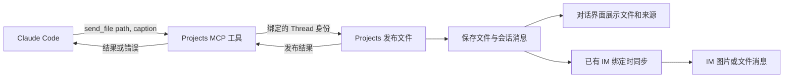

# Projects 会话主动发布文件与 IM 同步

> 状态：第一版实现中。本文保留设计方向；实际实现与尚未验证的范围见下方“第一版实现状态”。
> 关联：[输入附件](./projects-attachments.md)、[IM 并入 Projects](./projects-im.md)、[Remote 并入 Projects](./remote-into-projects.md)、[Claude Code 与 SmartGuide 的工具提案](./smart-guide-on-claude-code.md)。这些文档中旧的 `send_file` 或绑定模型是历史背景；本方案以会话主动发布为入口。

## 问题与目标

Claude Code 可以生成图片和文件，但 Projects 会话目前缺少一种让 Claude 主动把这些产物作为消息交给用户查看的统一方式。旧的自定义 Agent 曾有 `send_file`，切换到 Claude Code 后没有等价的出站能力。

第一版目标是让 Folder Session 和 Project Thread 都能发布文件：Web 对话中可查看和下载；有适用 IM 绑定时，同一条消息可以同步到 IM。文件发布本身属于 Projects，不依赖 Tingly Box 或 IM，Projects 单独构建运行时也应可用。

## 已讨论的方向

1. 给 Claude Code 提供 `send_file` 工具或 MCP 能力，语义是**向当前会话发布文件**，不让模型处理各平台 API、bot 凭据或聊天 ID。工具的具体名称、参数与接入方式尚未最终确定。
2. Projects 接收文件并生成可持久化的会话消息；前端收到消息后展示图片预览或文件卡片，支持打开、下载。刷新、重新进入会话后仍可查看。
3. TB 集成层根据适用的 IM 绑定同步文件。无绑定、IM 不可用或独立 Projects 场景下，会话发布依然成立。
4. **会话发布和 IM 投递是两个结果**：Web 发布成功不能冒充 IM 发送成功；某个 bot 离线或平台上传失败，也不能让已发布的会话文件消失。
5. 消息要写清来自哪个 Project、Thread 或 Folder Session；Thread 产出的文件也要真正让用户看到。第一版沿用已有绑定和消息同步机制，不把焦点和复杂接收规则作为发布能力的前置条件。

## 体验草图

用户说“画一张架构图发给我” → Claude 生成图片并调用发布工具 → 会话出现带说明的图片消息 → Web 渲染预览 → 有适用绑定时同步到 IM。

同一消息应能表达：文件名和类型、说明文字、会话发布结果，以及每个 IM 目标的投递状态。图片可预览；其他文件以文件卡片展示。若 IM 失败，文件仍可从 Web 查看，且用户能理解失败原因。是否提供手动重试，及其具体交互，待设计。

## 工具如何接入（候选方案）

优先验证 Projects 内置 MCP 服务：Claude Code 用工具发布文件，Projects 服务处理实际文件和消息；TB 是否存在只影响 IM 投递。以下是设计候选，Claude Code 支持的传输、权限和生命周期需要用真实 CLI 验证。

| 部分 | 第一版建议 | 现有基础 / 要补的工作 |
|---|---|---|
| 工具接口 | `send_file(path, caption?)`；先支持一个图片或文件 | 模型传文件路径和可选说明，不传 bot 或聊天 ID。图片或文件的发送类型由服务判断。 |
| 工具承载 | Projects 自己提供 MCP 服务，HTTP 或 stdio 二选一 | `agentboot.ExecutionOptions.MCPServers` 已能生成 `--mcp-config`；Projects 启动线程时目前尚未注入该服务。 |
| 会话定位 | 每个 Claude Code 实例的工具连接绑定到它的 Thread | 服务端根据连接上下文确定归属，不接受模型指定任意 Thread；令牌或其他本地身份绑定的具体方式待验证。 |
| 发布核心 | `PublishFile(threadID, path, caption)` | 复制文件到 Projects 管理的存储，持久化会话消息并通知前端；优先复用 Library 和附件能力。 |
| 页面与 IM | Thread 内直接展示；需要时同时在 Project 视图可见，消息写清来源 | 沿用现有事件与 Relay 路径，尽早让真实用户看到产物；不把复杂焦点模型当作发布前置条件。 |
| 协调者 | 暂不接入 | 协调者使用独立的模型调用和工具机制；其接入方式留待后续设计。 |

### HTTP 与 stdio 的取舍

| 方案 | 怎么工作 | 主要取舍 |
|---|---|---|
| 内置 HTTP MCP | Projects 进程提供本地 MCP 端点，Claude Code 用注入的配置连接 | 可以直接调用当前 Projects 的发布逻辑；需要验证 Claude Code 的传输支持，并隔离不同 Thread 的身份与访问权限。 |
| stdio MCP | Claude Code 启动本地工具子进程，由子进程回调 Projects 发布服务 | 采用 Claude Code 常见的子进程接入，但会增加进程和回调生命周期管理。 |

建议先做一个很小的验证：启动真实 Claude Code，确认它看见 `send_file`，调用后 Projects 能准确拿到 Thread 身份并发布一个本地文件；复用进程继续第二轮，再验证独立 Projects 启动、现有用户 MCP 配置和权限模式不被破坏。当前已有的是配置拼接，不代表端到端调用已实现。

### 复用 TB 的 MCP Profile（待验证）

TB 已有 MCP 网关及 Profile：Default 暴露默认工具集合，自定义 Profile 暴露其选择的工具，并提供 `/api/v1/mcp/{profile_id}` 的 Claude Code HTTP 接入方式。可以考虑增加服务于 Projects 的专用入口或 Profile，复用现有 MCP 传输、发现和路由，让 Projects 启动 Claude Code 时自动接入。

需先验证三件事：① Profile 只是选择和暴露工具，本身不会实现 `send_file`，仍需将工具调用接到 Projects 的发布方法；② 通用 Profile 不自动携带当前 Thread 身份，需要找到可验证的会话上下文传递方法；③ 自定义 Profile 是工具子集，不能无意覆盖用户原有 MCP 工具。此外，TB 内嵌时复用 TB 网关与 Projects 单独构建的可用性需要同时考虑：核心发布能力归 Projects，独立运行时的工具入口尚需确定。MCP Profile 与 Claude Code 的模型/配置 Profile 是不同概念。

### 启动时注入

Projects 创建每个 Thread 时已构造 `agentboot.ExecutionOptions`；可以在此加入 Projects MCP 连接配置。Agentboot 的 Claude driver 已把 `MCPServers` 合并后转换为 `--mcp-config`。每条连接携带由服务端生成并验证的 Thread 作用域凭据，让工具处理器确定消息来源；模型只填写文件路径和说明。

既有 MCP 配置必须保留，且不能意外启用 `--strict-mcp-config`。线程进程可能跨轮常驻，目前 engine 的 `launchSignature` 没有包含 `MCPServers`，因此接入时必须处理配置变化后的进程重启或其他生效机制，并验证后续轮次和恢复会话。配置可能包含凭据，应避免把它们直接暴露到进程参数、日志或页面；具体安全传递方式需要验证。Project 协调者可能不是 Claude Code，仍需单独接到同一发布核心。

## 建议的职责边界

- **Projects**：验证和接收会话产物，管理持久文件、会话事件及投递记录；通过宿主能力接口通知外部渠道。优先复用现有 Library、附件读取与前端附件组件，明确输出产物和用户输入附件在所有权、删除、路径与生命周期上的关系，避免平行实现两套文件存储。
- **Claude Code 接入**：为执行中的 Session 提供发布工具。已有 `ExecutionOptions.MCPServers` 和 CLI 的 `--mcp-config` 支持可作为候选，但要验证 Projects 实际注入、常驻进程和多轮请求的上下文如何衔接；不预设仅靠启动时一次性注入就能正确处理后续轮次。
- **TB 与 IM**：通过会话的发布事件触发渠道投递，选择对应 bot 和聊天，检查访问状态并调用适配器。各平台是否支持上传、图片预览、标题和大小限制必须以实际能力为准，不能把 URL 占位或未实现的接口视为上传成功。
- **数据流**：源文件被读入 Projects 管理的存储后再供 Web 和 IM 使用；前端不直接访问 Claude 所在机器的路径。消息记录引用稳定的受控资源，而非临时文件路径或内嵌大文件。

输入附件已有设计见 [projects-attachments.md](./projects-attachments.md)。本方案是 Claude 主动发布的**输出**，需要补会话事件、渲染和投递；不能因为输入附件已有上传和预览就假定输出链路已经完成。

## 第一版的结果

| 场景 | 预期 |
|---|---|
| Claude 在 Folder Session 或 Project Thread 发布文件 | 用户能看到文件，并能识别消息来自哪个会话或 Thread。 |
| 没有 IM 绑定 | 文件仍在 Projects 页面显示，可查看和下载。 |
| 有 IM 绑定 | 沿用现有绑定和消息同步路径发送，消息标明来源。 |
| IM 上传失败或平台暂不支持 | Web 中的文件保留；发送结果如实显示失败，不把链接占位算作文件发送成功。 |
| Projects 独立运行 | 发布和页面展示仍可用，不要求安装或运行 TB。 |

多目标投递、重试和焦点变化的细化留待后续讨论；第一版仍需避免重复发送，并遵守已有访问控制和合理的文件限制。

## 推进与验收建议

1. **验证工具接入**：真实 Claude Code 发现并调用工具，服务确定 Thread 身份；验证常驻会话、配置合并和独立构建。
2. **先打通 Projects + Web**：Claude Code 调用工具，文件持久化、实时展示、刷新恢复、预览和下载；独立 Projects 构建可用。验证文件不存在、无权限、过大、被删除等情况。
3. **接入 Tingly harness**：覆盖从 Session 发布到绑定 chat 的完整路径，以及无绑定、多绑定、焦点切换、`@N`、改绑、被禁用、部分失败、重连与重复投递。确认 harness 验证了文件内容或受控资源，而非只验证有一条媒体事件。
4. **逐个平台接入真实上传**：按实际平台能力处理图片与普通文件，并用平台测试验证上传、显示和错误反馈；明确首批支持的平台和不支持时的提示。

现阶段只记录设计，不代表上述待定语义已获批准，也不代表各平台能力已实现。

## 第一版实现状态

- Projects 启动 Claude Code 时自动追加独立的本地 HTTP MCP 配置；每个 Thread 使用独立的随机能力地址。原有 MCP 配置保留，工具的目标 Thread 由服务端确定。此实现未复用 TB MCP Profile，以保证 Projects 单独运行时也可使用。
- `send_file(path, caption?)` 读取当前工作目录或项目 Library 内的普通文件，复制到 Library，并持久化为会话消息。Project Thread 的产物也会显示在 Project 对话，标注来源。协调者不在第一版接入范围内。
- 发送时按现有绑定查找 IM 目标。首批适配 Tingly 测试渠道和 Telegram；其他渠道返回明确的投递错误，Web 中的文件仍保留。失败会在 Thread 中显示错误消息，目前没有逐目标投递状态或重试。
- 已覆盖 MCP 协议调用、文件持久化、路径约束及 Tingly 渠道的文件内容和改绑场景。真实 Claude 模型调用及 Telegram 实际上传仍需在有相应凭据的环境验证。
