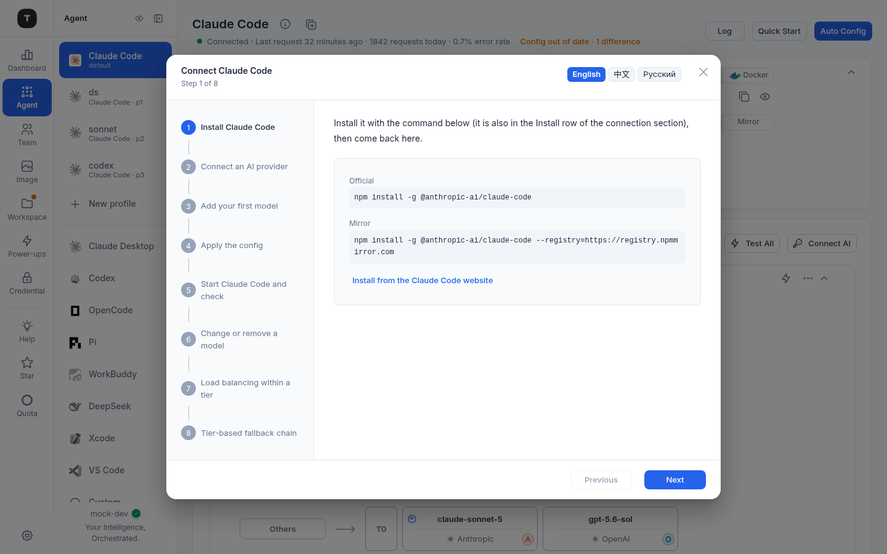
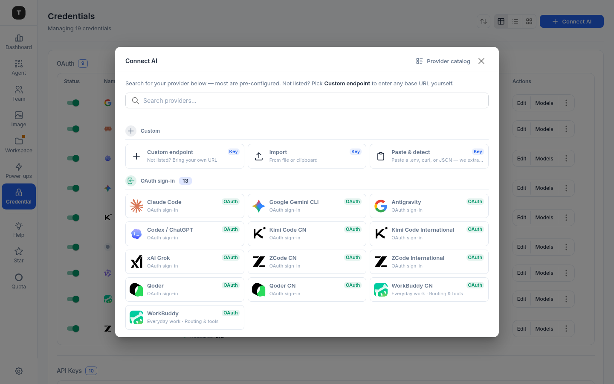
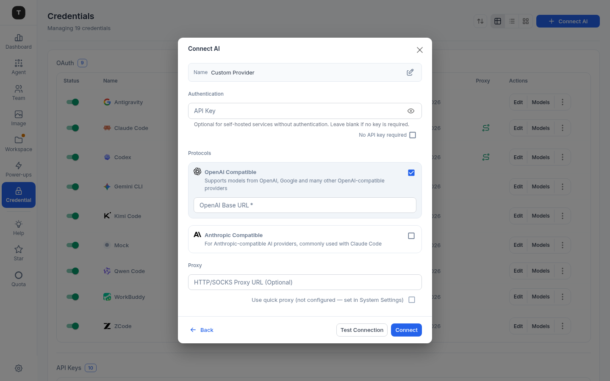

# Getting Started

This chapter takes you from a fresh install to a working agent: connect a provider, point a coding tool at the gateway, and see the first request arrive.

## Quick Start

From zero to a coding agent talking through Tingly-Box, in about five minutes. This is the canonical first run; every other page's Quick Start assumes you have done steps 1–3.

1. **Install** — `npm install -g tingly-box@latest` (needs Node.js). No global install? `npx -y tingly-box@latest` does the whole thing in one command. (Prefer the desktop app? Install it instead and skip to step 3 — see [Desktop App](./23-desktop-app.md#quick-start).)
2. **Start** — run `tb start`. It keeps running in the background, opens the Web UI at `http://localhost:12580` and signs you in. If the login page ever appears, run `tb token view auth --reveal` and paste the token into **Authentication Token**.
3. **Connect a provider** — a fresh install opens the **Claude Code** page. Under **Model Rules** click **Connect AI**, pick a provider (search by name; *Custom endpoint* takes any base URL), paste the API key and click **Connect**. Rather sign in with a subscription? Pick an *OAuth sign-in* provider instead — no key needed.
4. **Pick a model** — click **Add model** in the `cc` rule and select the provider and model Claude Code should use.
5. **Install the agent and run Auto Config** — copy the install command from the **Install** row (`npm install -g @anthropic-ai/claude-code`) and run it. Open **Auto Config** in the header, review the configuration, then apply it. Using another tool? Pick it in the **Agent** sidebar: [Codex](./04-scenario-codex.md#quick-start), [OpenCode, Pi, VS Code and others](./04-scenario-coding-agents.md#quick-start), or your own code through the [SDK endpoints](./05-scenario-sdk-proxy.md#quick-start).
6. **Verify** — start the agent (`claude`) and send a message. The status line under the page title changes from `No requests yet · finish the setup below` to `Connected`, and [Dashboard](./11-dashboard.md#quick-start) in the rail shows the request.

**Then, optionally:** share with a group via [Team](./07-team.md#quick-start), generate pictures in [Image](./07-image.md#quick-start), drive Claude Code from chat apps with [Remote](./12-remote-control.md#quick-start) or from the browser with [Projects](../tingly-projects/en/README.md#quick-start). The rest of this page explains what you just saw in detail.

---

## First Launch

A fresh installation opens **Claude Code**. **Quick Start** in the header opens the guide for installing, connecting AI, adding a model, applying the configuration, and checking a request. You can also copy the official or mirror install command directly from the **Install** row.

---

## Connecting Your First Provider

Whether from a Model Rules toolbar (**Connect AI**), the [Credentials](./08-credentials.md) page, or the **Provider Catalog** card on [Tips & Help](./13-help.md), it is the same picker:

A search box sits at the top, followed by:

- **Custom** — **Custom endpoint** (any OpenAI/Anthropic-compatible base URL), **Import** (from a file or the clipboard) and **Paste & detect** (paste a `.env`, curl command or JSON snippet — URL and credentials are extracted for you)
- **OAuth sign-in** — providers you sign in to with a subscription (Claude Code, Google Gemini CLI, Antigravity, Codex, Kimi Code, xAI Grok, ZCode, WorkBuddy, …). Clicking one launches the OAuth flow directly — no API key — and the token is saved when you authorize
- **Self-hosted**, **Cloud** and **API key** providers grouped by region and protocol (OpenAI · Anthropic)

Picking any non-OAuth provider opens the config form — see [Credentials · Adding a Provider](./08-credentials.md#adding-a-provider-the-connect-ai-flow) for every field.

---

## Next Steps

- [Scenario Overview](./02-scenario-overview.md) — the rail, the Agent sidebar and Power-ups
- [Claude Code](./03-scenario-claude-code.md) — the primary scenario, in full
- [Credentials](./08-credentials.md) — manage providers and see their quota
