# Claude Code Scenario

Path: `/agent/claude_code` (default configuration) and `/agent/claude_code/profile/:profileId` (one page per profile)

Claude Code is Tingly-Box's primary scenario. It proxies Claude Code CLI requests to your configured providers, with per-slot model rules, multiple profiles, and fine-grained routing.

The page shape described here (header, connection card, Plugins card, Quick Start, Model Rules) is shared by every agent page — the other agent chapters only describe what differs.

---

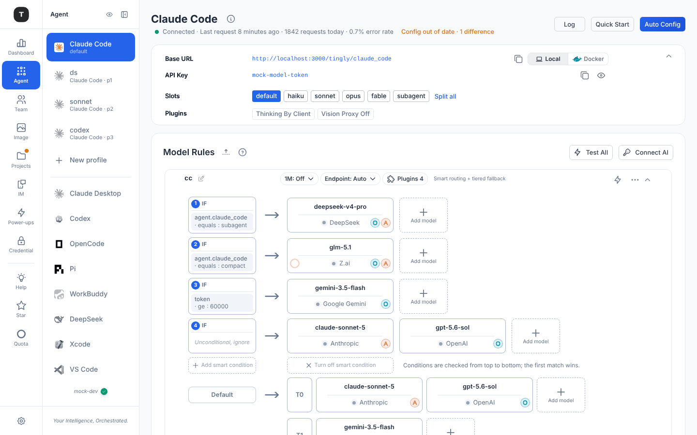

## Page Structure

Top to bottom:

### 1. Header: title, status line, buttons

- **Title** — `Claude Code`, with an **info** icon whose tooltip describes the agent.
- **Status line** (plain text under the title): a green dot and `Connected · Last request 4 minutes ago · 1842 requests today · 0.7% error rate`. Before the first request it reads `No requests yet · finish the setup below` (or `No requests yet` once connected). It answers "is this agent actually using the gateway?" at a glance.
- **Config state**, next to the status text, for agents whose config file the gateway can read back (Claude Code, Codex, DeepSeek Harness, WorkBuddy):
  - nothing extra when the file matches this page (the old green check is gone — silence means applied);
  - `Config out of date · 1 difference` in warning colour — hover for the file path and each `field: applied → expected` value, then run **Auto Config** again;
  - `Not applied` in grey when the file on this machine doesn't route through Tingly-Box yet.
- **Buttons**, one row, right-aligned: **Requests** (a dialog with this agent's latest requests, with an *Open in Dashboard* link), **Usage** (opens the [Dashboard](./11-dashboard.md) already filtered to this agent), **Log** (this agent's AI-request log and system log), **Quick Start** (only once Quick Start has finished and hidden itself — it brings the card back, reset) and the key action, filled and rightmost: **Auto Config** (or **Setup Guide** for agents the gateway can't configure for you).

### 2. Connection card

The agent's address, folded to a single `Base URL` line once the agent is connected (or open again whenever its config is out of date). Click the line — or the chevron on the card's right edge — to open or fold it; the choice is remembered on this machine. Open, it shows:

- **Base URL** `http://localhost:3000/tingly/claude_code` with a copy button and a **Local | Docker** switch (Docker swaps the host for `host.docker.internal`, for clients running in a container)
- **API Key** — the model token, with reveal and copy buttons
- **Slots** — see [Slots](#slots-per-slot-model-rules) below

Folded, it is one line (shown here on the Codex page):

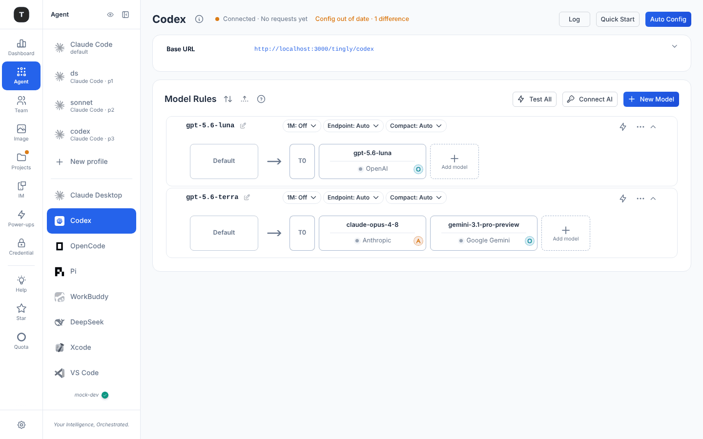

### 3. Plugins card

A single strip summarising the scenario-level plugins — one segment per plugin (name + current value, highlighted when it does something beyond the pass-through default). Click it to open the panel:

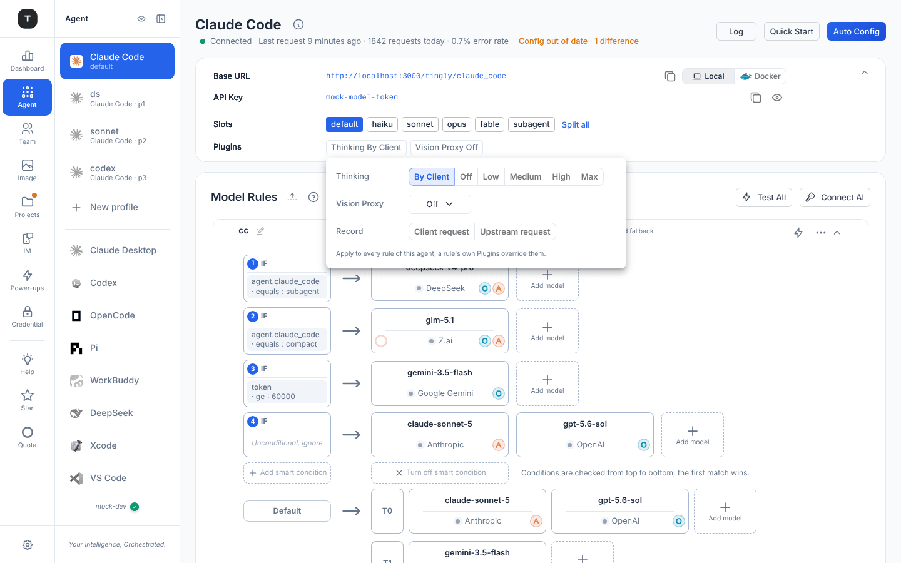

| Plugin | Options |
|--------|---------|
| **Thinking** | `By Client` (pass the client's setting through) / `Off` / `Low` (~4K tokens) / `Medium` (~10K) / `High` (~20K) / `Max` (~32K). Sent natively as the provider's effort setting where one exists, with a token budget as fallback |
| **Vision Proxy** | `Off` / a chosen vision model that describes images, so text-only models can still handle image-bearing requests |
| **Record** | Toggle capture points — **Client request** (`In`, exactly what the client sent) and **Upstream request** (`Out`, what was finally dispatched to the provider). Records land under the config directory's `record/` folder |

These apply to every rule of the agent; a rule's own Plugins (see [Routing Rules & Plugins](./20-routing-rules.md)) override them per rule. The Embedding, Image and Decisions scenarios only show **Record**, since thinking and vision don't apply to them.

### 4. Quick Start

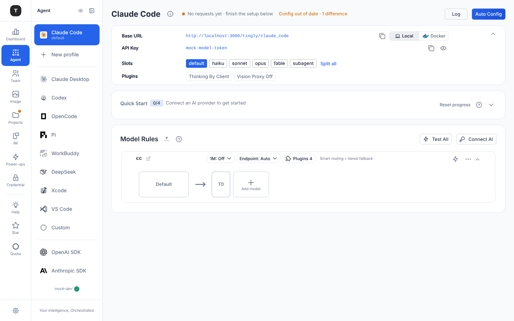

A 4-step card that guides a first run. It is driven by facts where it can be — steps tick over by themselves — and it hides itself when finished.

| Step | How it completes |
|------|------------------|
| 1. **Connect AI Provider** | A provider is connected. **Connect AI** opens the picker *in place*; once the provider is added the card moves on to step 2 without reloading the page |
| 2. **Select a Model** | A rule has a provider + model. **Choose Model** scrolls to Model Rules and spotlights **Add model**; **Skip** is available |
| 3. **Install Claude Code** | Claude Code has already sent a request through the gateway, or its config reads back as applied, or you confirm. Expand it for the npm install command (official and mirror, one-click copy) and **I've installed it** |
| 4. **Auto Config** | The config reads back as applied. **Auto Config** writes the configuration *and* installs the status line in one click; **Config** opens the full dialog to review first; **Skip** bypasses it |

- A step already satisfied by facts (a model is routed, the config is applied) shows `Skipped — a model is already set` rather than claiming something was installed
- Completed steps show a check and can be re-expanded; **Reset progress** clears what you recorded by hand; the **?** button reopens the [Direct Routing Guide](./20-routing-rules.md#first-run-guide)
- Once all four are done the page stops showing the card. **Quick Start** in the header brings it back (progress reset); when every step is satisfied by facts it reads `Quick Start · Done` with a **Hide** button

### 5. Model Rules

A collapsible node graph for each rule — see [Slots](#slots-per-slot-model-rules) for which rules appear and [Routing Rules & Plugins](./20-routing-rules.md) for the graph itself. Page toolbar: sort rules by name, collapse/expand all, the **?** guide, **Test All** (a quick streaming test of every active rule), **Connect AI**. Claude Code's rules can't be added, removed or switched off here — each one backs a slot — so there is no **New Model** button on this page.

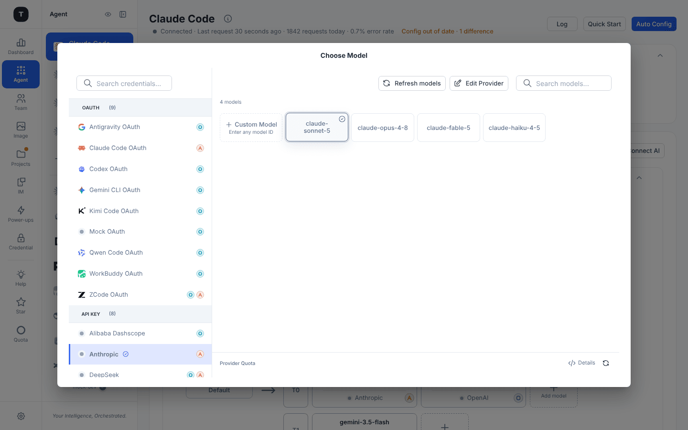

Click a provider node, or **Add model** in an empty rule, to open the **[Model Select](./21-model-select.md)** dialog.

---

## Slots: per-slot model rules

Claude Code asks for models by slot. The **Slots** row (inside the connection card) shows them as chips: `default` · `haiku` · `sonnet` · `opus` · `fable` · `subagent`, each mapped to an environment variable (hover a chip to see it): `ANTHROPIC_MODEL`, `ANTHROPIC_DEFAULT_HAIKU_MODEL`, `ANTHROPIC_DEFAULT_SONNET_MODEL`, `ANTHROPIC_DEFAULT_OPUS_MODEL`, `ANTHROPIC_DEFAULT_FABLE_MODEL`, `CLAUDE_CODE_SUBAGENT_MODEL`.

There is **no Unified / Separate mode switch any more** — the state is simply which slots have their own rule:

- `default` is the **main rule**, named **`cc`**, and is always on. Every slot without its own rule uses it.
- Click another chip to give that slot **its own rule** (the chip fills in and a rule named after the slot — `sonnet`, `opus`, … — appears under Model Rules, starting from a copy of the main rule's routing so nothing changes until you edit it). Click again to hand the slot back to the main rule; the rule is only switched off, so turning it on again restores it.
- **Split all** gives every slot its own rule; it turns into **Merge all**, which folds them back into the main rule. "Everything on one model, except the subagent on another" is just `subagent` split and the rest not.
- Rules shown on the page: the main rule plus the rules of split slots.

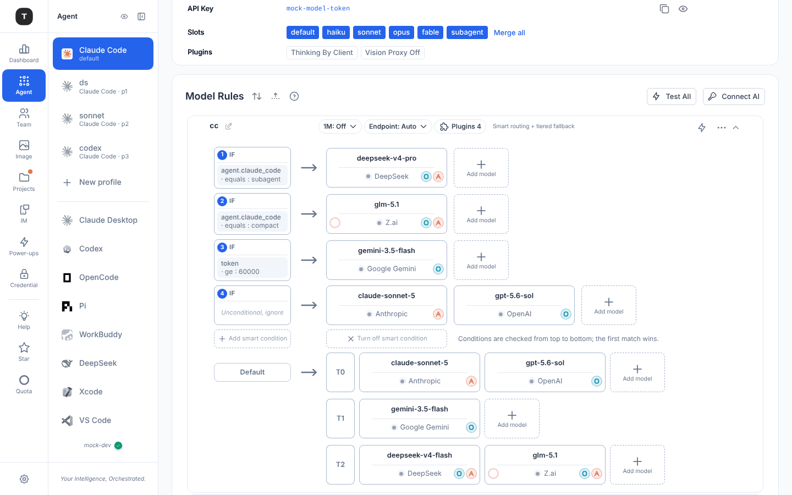

> Rules created before this change are migrated automatically: separate-mode setups keep their routing (the old `default` rule folds into `cc`), and settings files that still mention `tingly/cc`, `tingly/cc-sonnet`… keep working.

### 1M context

Each rule's header has a **`1M: Off ⌄`** chip. Choose **On** to add the 1M context window for that rule (the upstream model must support it); **Off** only means this rule doesn't add 1M — a client that asks for 1M itself is still honoured. If Claude Code's config has already been applied, the toggle **re-applies it straight away** — no dialog — keeping everything else you applied, and a toast says `1M context on. Claude Code's config is updated; restart Claude Code to take effect.`

### Endpoint

The **`Endpoint: Auto ⌄`** chip chooses the upstream API style for the rule: **Auto**, **Chat**, **Responses**, or **Anthropic** (*Force Anthropic style*: always send Anthropic Messages upstream, converting OpenAI-style clients; providers without an Anthropic endpoint fall back to Auto). It only matters for OpenAI-compatible upstreams; the tooltip says so when a rule has none.

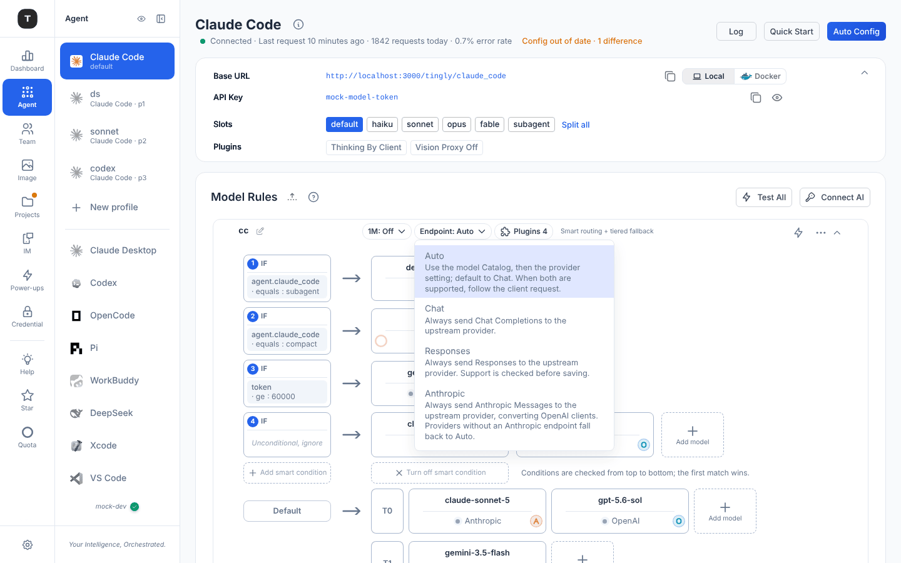

---

## Auto Config

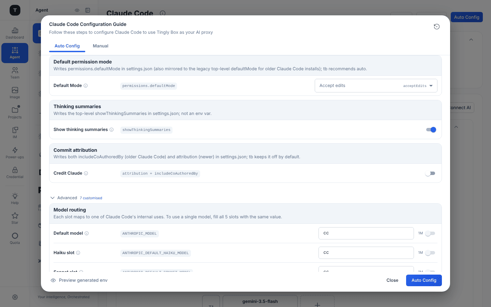

**Auto Config** opens the **Claude Code Configuration Guide** with two tabs. On open it restores the values you applied last time; first-time users start from recommendations derived from the current rules.

**Auto Config tab** — sections, top to bottom:

- **Default permission mode** — `permissions.defaultMode` in `settings.json`: Accept edits (recommended) / Default / Manual approval / Plan mode / Auto rules / Delegate / Don't ask / Bypass permissions
- **Thinking summaries** — **Show thinking summaries** writes the top-level `showThinkingSummaries` (on by default; only hides the summary, doesn't change whether the model thinks)
- **Commit attribution** — **Credit Claude**, **off by default**: when on, Claude Code adds a `Co-Authored-By: Claude` trailer to commits and a "Generated with Claude Code" line to PRs; when off, `includeCoAuthoredBy` is `false` and `attribution.commit` / `attribution.pr` are empty
- **Model routing** — the six slot variables above, each pre-filled from your rules (`cc`, `sonnet`, … or `…[1m]` with 1M on) with its own **1M** switch. A slot that has no rule of its own follows the default slot
- **Performance & limits** — `API_TIMEOUT_MS`, `CLAUDE_CODE_MAX_OUTPUT_TOKENS`, `MAX_THINKING_TOKENS`, `BASH_DEFAULT_TIMEOUT_MS`, `BASH_MAX_TIMEOUT_MS`, MCP timeouts and output limits, the sub-agent knobs (`CLAUDE_CODE_MAX_CONCURRENT_SUBAGENTS`, `CLAUDE_CODE_AUTO_BACKGROUND_TIMEOUT_MS`, `CLAUDE_ASYNC_AGENT_STALL_TIMEOUT_MS`, `CLAUDE_AUTO_BACKGROUND_TASKS`) and auto-compact (`CLAUDE_CODE_AUTO_COMPACT_WINDOW`, `CLAUDE_AUTOCOMPACT_PCT_OVERRIDE` — default **80**, `0` disables). Blank = not written; Claude Code uses its own default
- **Privacy & behavior** — telemetry / error reporting / non-essential traffic / auto-updater switches and `USE_BUILTIN_RIPGREP` (on = `"1"`, off = not written)
- **Network proxy** — `HTTP_PROXY`, `HTTPS_PROXY`, `NO_PROXY` (Tingly-Box always appends `localhost,127.0.0.1,::1` to `NO_PROXY`)
- **Install Tingly-Box Claude Code status line** (checked by default; also on the Manual tab) — adds a status line to `~/.claude/settings.json` that shows the current connection in the Claude Code prompt
- The reset icon (top right) returns everything to Tingly-Box's recommended defaults; **Preview generated env** shows the exact `env` block that will be written

Bottom button **Auto Config** writes the settings (and the status line if checked) and, on success, the dialog closes with a toast listing the files written and any backup made.

**Manual tab** — the same settings as raw scripts for `~/.claude/settings.json` and `~/.claude.json` (JSON / Windows PowerShell / Linux·macOS), plus the status-line script, for advanced users or machines the gateway can't reach.

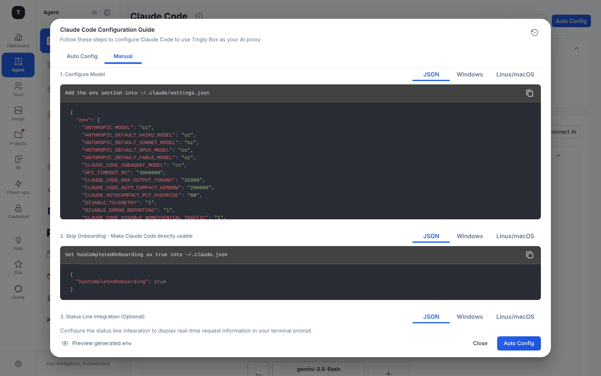

---

## Profiles

Claude Code supports multiple **Profiles** for projects or teams that need different providers or routing. They are listed under Claude Code in the sidebar by **name**, captioned `Claude Code · <id>`; **New profile** at the end of the list asks for a name. Each profile has its own page, Base URL (`/tingly/claude_code:<id>`), rules and settings.

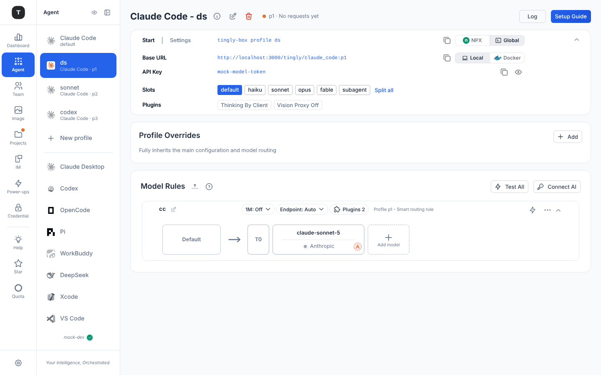

- **Title** — `Claude Code - ds` (the profile's name) with **info** (shows the Base URL), **rename** (pencil) and **delete** (trash) next to it. The status line leads with the profile id: `p1 · No requests yet`
- **Buttons** — **Requests**, **Usage**, **Log**, and the filled **Setup Guide**: a two-step dialog (*Connect an AI provider* → *Start Claude Code with this profile*, with the command to copy)
- **Connection card** — foldable like the Agent pages. Its first row switches between **Start** — the launch command, `tingly-box profile p1` or `npx -y tingly-box@<version> profile p1`, with an **NPX | Global** switch — and **Settings**, the generated settings file's path (a marker says whether it exists yet; manual edits are overwritten). Then Base URL, API Key and the **Slots** row, exactly as on the main page
- **Plugins card** — as above, per profile
- **Profile Overrides** — a compact card that starts as `Fully inherits the main configuration and model routing`. **Add** opens a searchable list of runtime settings (**Common**: max output tokens, default permission mode; **Runtime**, **Limits & tools**, **Behavior & privacy**, **Network**), each showing the inherited value. Overridden rows show `Inherited <value>` and an **×** to drop the override; **Save** applies, **Restore inheritance** clears them all. Models are not overridden here — they come from the rules

  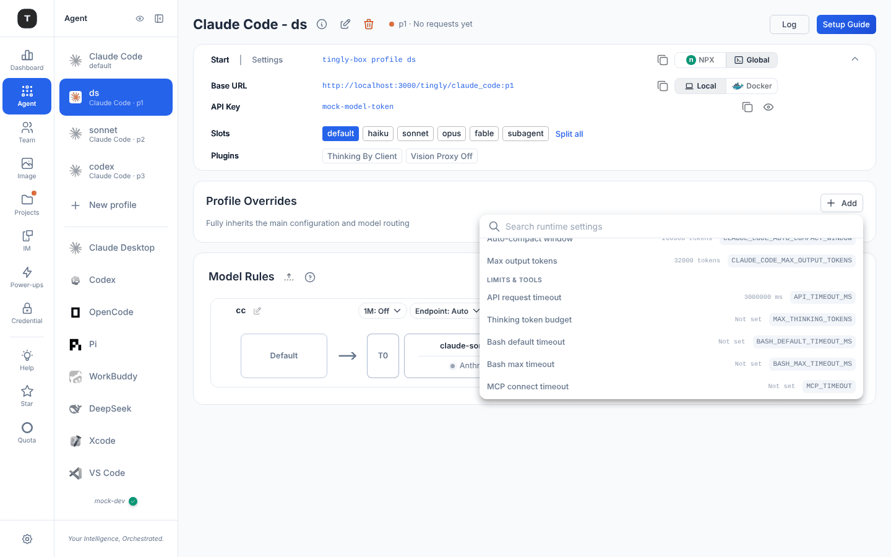

- **Model Rules** — the profile's main rule `cc` and the rules of its split slots

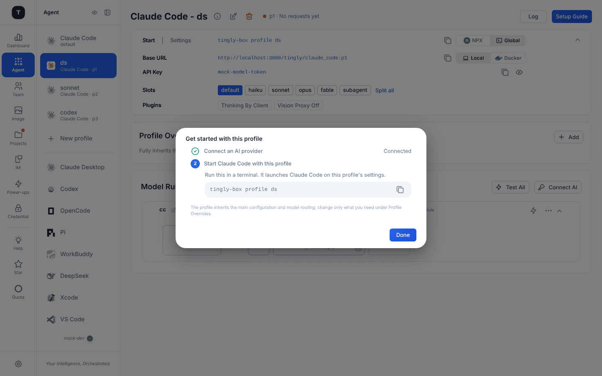

Each profile's generated Claude Code settings live in a readable `<profile-id>--<profile-name>` directory (e.g. `p1--deepseek`); renaming or deleting a profile keeps it in sync.

### CLI: launching with a profile

#### `tingly-box profile` — inspect and launch

```bash
tingly-box profile               # Interactive: list profiles, pick one to launch
tingly-box profile p1            # Launch Claude Code with profile p1
tingly-box profile p1 --port 12580  # Launch against a remote Tingly-Box on port 12580
tingly-box profile --list        # List profiles (non-interactive): ID, name, slots
tingly-box profile --show p1     # Profile ID/name, scenario path, slots, and a rules table
```

> `--list` and `--show` are mutually exclusive. If the profile name isn't found, launch and inspect fall back to an interactive picker.

#### `tingly-box cc` — launch with full Claude CLI passthrough

Tingly-Box consumes its own flags first, then passes everything else verbatim to the Claude CLI — no `--` separator needed.

```bash
tingly-box cc                           # Launch Claude Code (default profile)
tingly-box cc --profile p1              # Launch with profile p1  (short: -p p1)
tingly-box cc -p p1 --tingly-port 12580  # Profile p1, remote Tingly-Box on port 12580
tingly-box cc -p p1 --dangerously-skip-permissions  # Claude flags pass through unchanged
tingly-box cc -p p1 /path/to/project    # Open a specific directory in Claude Code
```

Tingly-Box flags (`--profile`/`-p`, `--tingly-port`) must come before any Claude flags.

---

## Claude Code from the browser and from IM

Besides the CLI, Claude Code also runs inside Tingly-Box itself: the **Projects** pages start sessions and project threads through this same scenario (so your rules, quota and usage apply), and IM chats talk to Claude Code through Projects. See [Projects](./22-projects.md).

---

## Common Configuration Flow

1. Add at least one provider in [Credentials](./08-credentials.md) (or **Connect AI** from Quick Start)
2. Open the Claude Code page; confirm Base URL and API Key
3. (Optional) Give slots their own models — split `subagent` or `haiku` onto a cheaper model
4. **Auto Config** → review → **Auto Config** (leave the status-line box checked if you want it)
5. Start Claude Code; the status line at the top of the page turns to `Connected`

---

## Related Pages

- [Scenario Overview](./02-scenario-overview.md)
- [Credentials](./08-credentials.md)
- [Routing Rules & Plugins](./20-routing-rules.md)
- [Projects](./22-projects.md)
- [Other Coding Agents](./04-scenario-coding-agents.md)
