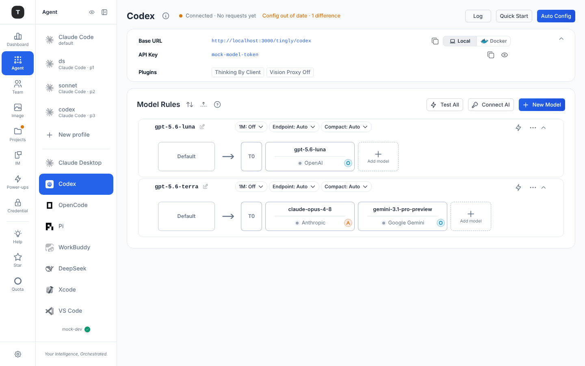
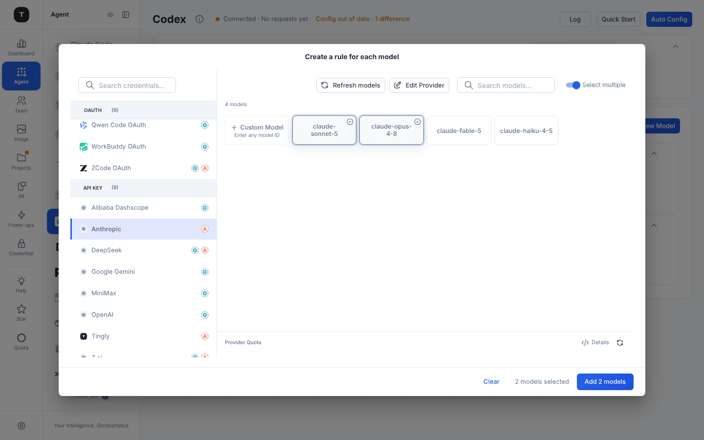
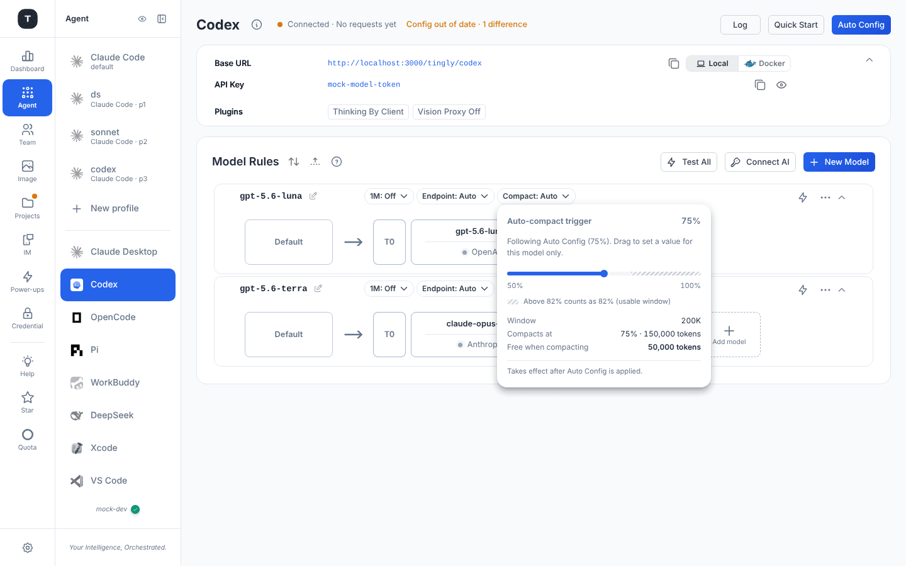
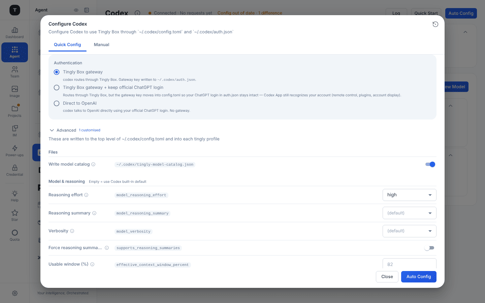

# Codex Scenario

Path: `/agent/codex`

The Codex scenario proxies OpenAI Codex CLI requests to your configured providers. The page has the standard agent shape — header with status line and buttons, connection card, Plugins card, Quick Start, Model Rules — described in [Claude Code](./03-scenario-claude-code.md#page-structure); this chapter covers what is specific to Codex.

---

## What differs from Claude Code

- **Auto Config** writes `~/.codex/config.toml` and `~/.codex/auth.json` (and optionally a model catalog) — the status line reads them back, so `Config out of date · N differences` appears here too
- **Model Rules are free-form**: there are no slots. **New Model** adds rules (see below), and each rule can be deleted or switched off
- Quick Start step 3 installs the CLI: `npm install -g @openai/codex` (official and mirror commands)
- Each rule header carries **`1M: Off ⌄`**, **`Endpoint: Auto ⌄`** and — only on this page — **`Compact: Auto ⌄`**. Switching **1M** opens the Auto Config dialog with a pending-change banner (Codex has no direct re-apply); re-apply there and restart Codex

## New Model: several models at once

**New Model** (top right of Model Rules) opens the model picker in "create rule" mode: *Select a model for your new rule*. Turn on **Select multiple** (switch on the models toolbar) and the title becomes *Create a rule for each model*: click as many models as you like across providers — they get a check — then use the footer, `3 models selected` → **Add 3 models** (**Clear** resets the picks). Each picked model becomes its own rule, named after the model (with a short suffix if that name is taken), with that model as its service.

## Per-model auto-compact

The **Compact** chip on a rule's header sets when Codex compacts *that model's* context:

- Drag the slider (50–100 %) to choose the trigger; the popover shows the model's **Window**, where it **Compacts at**, and the tokens **Free when compacting**
- Left alone it follows **Auto Config's** value (`Following Auto Config (75%)`); **Use Auto Config value** resets it
- It only goes into the Codex config (the model catalog) — requests are not affected — so it **takes effect after Auto Config is applied**
- Warnings explain when too little is left free for a long tool output, or when the usable window caps the value

## Auto Config dialog

**Quick Config** tab (reset icon top right restores defaults):

- **Authentication** — *Tingly Box gateway* (gateway key written to `~/.codex/auth.json`), *Tingly Box gateway + keep official ChatGPT login* (the gateway key goes into `config.toml` so your ChatGPT login in `auth.json` stays intact and the Codex App still recognises your account), or *Direct to OpenAI* (official ChatGPT login, no gateway). The latter two let you pick the stored **ChatGPT account** (a Codex OAuth provider) to write, or keep the existing `auth.json`
- **Files · Write model catalog** — writes `~/.codex/tingly-model-catalog.json` so Tingly-Box models show up in Codex's `/model` picker (`model_catalog_json`); off → Codex uses its built-in list
- **Model & reasoning** — empty means "use Codex's default": **Reasoning effort** (`none` … `xhigh`, `max`, `ultra`; Tingly-Box defaults to `medium`), **Reasoning summary** (`auto` / `concise` / `detailed` / `none`), **Verbosity** (`low` / `medium` / `high`), **Force reasoning summaries** (`supports_reasoning_summaries`, written to each catalog entry — needed for proxied models to return summaries; only effective with the catalog on), **Usable window (%)** (`effective_context_window_percent`, 50–100, default 82) and **Auto-compact at (%)** (default 75; never above the usable window; the default for every model, overridable per model with the Compact chip)

**Manual** tab — the real, server-rendered `config.toml`, `auth.json` and catalog for copy-paste setups.

## Configuration Flow

1. Add a provider in [Credentials](./08-credentials.md) (or **Connect AI** from Quick Start)
2. Install Codex (Quick Start step 3)
3. **Auto Config** → choose authentication → **Auto Config**
4. Optionally add more models with **New Model** and tune **Compact** per model
5. Use Codex; the status line shows `Connected`

---

## Related Pages

- [Claude Code Scenario](./03-scenario-claude-code.md)
- [Other Coding Agents](./04-scenario-coding-agents.md)
- [Credentials](./08-credentials.md)
