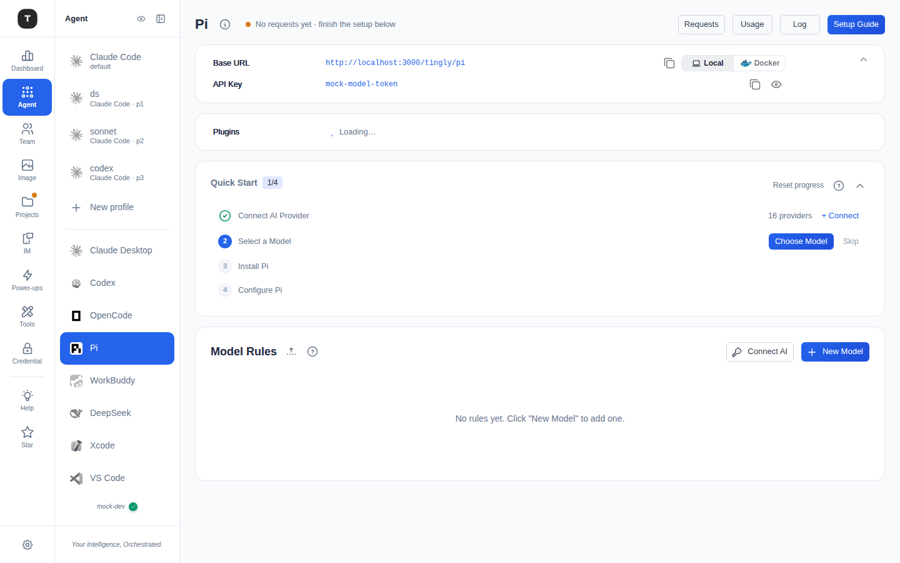
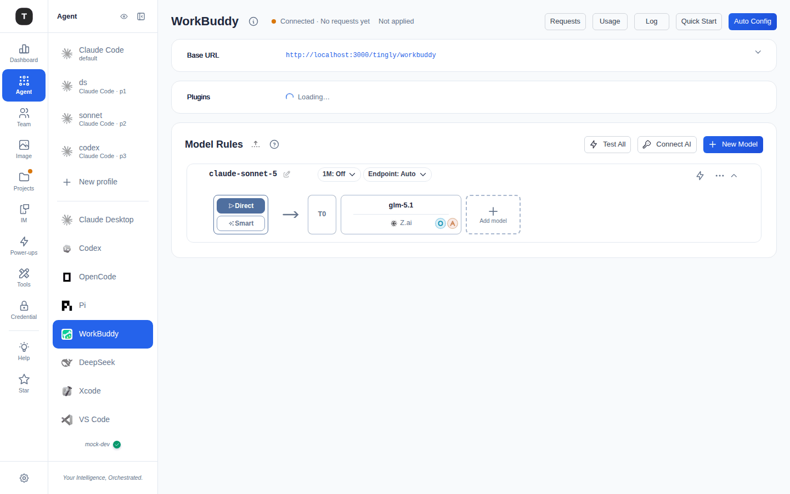
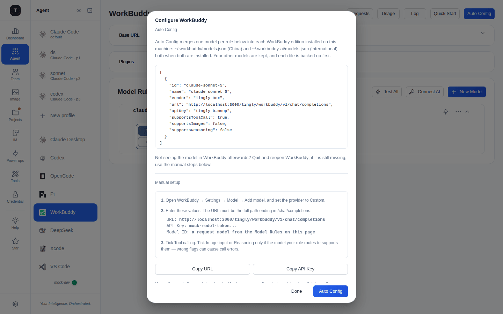
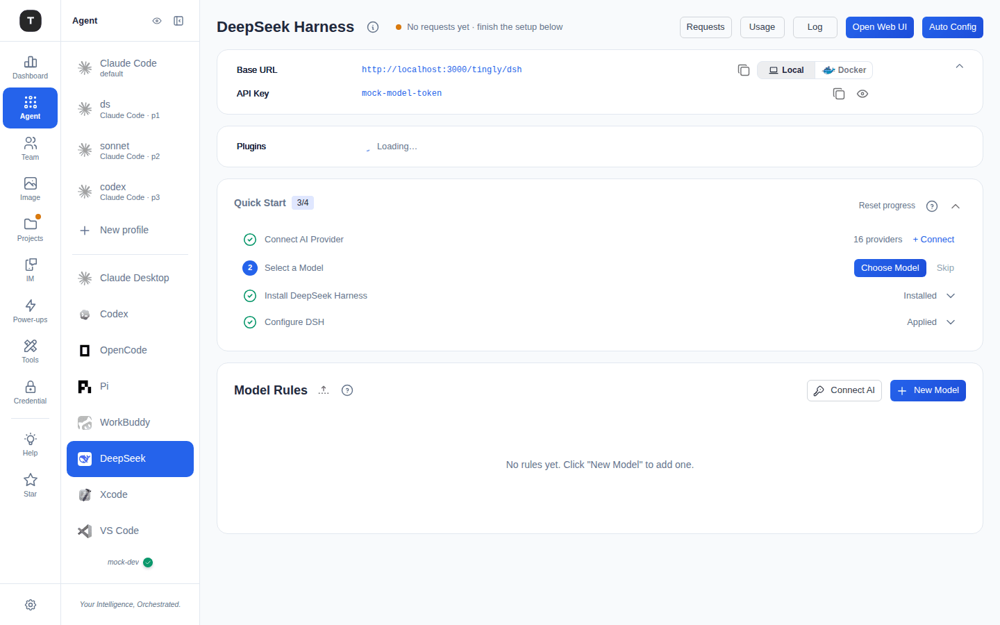

# Other Coding Agent Scenarios

This chapter covers the coding-agent scenarios beyond Claude Code and Codex: OpenCode, Pi, WorkBuddy, DeepSeek Harness, VS Code, Xcode and Claude Desktop (Cursor has [its own chapter](./04-scenario-cursor.md)). They all use the standard agent page — status line, buttons, folding connection card, Plugins card, Model Rules — described in [Claude Code](./03-scenario-claude-code.md#page-structure). The header's key action is **Auto Config** when the gateway can write the client's config for you, and **Setup Guide** (a dialog of manual steps) when it can't. A **Quick Start** card (provider → model → install → configure) exists for OpenCode, Pi, WorkBuddy, DeepSeek Harness and VS Code; Xcode, Cursor and Claude Desktop have none.

| Agent | Path | Header action | Quick Start |
|-------|------|---------------|-------------|
| OpenCode | `/agent/opencode` | Auto Config | yes |
| Pi | `/agent/pi` | Setup Guide | yes |
| WorkBuddy | `/agent/workbuddy` | Auto Config | yes |
| DeepSeek | `/agent/dsh` | Auto Config + **Open Web UI** | yes |
| VS Code | `/agent/vscode` | Setup Guide | yes |
| Xcode | `/agent/xcode` | Setup Guide | — |
| Claude Desktop | `/agent/claude_desktop` | Setup Guide | — |

---

## OpenCode

Path: `/agent/opencode`

Proxies OpenCode CLI requests. **Auto Config** shows the config the gateway would write — as JSON, a Windows script, or a Linux/macOS script — and its button writes `~/.config/opencode/opencode.json`. The connection card has Base URL and API Key rows. Install: `npm install -g opencode-ai`.

---

## Pi

Path: `/agent/pi`

Proxies the Pi coding agent. **Setup Guide** explains how to point Pi's provider base URL and API key at the values on the page (see Pi's repo for the exact config format); the Quick Start install step links to the repo (**View on GitHub**) and step 4 is **Configure Pi**.

---

## WorkBuddy

Path: `/agent/workbuddy`

Routes Tencent WorkBuddy through Tingly-Box as a **custom OpenAI-compatible model** — no WorkBuddy account sign-in is involved. (Signing in *to* a WorkBuddy account as an upstream provider is a different thing; see [Credentials](./08-credentials.md).)

**Auto Config** merges **one model per rule** into the `models.json` of each WorkBuddy edition installed on the machine — `~/.workbuddy/models.json` (China) and `~/.workbuddy-ai/models.json` (international), both when both exist. Other models in those files are kept, each file is backed up first, and ids you already own are skipped with a warning. The dialog previews the entries (API key masked); if the model doesn't appear in WorkBuddy afterwards, quit and reopen WorkBuddy.

The dialog's **Manual setup** covers the same thing by hand: WorkBuddy → Settings → Model → Add model → provider **Custom**, then

- **URL** — the full path ending in `/chat/completions`: `<Base URL>/tingly/workbuddy/v1/chat/completions`
- **API Key** — the Tingly-Box token
- **Model ID** — a request model from this page's Model Rules

Tick **Tool calling**; tick **Image input** or **Reasoning** only if the model the rule routes to supports them (wrong flags cause call errors). Copy buttons for URL and key are in the dialog.

---

## DeepSeek Harness (dsh)

Path: `/agent/dsh`

Proxies [DeepSeek Harness](https://github.com/deepseek-ai/deepseek-harness), an agent harness with its own **self-hosted Web UI**.

- **Open Web UI** (header, filled) jumps to the locally running Web UI, by default `http://127.0.0.1:3080`. Tingly-Box does **not** launch dsh — start it first with `npx @deepseek-ai/dsh web` (requires Node.js)
- Quick Start step 3 is **Install DeepSeek Harness** (with the same **Open Web UI** and a **View on GitHub** link); step 4 is **Configure DSH**
- `dsh` is in developer preview; its configuration may change

**Auto Config** writes a `tingly-box` provider into `$DSH_HOME/settings.yaml` (and `$DSH_HOME/.credentials.yaml`), with two extra settings:

| Setting | Values | Purpose |
|---------|--------|---------|
| **Primary protocol** | `openai-completions` (default) / `openai-responses` / `anthropic-messages` | Which wire format Tingly-Box speaks to dsh's adapter. OpenAI Chat is the most compatible; pick another only if the models under this provider really use it |
| **Supported input modality** | `text` (default) / `text_image` | Whether models accept image input; empty/`text` = text-only |

---

## VS Code

Path: `/agent/vscode`

Proxies VS Code Copilot Chat and other AI extensions through the **Tingly Box extension**, which does the endpoint and key configuration for you. Quick Start step 3 offers **Install in VS Code** (opens the extension) and **View Marketplace**; step 4 is **Follow VS Code Guide**. **Setup Guide** repeats the instruction: install the extension, then follow the setup guide inside VS Code.

---

## Xcode

Path: `/agent/xcode`

Brings your models into Xcode's coding intelligence. **Setup Guide** lists the steps, with copy buttons for the URL and key and a screenshot of Xcode's panel:

1. Open **Xcode → Settings → Intelligence**
2. **Add a Model Provider** → **Internet-Hosted**
3. Enter URL `<Base URL>/tingly/xcode`, the API Key, and any Description (e.g. `Tingly Box`)

---

## Claude Desktop

Path: `/agent/claude_desktop`

Routes Claude Desktop's **third-party inference** through your providers. There is no config file to paste: **Setup Guide** walks through Claude Desktop's own settings.

1. **Enable Developer Mode** — download Claude Desktop, then *Help → Troubleshooting → Enable Developer Mode*
2. **Configure Third-Party Inference** — *Developer → Configure third-party inference*: Connection **Gateway**, Base URL `<Base URL>/tingly/claude_desktop`, and the API key
3. **Configure Models** (optional) — Claude Desktop discovers models from `/v1/models` by itself. To pin a list, paste the generated `inferenceModels` JSON; the dialog lists each Model Rule with a **label** field you can fill (it becomes that model's display `labelOverride`). Models themselves are added and removed in Model Rules

Rules here have the **`1M`** chip too; toggling it opens the Setup Guide with a banner telling you to restart Claude Desktop and re-select the model (there is no config file to re-apply).

---

## Scenario Visibility

Hide agents you don't use from the sidebar in the sidebar's [edit mode](./02-scenario-overview.md#managing-visibility-sidebar-edit-mode) (the eye icon).

---

## Related Pages

- [Claude Code Scenario](./03-scenario-claude-code.md)
- [Cursor Scenario](./04-scenario-cursor.md)
- [Codex Scenario](./04-scenario-codex.md)
- [Scenario Overview](./02-scenario-overview.md)
- [Credentials](./08-credentials.md)
