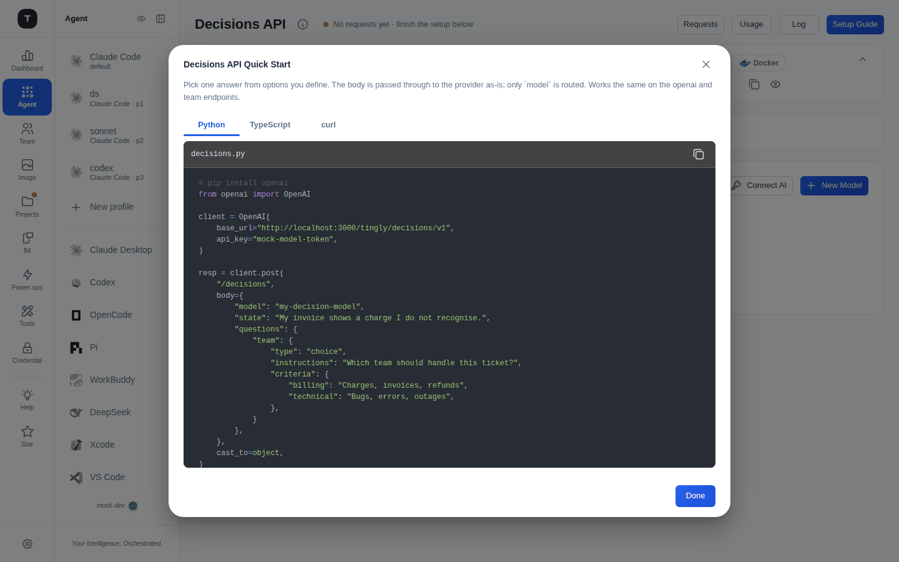
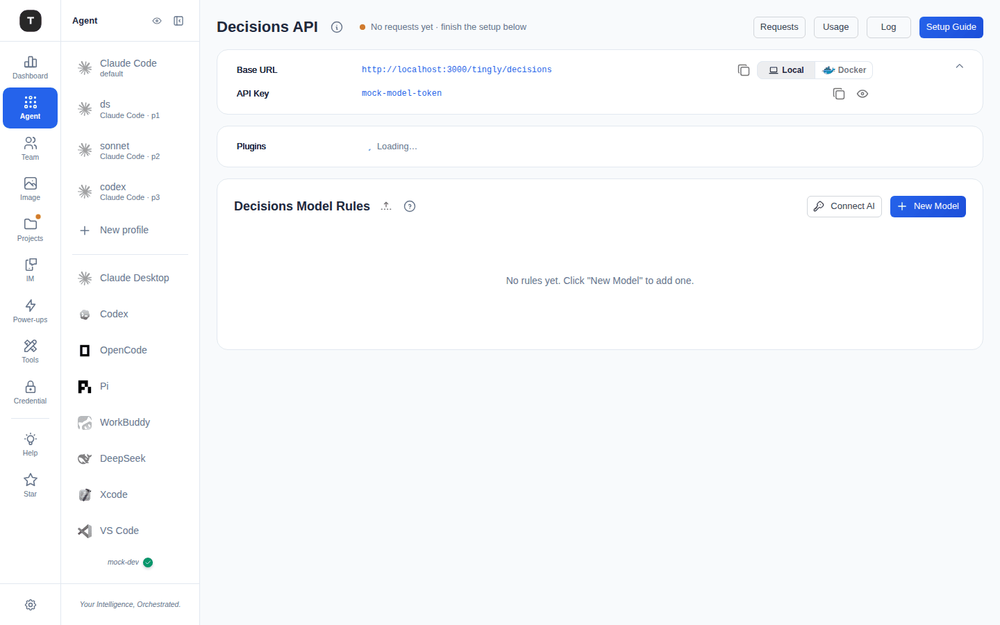

# OpenAI / Anthropic SDK Proxy

This chapter covers the OpenAI-compatible interface proxy, the Anthropic native interface proxy and the Decisions API endpoint — all designed for applications that call AI APIs directly in code. They are standard agent pages (status line, **Requests / Usage / Log** buttons, folding connection card, Plugins card, Model Rules — see [Claude Code § Page Structure](./03-scenario-claude-code.md#page-structure)), minus anything client-specific: there is no Auto Config or Setup Guide button and no Quick Start, because there is nothing to install on a client — you just point the SDK at the Base URL.

---

## OpenAI Scenario

Path: `/agent/openai`

Transparently proxies requests from any application using the OpenAI SDK to the providers managed by Tingly-Box.

### Use Cases

- Your own Python/Node.js/Go applications using the `openai` official SDK
- Third-party tools configured with an OpenAI-compatible endpoint (LangChain, LlamaIndex, etc.)
- Unified management of API credentials across multiple OpenAI-compatible providers

### Page Structure

1. **Connection card**: proxy Base URL (`/tingly/openai`) and API Key
2. **Model Rules** (collapsible): which provider each requested model name is routed to — **New Model** adds a rule (or several at once, one per model), **Connect AI** adds a provider

### Integration

Point the OpenAI SDK's `baseURL` to the proxy address provided by Tingly-Box:

```python
from openai import OpenAI
client = OpenAI(
    base_url="<tingly-box-base-url>",
    api_key="<tingly-box-api-key>",
)
```

```javascript
import OpenAI from 'openai';
const client = new OpenAI({
  baseURL: '<tingly-box-base-url>',
  apiKey: '<tingly-box-api-key>',
});
```

---

## Anthropic Scenario

Path: `/agent/anthropic`

Proxies requests from applications using the Anthropic official SDK to providers managed by Tingly-Box (including non-Anthropic providers that support the Anthropic protocol).

### Use Cases

- Applications using the `anthropic` official SDK to call the Claude API
- Switching underlying providers without code changes
- Auditing and tracking Anthropic API usage

### Integration

Point the Anthropic SDK's `base_url` to the Tingly-Box proxy address:

```python
import anthropic
client = anthropic.Anthropic(
    base_url="<tingly-box-base-url>",
    api_key="<tingly-box-api-key>",
)
```

---

## Decisions API

Path: `/agent/decisions`

The Decisions API picks **one answer from options you define** (OpenAI's `/decisions` endpoint; vendors that host the same shape — TypeSafe, OpenRouter — are reachable through the same scenario). The request body is passed through to the provider as-is; only `model` is routed through your rules (and echoed back as the model the caller asked for). The same endpoint also works on the `openai` and `team` scenarios; this page is a dedicated entry point, like Embedding.

- Connection card: Base URL (`/tingly/decisions/v1`) and API Key; Plugins card shows **Record** only
- **Decisions Model Rules**: request-model names mapped to providers, as on any agent page
- **Setup Guide** (header, filled) opens **Decisions API Quick Start** — a copy-ready example in **Python**, **TypeScript** and **curl**, already filled in with your Base URL, API key and the first rule's model:



```bash
curl http://localhost:3000/tingly/decisions/v1/decisions \
  -H "Authorization: Bearer <token>" -H "Content-Type: application/json" \
  -d '{"model": "my-decision-model", "state": "My invoice shows a charge I do not recognise.",
       "questions": {"team": {"type": "choice", "instructions": "Which team should handle this ticket?",
                               "criteria": {"billing": "Charges, invoices, refunds", "technical": "Bugs, errors, outages"}}}}'
```



---

## Relationship to Credentials

The forwarding rules for these scenarios determine which provider requests are ultimately sent to. If no providers have been added, go to [Credentials](./08-credentials.md) first.

---

## Related Pages

- [Scenario Overview](./02-scenario-overview.md)
- [Claude Code Scenario](./03-scenario-claude-code.md)
- [Credentials](./08-credentials.md)
