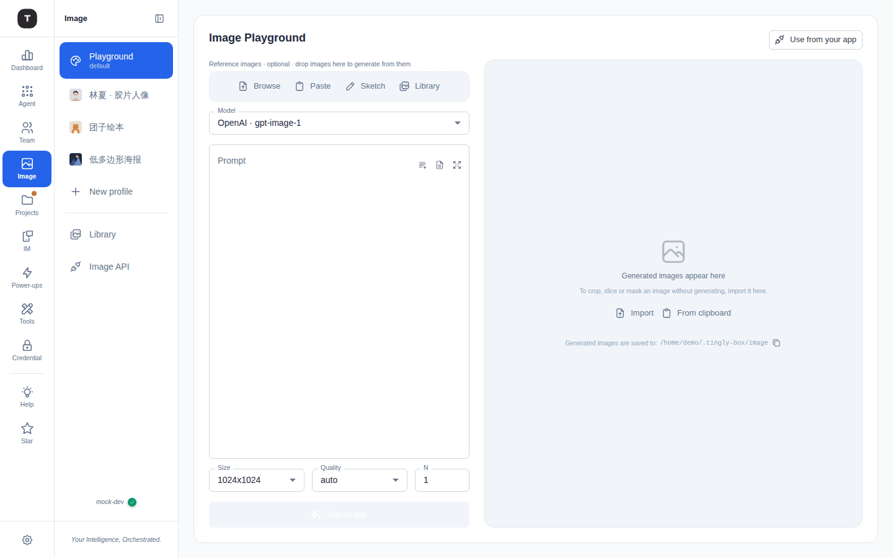
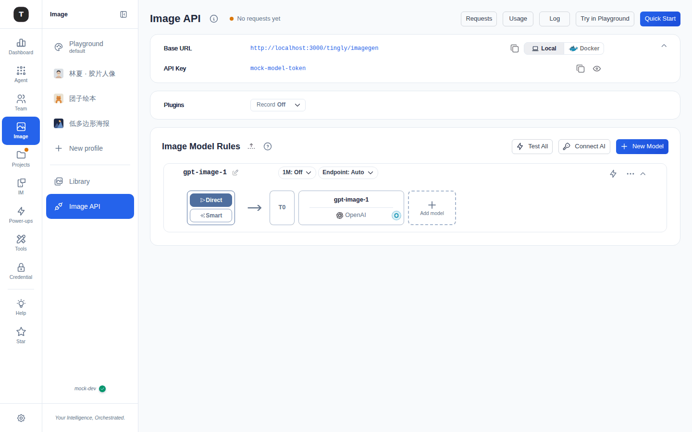
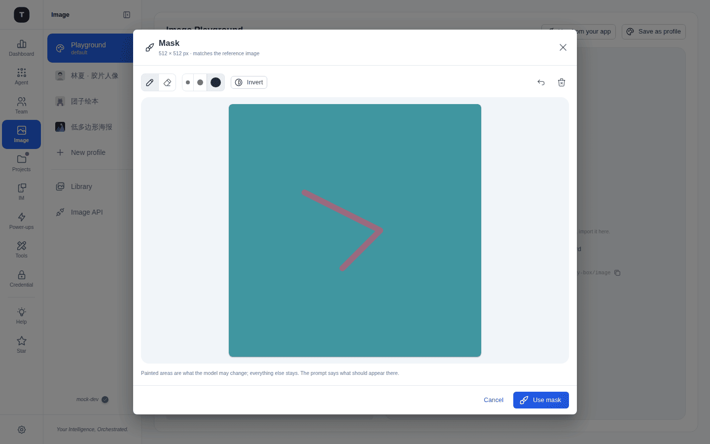
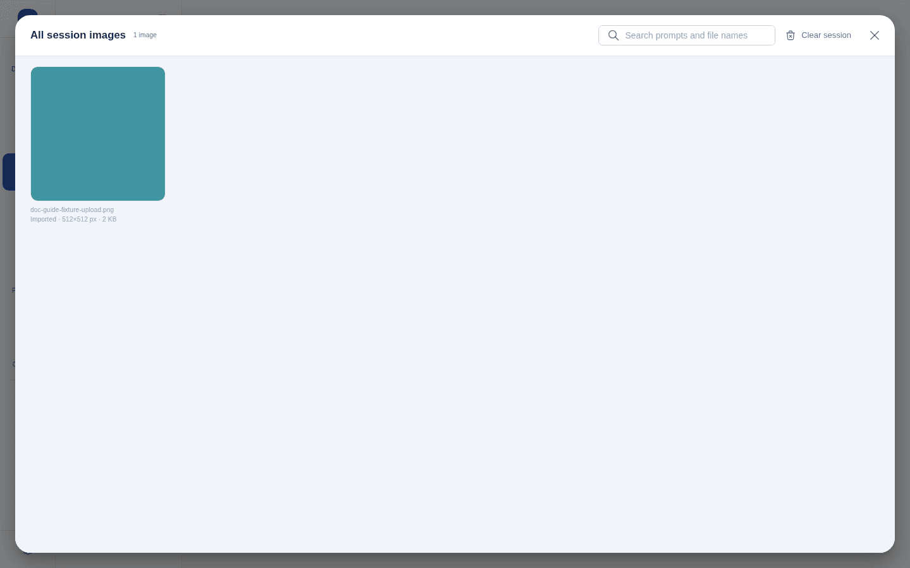
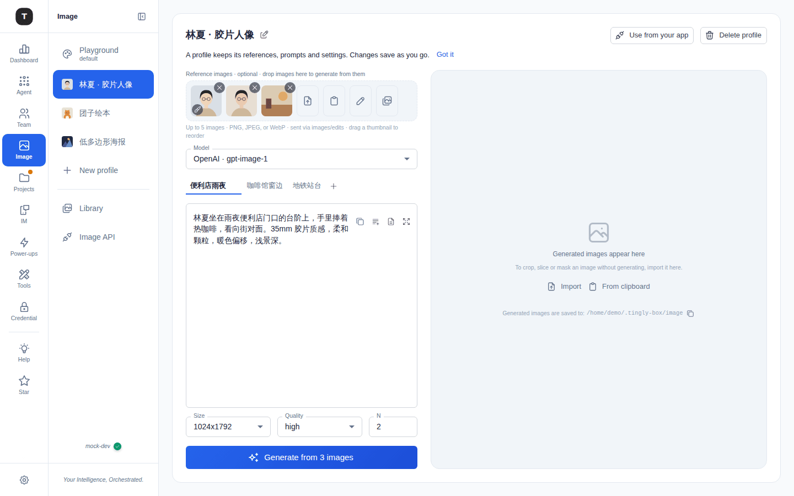
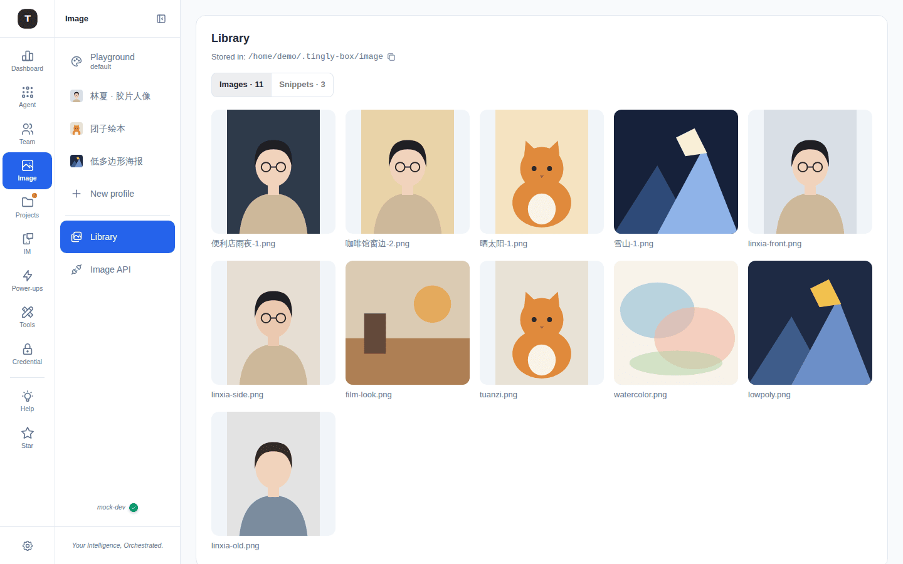
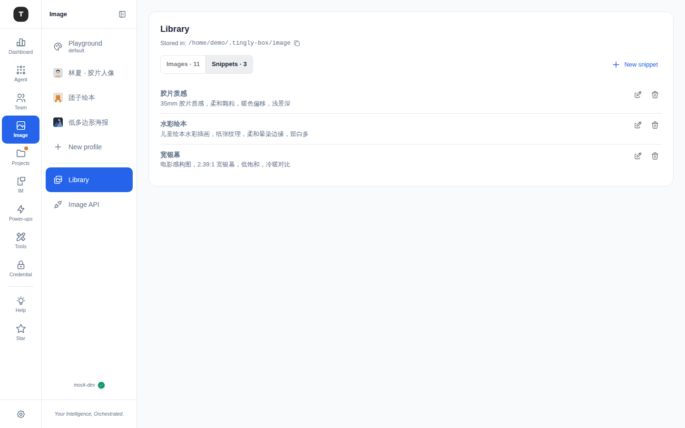

# Image

Paths: `/image/playground` (default landing, also `/image`) · `/image/profile/:id` (one page per profile) · `/image/library` · `/image/api` (old `/agent/image` and `/agent/imagegen` redirect here)



**Image** is its own top-level item in the left rail. Its sidebar, top to bottom:

1. **Playground** (captioned `default`) — the day-to-day work surface
2. one row per **profile** (cover thumbnail + name) and **New profile** — the same shape as Claude Code's profiles
3. a divider, then **Library** — images and prompt snippets you have kept
4. **Image API** — the connect-a-client page (Base URL, Quick Start, model rules), last, because only someone wiring up an app needs it

The work surface comes first and what is shared comes after. Image is shown by default; the **Image** switch in the [Power-ups menu](./02-scenario-overview.md#power-ups-the-menu-behind-the-gear) hides or shows the whole entry.

> Profiles, the Library and the Playground's session (runs and imported images) are kept in **this browser's IndexedDB** — they survive reloads but don't follow you to another browser or machine. Generated image *files* go to the output folder on the server (shown on the page, with a copy button) and stay there when you remove a run, a profile or a library entry.

---

## Image API



The configure-once page — a standard agent page ([Claude Code § Page Structure](./03-scenario-claude-code.md#page-structure)):

1. **Header**: `Image API` with the status line, **Requests / Usage / Log**, **Try in Playground**, and the filled **Quick Start** — a dialog (*Image API Quick Start*) with a copy-ready call to `images/generations` or `images/edits`: decode the base64 response into an image file; the model token comes from `GET /api/v1/token`
2. **Connection card**: Base URL (`/tingly/imagegen`) and API Key, copy buttons, **Local | Docker**
3. **Plugins card**: **Record** only
4. **Image Model Rules** (collapsible): routing rules for image generation/editing models — **New Model**, **Connect AI**, **Test All**

---

## Image Playground

The interactive work surface. It has no rules of its own — it reads the same `imagegen` rules as Image API, and every run goes through the real `/tingly/imagegen` path a client would use. A **Use from your app** button at the top right jumps to Image API (*Call these models from your own app through the Image API*).

On large screens it is a full-height **workbench**, not a scrolling page: a fixed-width control column on the left and the results panel filling the rest (minimum height 600 px, below which the page scrolls instead of squashing the prompt).

### Controls (left)

- **Reference images** — optional; drag & drop onto the dashed row, **Browse**, **Paste** from the clipboard, open the **Sketch** canvas, or pick from the **Library** (multi-select, within the cap) — up to **5** images (PNG/JPEG/WebP). Thumbnails are draggable to reorder (or move with arrow keys), and each can carry:
  - a **mask** (brush icon) — see [Mask tool](#mask-tool) below; only the **first** image's mask is actually sent, and the row calls this out if a masked image is no longer first
  - a **sketch** (if it originated from the Sketch tool) — reopenable for further editing, since "done" isn't a lock
- **Model** — you pick a **provider · model** (for example `OpenAI · gpt-image-1`), not a rule name. **Choose another model…** at the end of the list opens the same model picker as the rule editor ([Model Select](./21-model-select.md)). Behind the scenes the matching `imagegen` rule is found or created, so API clients can call the same name; rules you built with several services are listed by name under *Your rules*. With nothing chosen yet it reads *Choose a model to start*
- **Prompt** — a multi-row field that grows to fill remaining column height; buttons to **insert a snippet** (from the [Library](#library), at the cursor; *Manage snippets…* is at the bottom of the menu), open a text file as the prompt, and expand into a larger editor. Placeholder text adapts to context (masking, sketching, editing from references, or a plain new generation)
- **Size** / **Quality** (auto/low/medium/high/standard) / **N** (count, 1–10)
- **Generate** button — label adapts: "Generate", "Generate from N images" when references are attached, or "Generate another · N running" while a batch is in flight. `⌘/Ctrl + Enter` from the prompt field submits.

### Mask tool



Paint the area of the **first** reference image the model may change; everything else stays as-is, and the prompt describes what should appear in the painted region.

- **Tools**: Paint / Erase, plus **Invert** (flip which area is protected) and **Clear**
- Canvas matches the reference image's exact pixel size
- A mask can be edited or removed later, and stays attached to its image even when the row is reordered — it is dropped only if that image itself is removed

### Sketch tool

A freehand canvas at the request's configured Size — Pen/Eraser, brush size, colour, undo — for a rough sketch the prompt then describes turning into a finished image. It includes a **pose figure** add-on: drag a mannequin's joints to pose it (with presets like Standing, Walking, Sitting, Kneeling, Waving, and six camera angles from front to below), useful for describing a character's pose without drawing it by hand.

### Results panel (right)

- A **timeline** of everything in the session — generation runs and imported images together, oldest to newest — capped to the most recent entries; older items collapse into one "view all" tile at the end
- Empty state: *Generated images appear here*, with **Import** and **From clipboard** (to crop, slice or mask an image without generating it) and, beneath, `Generated images are saved to: <output folder>` with a copy button
- Each generation shows its prompt, with **Copy prompt**, **Edit this request** (loads the run's references, prompt, model and settings back into the panel), **Save this request as a profile** (palette icon — see [Profiles](#profiles)) and **Remove this generation**; a running one can be **cancelled**, a failed one **retried**. Removing a run never deletes files already written to the output folder
- Every image (result, reference, or import) opens in one shared **lightbox viewer**: copy prompt, download, **Use as reference** (feeds it back in, chaining edits without leaving the page), **Split into tiles**, edit sketch / mask where they apply, and **Keep in library** (turns to *In the library* once kept)
- Images can be **imported** directly (drag/drop/paste/browse) as first-class working images with the same viewer and tools as a generated result

### Overview (paginated gallery)



The strip above answers "what's happening right now"; **All session images** (opened from the strip) answers "where's the one I made twenty images ago" — every image in the session on one page, newest first, with:

- **Search** across prompts and file names
- **Pagination**, 24 tiles per page
- Each tile: a thumbnail, up to 3 **source-image badges** in the corner for edited results (click to open the source), hover actions (preview, use as reference, retry a failure, remove), and two caption lines (prompt or file name; model/size/quality or import dimensions/size)
- **Clear session** empties everything at once (confirmed) — the one place that shows how much there is to clear

### Split into tiles

Cuts a result into an evenly divided grid (rows × columns) via a draggable, resizable frame with an adjustable gap — for sticker sheets, contact sheets, or spritesheets. Click a tile to exclude it, then download that one tile or every remaining tile as a ZIP of PNGs.

### Multi-image and masked edits

Up to 5 reference images can be attached to a single edit request — the common cap across the providers this scenario routes to. Each image can independently carry a mask, but only the **first** image's mask is sent (the underlying API applies a mask to the first image only); the reference row is explicit about this whenever a masked image has been dragged out of the first slot.

---

## Profiles



A **profile** pins one ongoing piece of work: its **reference images** (you choose which, within the 5-image cap), its **prompts**, and the **model / size / quality / N**. Its page *is* the Playground with those already in place. Changes **save as you go** — there is no unsaved state — and the first time you open a profile a line under the title says so (*A profile keeps its references, prompts and settings. Changes save as you go.* — **Got it** dismisses it).

- **Create** — sidebar **New profile** makes an empty one and opens it with its name ready to type; or, when a result turns out well, click **Save this request as a profile** on that run (the palette icon) to turn its references, prompt, model and settings into a profile — the generation is copied into it too. The header's **Save as profile** does the same from whatever is currently in the panel (it only appears when there is something to keep)
- **One prompt box, several prompts** — a row of tabs above the box (`Prompt 1`, `Prompt 2`, …, **New prompt**) swaps which prompt you are editing; double-click a tab to rename it, hover the current one to remove it (at least one stays). Typing saves after a short pause, when you switch tabs, or when you leave the page
- **History is per profile** — each page shows only its own runs and imported images, and **Clear session** clears only the current one. The page header has **Use from your app** and **Delete profile** (confirmed; already-generated files stay in the output folder, the profile's references, prompts, settings and history go)
- Profiles live in this browser — see the note at the top

---

## Library



**Library** (`/image/library`) is a keep-shelf: what you want to *keep*, separate from what is *in use* (a profile, the reference row) and what *happened* (the session history, which you can clear). The header shows `Stored in: <output folder>`, and two tabs:

- **Images** — images you chose to keep with **Keep in library** in the lightbox (nothing joins the Library implicitly; keeping the same image twice doesn't duplicate it). Click one to rename it or delete it (*Deletes the image and its file. Profiles that already use it keep their copy.*)
- **Snippets** — pieces of prompt you reuse — a look, a lens, a palette. **New snippet** takes a name and text; edit or delete them here. Insert one from the Playground's prompt field with the snippet button (a comma is added when needed)

Using a library image **copies** it — into the reference row (**Library** button, multi-select within the cap) or a profile — so deleting a library entry never changes a profile that already uses it.



---

## Integration

```bash
curl <tingly-box-imagegen-url>/images/generations \
  -H "Authorization: Bearer <api-key>" \
  -H "Content-Type: application/json" \
  -d '{"model": "dall-e-3", "prompt": "a cute cat", "n": 1, "size": "1024x1024"}'
```

---

## Related Pages

- [Scenario Overview](./02-scenario-overview.md)
- [Custom / Embed](./06-scenario-special.md)
- [Usage Dashboard](./11-dashboard.md)
- [Model Select](./21-model-select.md)
