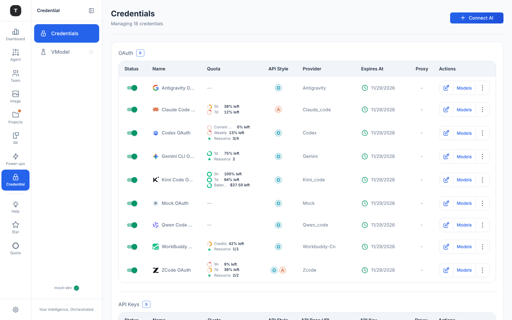
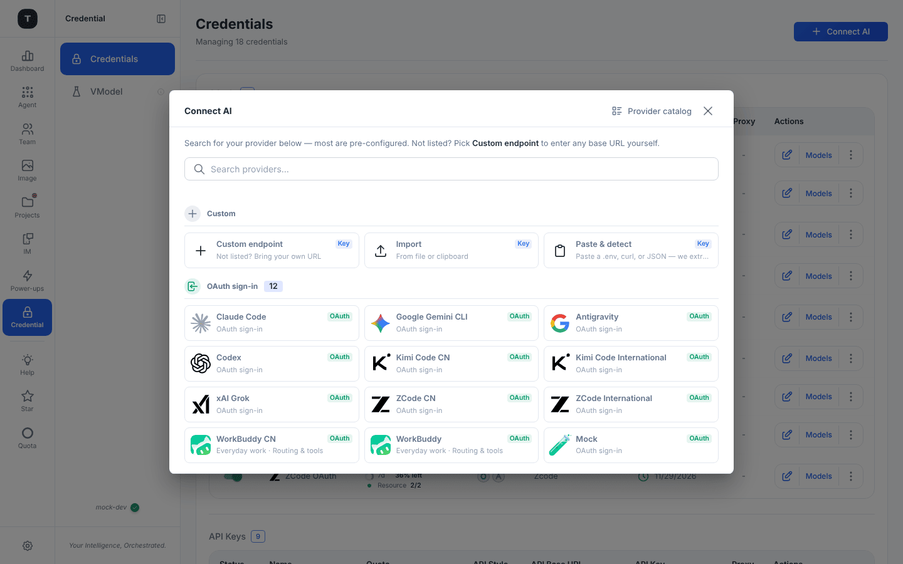
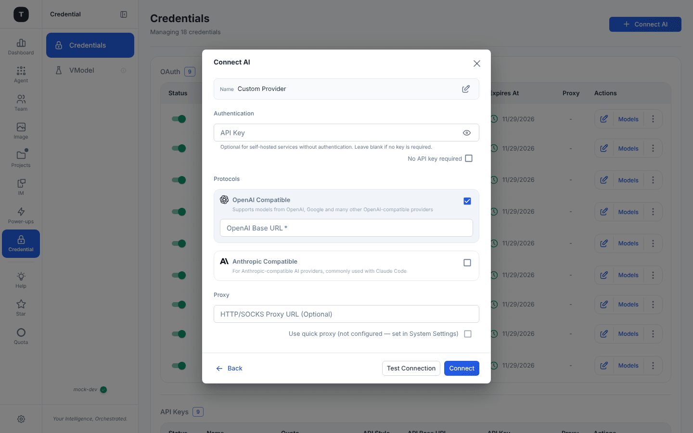

# Credentials

Path: `/credentials`

The Credentials page is the core of Tingly-Box's configuration chain. All provider API keys and OAuth credentials are centrally managed here.

---

## Page Overview

The rail item is **Credential**; its sidebar has two rows: **Credentials** (this page) and **VModel** (abbreviated from Virtual Models — see [Virtual Models](./09-virtual-models.md); the row is a Power-up, so it disappears when *Virtual Models* is switched off in the [Power-ups menu](./02-scenario-overview.md#power-ups-the-menu-behind-the-gear), though the page stays reachable by URL). The old **Sharing** sub-page is gone — multi-token external-client access is now the Team concept **Team Keys**, managed from [Team](./07-team.md).

The page header shows the total credential count as its subtitle (`Managing N credentials`, or `No credentials yet` when empty). The only action in the header is:

| Button | Function |
|--------|----------|
| **Connect AI** | Opens the unified provider picker to add new credentials (same flow as Onboarding) — the single entry point for both browsing the provider catalog and filling in config |

> There is no separate **Providers** button anymore (it used to jump to a standalone catalog page) — the provider catalog is reached from inside Connect AI's picker instead. There is also no bulk Import/Export for credential configs — connect providers individually through Connect AI. (Guardrails' separate Secrets page still offers an "Import from Credentials" shortcut — see [Guardrails](./15-guardrails.md).)

---

## Credential Types

Only the kinds of credential that actually exist get their own section — an empty kind (e.g. no OAuth providers yet) no longer renders an empty block of its own with a redundant Connect AI button. With zero credentials of any kind, the whole card collapses to a single **"Connect your first AI"** empty-state landing (see below) instead of showing two empty tables.

### OAuth Table

Lists all providers connected via OAuth (e.g. Claude Code, Codex, Gemini CLI, Kimi Code, WorkBuddy). Every row shows the provider's **logo** beside its name:

| Column | Description |
|--------|-------------|
| Status | Enabled/disabled toggle |
| Name | Provider display name |
| **Quota** | Live usage, as a table column (see below) — not a detail row |
| API Style | Protocol badge (OpenAI / Anthropic) |
| Provider | Underlying provider key |
| Expires At | Token expiration date |
| Proxy | Per-credential proxy, if set |
| Actions | Edit, Models, more (⋮) — Quota's own Refresh/Details moved into its column (below) |

### API Keys Table

Lists all providers connected via API Key, again with each provider's logo beside its name (resolved from the provider catalog by its API host, so custom endpoints of well-known vendors get the right logo too):

| Column | Description |
|--------|-------------|
| Status | Enabled/disabled toggle |
| Name | Provider display name |
| **Quota** | Live usage, as a table column (see below) |
| API Style | Protocol badge (OpenAI / Anthropic — dual badge for fusion providers) |
| API Base URL | The endpoint address |
| API Key | Masked value, with a reveal (eye) icon |
| Proxy | Per-credential proxy, if set |
| Actions | Edit, Models, more (⋮) |

### Quota Column

Quota is no longer a strip underneath the row — it's its own table column, up to three compact lines per cell (e.g. two allowance windows like `5h` / `7d` plus one money line), each with a small ring showing the remaining share. A window's **name sits right in the cell** (e.g. `5h  80% left`, `7d  42% left`) instead of behind a separate label column. Money reads as an amount, not a share: a capped wallet shows `$37.50 left` with a ring, an uncapped spend shows `$8.10 used` with none, and a plain balance shows just the figure.

A few kinds of line you will see:

- **Allowance windows** — `5h  38% left`, `7d  12% left`, `Weekly  13% left`, with a ring
- **Resource groups** — credits or per-model entries a provider reports as a count sit **inline** in the cell (a dot instead of a ring, e.g. `Resource  3/4`; muted when nothing is left) instead of hiding behind the hover
- **Balances** — `Balance  $37.50 left` (Kimi Code's booster wallet), `Balance  81.41 CNY` / `2.50 USD` (DeepSeek, one line per currency; an **overdraft** is shown as the debt it is rather than being rejected), OpenRouter's account **balance** (`Balance  11.90 USD`, not the API key's cap) next to its 30-day spend (`30d  $8.10 used`), WorkBuddy **credits**
- **Monthly limits** — Kimi Code's monthly allowances appear alongside its 5-hour and weekly windows

The quota *history* behind these readings is charted under [Dashboard → Quota history](./11-dashboard.md#quota-history-dashboardquota-history).

- No reading yet → a plain `—`, but the cell stays clickable to request one
- **Hover** the cell for the full tooltip: every window with its reset countdown, and — in the hover's own bottom row — **Refresh** and (when the provider's upstream returned one) **Details** (raw response). These used to be separate row-level icons; they now live inside the quota hover itself
- **Click** the cell to refresh immediately (same as the hover's Refresh action)
- A stale reading (>1h old) is dimmed
- Providers without a quota API show `—`, or a tooltip note like `quota API not available — see the OpenAI dashboard`

---

## Empty State

With no credentials configured yet, the page shows one landing (icon, "Connect your first AI" title, a short description of signing in with a subscription or pasting an API key, and a single **Connect AI** button) — not a separate empty block per credential kind.

---

## Adding a Provider (the Connect AI flow)

Click **Connect AI** to open the provider picker. This is the single entry point for connecting any AI service, and it works in two steps: **pick a type, then fill in the config**.

### Step 1: Pick a provider

The dialog title has a **Provider catalog** link (the same catalog on the [Tips & Help](./13-help.md) page). A search box (filters by name) sits at the top; below it providers are grouped by connection type, and each card carries a coloured badge marking its kind:

| Section | What's in it | What happens on click |
|---------|--------------|------------------------|
| **Custom** | `Custom endpoint` (bring your own Base URL), `Import` (from file or clipboard), `Paste & detect` (paste a `.env`, curl command, or JSON snippet — Tingly extracts the provider config for you) | Opens a blank config form / the import dialog / the paste-and-detect flow |
| **OAuth sign-in** | Providers that support OAuth (Claude Code, Google Gemini CLI, Antigravity, Codex, Kimi Code, xAI Grok, ZCode CN / International, **WorkBuddy** and **WorkBuddy CN** — the latter is also the entry for CodeBuddy accounts) | **Launches the OAuth flow directly** — no API key needed. The dialog shows the fixed loopback callback port up front (e.g. Claude Code uses 54545, Codex 1455), plus a collapsed-by-default **"Running this remotely?"** toggle revealing the `ssh -L` forwarding command needed when Tingly-Box runs on a remote machine |
| **Self-hosted** | Locally hosted services (e.g. Ollama); the card shows `localhost:port` | Opens the config form with the Base URL pre-filled but **editable** (adjust to your host/port) |
| **Cloud** / **API key providers** | Cloud platforms and providers accessed via API key, grouped by region (CN / Global); each card shows its protocol (OpenAI · Anthropic) | Opens the config form with name and Base URL pre-filled |

> A WorkBuddy sign-in uses WorkBuddy's client interfaces — models, credits and permitted clients are decided by WorkBuddy, and a successful sign-in doesn't guarantee access from every client (the dialog says so). Using a WorkBuddy *account* as an upstream provider is separate from routing the WorkBuddy *app* through Tingly-Box, which is the [WorkBuddy agent](./04-scenario-coding-agents.md#workbuddy).

> Most providers are pre-configured, so you'll only be asked for what they need. Not listed? Pick **Custom endpoint** to enter any base URL yourself.

> **Import now shows what it created**: instead of closing with a toast, the import dialog switches into a result list of every provider it just created — each freshly minted with its own UUID (no more silent "reuse an existing provider on UUID match"), with a "renamed" hint on any name that got an auto-suffix to avoid a collision. Each row's **Edit** button opens the same edit dialog used everywhere else, so a rename or tweak doesn't require leaving the flow.

### Step 2: Fill in the config form

Choosing any non-OAuth provider opens the config form (title **Connect AI**; **Edit AI Config** when editing):

- **Protocols**: two cards, **OpenAI Compatible** (recommended — most endpoints speak the OpenAI API) and **Anthropic Compatible** (native Anthropic protocol, commonly used with Claude Code). Tick one or both — with both, one credential serves OpenAI and Anthropic inbound protocols (a *fusion* provider). Each ticked card has its own **Base URL** field, pre-filled for known providers (*from template*) and freely editable for Custom / Self-hosted. Typing a URL can offer *Matching providers — click to fill URLs*
- **Name**: always visible (leave blank for an auto-generated name; click the pencil to edit)
- **API Key** (required): the access token, with a reveal icon. For a local service with no auth, tick **No API Key Required**
- **HTTP/SOCKS Proxy URL (Optional)**: route this provider through a dedicated proxy (`http://127.0.0.1:7890` or `socks5://…`). **Use quick proxy (…)** fills in the shared proxy configured in [System Settings](./17-system-settings.md#proxy-settings) — it reads *not configured — set in System Settings* until one exists

Buttons: **Back** (to the picker), **Test Connection** (checks connectivity — a failure explains why, and **Add Anyway** lets you save regardless if you are sure the config is right), and **Connect**.

In **edit mode** the dialog is *Edit AI Config*, shows an **Enabled** switch next to the close button, and leaves the API key empty to keep the current one.

> **OAuth providers are the exception**: selecting an OAuth card in step 1 jumps straight to the authorization page — there's no step-2 form, and the token is saved automatically once you authorize.

---

## Editing a Provider

Click the edit icon on the right of a provider row to open the edit form. You can modify:
- Name
- API Base URL
- API Key/Token
- Proxy settings
- Enabled/disabled status

---

## Enable / Disable a Provider

Each provider row has a toggle for quick enable/disable. Disabled providers will not receive new routing requests, but their configuration is retained.

---

## Related Pages

- [Virtual Models](./09-virtual-models.md)
- [Team](./07-team.md)
- [Getting Started](./01-getting-started.md)
