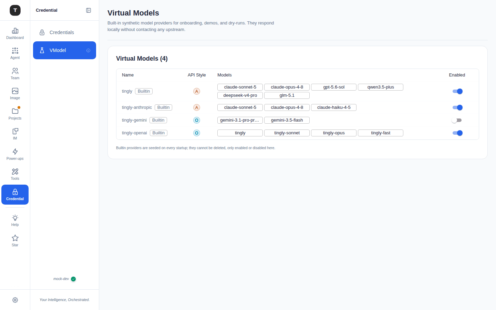

# Virtual Models

Path: `/credentials/virtual-models`

Virtual Models are Tingly-Box's built-in synthetic model providers. They require no real API keys and are suitable for demos, development debugging, and dry-run scenarios.

---

## Page Overview

Reached from **Credential → VModel** (the sidebar row is abbreviated; the page itself is titled **Virtual Models**). VModel is a **Power-up** — on by default; switch it off under *Virtual Models* in the [Power-ups menu](./02-scenario-overview.md#power-ups-the-menu-behind-the-gear) and the sidebar row disappears (the page stays reachable by URL, and the providers keep working).

Subtitle: *Built-in synthetic model providers for onboarding, demos, and dry-runs. They respond locally without contacting any upstream.*

### Virtual Models table (`Virtual Models (N)`)

| Column | Description |
|--------|-------------|
| Name | Virtual provider name (`tingly`, `tingly-anthropic`, `tingly-gemini`, `tingly-openai`, …) with a **Builtin** badge |
| API Style | OpenAI / Anthropic protocol badge |
| Models | The synthetic model names it serves (chips) |
| Enabled | Enable/disable switch |

A note under the table: *Builtin providers are seeded on every startup; they cannot be deleted, only enabled or disabled here.*

---

## Use Cases

| Scenario | Description |
|----------|-------------|
| **Onboarding demo** | Walk through the full UI flow without configuring a real provider |
| **Development debugging** | Test forwarding rule configurations without consuming real API quota |
| **Feature demos** | Demonstrate Tingly-Box features to your team without exposing real API keys |

---

## Differences from Real Providers

- Virtual providers are **built-in** (re-seeded on every startup) and cannot be added or deleted via the UI
- Responses contain **simulated content** — no real AI model is called
- Individual virtual providers can be **enabled/disabled** via the toggle
- Compatible with **all scenarios** (Claude Code, OpenAI, Anthropic, etc.)

---

## How to Enable

1. Go to **Credential → VModel** (`/credentials/virtual-models`)
2. Find the target virtual provider
3. Switch the toggle to **enabled**

Once enabled, the virtual provider appears in each scenario's model routing options and can be configured as a forwarding target just like a real provider.

---

## Related Pages

- [Credentials](./08-credentials.md)
- [Scenario Overview § Power-ups](./02-scenario-overview.md#power-ups-the-menu-behind-the-gear)
