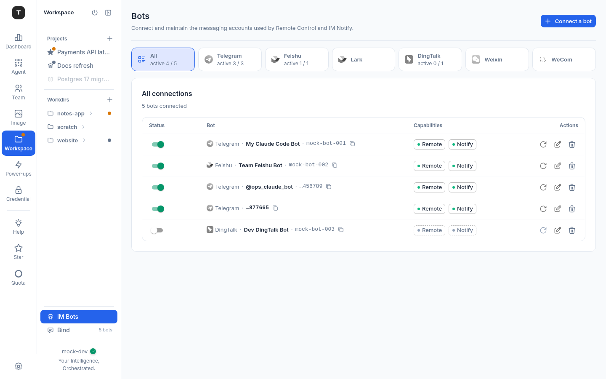
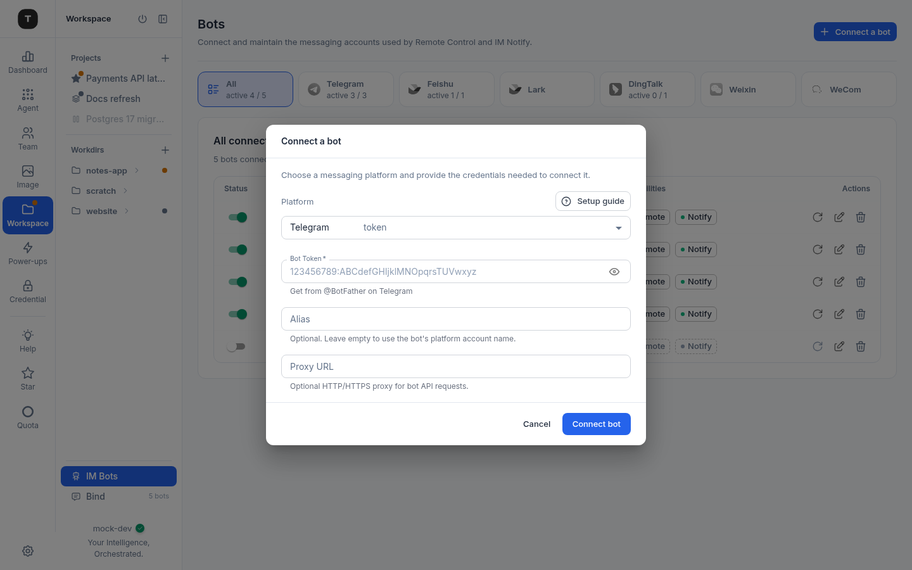
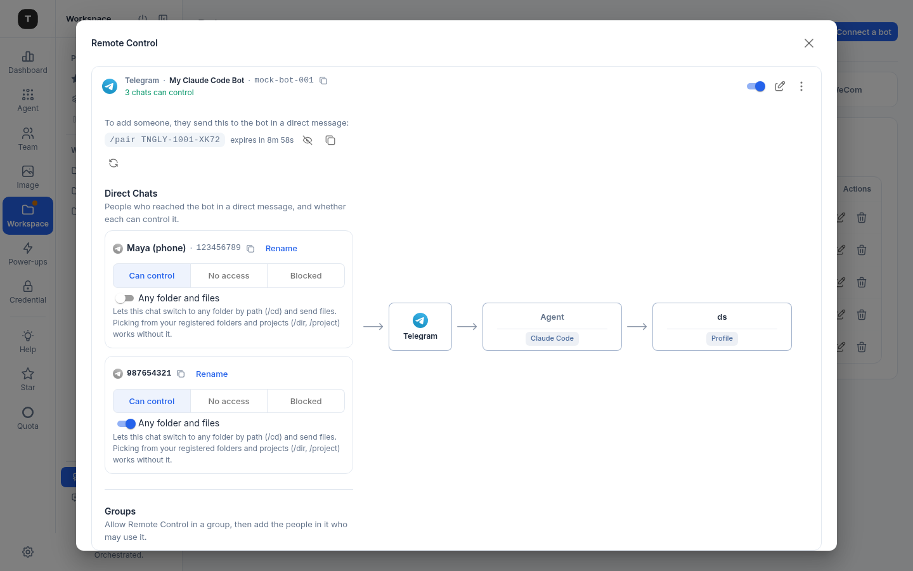
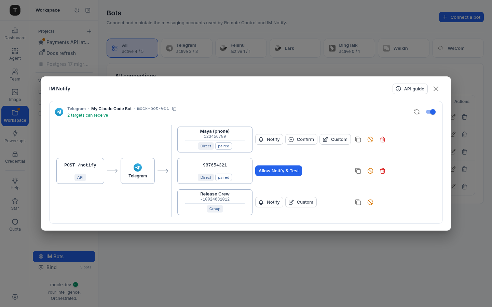
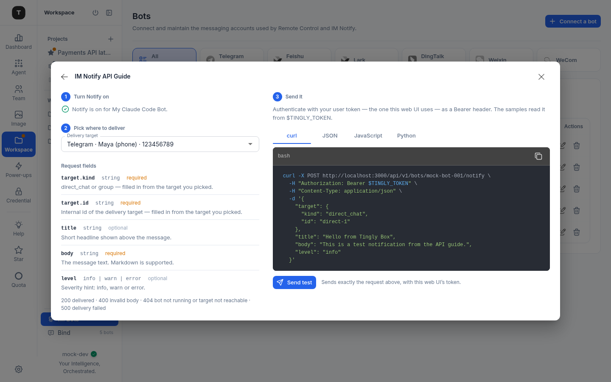

# IM Bots and Remote Control

Open `/bots/overview` from **Workspace → IM Bots**.

Connect messaging accounts in **IM Bots**. Open **Remote** or **Notify** on a bot row to manage its corresponding capability.

**What a chat does.** Chats talk to Claude Code through [Projects](../tingly-projects/en/README.md). A working-folder binding starts a folder session, while a project binding sends messages to the coordinator. Enable **Workspace** to manage these bindings from **Bind** in the Workspace sidebar.

## Quick Start

Talk to Claude Code from a chat app. This example uses Telegram. **Before you start:** Claude Code must already work through Tingly-Box ([Claude Code Quick Start](./03-scenario-claude-code.md#quick-start)).

1. Open **gear → Power-ups** and enable **Workspace**. Read the notice about who can run Claude Code on the host.
2. Open **Workspace → IM Bots → Connect a bot**. Choose Telegram, enter the **Bot Token** from `@BotFather`, and click **Connect bot**.
3. Open **Remote** on the bot's row and turn on Remote Control. If the dialog shows a pairing command, send `/pair <code>` to the bot in a direct message and check that the chat has **Can control** under **Direct Chats**.
4. Open **Bind** (`/projects/im`) in the Workspace sidebar. Click **Bind** on the chat row and choose an existing project or working folder. Use **Move** if the chat already has a binding.
5. Send the bot a message. A project chat reaches the coordinator. A working-folder chat reaches a Claude Code session in that folder.

**Verify:** **Remote** shows a chat can control the bot and **Bound to** shows the destination on the **Bind** page. Check for the reply in the chat and open the corresponding conversation in Workspace.

---

## Bots (`/bots/overview`)

**All connections** in **IM Bots** lists bots across platforms. Use the tiles to filter by platform. **Status** controls the bot connection. **Bot** shows the platform, name, and copyable bot UUID. **Remote** and **Notify** under **Capabilities** open that bot's settings. The row actions restart, edit, or delete the connection.

The overview supports **Telegram, Feishu, Lark, DingTalk, Weixin (WeChat), and WeCom**. Existing `/bots/<platform>` bookmarks still open the corresponding platform's connection list and setup guide. The QQ page shows an integration under development.

### Connecting a bot

Click **Connect a bot** (top right):

1. Choose the **Platform**
2. Fill in the platform-specific credential (e.g. **Bot Token** for Telegram, from `@BotFather`)
3. Optional: **Alias** and **Proxy URL** (HTTP/HTTPS proxy for the bot's API requests)
4. Click **Connect bot**

Each platform also has a **Setup guide** (collapsed by default) with its steps and examples. Feishu and Lark offer **One-click (scan QR)** app creation (the app, permissions and events are created for you); Weixin uses **QR code** binding instead of a token.

## Remote Control

Click **Remote** on the bot row in **IM Bots**. The switch at the top controls that bot's Remote Control capability. The dialog contains:

- **Direct Chats** lists people who have messaged the bot privately. Set **Can control**, **No access**, or **Blocked** per chat. Send the pairing command shown here to the bot in a direct message.
- **Groups** has a **Remote Control** switch per group and a separate list of people who may use it within that group.
- **Any folder and files** allows choosing a folder by path with `/cd` and sending files. A direct chat can still select a registered destination with `/dir` or `/project`.
- The route graph shows the chats, the platform, Claude Code, and the **Profile**. Click **Profile** to change the bot's default.

### Claude Code profile

The **Profile** node (**Claude Code profile** dialog) picks which Claude Code configuration the bot's chats run under: *New sessions from this bot's chats run under this profile: its rules, model mapping and settings overrides.* **Default** is the main `claude_code` scenario; otherwise choose one of your [profiles](./03-scenario-claude-code.md#profiles) (create it on the Claude Code page first). The bot's profile applies to a chat's **first** session; later sessions keep the previous session's profile, model and permission mode, and fall back to the default if the profile was deleted.

---

## Talking to Claude Code in a chat

A chat bound to a [project](../tingly-projects/en/projects-and-threads.md) reaches its coordinator by default. A chat bound to a working folder reaches a folder session. See [IM chat bindings](../tingly-projects/en/im.md) for setup. Replies, tool approvals, and questions come back to the chat. Use buttons when offered, or follow the text prompt.

| Command | What it does |
|---|---|
| `/help` | Show commands available to this chat |
| `/pair <code>` | Pair in a direct message using the code from the dialog |
| `/dir [N]`, `/project [N]` | List or select registered working folders and projects |
| `/cd <path>` | Switch folders by path, with **Any folder and files** enabled |
| `/session [N]`, `/new [message]` | Choose a session or start a new one |
| `/stop [#N]`, `/clear` | Stop a session, or stop and start a fresh session on the next message |
| `/status`, `/compact [instructions]` | Show session state or compact the conversation |
| `/verbose on\|off` | Show or hide step-by-step messages |
| `/yolo` | Toggle the permission mode that runs tools without asking |
| `@N <message>` | Send one message to session #N |

---

## IM Notify

Open **Notify** on the bot’s row in **IM Bots**. It lets automations push messages into chats the bot has seen, independent of Remote Control. The **API guide** button (top right) documents the notification API: authenticate with your user token as a Bearer header, `POST /api/v1/bots/{bot}/notify` with the bot UUID (a `200` means delivered), and copy the target UUID from a chat node.

### Delivery targets

Each bot’s dialog has a **Notify switch** and a **refresh** button, a status line (`N targets can receive` · `No target allowed yet` · `Notify off`) and a graph `POST /notify (API)` → platform → **chat nodes**. Each node pairs the platform id (e.g. `telegram:123456789`, tagged **Direct** or **Group**, and `paired`) with inline actions:

- **Notify** — send a test/manual message
- **Confirm** — send an interactive confirmation test when the target supports replies
- **Allow Notify & Test** — authorize a new target and immediately send a test notification
- **Custom** — send a custom payload (title, level, markdown body)
- copy (the internal target UUID the API needs), **Disable** (silently drop its messages; **Show disabled (N)** / **Hide disabled** reveals them) and delete (direct chats only; the pairing and bindings go, session history stays)

New targets need explicit authorization (**Allow Notify & Test**) before automated notifications reach them — a chat the bot merely happens to see can't silently become a target.

### API guide

Open **API guide** in the **Notify** dialog and select an authorized chat under **Delivery target**. The guide fills in `target.kind` and the internal `target.id` and provides a copyable request. Click **Send test** to verify delivery through the same endpoint.

---

## Old bookmarks

`/remote-agent` (including platform suffixes), `/remote-control/*`, `/remote-coder/*`, and `/notify` open the **IM Bots** overview. Open **Remote** or **Notify** on the relevant bot row.

## Related Pages

- [Projects](../tingly-projects/en/README.md)
- [Experimental Features § Projects](./19-experimental.md#projects)
- [Claude Code § Profiles](./03-scenario-claude-code.md#profiles)
- [Scenario Overview](./02-scenario-overview.md)
