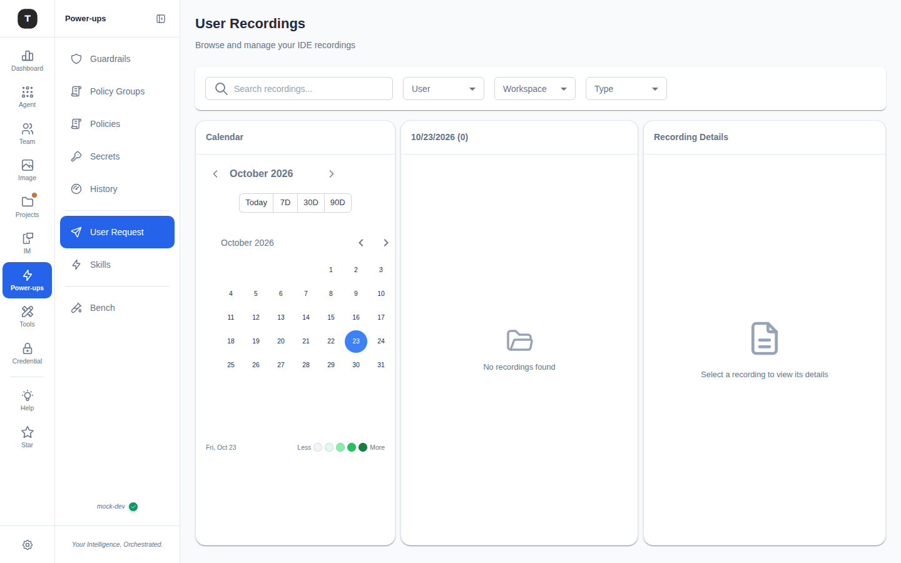
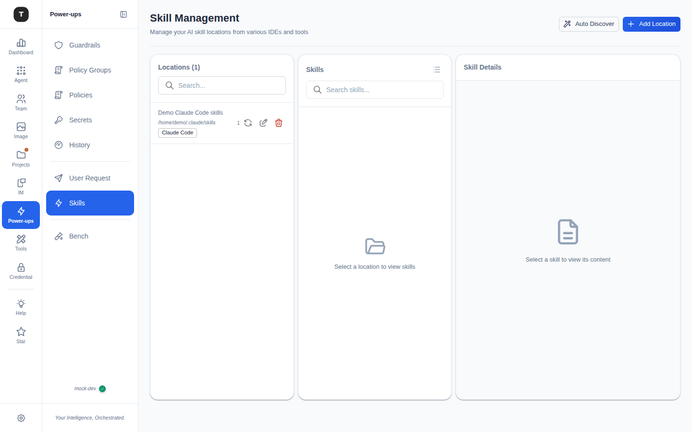

# Prompt Management

Paths: `/prompt/user`, `/prompt/skill` (`/prompt/command` redirects to Skills)

Prompt Management provides IDE recording browsing and Skills management, helping teams accumulate and reuse AI coding knowledge.

> **Note**: Prompt Management is a pair of opt-in power-ups — **User prompts** and **Skills** — switched on in the [Power-ups menu](./02-scenario-overview.md#power-ups-the-menu-behind-the-gear) or [Experimental Features](./19-experimental.md). They appear under the **Power-ups** rail item as **User Request** and **Skills**. (There is no edition split any more; the desktop app has them too.)

---

## User Requests

Path: `/prompt/user`

### Function

The page (titled **User Recordings** — *Browse and manage your IDE recordings*) browses and manages interaction recordings captured from Claude Code IDE sessions. Use cases:
- Reviewing past AI-assisted decision processes
- Extracting successful prompt templates
- Team knowledge sharing

### Layout

A filter bar across the top — **Search recordings…**, **User**, **Workspace** (the workspace the IDE had open when recording; it used to be called *Project*) and **Type** (code-review / debug / refactor / test) — above three columns:

**Left: Calendar** — a month calendar shaded by recording count (Less → More), with range buttons **Today / 7D / 30D / 90D**

**Center: Recording list** — titled with the selected date and its count (`10/23/2026 (0)`); each recording shows title, type badge and timestamp; *No recordings found* when the day is empty

**Right: Recording Details** — summary, metadata (user, workspace, type, duration, model, timestamp) and the full conversation

---

## Skills Management

Path: `/prompt/skill`

### Function

The page (titled **Skill Management** — *Manage your AI skill locations from various IDEs and tools*) manages reusable prompt snippets synced from IDE configurations (e.g. `.claude/skills/` directories), supporting:
- Auto-discovery of skills from multiple IDE sources
- Grouped browsing and search
- Viewing skill content in Markdown or raw format

### Three-Column Layout

**Left column: Skill Locations**

Each location corresponds to a directory source:
- Location name
- Path
- IDE source badge (e.g. claude_code)
- Skill count
- Actions: refresh, edit, delete

Top buttons:
- **Add Location**: Manually add a skill directory (display name, path and IDE source)
- **Auto Discover**: Scan the home directory for supported IDEs (Claude Code, OpenCode, VS Code, Cursor, Codex, Antigravity, Gemini CLI, GitHub Copilot, Windsurf, …) and import their skills — pick which to import in the dialog

**Center column: Skills List**

After selecting a location, shows all skills in that location:
- Toggle between **grouped** and **flat** view (the icon in the column header)
- Search filter

**Right column: Skill Content**

After selecting a skill:
- File metadata (path, size, modification time)
- **Markdown** rendered view (default)
- **Raw** plaintext view
- Copy button

---

## Related Pages

- [Experimental Features](./19-experimental.md)
- [Claude Code Scenario](./03-scenario-claude-code.md)
