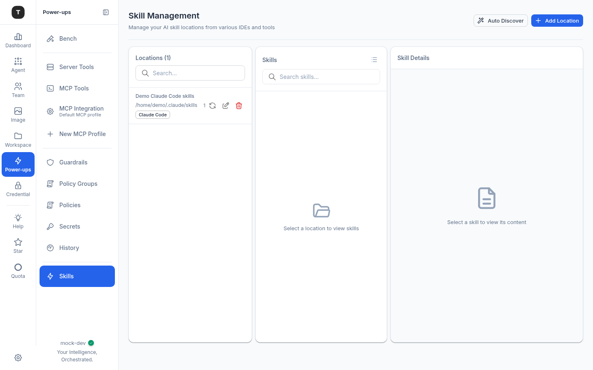

# Prompt Management

Path `/prompt/skill`

Enable **Skills** to browse and manage skills from your IDEs under **Power-ups**.

## Quick Start

Browse the skills your IDEs already have, in one place.

1. Switch the feature on: **gear** → **Power-ups** → **Skills**.
2. Click **Power-ups** in the rail → **Skills**.
3. Click **Auto Discover**, tick the IDEs you use (Claude Code, OpenCode, VS Code, Cursor, Codex, …) and import. A directory the scan can't find? **Add Location** takes a name, path and IDE source.
4. Click a location, then a skill, to read it as rendered **Markdown** or **Raw**, and copy it.

**Verify:** your locations list shows a skill count, and a skill's content appears on the right.

---

## Skills Management

Path: `/prompt/skill`

### Function

The page (titled **Skill Management** — *Manage your AI skill locations from various IDEs and tools*) manages reusable prompt snippets synced from IDE configurations (e.g. `.claude/skills/` directories), supporting:
- Auto-discovery of skills from multiple IDE sources
- Grouped browsing and search
- Viewing skill content in Markdown or raw format

### Three-Column Layout

**Left column: Skill Locations**

Each location corresponds to a directory source:
- Location name
- Path
- IDE source badge (e.g. claude_code)
- Skill count
- Actions: refresh, edit, delete

Top buttons:
- **Add Location**: Manually add a skill directory (display name, path and IDE source)
- **Auto Discover**: Scan the home directory for supported IDEs (Claude Code, OpenCode, VS Code, Cursor, Codex, Antigravity, Gemini CLI, GitHub Copilot, Windsurf, …) and import their skills — pick which to import in the dialog

**Center column: Skills List**

After selecting a location, shows all skills in that location:
- Toggle between **grouped** and **flat** view (the icon in the column header)
- Search filter

**Right column: Skill Content**

After selecting a skill:
- File metadata (path, size, modification time)
- **Markdown** rendered view (default)
- **Raw** plaintext view
- Copy button

---

## Related Pages

- [Experimental Features](./19-experimental.md)
- [Claude Code Scenario](./03-scenario-claude-code.md)
