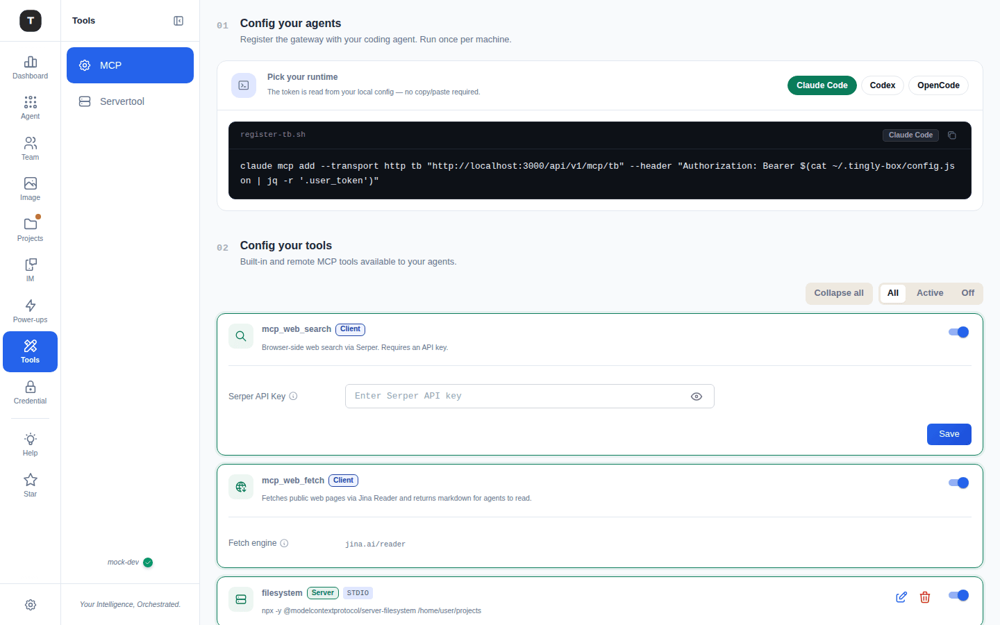
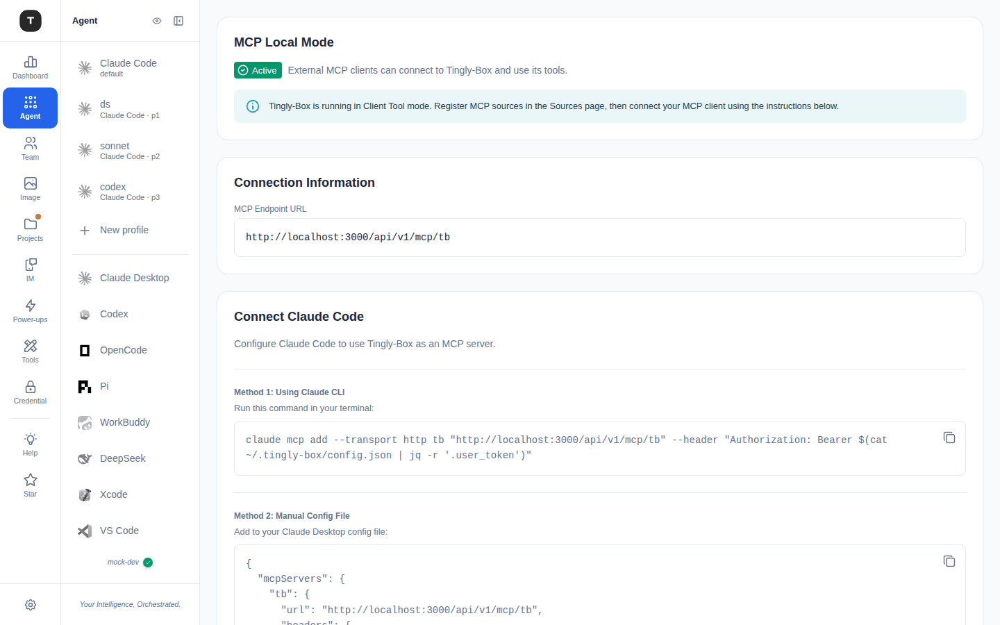
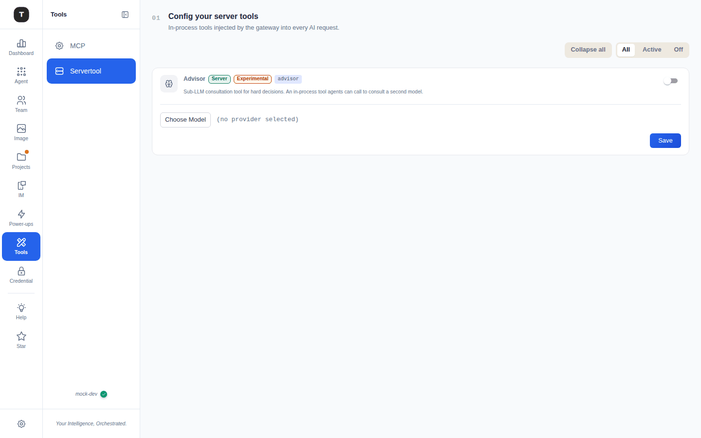

# MCP & Tools

Paths: `/mcp/sources` (**MCP**), `/tools/servertool` (**Servertool**), `/mcp/local-mode`



MCP (Model Context Protocol) tool support lets you register external tool servers for Claude Code and other scenarios, alongside built-in web tools. The **Tools** rail item has two rows: **MCP** and **Servertool**.

> **Note**: MCP Tools is an opt-in power-up (*MCP Tools*, tagged *Exp.*): switch it on in the [Power-ups menu](./02-scenario-overview.md#power-ups-the-menu-behind-the-gear) or [Experimental Features](./19-experimental.md) and the **Tools** rail item appears.

---

## MCP (`/mcp/sources`)

A two-step page.

### 01 · Config your agents

*Register the gateway with your coding agent. Run once per machine.* **Pick your runtime** — **Claude Code**, **Codex** or **OpenCode** — and a dark code block shows the registration for it, with a copy button:

| Runtime | What you run |
|---------|--------------|
| Claude Code | `claude mcp add --transport http tb "<Base URL>/api/v1/mcp/tb" --header "Authorization: Bearer $(cat ~/.tingly-box/config.json | jq -r '.user_token')"` |
| Codex | `codex mcp add tb -- http <endpoint> --header "Authorization: Bearer …"` |
| OpenCode | an `mcp` entry for `~/.config/opencode/opencode.json` (set `MY_API_KEY` to your token; the page shows how to read it) |

The token is read from your local config (`~/.tingly-box/config.json`) at run time — no copy/paste of secrets — and the endpoint follows the gateway's real address, so it stays correct off the default port.

### 02 · Config your tools

*Built-in and remote MCP tools available to your agents.* Controls: **Collapse all** and a filter **All / Active / Off**. Each tool is a card with an enable switch and a badge — **Client** (executed by the client side) or **Server** (executed by the gateway).

**Built-in web tools** (Client)

| Tool | Description |
|------|-------------|
| **mcp_web_search** | *Browser-side web search via Serper.* Needs a **Serper API Key** (masked, with reveal) — enter it and **Save** |
| **mcp_web_fetch** | *Fetches public web pages via Jina Reader and returns markdown for agents to read.* The **Fetch engine** is `jina.ai/reader` |

**Custom MCP servers** — each registered server is a card with its **Server** / **Client** visibility badge, a transport badge (`STDIO` / `HTTP` / `SSE`), its command or URL, an enable switch and **Edit** / **Delete** icons. At the end of the list an **Add server** card (*Add a remote MCP server via stdio, HTTP or SSE*) opens **Connect custom MCP server**:

- **Name** — the server id
- **Transport** — **STDIO** (*Command to launch*, *Environment variables*, *Environment variable passthrough*, *Working directory*) or **HTTP** / **SSE** (*HTTP endpoint* / *SSE endpoint*; the working directory only applies to STDIO)
- **Proxy** — **Use global proxy configuration**, or a proxy URL
- **Tools** — `*` for all, or a space-separated list of tool names (e.g. `mcp_web_search mcp_web_fetch`)

Editing an existing server is *Edit — <id>*. **Docs** and **Use Weather Example** shortcuts help you start.

---

## MCP Local Mode (`/mcp/local-mode`)



Configure Claude Code to use Tingly-Box as an MCP server. This page is still served at `/mcp/local-mode` but is no longer a sidebar row — the MCP page's step 01 covers the same registration.

The top of the page shows the current status:
- **Active** badge (green): MCP service is running and external clients can connect
- Info banner: `Tingly-Box is running in Client Tool mode. Register MCP sources in the Sources page, then connect your MCP client using the instructions below.`

### Connection Information

Displays the **MCP Endpoint URL** — the complete endpoint (including auth) that Claude Code needs to connect.

### Connect Claude Code

**Method 1: Claude CLI**

```bash
claude mcp add --transport http tb "<mcp-endpoint-url>" \
  --header "Authorization: Bearer $(cat ~/.tingly-box/config.json | jq -r '.user_token')"
```

The command auto-reads the User Token from `~/.tingly-box/config.json` as the Bearer Token — no manual token entry needed.

**Method 2: Manual Configuration File**

Add the following to Claude Desktop's configuration file (includes the Authorization header):

```json
{
  "mcpServers": {
    "tb": {
      "url": "<mcp-endpoint-url>",
      "headers": { "Authorization": "Bearer <your-token>" }
    }
  }
}
```

The page notes the default configuration file path for each OS.

---

## Server Tool (`/tools/servertool`)

Path: `/tools/servertool`



**Config your server tools** — *In-process tools injected by the gateway into every AI request.* The page has the same **Collapse all** / **All / Active / Off** controls and one card per server tool, with an enable switch. The page currently lists **Advisor** (tagged **Server** and **Experimental**): a *sub-LLM consultation tool for hard decisions* — an in-process tool agents can call to consult a second model. Pick the second model with **Choose Model** and **Save**.

---

## Related Pages

- [Experimental Features](./19-experimental.md)
- [Guardrails](./15-guardrails.md)
- [Claude Code Scenario](./03-scenario-claude-code.md)
