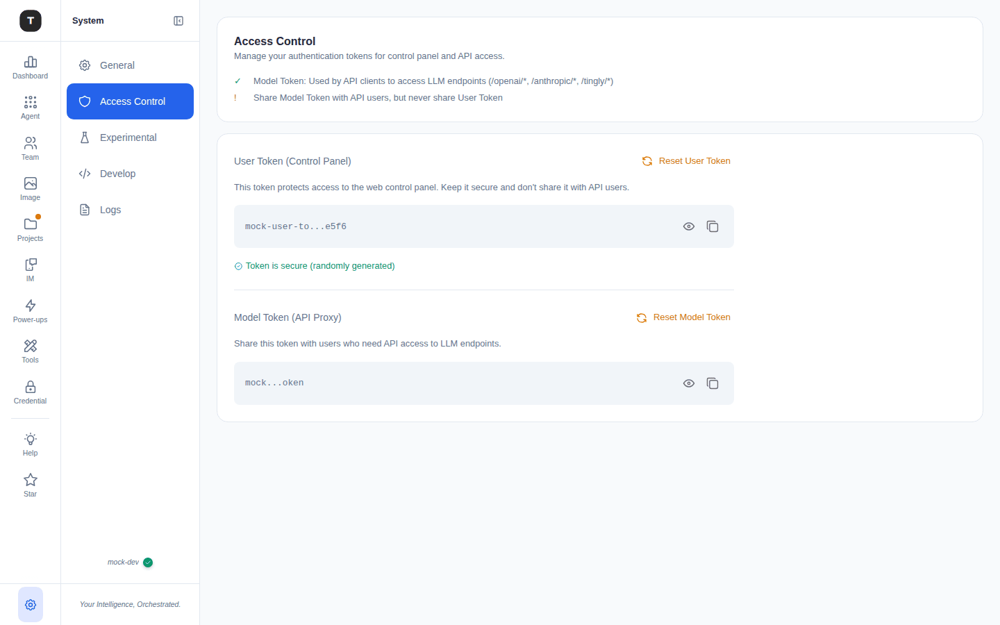

# Access Control

Path: `/access-control`

The Access Control page (**System → Access Control**) manages Tingly-Box's core authentication tokens: the **User Token (Control Panel)** — the Web UI login credential — and the **Model Token (API Proxy)** — the API key for all agent scenarios. The header card summarises the difference (the Model Token is used by API clients on `/openai/*`, `/anthropic/*`, `/tingly/*`; share it with API users, never the User Token).

---

## User Token

Used for Web UI authentication.

### Viewing the Current Token

- Masked by default (`••••••••`)
- Click the eye icon to toggle plaintext display
- Click the copy icon to copy the token to the clipboard

### Security Notes

The **Token Security** summary at the top of the page explains the difference between the two tokens and warns never to share the User Token with API users.

Under the token, `Token is secure (randomly generated)` confirms it was randomly generated. If the **default token** is still in use (set at initial installation), the page instead shows a security warning with a **Reset Now** button.

### Resetting the Token

Click **Reset User Token** — a confirmation dialog explains the consequences:
- A new random token will be generated
- Your current session is updated automatically
- Any other browsers/devices will need to log in again
- The old token immediately stops working

After confirming with **Reset**, a success dialog shows the new token (with a copy button); click **I've Saved My Token** once it is stored. If the token was changed elsewhere, **Pull latest token from server** refreshes what this page shows.

---

## Model Token

The Model Token is the universal API Key for all agent scenario proxy interfaces.

### Characteristics

- All scenarios (Claude Code, OpenAI proxy, etc.) share the same Model Token
- Can be shared with other developers or environments for proxy interface access
- **Not** the same as the User Token; cannot be used to log into the Web UI

### View and Copy

Same operation as User Token: eye icon to toggle display, copy icon to write to clipboard.

### Resetting the Model Token

Click **Reset Model Token** to open a confirmation dialog (*the old token immediately stops working — all API clients will need to update*). After confirmation a new token is generated; click **I've Updated My Clients** when done.

> **Note**: After resetting the Model Token, all tools configured with the old token (Claude Code CLI, OpenAI SDK clients, etc.) must update their token configuration.

---

## Relationship to Team Keys

The standalone "API Tokens" / "Sharing" page under Credential (previously at `/tingly-box-token`) is **retired** — that URL now redirects straight to [Team Keys](./07-team.md#team-keys-overview) (`/agent/team/keys`). Named, multi-token external-client access is now a Team concept: each Team's **Team Keys** are the equivalent of what used to be a global list of API Tokens, scoped to that Team's routing rules instead of reaching every scenario.

| | User Token | Model Token | Team Key |
|-|-----------|-------------|-----------|
| Location | `/access-control` | `/access-control` | `/agent/team/keys`, or a Team's own workspace page |
| Quantity | 1 | 1 | Multiple, per Team |
| Purpose | Web UI login | Agent scenario API Key (instance-wide, unscoped) | External client access, scoped to one Team's `/tingly/team[/v1]` endpoint |
| Named | No | No | Yes |

---

## Related Pages

- [Team](./07-team.md)
- [System Settings](./17-system-settings.md)
