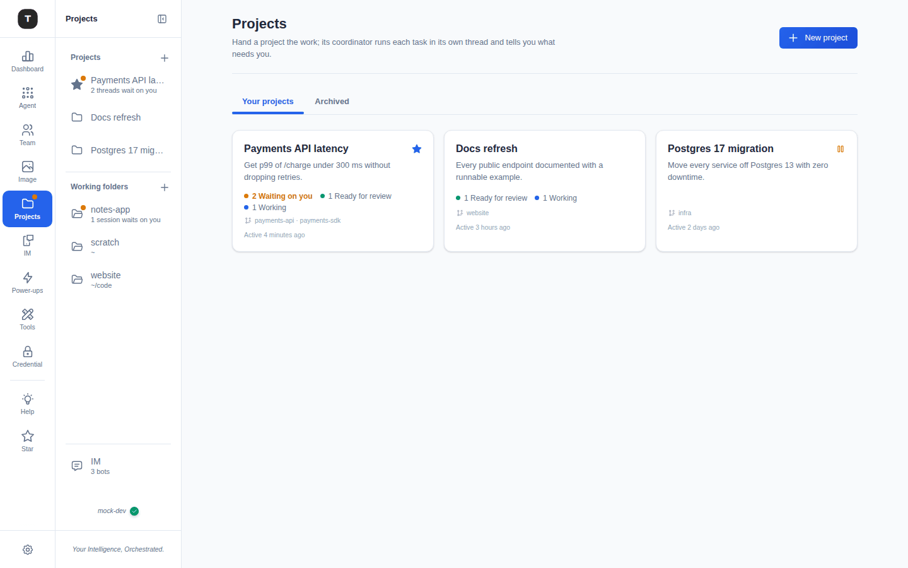
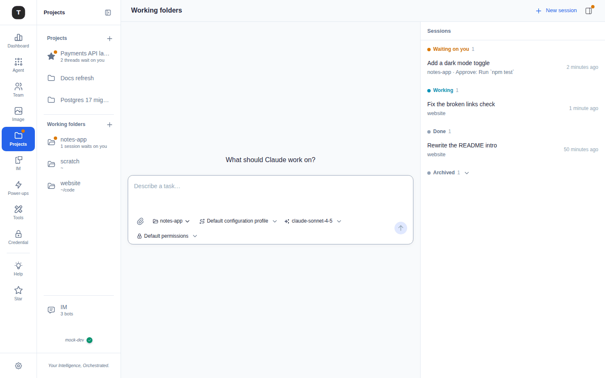
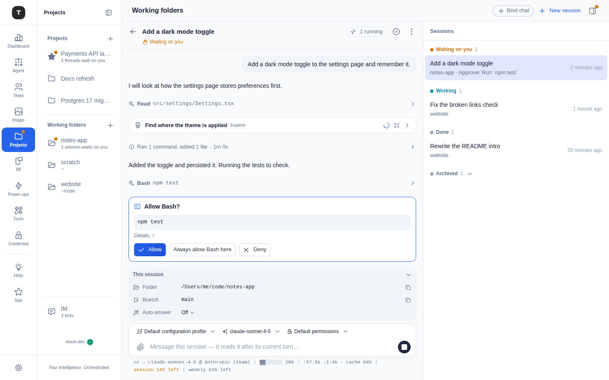
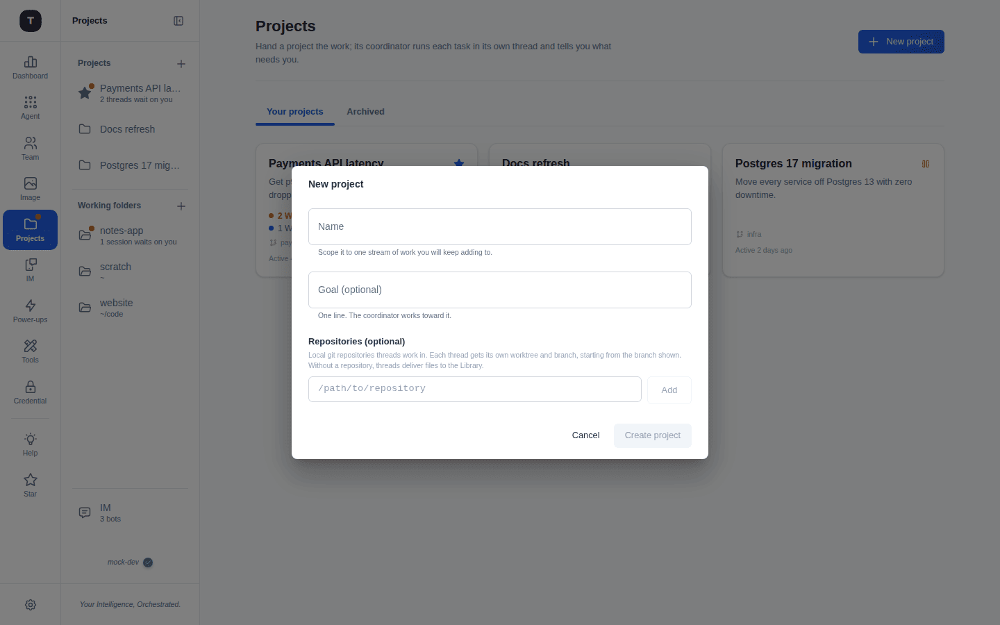
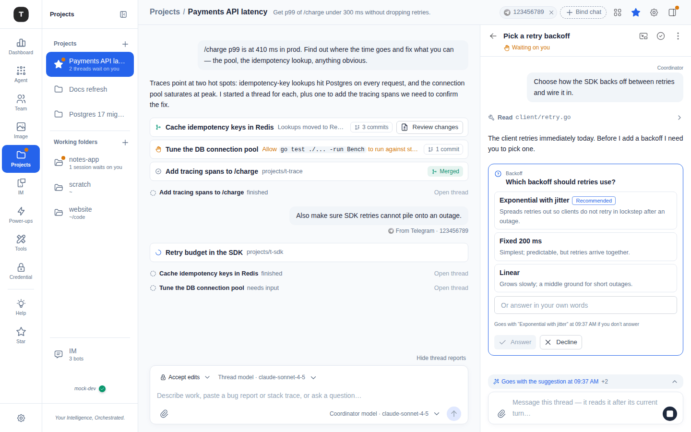
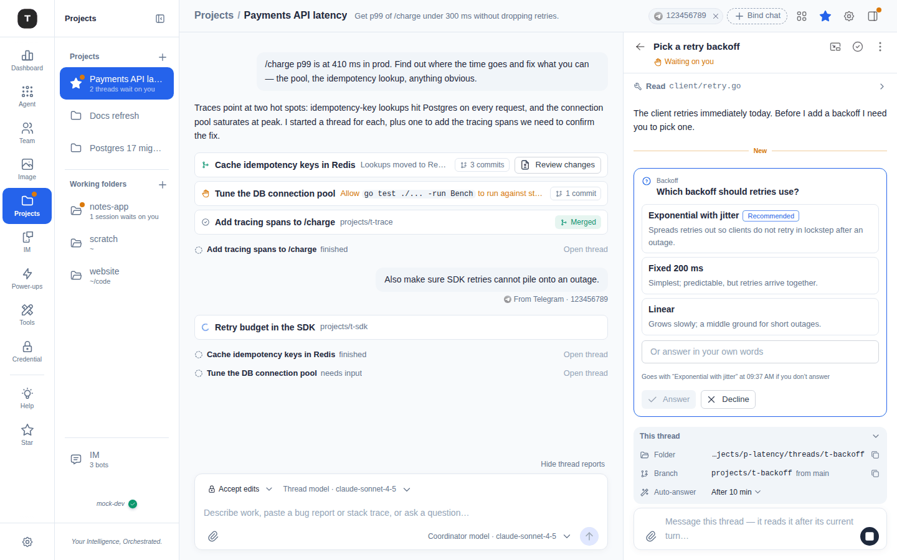
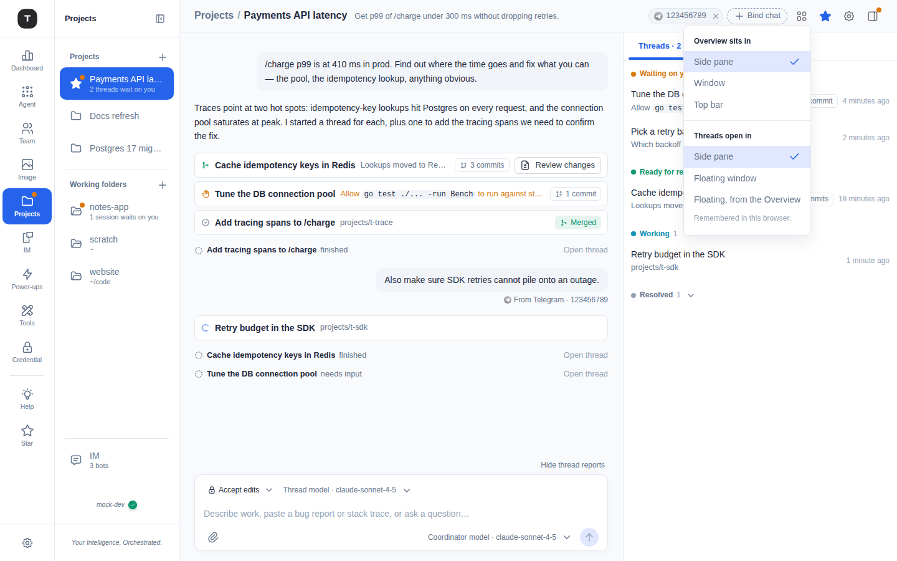
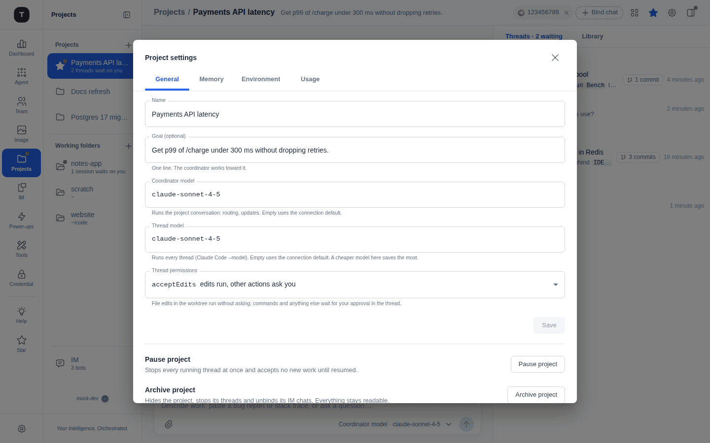
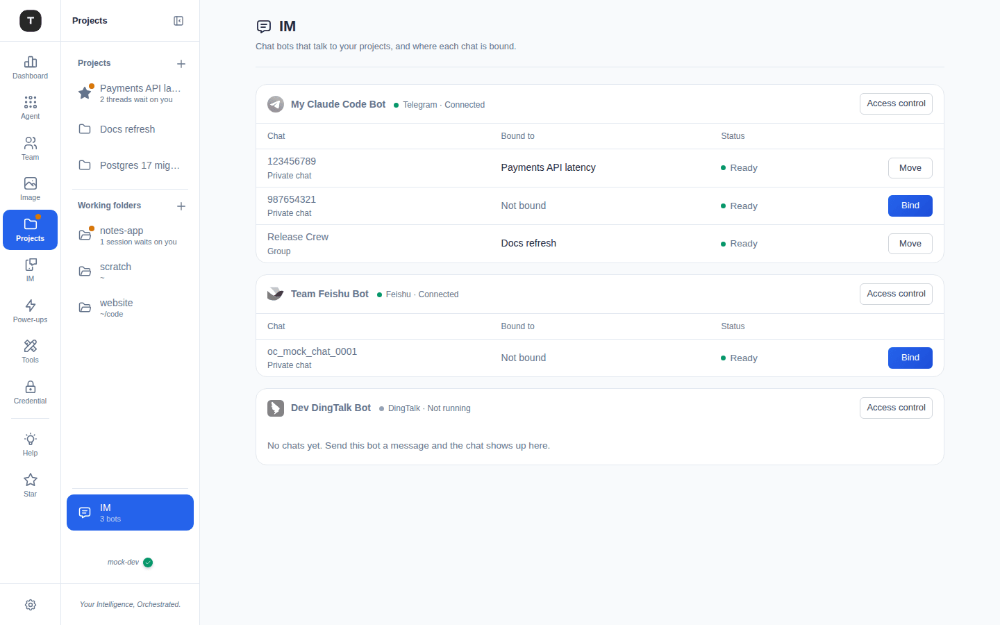

# Projects

Paths: `/projects` (your projects) · `/projects/:id` (one project) · `/projects/folder` (working folders and their sessions) · `/projects/im` (IM chats and where they are bound)

**Projects** runs Claude Code from the web — and from your IM chats — through Tingly-Box. It replaces the former *Desk*: a plain working folder is now a first-class place, and a project is the bigger, long-running shape. Everything goes through the gateway's `claude_code` scenario, so your [routing rules, quota and usage](./03-scenario-claude-code.md) apply to it exactly as to the CLI.

> **Off by default.** Projects runs a local coding agent on the host, so it is a **Beta** [power-up](./19-experimental.md#projects): turn on *Projects* in the Power-ups menu (or **System → Experimental**). The same switch also turns on the **IM** rail item and lets IM chats talk to Claude Code (see [Remote](./12-remote-control.md)). Anyone who can sign in to this Tingly-Box, or who may use Remote Control through one of its bots, can then run Claude Code on this machine, in the folders and repositories they choose, and approve its tool calls. Claude Code itself must be installed on the machine; if it isn't, the project's **Environment** tab says so and shows the install command.

Two shapes live under one rail item (**Projects**, with an orange **dot** when something waits on you):

| | What it is | Who talks to Claude |
|---|---|---|
| **Working folder** | An existing folder on the machine. Sessions run *in the folder itself*, no worktree | you, directly — one session per task |
| **Project** | A goal that outlasts one session: a **coordinator** conversation plus **threads**, each a Claude Code session in its own git worktree and branch | you talk to the coordinator; it starts a thread per task and tells you what needs you |

The sidebar lists both: **Projects** (with **+**) and **Working folders** (with **+**), then an **IM** row (`3 bots`) that opens the IM page. A project row shows how many threads *wait on you* (`2 threads wait on you`); a starred project sits first; a folder row shows its path and sessions waiting.

---

## Working folders

Add one with the **+** next to *Working folders* (*Enter an existing folder on the machine running this app. Sessions you start there work in the folder itself, with no worktree.*). Click a folder in the sidebar to see its sessions; `/projects/folder` shows every folder together. A folder can be taken off the sidebar (**Remove from the sidebar** — running sessions in it stop, past sessions are kept).

**Start a session** — the page opens on *What should Claude work on?* with a message box. Under the box are quiet pickers: the **working folder**, the **Claude Code configuration profile** (*Default configuration profile* = the main `claude_code` scenario, or one of your [profiles](./03-scenario-claude-code.md#profiles)), the **model**, and **permissions**: *Ask for everything · Accept edits · Auto · Plan only · Don't ask · Never ask* (the default follows the project/connection). **Attach** adds files (needs a folder). The **Sessions** panel on the right groups sessions by **Waiting on you**, **Working**, **Done** and **Archived**; **New session** starts another.

### A session

The conversation is the shared transcript: your message, Claude's text, and **one line per tool call** (*Read src/…*, *Ran 1 command, edited 1 file · 1m 0s*) that expands for the detail; subagent runs appear as their own rows and can be opened to read their steps.

- **Approvals** — *Allow Bash? `npm test`* with **Allow**, **Always allow Bash here** and **Deny**; the card says what the approval is for. Waiting sessions show the orange *Waiting on you* state and light the rail dot
- **Questions** — when Claude asks, the options appear on a card (below). Pick one, type your own words, or **Decline**
- **Info panel above the message box** — *This session*: **Folder** (copy the `cd` command), **Branch** (copy the name) and **Auto-answer** (below). Collapsible
- **Message box** — while Claude is busy, what you send is queued: *Message this session — it reads it after its current turn…*, and **stop** ends the turn
- **Header** — a **running** counter for background tasks (open to see commands and subagents Claude runs in the background, and stop them), **Archive session** (the check icon; **Reopen session** brings it back) and ⋮: *Show task*, *Show trajectory* (the step-by-step view for reviewing a session), *Expand all tool calls*, **Continue in terminal** (see below)
- **Route status line** under the message box: which rules route the session (`cc → claude-sonnet-4-5 @ Anthropic (team)`), the context used (`29% · 57.5k in / 1.4k out · cache 84%`) and the quota of the provider behind it (`session 14% left · weekly 81% left`); if the provider is exhausted it says to pick another profile
- **Continue in terminal** — gives you the command to resume the same Claude Code session in a terminal on this machine. Use one place at a time: a message sent here starts the session again; background tasks stop with the session's process (the dialog says so)

**Auto-answer** (info panel) — what to do when a question has a suggested answer: **Off** (every question waits for you), **After 10 min** (if you don't answer in ten minutes the thread goes with the suggestion and keeps working) or **Right away** (it goes with the suggestion at once; you can still correct it with a message). The question card says when: *Goes with "Exponential with jitter" at 08:55 AM if you don't answer*.

---

## Projects

`/projects` lists your projects as cards — name, goal, status counts (*2 Waiting on you · 1 Ready for review · 1 Working*), repositories, and when it was last active; a star for favourites, a pause icon when paused. Tabs: **Your projects** and **Archived**. **New project** opens:

- **Name** — *Scope it to one stream of work you will keep adding to*
- **Goal (optional)** — one line the coordinator works toward
- **Repositories (optional)** — local git repositories threads work in. Each thread gets its own worktree and branch, starting from the branch shown. **Without a repository, threads deliver files to the Library**

A project is worth it when the work has a goal that outlasts one session and keeps producing tasks: one change across several repositories, an area you keep feeding bugs to, or a migration bigger than a session.

### A project

The header reads `Projects / <name>` with the goal, the **bound IM chats** (a chip per chat and **Bind chat**, below), the **Layout** menu, a **star**, **Project settings** (gear) and the **Overview** toggle. Left: the **conversation** with the coordinator; right: the **Overview** with two tabs, **Threads** (`· 2 waiting`) and **Library**.

- **Talk to the coordinator**: *Describe work, paste a bug report or stack trace, or ask a question…* — one task, a list, a bug report. It starts a thread per task and reports back with a row per thread: title, branch (`projects/t-sdk`), `N commits`, and **Review changes** when there is something to merge. Thread reports can be hidden (**Hide thread reports**). On an empty project, three one-click examples are offered
- **Pick models** under the box: **Thread model** and **Coordinator model** (empty = the connection default; a cheaper thread model saves the most), and the **permission mode** threads run with
- **Threads** are grouped **Waiting on you · Ready for review · Working · Idle · Resolved**, each with its latest line and time
- **Library** — files you add (readable by every thread); threads without a repository deliver theirs here
- If the project is **paused** (threads stopped, no new work) or **archived** (readable, unbind its chats), a banner says so with the button to undo it

### A thread

Click a thread to open it beside the conversation (or `Open thread` in a report). It is the same transcript as a session, plus:

- **Question cards** — *Answer Claude's questions with options*: the header names the topic, each option has a title and a description (the recommended one is tagged), and **Or answer in your own words** takes free text; **Answer** or **Decline**
- **Status** under the title (`Waiting on you`), and **New** marking what arrived since you last looked; a **working timer** while it runs
- **Mark resolved** (check) — one click when a thread is done; **Reopen** to send it more work. The ⋮ menu adds *Show task*, *Show trajectory*, *Expand all tool calls* and background tasks / subagents
- **Review changes** (ready-for-review threads) — the diff of the thread's commits against its base branch, **Merge it** (the checkout must be on the base branch with no local changes; uncommitted changes in the worktree are warned about and not part of the merge) and the *Merged into main* mark afterwards
- **Info panel** above the message box: **Folder** (copy `cd` to the worktree), **Branch** (`projects/t-backoff` *from main*), **Auto-answer** (above)
- **Message box** — message this thread directly; it reads it after its current turn

### Layout

The **Layout** menu chooses where things open — remembered in this browser, hidden on narrow screens (which use one drawer):

| | Choices |
|---|---|
| **Overview sits in** | *Side pane* (default) · *Window* (a floating, draggable, resizable window that minimises to a pill with a dot when something waits on you) · *Top bar* (one column per status, what needs you first; collapsed it is one line of counts) |
| **Threads open in** | *Side pane* (default) · *Floating window* · *Floating, from the Overview* (a thread opened from the floating Overview opens in its own window too). With the Overview on top, threads open below it, so the choice is greyed out with the reason |

### Project settings

- **General** — name and goal; **Coordinator model** and **Thread model** (empty = *Connection default*); **Thread permissions**: *edits run, other actions ask you* · *everything asks you* · *Claude Code decides* (needs a model that supports Claude Code's auto mode) · *never ask* (only for disposable environments); **Pause project** (stops every running thread and accepts no new work until resumed) and **Archive project** (hides it, stops its threads and unbinds its IM chats; everything stays readable)
- **Memory** — **Project instructions** (the brief every new thread and the coordinator start from: what it's for, where the work happens, how a thread checks its work, what needs your go-ahead) and **Memory files** (notes Claude keeps — requirements, decisions, pitfalls; ask in the conversation to remember or forget something, or edit them here; `MEMORY.md` is the index every thread reads)
- **Environment** — the project's **Repositories** (new threads use these; existing threads keep their worktree) and the **Thread runtime**: where the Claude Code CLI was found, and where threads send their model calls (the gateway, when its connection is Anthropic-style; otherwise threads use Claude Code's own login)
- **Usage** — token use reported by the threads, per model and per thread (each thread is a full Claude Code session; parallel threads burn tokens faster)

---

## IM

`/projects/im` (the **IM** row at the bottom of the Projects sidebar) lists each connected bot — platform, `Connected` / `Not running`, **Access control** — with its chats: **Chat** (Private chat / Group), **Bound to**, **Status** (*Ready · Disabled · Waiting to pair*) and an action: **Bind** or **Move**. A chat is bound to **one place at a time** — a project or a working folder; moving it keeps the old threads and deletes nothing. A chat that has never talked has only a folder and isn't listed here.

On a project or folder page, the header chips show the bound chats (click the **×** to unbind) and **Bind chat** opens the picker: chats that would move are marked *Will move*, chats disabled in access control are greyed. *Send the bot a message from the chat you want, and it shows up here.* Messages from IM carry a platform mark (*From Telegram · 123456789*) in the transcript.

How a chat behaves — commands, approvals in chat, profiles — is in [Remote](./12-remote-control.md#talking-to-claude-code-in-a-chat).

---

## Related Pages

- [Remote](./12-remote-control.md)
- [Claude Code](./03-scenario-claude-code.md)
- [Experimental Features § Projects](./19-experimental.md#projects)
- [Scenario Overview § Power-ups](./02-scenario-overview.md#power-ups-the-menu-behind-the-gear)
