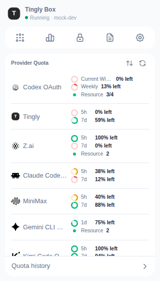

# Desktop App & Tray Hub

The desktop app (Tingly Box for macOS, Windows and Linux) is the **same full product** as the browser UI: the same gateway, the same pages, in a native window with a system-tray icon. There is no separate *lite* edition any more — every page in this guide, including Projects, IM, Prompt Management and the Apply buttons, is there, each still behind its own switch in [Power-ups](./02-scenario-overview.md#power-ups-the-menu-behind-the-gear). The desktop window only adds a few native touches:

- **Files save through the native Save dialog** (exports, downloaded images), and **external links open in your OS browser**, not inside the window
- The [Tips & Help](./13-help.md) page hides its *Desktop Shortcut* card — the app itself is the shortcut

---

## The tray icon and the hub panel

Tingly Box sits in the system tray (the macOS menu bar). **Left-click** the icon to toggle the **hub panel** — a small, frameless panel under the icon that closes when you click elsewhere or press Esc (it floats over full-screen apps too). **Right-click** for a menu: **Show Hub**, **Open Tingly Box**, **Dashboard**, **Credentials**, **Logs**, **Quit Tingly Box**.

The hub (`/hub`) answers the questions you don't need the whole app for: *is it running, and am I about to run out of quota?* Top to bottom:

- **Header** — the app mark, `Tingly Box`, and a status dot with **Running** / **Disconnected** and the version. An **Update available** chip appears when a newer version exists (click it to open System in the main window; a dev build never claims an update)
- **Jump row** — five icons that open the **main window** at the same place the matching rail item would: **Agent**, **Dashboard**, **Credential**, **Logs** and **System** (the panel itself never navigates)
- **Provider Quota** — every provider with a quota reading, in the same cells as the [Credentials](./08-credentials.md#quota-column) table (rings, `% left`, balances, resource groups), with the provider's logo. The list is ordered by **Closest to limit** by default; the sort button offers **Name** and **Type**, and your choice is remembered. Click a provider's name to open Credentials; click a quota cell to refresh it, or use the refresh button in the header for all of them
- **Quota history** — the row at the foot opens [Dashboard → Quota history](./11-dashboard.md#quota-history-dashboardquota-history)

---

## macOS menu bar

On macOS the window also gets a real menu bar:

| Menu | Items |
|------|-------|
| **Tingly Box** | About · **Settings…** (⌘,) — opens System · Hide / Hide Others / Show All · Quit |
| **Edit** | the standard Edit menu (so ⌘C / ⌘V work in the window) |
| **Go** | **Agent** (⌘1) · **Dashboard** (⌘2) · **Credentials** (⌘3) · **Logs** (⌘4) · **Show Hub** (⇧⌘H) — these mirror the rail |
| **View** | Reload (⌘R) · Toggle Full Screen (and Developer Tools in debug builds) |
| **Window** | the standard Window menu |
| **Help** | **GitHub** · **Report an Issue** |

Windows and Linux have no global menu bar, so they keep the tray menu and the hub panel only.

---

## Related Pages

- [Scenario Overview](./02-scenario-overview.md)
- [System Settings](./17-system-settings.md)
- [Credentials](./08-credentials.md)
