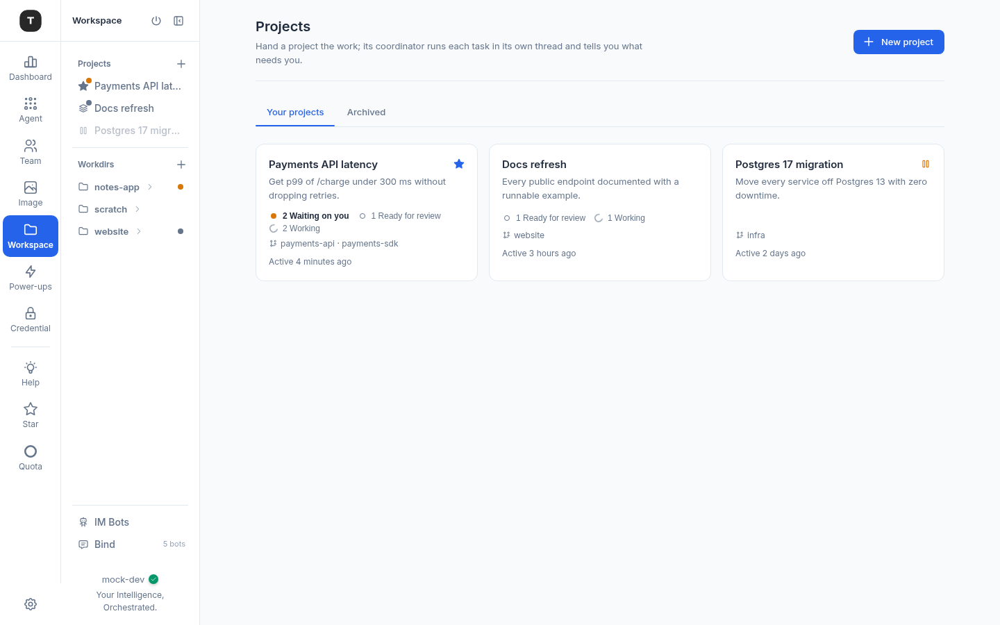

# tingly-projects

[Main guide](../../en/README.md) · [简体中文](../zh/README.md)

Paths: `/workspace` (Workspace) · `/projects` (your projects) · `/projects/:id` (one project) · `/projects/folder` (working folders and their sessions) · `/projects/im` (IM chats and where they are bound)

**Projects** runs Claude Code from the web — and from your IM chats — through Tingly-Box. It replaces the former *Desk*: a plain working folder is now a first-class place, and a project is the bigger, long-running shape. Everything goes through the gateway's `claude_code` scenario, so your [routing rules, quota and usage](../../en/03-scenario-claude-code.md) apply to it exactly as to the CLI.

> **Off by default.** Projects runs a local coding agent on the host, so it is a **Beta** [power-up](../../en/19-experimental.md#projects): turn on *Workspace* in the Power-ups menu (or **System → Experimental**). The same switch enables **IM → Bind** in Workspace and lets IM chats talk to Claude Code (see [Remote](../../en/12-remote-control.md)). Anyone who can sign in to this Tingly-Box, or who may use Remote Control through one of its bots, can then run Claude Code on this machine, in the folders and repositories they choose, and approve its tool calls. Claude Code itself must be installed on the machine; if it isn't, the project's **Environment** tab says so and shows the install command.

## Quick Start

Let Claude Code work on a folder from your browser. **Before you start:** Claude Code is installed and works through Tingly-Box ([Claude Code Quick Start](../../en/03-scenario-claude-code.md#quick-start)).

1. Switch Projects on: **gear** → **Power-ups** → **Workspace** (*Beta*). Note the warning: anyone who can sign in can then run Claude Code on this machine.
2. Click **Workspace** in the rail. Next to **Workdirs** click **+** and enter the path of an existing folder, e.g. `/home/me/my-app`.
3. In the box titled *What should Claude work on?* type a task (*Describe a task…*) and send it.
4. When Claude asks to run something (*Allow Bash? …*), click **Allow** — or **Always allow Bash here**.

**Verify:** the transcript shows one line per tool call and Claude's answer; the **Sessions** panel moves the session from **Working** to **Done**, and an orange dot on **Workspace** in the rail tells you whenever something waits on you. For a goal bigger than one session, create a project instead with **New project** ([Projects](projects-and-threads.md) below); to reach the same sessions from chat apps, see the [Remote Quick Start](../../en/12-remote-control.md#quick-start).

Two shapes live under one rail item (**Projects**, with an orange **dot** when something waits on you):

| | What it is | Who talks to Claude |
|---|---|---|
| **Working folder** | An existing folder on the machine. Sessions run *in the folder itself*, no worktree | you, directly — one session per task |
| **Project** | A goal that outlasts one session: a **coordinator** conversation plus **threads**, each a Claude Code session, with its own git worktree and branch by default for Git repositories | you talk to the coordinator; it starts a thread per task and tells you what needs you |

The sidebar lists both: **Projects** (with **+**) and **Workdirs** (with **+**), then an **IM** group with **IM Bots** for bot settings and **Bind** for chat bindings. A project row shows how many threads *wait on you* (`2 threads wait on you`); a starred project sits first; a folder row shows its path and sessions waiting.

## Read by task

[Working folders](working-folders.md) · [Projects and threads](projects-and-threads.md) · [Chat bindings](im.md)

[Run tingly-project standalone](../../../../projects/README.md)
