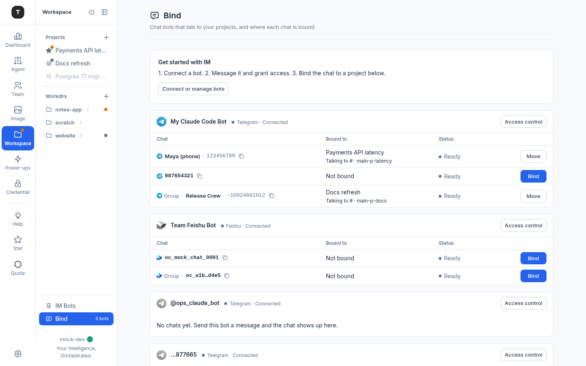

# IM

[Back to the tingly-projects guide](README.md)

`/projects/im` (**Bind** in the Workspace sidebar) lists each connected bot — platform, `Connected` / `Not running`, **Access control** — with its chats: **Chat** (Private chat / Group), **Bound to**, **Status** (*Ready · Disabled · Waiting to pair*) and an action: **Bind** or **Move**. A chat is bound to **one place at a time** — a project or a working folder; moving it keeps the old threads and deletes nothing. Send a message to the bot to make the chat appear. The **Bound to** column also shows the active conversation when available.

In a project or an open folder session, the header chips show the bound chats (click the **×** to unbind) and **Bind chat** opens the picker: chats that would move are marked *Will move*, chats disabled in access control are greyed. *Send the bot a message from the chat you want, and it shows up here.* Messages from IM carry a platform mark (*From Telegram · 123456789*) in the transcript.

How a chat behaves — commands, approvals in chat, profiles — is in [IM Bots and Remote Control](../../en/12-remote-control.md#talking-to-claude-code-in-a-chat).
