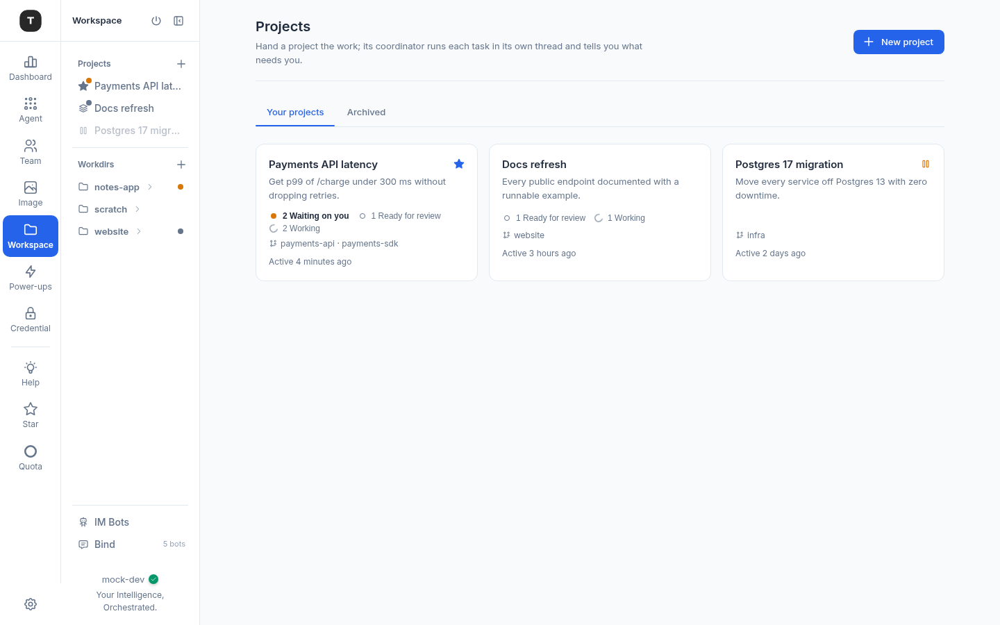
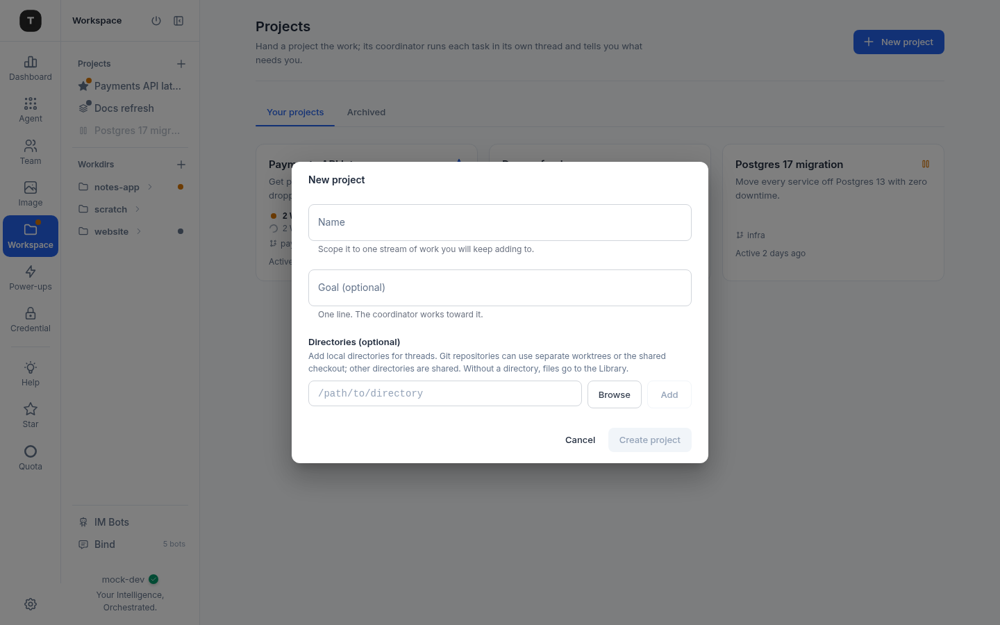
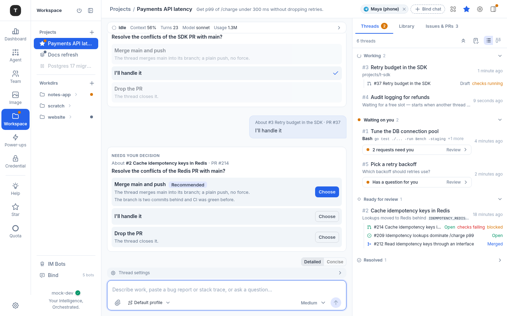
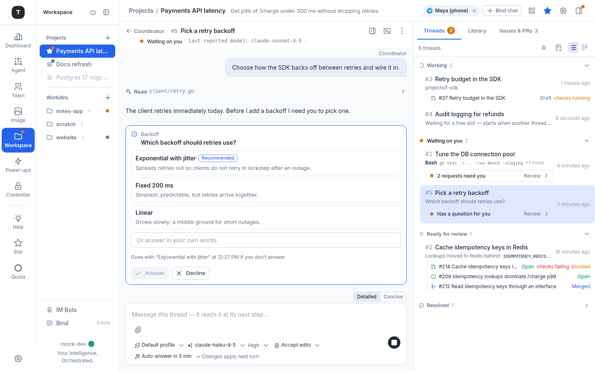
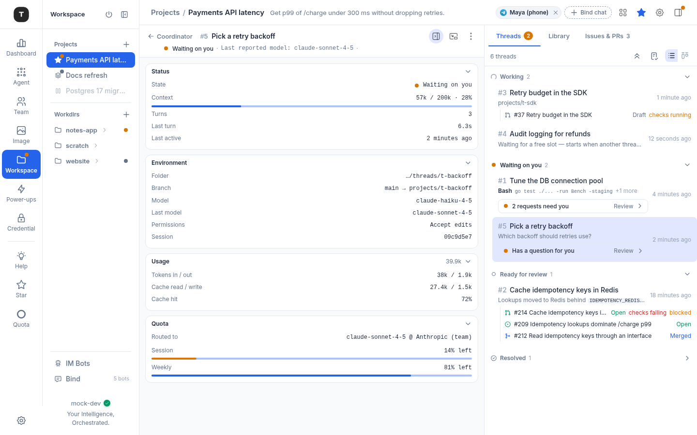
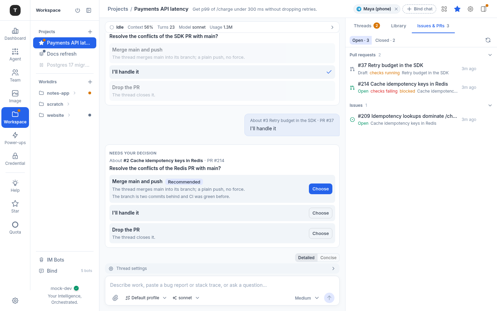
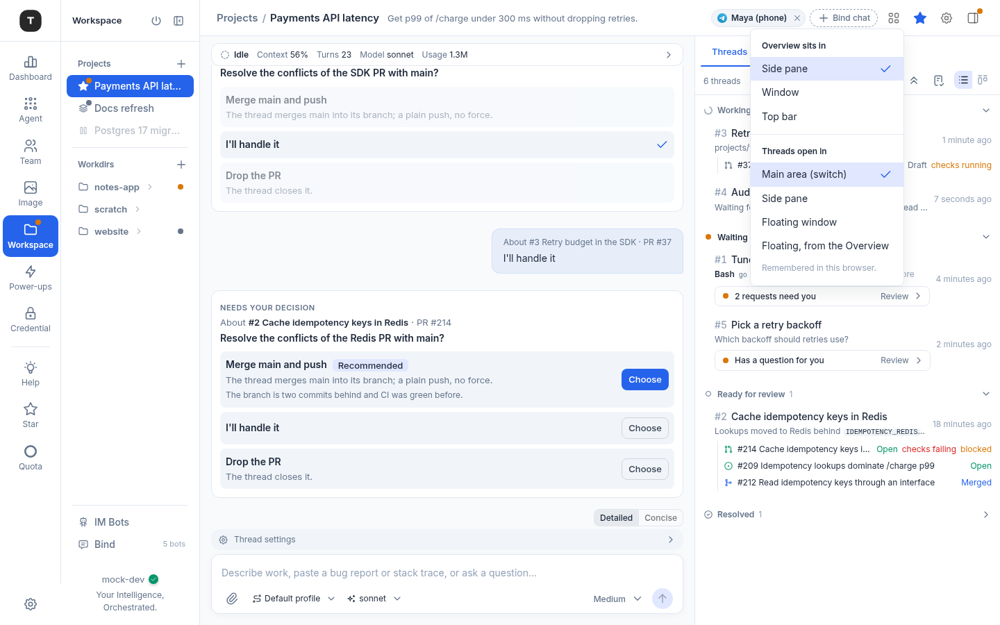
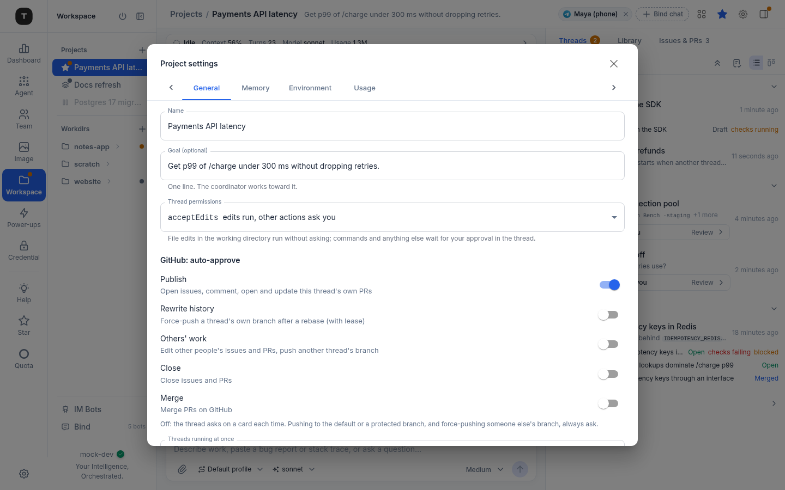

# Projects and threads

[Back to the tingly-projects guide](README.md)

`/projects` lists your projects as cards — name, goal, status counts (*2 Waiting on you · 1 Ready for review · 1 Working*), repositories, and when it was last active; a star for favourites, a pause icon when paused. Tabs: **Your projects** and **Archived**. **New project** opens:

- **Name** — *Scope it to one stream of work you will keep adding to*
- **Goal (optional)** — one line the coordinator works toward
- **Directories (optional)** accepts Git repositories and regular directories. Git threads get their own worktree and branch by default. Regular directories use shared mode. Without a repository or directory, threads deliver files to **Library**.

A project is worth it when the work has a goal that outlasts one session and keeps producing tasks: one change across several repositories, an area you keep feeding bugs to, or a migration bigger than a session.

## A project

The header reads `Projects / <name>` with the goal, the **bound IM chats** (a chip per chat and **Bind chat**, see [chat bindings](im.md)), the **Layout** menu, a **star**, **Project settings** (gear) and the **Overview** toggle. Left: the **conversation** with the coordinator; right: the **Overview** with three tabs, **Threads** (`· 2 waiting`), **Issues & PRs**, and **Library**.

- **Talk to the coordinator**: *Describe work, paste a bug report or stack trace, or ask a question…* — one task, a list, a bug report. It starts a thread per task and reports back with a row per thread: title, branch (`projects/t-sdk`), and **Review changes** when there is something to merge. Thread reports can be hidden (**Hide thread reports**). On an empty project, three one-click examples are offered
- **Pick models** under the box: **Thread model** and **Coordinator model** (empty = the connection default; a cheaper thread model saves the most), and the **permission mode** threads run with
- **Threads** are grouped by Waiting on you, Failed, Ready for review, Working, Idle, Resolved, and Archived. Every group can fold. Resolved and Archived start folded.
- **Library** — files you add (readable by every thread); threads without a repository deliver theirs here
- If the project is **paused** (threads stopped, no new work) or **archived** (readable, unbind its chats), a banner says so with the button to undo it

## A thread

Click a thread to open it in the main area by default (or `Open thread` in a report). It is the same transcript as a session, plus:

- **Question cards** — *Answer Claude's questions with options*: the header names the topic, each option has a title and a description (the recommended one is tagged), and **Or answer in your own words** takes free text; **Answer** or **Decline**
- **Status** under the title (`Waiting on you`), and **New** marking what arrived since you last looked; a **working timer** while it runs
- **Mark resolved** (check) — one click when a thread is done; **Reopen** to send it more work. The ⋮ menu adds *Show task*, *Show trajectory*, *Expand all tool calls* and background tasks / subagents
- **Review changes** (ready-for-review threads) — the diff of the thread's commits against its base branch, **Merge it** (the checkout must be on the base branch with no local changes; uncommitted changes in the worktree are warned about and not part of the merge) and the *Merged into main* mark afterwards
- **Details** shows the thread’s working folder, branch, state, and usage. Beside the composer, **Auto-answer** can be turned off, set to five minutes or a custom delay, or set to accept the suggestion immediately.
- **Message box** sends a message directly to the thread. During a running turn, choose **Insert into this turn** or **Send after this turn**. New launch settings take effect on the next turn.

## GitHub issues and PRs

Open **Issues & PRs** in the project **Overview** to see linked issues and PRs, checks, and merge status. Expand a thread row to see its links or use the strip above its message box. Open a PR’s changes to review that PR on its own. If GitHub reports a merge conflict, the thread asks how to proceed.

Under **Project settings → General → GitHub: auto-approve**, choose which categories of actions can run automatically. Actions in disabled categories ask for approval on a card. Pushes to the default or a protected branch and force-pushes to someone else’s branch always ask.

## Layout

The **Layout** menu chooses where things open — remembered in this browser, hidden on narrow screens (which use one drawer):

| | Choices |
|---|---|
| **Overview sits in** | *Side pane* (default) · *Window* (a floating, draggable, resizable window that minimises to a pill with a dot when something waits on you) · *Top bar* (one column per status, what needs you first; collapsed it is one line of counts) |
| **Threads open in** | *Main area (switch)* (default) · *Side pane* · *Floating window* · *Floating, from the Overview* (a thread opened from the floating Overview opens in its own window too). With the Overview on top, threads open below it, so the choice is greyed out with the reason |

## Project settings

- **General** — name and goal; **Coordinator model** and **Thread model** (empty = *Connection default*); **Thread permissions**: *edits run, other actions ask you* · *everything asks you* · *Claude Code decides* (needs a model that supports Claude Code's auto mode) · *never ask* (only for disposable environments); **Pause project** (stops every running thread and accepts no new work until resumed) and **Archive project** (hides it, stops its threads and unbinds its IM chats; everything stays readable)
- **Memory** — **Project instructions** (the brief every new thread and the coordinator start from: what it's for, where the work happens, how a thread checks its work, what needs your go-ahead) and **Memory files** (notes Claude keeps — requirements, decisions, pitfalls; ask in the conversation to remember or forget something, or edit them here; `MEMORY.md` is the index every thread reads)
- **Environment** — the project's **Repositories** (new threads use these; existing threads keep their worktree) and the **Thread runtime**: where the Claude Code CLI was found, and where threads send their model calls (the gateway, when its connection is Anthropic-style; otherwise threads use Claude Code's own login)
- **Usage** — token use reported by the threads, per model and per thread (each thread is a full Claude Code session; parallel threads burn tokens faster)

- **Thread defaults** include the concurrency limit and whether each thread uses a worktree. Turn off worktrees to have new threads share the repository directory and current branch. Existing threads keep their working directories and their own launch settings.
