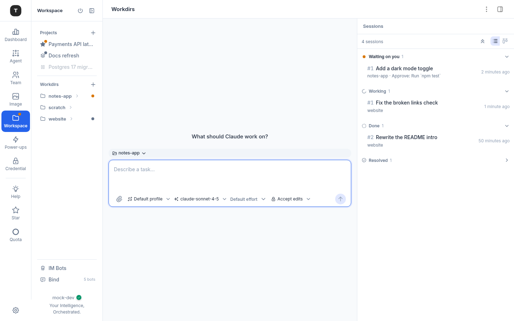
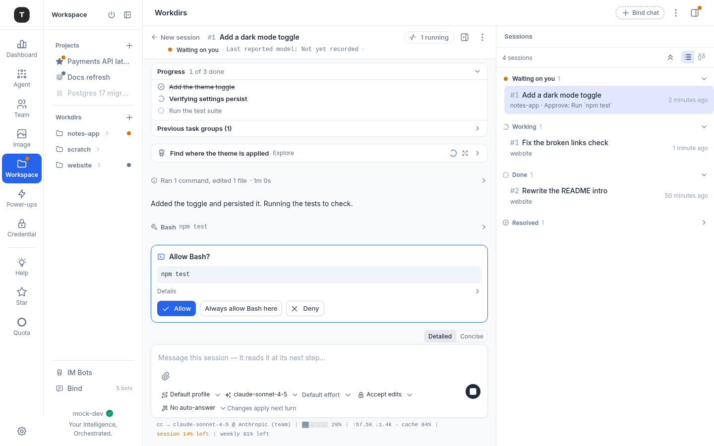

# Working folders

[Back to the tingly-projects guide](README.md)

Add one with the **+** next to *Working folders* (*Enter an existing folder on the machine running this app. Sessions you start there work in the folder itself, with no worktree.*). Click a folder in the sidebar to see its sessions; `/projects/folder` shows every folder together. A folder can be taken off the sidebar (**Remove from the sidebar** — running sessions in it stop, past sessions are kept).

**Start a session** — the page opens on *What should Claude work on?* with a message box. Under the box are quiet pickers: the **working folder**, the **Claude Code configuration profile** (*Default configuration profile* = the main `claude_code` scenario, or one of your [profiles](../../en/03-scenario-claude-code.md#profiles)), the **model**, and **permissions**: *Ask for everything · Accept edits · Auto · Plan only · Don't ask · Never ask* (the default follows the project/connection). **Attach** adds files (needs a folder). The **Sessions** panel on the right groups sessions by **Waiting on you**, **Working**, **Done** and **Archived**; **New session** starts another.

## A session

The conversation is the shared transcript: your message, Claude's text, and **one line per tool call** (*Read src/…*, *Ran 1 command, edited 1 file · 1m 0s*) that expands for the detail; subagent runs appear as their own rows and can be opened to read their steps.

- **Approvals** — *Allow Bash? `npm test`* with **Allow**, **Always allow Bash here** and **Deny**; the card says what the approval is for. Waiting sessions show the orange *Waiting on you* state and light the rail dot
- **Questions** — when Claude asks, the options appear on a card (below). Pick one, type your own words, or **Decline**
- **Info panel above the message box** — *This session*: **Folder** (copy the `cd` command), **Branch** (copy the name) and **Auto-answer** (below). Collapsible
- **Message box** — while Claude is busy, what you send is queued: *Message this session — it reads it after its current turn…*, and **stop** ends the turn
- **Header** — a **running** counter for background tasks (open to see commands and subagents Claude runs in the background, and stop them), **Archive session** (the check icon; **Reopen session** brings it back) and ⋮: *Show task*, *Show trajectory* (the step-by-step view for reviewing a session), *Expand all tool calls*, **Continue in terminal** (see below)
- **Route status line** under the message box: which rules route the session (`cc → claude-sonnet-4-5 @ Anthropic (team)`), the context used (`29% · 57.5k in / 1.4k out · cache 84%`) and the quota of the provider behind it (`session 14% left · weekly 81% left`); if the provider is exhausted it says to pick another profile
- **Continue in terminal** — gives you the command to resume the same Claude Code session in a terminal on this machine. Use one place at a time: a message sent here starts the session again; background tasks stop with the session's process (the dialog says so)

**Auto-answer** (info panel) — what to do when a question has a suggested answer: **Off** (every question waits for you), **After 5 min** (if you don't answer in five minutes the thread goes with the suggestion and keeps working) or **Right away** (it goes with the suggestion at once; you can still correct it with a message). The question card says when: *Goes with "Exponential with jitter" at 08:55 AM if you don't answer*.
