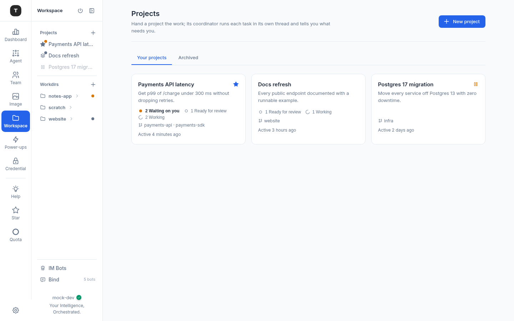

# tingly-projects

[主指南](../../zh/README.md) · [English](../en/README.md)

路径：`/workspace`（工作区）· `/projects`（你的项目）· `/projects/:id`（某个项目）· `/projects/folder`（工作文件夹及其会话）· `/projects/im`（IM 聊天及其绑定位置）

**Projects** 通过 Tingly-Box 在网页——以及你的 IM 聊天——里运行 Claude Code。它取代了原来的 *Desk*：普通的工作文件夹现在是一等公民，项目则是更大、更长期的形态。一切都经由网关的 `claude_code` 场景，所以你的[路由规则、配额和用量](../../zh/03-scenario-claude-code.md)对它的作用与对 CLI 完全一样。

> **默认关闭。** Projects 会在主机上运行本地编码 Agent，所以它是一个 **Beta** 的 [Power-up](../../zh/19-experimental.md#projects)：在 Power-ups 菜单（或 **System → Experimental**）里打开工作区功能。同一个开关还会启用工作区的 **IM → Bind**，并让 IM 聊天可以与 Claude Code 对话（见 [Remote](../../zh/12-remote-control.md)）。能登录这个 Tingly-Box 的人，或者可以通过它的机器人使用 Remote Control 的人，随后就可以在这台机器上、在他们选择的文件夹和仓库里运行 Claude Code，并批准它的工具调用。机器上必须装有 Claude Code；没有的话，项目的 **Environment** 标签页会提示并给出安装命令。

## 快速开始

让 Claude Code 在浏览器里处理一个文件夹。**开始之前**：Claude Code 已安装，并能通过 Tingly-Box 正常工作（[Claude Code 快速开始](../../zh/03-scenario-claude-code.md#快速开始)）。

1. 打开 Projects：**齿轮** → **扩展**（Power-ups）→ **工作区**（Workspace，*Beta*）。请留意警告：之后任何能登录的人都可以在这台机器上运行 Claude Code。
2. 点导航栏的 **工作区**（Workspace）。在 **工作目录**（Workdirs）旁点 **+**，输入一个已有文件夹的路径，例如 `/home/me/my-app`。
3. 在标题为「需要 Claude 处理什么任务？」（*What should Claude work on?*）的输入框里写一个任务（「描述一个任务…」）并发送。
4. Claude 请求运行某个操作时（「允许 Bash？」），点 **允许**（Allow），或 **本线程都允许 Bash**（Always allow Bash here）。

**验证**：对话记录里每个工具调用占一行，并有 Claude 的回答；**会话**（Sessions）面板里这次会话从 **进行中**（Working）变为 **已完成**（Done）；有事等你处理时，**工作区**导航项上会出现橙色圆点。目标比一次会话更大？改用 **New project** 新建项目（见下文 [Projects](projects-and-threads.md)）；想在聊天软件里使用同样的会话，见 [Remote 快速开始](../../zh/12-remote-control.md#快速开始)。

两种形态放在同一个导航项（**工作区**，有东西在等你时带橙色**圆点**）之下：

| | 是什么 | 谁和 Claude 对话 |
|---|---|---|
| **Working folder（工作文件夹）** | 机器上一个已有的文件夹。会话*直接在这个文件夹里*运行，不用 worktree | 你本人——一个任务一个会话 |
| **Project（项目）** | 超出单次会话的目标：一个**协调者（coordinator）**对话，加上若干**线程（thread）**，每个线程是一次 Claude Code 会话；使用 Git 仓库时默认拥有自己的 worktree 和分支 | 你和协调者对话；它为每个任务开一个线程，并告诉你哪里需要你 |

侧边栏同时列出两者：**Projects**（带 **+**）和 **Working folders**（带 **+**），然后是 **IM** 分组，提供 **IM Bots** 与 **Bind**。项目行显示有多少线程*在等你*（`2 threads wait on you`）；加星标的项目排在最前；文件夹行显示它的路径和等待中的会话。

## 按任务阅读

[工作文件夹](working-folders.md) · [项目与线程](projects-and-threads.md) · [聊天绑定](im.md)

[独立运行 tingly-project](../../../../projects/README.zh-CN.md)
