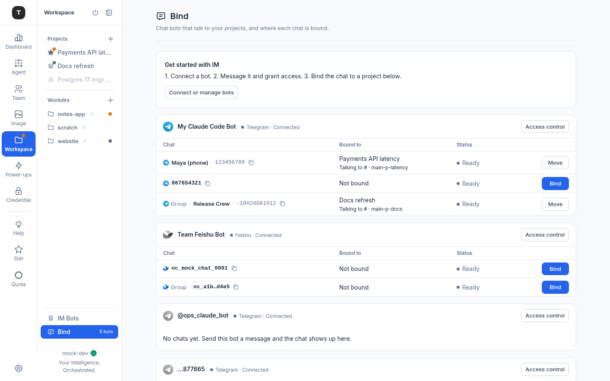

# IM

[返回 tingly-projects 指南](README.md)

`/projects/im`（工作区侧边栏的 **Bind**）列出每个已连接的机器人——平台、`Connected` / `Not running`、**Access control**——以及它的聊天：**Chat**（Private chat / Group）、**Bound to**、**Status**（*Ready · Disabled · Waiting to pair*）和一个操作：**Bind** 或 **Move**。一个聊天**同一时间只绑定一个位置**——项目或工作文件夹；移动它会保留旧线程，不会删除任何东西。先给机器人发消息，聊天才会出现在列表中。**Bound to** 也会显示当前的对话位置。

在项目或已打开的目录会话中，页头的标签显示已绑定的聊天（点 **×** 解绑），**Bind chat** 打开选择器：会被移动的聊天标有 *Will move*，在访问控制中被禁用的聊天置灰。*Send the bot a message from the chat you want, and it shows up here.* 来自 IM 的消息在转录里带有平台标记（*From Telegram · 123456789*）。

聊天的行为——命令、聊天里的审批、Profile——见 [IM 机器人与远程控制](../../zh/12-remote-control.md#在聊天里与-claude-code-对话)。
