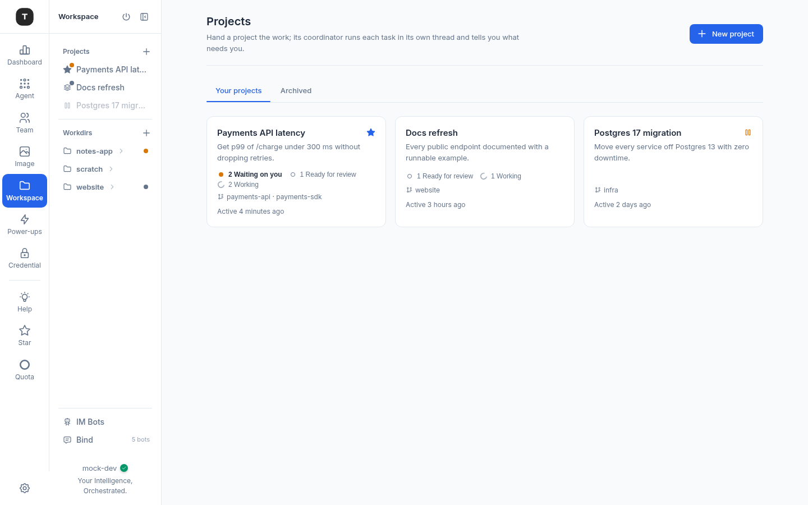
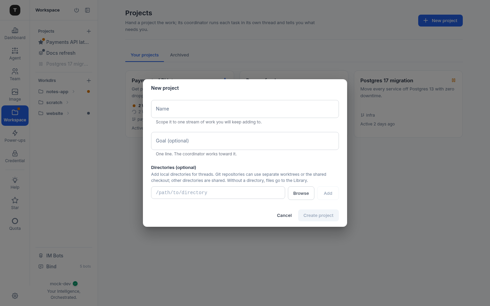
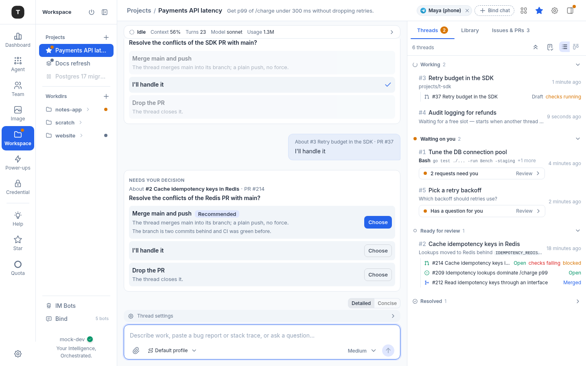
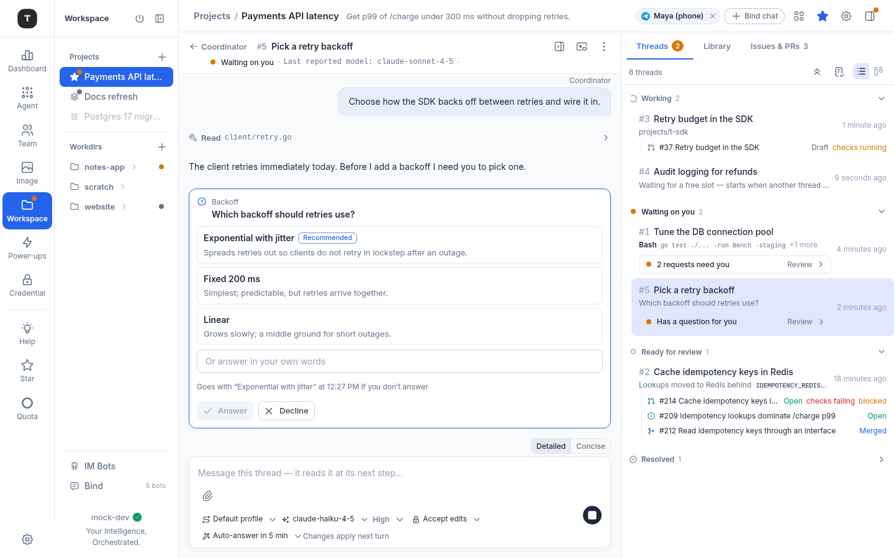
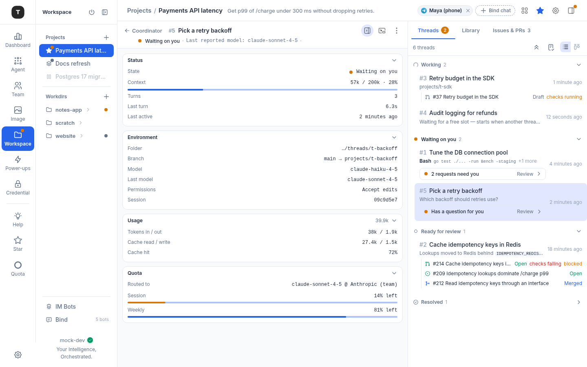
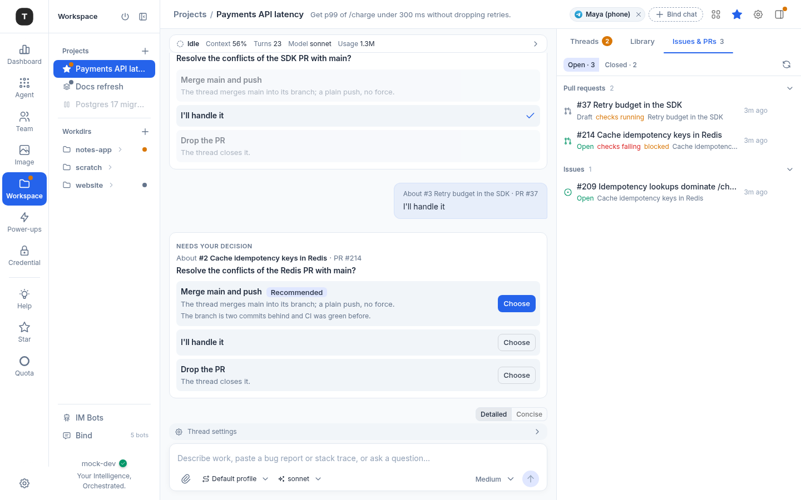
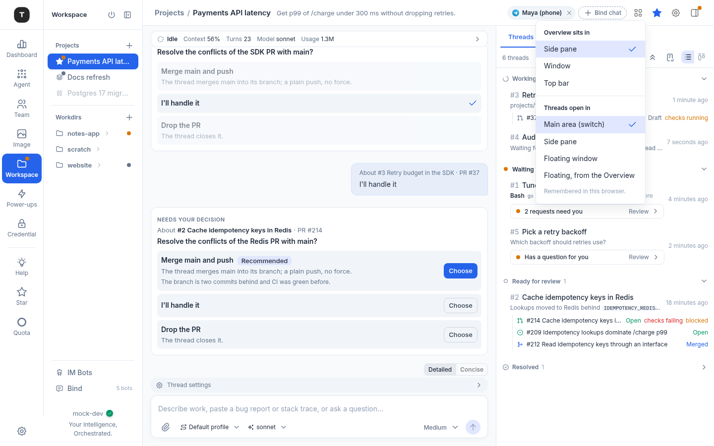
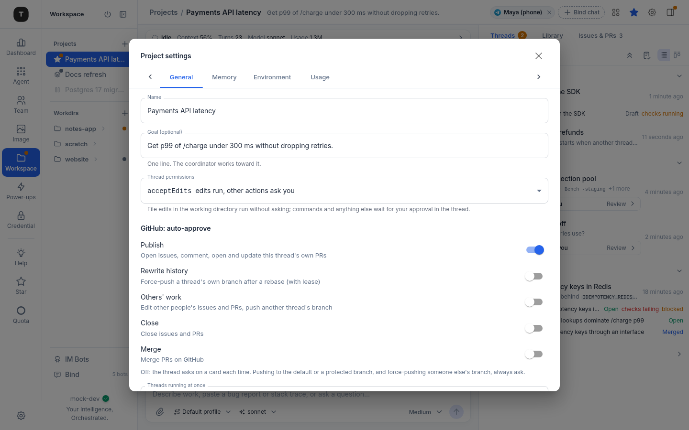

# 项目与线程

[返回 tingly-projects 指南](README.md)

`/projects` 以卡片列出你的项目——名称、目标、状态计数（*2 Waiting on you · 1 Ready for review · 1 Working*）、仓库以及最近活跃时间；收藏的带星标，暂停的带暂停图标。标签页：**Your projects** 和 **Archived**。**New project** 打开：

- **Name**：*Scope it to one stream of work you will keep adding to*（范围限定为你会持续添加的一条工作流）
- **Goal (optional)**：协调者朝着它工作的一行目标
- **Directories（可选）** 可添加 Git 仓库或普通目录。默认给 Git 线程分配独立的 worktree 和分支。普通目录使用共享模式；没有配置仓库或目录时，线程将交付文件放在 **Library**。

当工作有一个超出单次会话、并会不断产生任务的目标时，项目就值得——例如跨多个仓库的一次改动、你会持续丢 bug 进去的一块区域，或比一次会话更大的迁移。

## 一个项目

页头是 `Projects / <名称>`，带目标、**已绑定的 IM 聊天**（每个聊天一个标签，加 **Bind chat**，见 [聊天绑定](im.md)）、**Layout** 菜单、**星标**、**Project settings**（齿轮）和 **Overview** 开关。左侧是与协调者的**对话**；右侧是 **Overview**，有 **Threads**（`· 2 waiting`）、**Issues & PRs** 和 **Library** 三个标签页。

- **与协调者对话**：*Describe work, paste a bug report or stack trace, or ask a question…*——一个任务、一个清单、一份 bug 报告。它为每个任务开一个线程，并以每线程一行的方式汇报：标题、分支（`projects/t-sdk`），以及有东西可合并时的 **Review changes**。线程汇报可以隐藏（**Hide thread reports**）。空项目会给出三个一键示例
- 消息框下方**选模型**：**Thread model** 和 **Coordinator model**（留空 = 连接默认值；线程用更便宜的模型最省钱），以及线程运行时的**权限模式**
- **Threads** 按等你处理、失败、待评审、进行中、空闲、已解决、已归档分组。每个分组可折叠，已解决和已归档默认折叠。
- **Library**：你添加的文件（所有线程都可读）；没有仓库的线程把成果交付到这里
- 项目被**暂停**（线程停止、不接新工作）或**归档**（只读，解绑聊天）时，会有横幅说明，并带撤销按钮

## 一个线程

点击线程会在对话旁边打开它（或点汇报里的 `Open thread`）。它与会话是同一种转录视图，另外还有：

- **提问卡片**——*用选项回答 Claude 的提问*：标题写明主题，每个选项有标题和说明（推荐项有标记），**Or answer in your own words** 接受自由文本；**Answer** 或 **Decline**
- 标题下的**状态**（`Waiting on you`）、标记自上次查看以来新内容的 **New**，以及运行时的**计时器**
- **Mark resolved**（对勾）——线程完成时一键标记；**Reopen** 可再给它发工作。⋮ 菜单还有 *Show task*、*Show trajectory*、*Expand all tool calls* 以及后台任务 / 子 Agent
- **Review changes**（待评审的线程）——线程提交相对基础分支的 diff、**Merge it**（检出必须在基础分支上且没有本地改动；worktree 中未提交的改动会给出警告且不属于合并内容）以及之后的 *Merged into main* 标记
- **Details（详情）** 展示线程的工作目录、分支、运行状态和用量。输入框旁的 **Auto-answer** 可以关闭、等待 5 分钟、自定义时长或立即采用建议答案。
- **消息框** 可直接联系线程。运行期间，可选择 **插入当前轮次** 或 **本轮结束后发送**。新的启动设置从下一轮开始生效。

## GitHub 议题与 PR

从项目 **Overview** 的 **Issues & PRs** 查看线程关联的议题和 PR、检查结果及合并状态。线程列表可展开这些记录，线程输入框上方也有入口。打开某个 PR 的改动可单独评审该 PR；遇到合并冲突时，线程会请你决定如何继续。

在 **Project settings → General → GitHub：自动放行** 中按操作类别配置。关闭的类别会通过卡片请求批准。推送到默认分支或受保护分支，以及强推别人的分支，仍会请求批准。

## Layout（布局）

**Layout** 菜单选择各个面板在哪里打开——保存在当前浏览器，窄屏上隐藏（窄屏使用单个抽屉）：

| | 选项 |
|---|---|
| **Overview sits in** | *Side pane*（默认）· *Window*（可拖动、可缩放的浮动窗口，最小化为一个药丸，有东西等你时带圆点）· *Top bar*（每个状态一列，最需要你的排前面；折叠后是一行计数） |
| **Threads open in** | *Main area (switch)*（默认）· *Side pane* · *Floating window* · *Floating, from the Overview*（从浮动的 Overview 里打开的线程也在自己的窗口里打开）。当 Overview 在顶部时线程在它下方打开，所以这个选项会置灰并说明原因 |

## 项目设置

- **General**：名称和目标；**Coordinator model** 和 **Thread model**（留空 = *Connection default*）；**Thread permissions**：*edits run, other actions ask you* · *everything asks you* · *Claude Code decides*（需要支持 Claude Code auto 模式的模型）· *never ask*（仅用于一次性环境）；**Pause project**（立即停止所有运行中的线程，恢复前不接新工作）和 **Archive project**（隐藏项目、停止它的线程并解绑它的 IM 聊天；一切仍可阅读）
- **Memory**：**Project instructions**（每个新线程和协调者开始时依据的简报：项目的用途、工作发生在哪里、线程如何自检、哪些需要你点头）和 **Memory files**（Claude 记下的笔记——需求、决定、坑；可以在对话里让它记住或忘记某事，也可以在这里编辑；`MEMORY.md` 是每个线程都会读的索引）
- **Environment**：项目的 **Repositories**（新线程使用这些；已有线程保留自己的 worktree）和 **Thread runtime**：找到的 Claude Code CLI 位置，以及线程把模型调用发往何处（当它的连接是 Anthropic 风格时是网关；否则线程使用 Claude Code 自己的登录）
- **Usage**：线程上报的 Token 使用量，按模型和按线程列出（每个线程都是完整的 Claude Code 会话；并行线程消耗 Token 更快）

- **线程默认设置**：可调整并行线程数和是否为每个线程使用 worktree。关闭 worktree 后，新线程共享仓库目录和当前分支。现有线程保留原工作目录与自己的启动设置。
