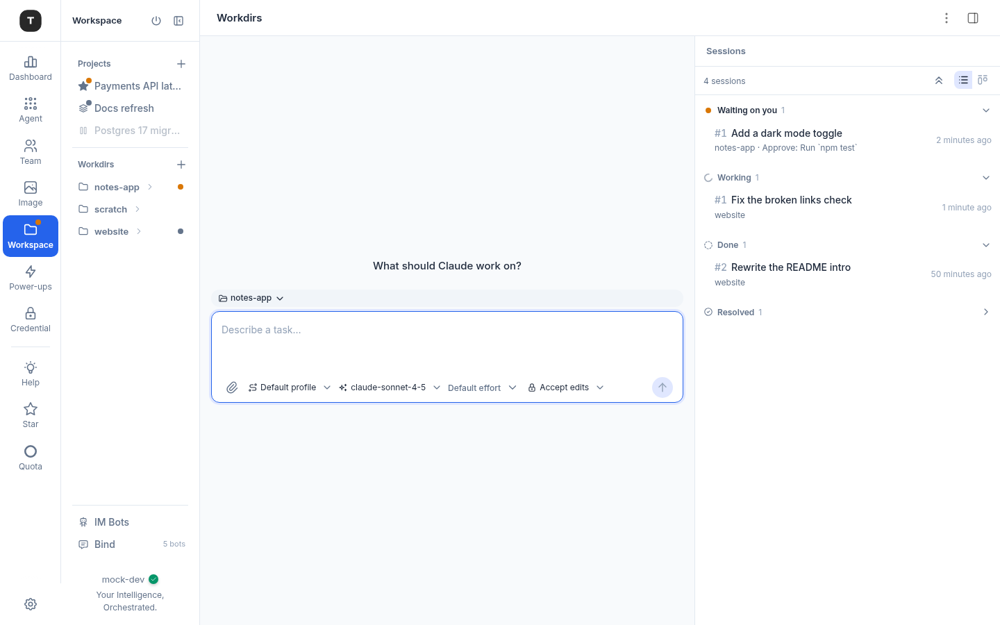
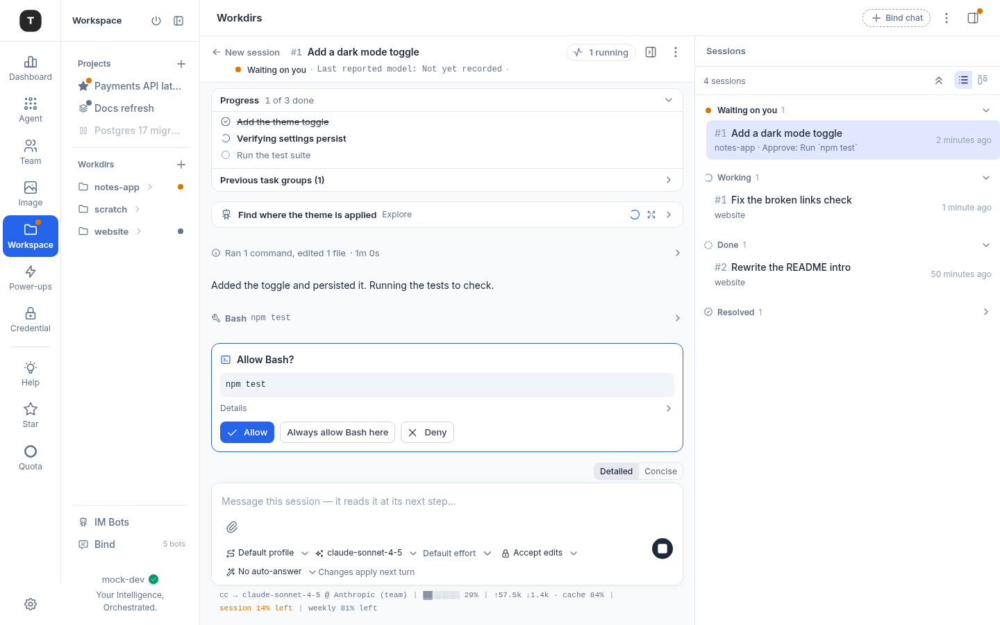

# Working folders（工作文件夹）

[返回 tingly-projects 指南](README.md)

用 *Workdirs* 旁的 **+** 添加（*Enter an existing folder on the machine running this app. Sessions you start there work in the folder itself, with no worktree.*）。点击侧边栏里的文件夹查看它的会话；`/projects/folder` 把所有文件夹放在一起。文件夹可以从侧边栏移除（**Remove from the sidebar**——其中运行中的会话会停止，过去的会话保留）。

**开始会话**——页面以 *What should Claude work on?* 和一个消息框开头。消息框下面是几个安静的选择器：**工作文件夹**、**Claude Code configuration profile**（*Default configuration profile* = 主 `claude_code` 场景，或你的某个 [Profile](../../zh/03-scenario-claude-code.md#profile-管理)）、**模型**和**权限**：*Ask for everything · Accept edits · Auto · Plan only · Don't ask · Never ask*（默认跟随项目/连接）。**Attach** 添加文件（需要先选文件夹）。右侧的 **Sessions** 面板把会话分成 **Waiting on you**、**Working**、**Done** 和 **Archived**；**New session** 再开一个。

## 一次会话

对话使用共享的转录视图：你的消息、Claude 的文字，以及**每次工具调用一行**（*Read src/…*、*Ran 1 command, edited 1 file · 1m 0s*），可展开看详情；子 Agent 的运行显示为单独的行，可以点开阅读它们的步骤。

- **审批**——*Allow Bash? `npm test`*，带 **Allow**、**Always allow Bash here** 和 **Deny**；卡片会说明这次审批是为了什么。等待中的会话显示橙色的 *Waiting on you* 状态并点亮导航栏圆点
- **提问**——Claude 提问时，选项会显示在一张卡片上（见下）。可以选一个、写自己的话，或 **Decline**
- **消息框上方的信息面板**——*This session*：**Folder**（复制 `cd` 命令）、**Branch**（复制分支名）和 **Auto-answer**（见下）。可折叠
- **消息框**——Claude 忙碌时你发的内容会排队：*Message this session — it reads it after its current turn…*，**停止**按钮结束当前回合
- **头部**——后台任务的 **running** 计数（点开可查看 Claude 在后台运行的命令和子 Agent，并可停止它们）、**Archive session**（对勾图标；**Reopen session** 可恢复）以及 ⋮：*Show task*、*Show trajectory*（逐步的回顾视图）、*Expand all tool calls*、**Continue in terminal**（见下）
- 消息框下方的**路由状态行**：哪些规则在路由这个会话（`cc → claude-sonnet-4-5 @ Anthropic (team)`）、已用上下文（`29% · 57.5k in / 1.4k out · cache 84%`）以及背后 Provider 的配额（`session 14% left · weekly 81% left`）；Provider 配额耗尽时会提示换一个 Profile
- **Continue in terminal**——给出在这台机器的终端里恢复同一个 Claude Code 会话的命令。同一时间只用一个地方：在这里发消息会再次启动会话；后台任务会随会话的进程一起停止（对话框会说明）

**Auto-answer**（信息面板）——当问题带有建议答案时怎么做：**Off**（每个问题都等你）、**After 5 min**（五分钟内你没回答，线程就按建议继续工作）或 **Right away**（立刻按建议继续；你仍可以用一条消息来纠正）。提问卡片会写明时间：*Goes with "Exponential with jitter" at 08:55 AM if you don't answer*。
