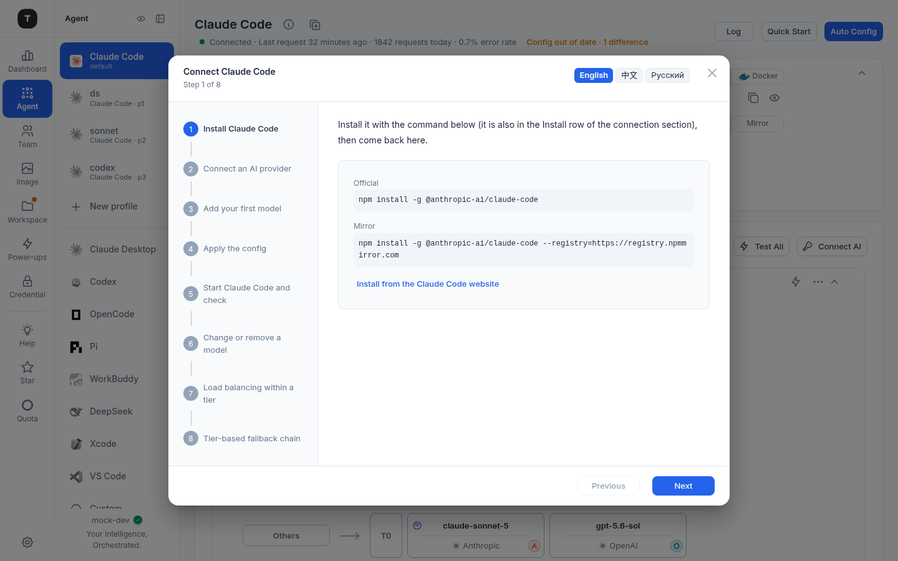
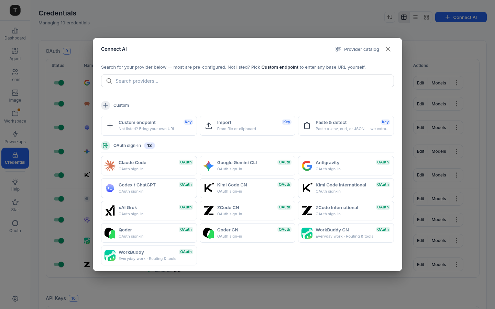
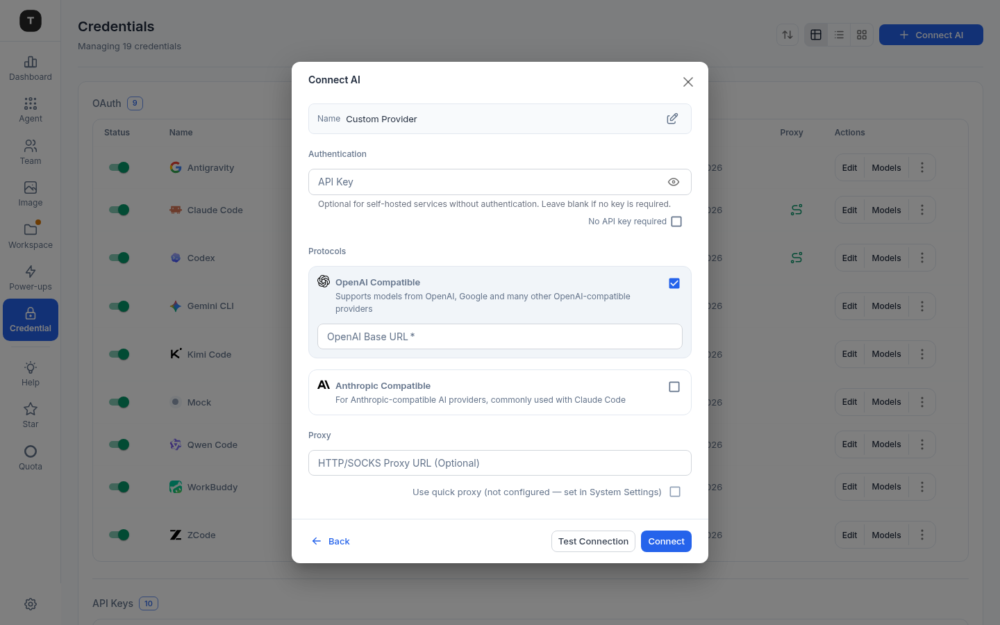

# 快速开始

本章带你从全新安装走到一个能工作的 Agent：连接 Provider、让编码工具指向网关，并看到第一条请求到达。

## 快速开始

从零开始，大约五分钟，让一个编码 Agent 通过 Tingly-Box 跑起来。这是标准的首次使用流程；其他页面的「快速开始」默认你已完成第 1–3 步。

> 界面语言为中文时，按钮显示中文；括号里是英文界面的原文。

1. **安装**：`npm install -g tingly-box@latest`（需要 Node.js）。不想全局安装？一条命令 `npx -y tingly-box@latest` 就能装好并启动。（想用桌面应用？直接装桌面应用，跳到第 3 步，见[桌面应用](./23-desktop-app.md#快速开始)。）
2. **启动**：运行 `tb start`。它在后台常驻，自动打开 Web UI（`http://localhost:12580`）并完成登录。如果出现登录页，运行 `tb token view auth --reveal`，把令牌粘贴到「身份验证令牌」里。
3. **连接 Provider**：全新安装会打开 **Claude Code** 页面。在 **Model Rules** 工具栏点 **连接 AI**（Connect AI），选一个 Provider（可按名称搜索，*Custom endpoint* 支持任意 Base URL），粘贴 API Key，点 **连接**（Connect）。想用订阅账号登录？选 *OAuth sign-in* 里的 Provider，不需要 Key。
4. **选模型**：在 `cc` 规则里点 **添加模型**（Add model），选 Claude Code 要用的 Provider 和模型。
5. **安装并配置 Agent**：从连接区的 **安装**（Install）行复制并运行 `npm install -g @anthropic-ai/claude-code`。打开页头的 **自动配置**（Auto Config），检查并应用配置。其他客户端见 [Codex](./04-scenario-codex.md#快速开始)、[其他编码 Agent](./04-scenario-coding-agents.md#快速开始) 或 [SDK 端点](./05-scenario-sdk-proxy.md#快速开始)。
6. **验证**：启动 Agent（`claude`）并发一条消息。页面标题下的状态行会从「尚未收到请求 · 先完成下面的接入」变成「已接入」（Connected），左侧导航栏的[仪表盘](./11-dashboard.md#快速开始)（Dashboard）里也能看到这条请求。

**之后按需**：用 [Team](./07-team.md#快速开始) 分享给一个小组，用 [Image](./07-image.md#快速开始) 生成图片，用 [Remote](./12-remote-control.md#快速开始) 在聊天软件里使用 Claude Code，或用 [Projects](../tingly-projects/zh/README.md#快速开始) 在浏览器里使用。本页其余部分详细解释刚才看到的这些内容。

---

## 首次启动

全新安装会打开 **Claude Code**。页头的 **快速开始**（Quick Start）打开安装、连接 AI、添加模型、应用配置和验证请求的引导。连接区的 **安装** 行可直接复制官方源或镜像源命令。

---

## 连接你的第一个 Provider

无论是从 Quick Start、Model Rules 工具栏（**Connect AI**）、[凭证管理](./08-credentials.md)页面，还是[提示与帮助](./13-help.md)上的 **Provider Catalog** 卡片进入，都是同一个选择器：

顶部是搜索框，下面是：

- **Custom**：**Custom endpoint**（任意 OpenAI/Anthropic 兼容的 Base URL）、**Import**（从文件或剪贴板）和 **Paste & detect**（粘贴 `.env`、curl 命令或 JSON 片段——自动提取 URL 和凭证）
- **OAuth sign-in**：用订阅登录的 Provider（Claude Code、Google Gemini CLI、Antigravity、Codex、Kimi Code、xAI Grok、ZCode、WorkBuddy 等）。点击后直接发起 OAuth 流程——无需 API Key——授权后令牌自动保存
- **Self-hosted**、**Cloud** 和 **API key** Provider，按地区和协议（OpenAI · Anthropic）分组

选择任何非 OAuth 的 Provider 都会打开配置表单——所有字段见[凭证管理 · 添加 Provider](./08-credentials.md#添加-providerconnect-ai-流程)。

---

## 下一步

- [场景总览](./02-scenario-overview.md)——导航栏、Agent 侧边栏和 Power-ups
- [Claude Code](./03-scenario-claude-code.md)——主力场景的完整说明
- [凭证管理](./08-credentials.md)——管理 Provider 并查看其配额
