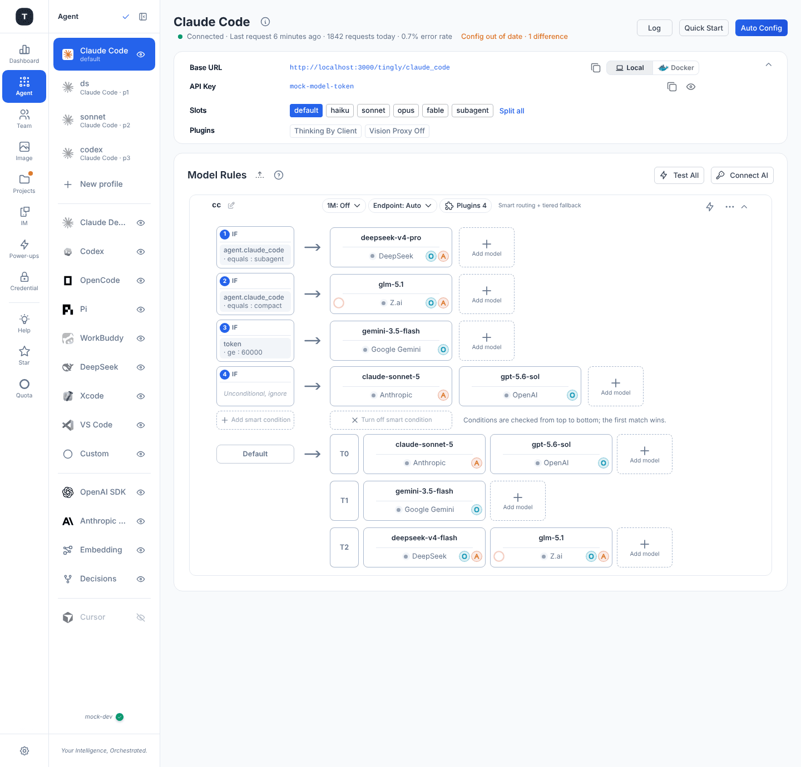
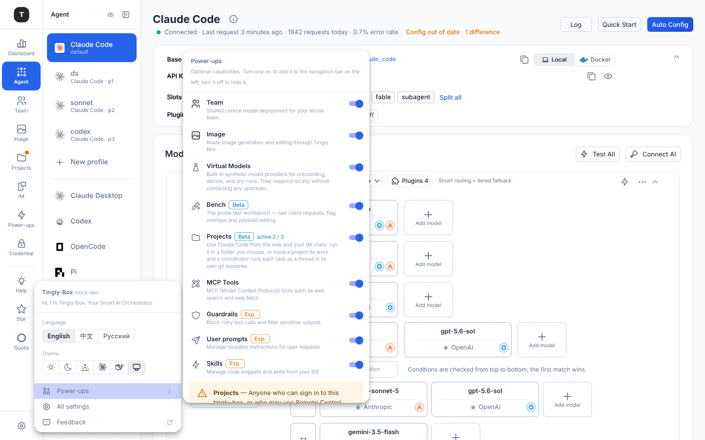

# 场景总览

本章是界面骨架的地图：图标导航栏（rail）、**Agent** 侧边栏和 **Power-ups** 菜单。不再有 `/agent` 总览页——`/agent` 会直接打开你上次所在的 Agent 页面（点击 Agent 导航项效果相同），全新安装的用户也会落在这里并且侧边栏是展开的，由各个 Agent 页面的 Quick Start 接手引导。

---

## 导航栏（Rail）

最左侧的窄条，自上而下：

| 项目 | 打开 | 何时显示 |
|------|------|----------|
| **Dashboard** | Usage、Team usage、Quota history——[用量面板](./11-dashboard.md) | 始终 |
| **Agent** | 各 Agent 页面（本章） | 始终 |
| **Team** | Team 与 Team Keys——[Team](./07-team.md) | 默认显示；在 Power-ups 中开关 |
| **Image** | Playground、Profile、Library、Image API——[Image](./07-image.md) | 默认显示；在 Power-ups 中开关 |
| **Projects** | 在文件夹或项目里使用 Claude Code——[Projects](./22-projects.md)；橙色**圆点**表示有线程在等你处理 | 开启 Projects 后 |
| **IM** | Bots、Remote Control、IM Notify——[Remote](./12-remote-control.md) | 开启 Projects 后 |
| **Power-ups** | 已开启的可选功能的页面：Guardrails、Prompt（User Request、Skills）、Bench | 至少开启其中一个 |
| **Tools** | MCP 与 Servertool——[MCP 与工具](./16-mcp-tools.md) | 开启 MCP 后 |
| **Credential** | Credentials 与 VModel——[凭证管理](./08-credentials.md) | 始终 |
| **Help**（灯泡） | [提示与帮助](./13-help.md) | 始终 |
| **Star** | 打开 GitHub 项目页（应用里唯一一处请求 star 的地方） | 始终 |
| **齿轮**（底部） | *Preferences* 弹层——语言、主题、**Power-ups**、**All settings**、**Feedback**——[系统设置](./17-system-settings.md) | 始终 |

顶部的 Logo 会打开 GitHub 仓库，悬停可看版本号。**System** 没有自己的导航图标：**齿轮 → All settings** 打开它。服务器无法连接时，齿轮上方会出现红色的 **Offline** 标记。

Agent 侧边栏和其他所有侧边栏一样，底部有一行**版本行**（版本号加一个徽标：绿色对勾 = 已是最新，橙色箭头 = 有可用更新——点击打开更新对话框），以及标语 *Your Intelligence, Orchestrated.*

---

## Agent 侧边栏

打开 **Agent** 后按分组列出所有 Agent：

1. **Claude Code**（副标题 `default`），其后是各个 **Profile**——以自己的名称显示，副标题 `Claude Code · <id>`——以及 **New profile**
2. 编码 Agent：**Claude Desktop**、**Codex**、**OpenCode**、**Pi**、**WorkBuddy**、**DeepSeek**、**Xcode**、**VS Code**、**Cursor**、**Custom**
3. SDK 端点：**OpenAI SDK**、**Anthropic SDK**、**Embedding**、**Decisions**

悬停某一行可以看到说明提示。标题栏有两个图标：**眼睛**（编辑模式，见下）和**折叠**（把侧边栏收成细条；悬停或点击导航项可以把它当作浮层查看，而不必永久展开——窄桌面窗口（900–1200 px）在你至少用过一次折叠开关之后默认折叠，首次使用的用户总是从展开状态开始，在窄窗口里手动展开只在本次会话有效；手机/平板宽度下整个导航变成由顶栏菜单按钮打开的抽屉）。

### 置顶 Agent

**悬停某个 Agent 行并点击图钉**（*Pin to top*），就会把它移到列表顶部、Claude Code 之上，按你置顶的顺序排列，并用分隔线与其余行隔开。点击实心图钉（*Unpin*）可放回原位。置顶记录保存在当前浏览器中。

### 管理可见性：侧边栏编辑模式

点击侧边栏标题栏里的**眼睛**（**Agent** 项处于激活状态时可见）进入编辑模式：

- 图标变成**对勾**（*Done*）；再次点击退出
- 每个可隐藏的行右侧出现一个小眼睛开关——*Hide from sidebar* / *Show in sidebar*
- 被隐藏的 Agent 仍留在列表里，**变暗并排在分隔线下方**，所以上面可见的部分就是你最终会看到的侧边栏
- 退出编辑模式后，被隐藏的行完全不显示
- 第一次进入 Agent 页面时会有一个一次性的引导提示（*Choose which agents show*）指向眼睛图标

开箱即用时**除 Cursor 外**全部可见（它需要公网可达的 HTTPS 地址——见 [Cursor](./04-scenario-cursor.md)）。Claude Code 及其 Profile 始终显示，除非你隐藏 Claude Code 本身——那样它的 Profile 也会一起隐藏。

---

## 全部 Agent 列表

| Agent | 路径 | 用途 |
|-------|------|------|
| Claude Code | `/agent/claude_code` | 用自定义 Profile 和按任务选模型来路由 Claude Code |
| Claude Desktop | `/agent/claude_desktop` | 把你自己的 Provider 作为 Claude Desktop 的第三方推理网关 |
| Codex | `/agent/codex` | 通过你的 Provider 密钥配置 Codex CLI |
| OpenCode | `/agent/opencode` | 由你的 Provider 驱动的开源编码 Agent |
| Pi | `/agent/pi` | 通过你的 Provider 路由 Pi 编码 Agent |
| WorkBuddy | `/agent/workbuddy` | 在腾讯 WorkBuddy 中以自定义模型使用你自己的模型 |
| DeepSeek | `/agent/dsh` | 通过你的 Provider 路由 DeepSeek Harness（dsh）编码 Agent |
| Xcode | `/agent/xcode` | 把你的模型接入 Xcode 的编码智能功能 |
| VS Code | `/agent/vscode` | 通过 Tingly Box 驱动 VS Code Copilot Chat |
| Cursor | `/agent/cursor` | 把你的模型接入 Cursor，内置兼容性处理（默认隐藏） |
| Custom | `/agent/custom` | 自带请求模型名——通用兜底场景 |
| OpenAI SDK | `/agent/openai` | 即插即用的 OpenAI 兼容 SDK 端点 |
| Anthropic SDK | `/agent/anthropic` | 即插即用的 Anthropic 兼容 SDK 端点 |
| Embedding | `/agent/embed` | 把 Embedding 请求路由到你的 Provider |
| Decisions | `/agent/decisions` | 把 Decision 请求路由到你的 Provider |

> 「Custom」曾叫「OpenClaw」/「Claw Agent」；路径从 `/agent/agent` 改为 `/agent/custom`。Cursor 从 **Cursor 自己的云端**调用 Base URL，所以 `localhost` 不可用——见 [Cursor 场景](./04-scenario-cursor.md)。

所有 Agent 页面共用同一种布局——见 [Claude Code · 页面结构](./03-scenario-claude-code.md#页面结构)——而 [Codex](./04-scenario-codex.md)、[其他编码 Agent](./04-scenario-coding-agents.md)、[SDK 端点](./05-scenario-sdk-proxy.md)和 [Custom / Embed](./06-scenario-special.md) 的页面只写各自不同的部分。

---

## Power-ups：齿轮背后的菜单

可选功能集中在一个地方。点击导航栏底部的**齿轮**，然后悬停（或点击）**Power-ups**，子菜单会在弹层旁边展开：

*Optional capabilities. Turn one on to add it to the navigation bar on the left; turn it off to hide it.* 每个 Power-up 一行——图标、名称（带 **Exp.** 或 **Beta** 标签）、一句话说明和一个开关；点击已开启行的名称会打开它的页面：

| Power-up | 作用 | 阶段 |
|----------|------|------|
| **Team** | **Team** 导航项 | — |
| **Image** | **Image** 导航项（及其 Agent） | — |
| **Virtual Models** | Credential 下的 **VModel** 行（内置的模拟 Provider 无论如何都继续可用） | — |
| **Bench** | **Bench** 页面 | Beta |
| **Projects** | **Projects** 和 **IM** 导航项；显示 `active n / m` 个机器人；警告会说明之后谁可以在这台机器上运行 Claude Code | Beta |
| **MCP Tools** | **Tools** 导航项 | Exp. |
| **Guardrails** | **Guardrails** 各页面 | Exp. |
| **User prompts** / **Skills** | **User Request** / **Skills** 页面 | Exp. |

- **Team**、**Image** 和 **Virtual Models** 只是显示或隐藏一个入口——它们管理的内容不会停止。由标志位支撑的几项（Bench、Projects、MCP、Guardrails、Prompt 页面）与[实验性功能](./19-experimental.md)用的是同一组 `_global` 开关。
- 首次访问时会有一个引导提示（*Power-ups moved here*）指向齿轮。
- 原来的 **Remote** 和 **Desk** 开关已取消：IM 聊天现在运行在 **Projects** 之上，所以一个开关同时打开两者（见 [Projects](./22-projects.md)）。

---

## 相关页面

- [Claude Code 场景](./03-scenario-claude-code.md)
- [Codex](./04-scenario-codex.md) · [Cursor](./04-scenario-cursor.md) · [其他编码 Agent](./04-scenario-coding-agents.md)
- [OpenAI / Anthropic SDK 代理](./05-scenario-sdk-proxy.md) · [Custom / Embed](./06-scenario-special.md)
- [Team](./07-team.md) · [Image](./07-image.md) · [Projects](./22-projects.md)
