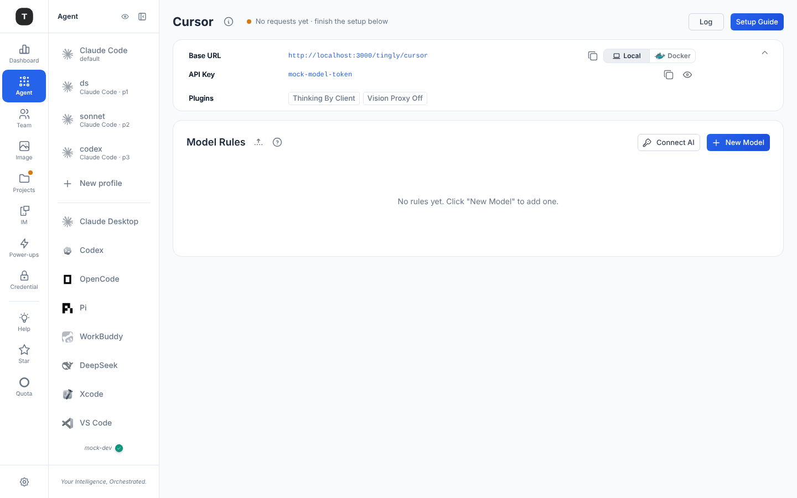
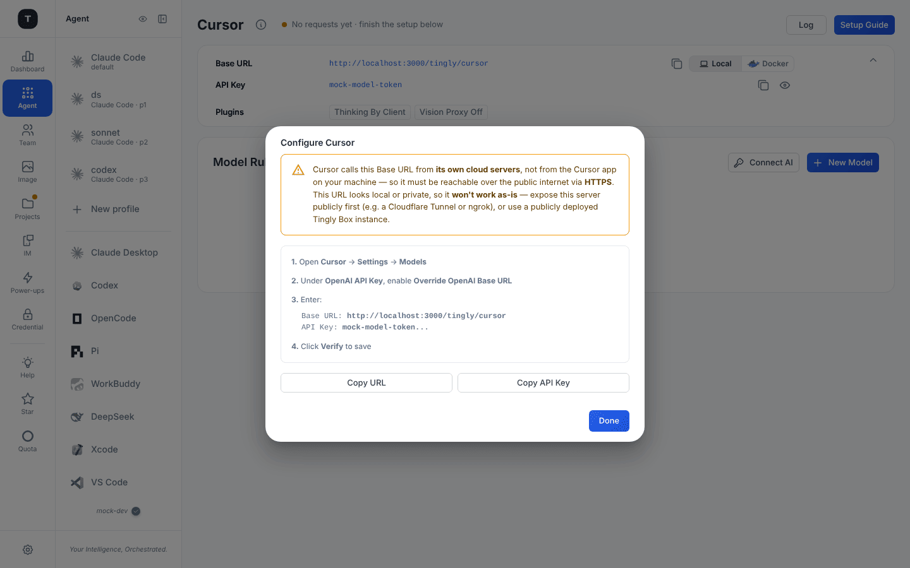

# Cursor 场景

路径：`/agent/cursor`

Cursor 是唯一默认在侧边栏中隐藏的 Agent（如需使用，可在侧边栏的[编辑模式](./02-scenario-overview.md#管理可见性侧边栏编辑模式)中取消隐藏）。该场景将 Cursor 的 OpenAI 兼容 API 请求代理到你配置的 Provider，其内置规则默认开启 **Cursor 兼容处理**（`cursor_compat`）。

---

## 为什么 Cursor 需要独立页面

与其他编程 Agent 场景不同，Cursor 是从 **Cursor 自己的云端后端**（`api2.cursor.sh`）调用你配置的 "Override OpenAI Base URL"，而**不是**从你本机运行的 Cursor 客户端调用。这意味着：

- `localhost` 或内网地址（`10.x`、`192.168.x`、`172.16–31.x`）**无法使用**——Cursor 的云端服务器访问不到
- Base URL 必须是**公网可达的 HTTPS** 地址——需先用 Cloudflare Tunnel、ngrok 或公网部署将本服务暴露出去

## 页面结构

标准的 Agent 页面——状态行、页头按钮、连接卡、Plugins 卡和 Model Rules 详见 [Claude Code · 页面结构](./03-scenario-claude-code.md#页面结构)。Cursor 的不同之处：

- 连接卡里有 **Base URL** 和 **API Key** 两行（复制/显示）。
- 页头的主操作按钮是 **Setup Guide**（实心、最靠右），而不是 Auto Config：Cursor 没有本地配置文件可供 Tingly-Box 写入，配置只能手动复制粘贴到 Cursor 自己的设置界面中。没有 Quick Start 卡。
- Model Rules 是自由形式的（**New Model**、**Test All**、**Connect AI**），内置规则带有 `cursor_compat`（见下文）。

### Setup Guide（Configure Cursor）

- 顶部提示框会根据当前 Base URL 是否像是 Cursor 云端可达（本地/内网或非 HTTPS 时显示警告，否则显示提示）重申公网可达性要求
- 分步说明：打开 **Cursor → Settings → Models**，在 **OpenAI API Key** 下启用 **Override OpenAI Base URL**，填入下方显示的 Base URL（`<Base URL>/tingly/cursor`）与 API Key，最后在 Cursor 中点击 **Verify** 保存
- **Copy URL** / **Copy API Key** 按钮

---

## `cursor_compat` 标记

Cursor 的内置规则默认开启 `cursor_compat` 标记，用于规范富文本内容、限制工具定义、并剥离流式响应中的 usage 字段，以适配 Cursor 客户端的特殊行为。另有一个默认关闭的 `cursor_compat_auto` 标记，可以通过请求头自动识别 Cursor 流量，从而对其他客户端共用的规则也应用同样的处理——详见 [路由规则与插件 · App](./20-routing-rules.md#app-类)。

---

## 配置流程

1. 确保本 Tingly-Box 实例已通过 HTTPS 公网可达（隧道或公网部署）
2. 在 [凭证管理](./08-credentials.md) 添加至少一个 Provider
3. 如有需要，在侧边栏的编辑模式中取消隐藏 Cursor，然后打开 `/agent/cursor`
4. 点击 **Setup Guide**，按弹窗步骤在 Cursor 的 Settings → Models 面板中操作
5. 在 Cursor 中点击 **Verify** 确认连接成功

---

## 相关页面

- [场景总览](./02-scenario-overview.md)
- [Claude Code 场景](./03-scenario-claude-code.md)
- [路由规则与插件](./20-routing-rules.md)
- [凭证管理](./08-credentials.md)
