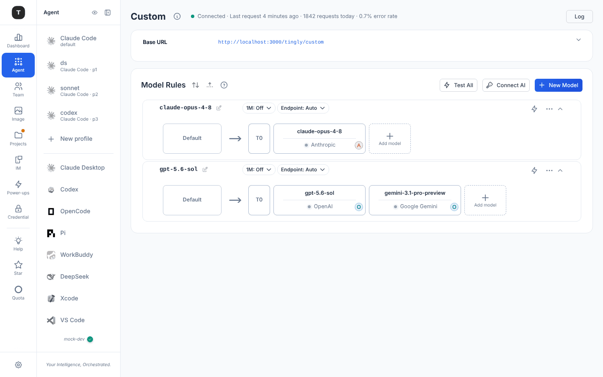

# Custom / Embed

本章介绍两个通用兜底场景：Custom 通用兜底场景（原「OpenClaw」）与 Embedding API 代理。

> Team 和 Image 曾经也在本章介绍。它们现在都已升级为 导航栏中的独立一级入口，各自拥有专属页面——详见 [Team](./07-team.md) 与 [Image](./07-image.md)。

## 快速开始

**Custom** 让任意 Agent 框架用你自己起的请求模型名接入；**Embed** 对 Embedding 请求做同样的事。**开始之前**：先添加 Provider（[凭证管理](./08-credentials.md#快速开始)）。

> 界面语言为中文时，按钮显示中文；括号里是英文界面的原文。

1. 点 **Agent** → **Custom**（或 **Embedding**）。
2. 在 **模型规则**（Model Rules）里点 **新建模型**（New Model），选要转发到的 Provider 模型（Embed 要选 Embedding 模型）。规则以它命名；如果你的 Agent 发的是别的模型名，点铅笔图标重命名。
3. 在连接卡里复制 **Base URL**（`/tingly/custom` 或 `/tingly/embed`）和 **API Key**。
4. 把它们配置到你的 Agent 里，模型名填规则名。快速测试：

```bash
curl <Base URL>/chat/completions -H "Authorization: Bearer <API Key>" \
  -H "Content-Type: application/json" \
  -d '{"model": "<规则名>", "messages": [{"role": "user", "content": "ping"}]}'
```

**Embed** 则调用 `<Base URL>/embeddings`，请求体 `{"model": "<规则名>", "input": "hello"}`（SDK 代码见[下文](#接入方式)）。

**验证**：调用成功，页面状态行显示「已接入」。

---

## Custom

路径：`/agent/custom`



Custom 场景（侧边栏曾用名「OpenClaw」/「Claw Agent」）是一个通用兜底场景：可自定义请求模型名，为任意自定义 Agent 框架提供标准化的 API 端点。默认显示在侧边栏中（不需要时可在侧边栏的[编辑模式](./02-scenario-overview.md#管理可见性侧边栏编辑模式)中隐藏）。

### 页面结构

标准的 Agent 页面（[Claude Code · 页面结构](./03-scenario-claude-code.md#页面结构)），没有客户端专属的配置——没有 Auto Config / Setup Guide 按钮，也没有 Quick Start：

1. **页头**：状态行加 **Requests / Usage / Log**
2. **连接卡**：**Base URL**（`/tingly/custom`）和 **API Key**，连接后自动折叠
3. **Plugins 卡**：Thinking / Vision Proxy / Record
4. **Model Rules**（可折叠）：**New Model** 为你的 Agent 发送的请求模型名添加路由规则

### 使用场景

- 自定义 Agent 框架需要统一的 API 端点
- 多个 Agent 需要共享同一组 Provider 凭证
- 需要为 Agent 访问配置独立的路由规则

---

## Embed（Embedding API）

路径：`/agent/embed`

代理 Embedding API 请求，适用于文本向量化应用。

### 页面结构

同样的 Agent 页面，标题为 **Embed API**：

1. **页头**和**连接卡**，显示代理地址（`/tingly/embed`）和 Key
2. **Plugins 卡**只显示 **Record**（思考和视觉对 Embedding 没有意义）
3. **Embedding Model Rules**（可折叠）：专门针对 Embedding 模型配置路由

### 使用场景

- RAG（检索增强生成）应用的文本向量化
- 语义搜索系统
- 文本相似度计算

### 接入方式

```python
from openai import OpenAI
client = OpenAI(
    base_url="<tingly-box-embed-url>",
    api_key="<tingly-box-api-key>",
)
response = client.embeddings.create(
    model="text-embedding-3-small",
    input="your text here",
)
```

---

## 相关页面

- [场景总览](./02-scenario-overview.md)
- [Team](./07-team.md)
- [Image](./07-image.md)
- [凭证管理](./08-credentials.md)
