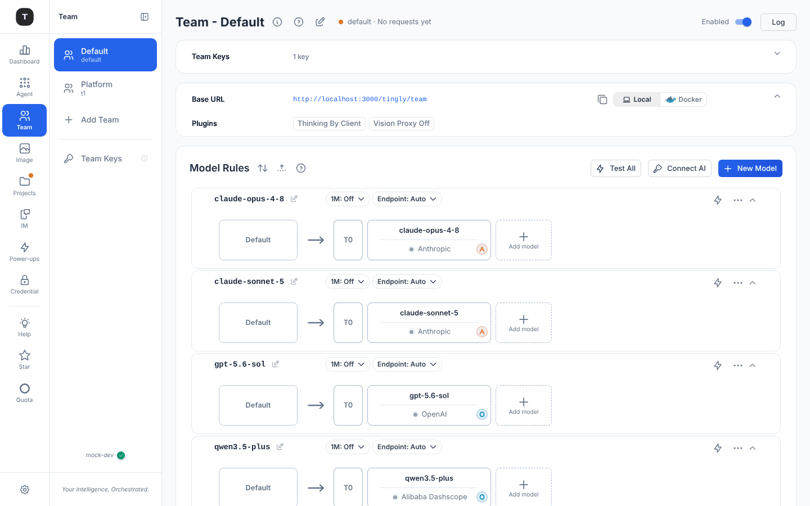
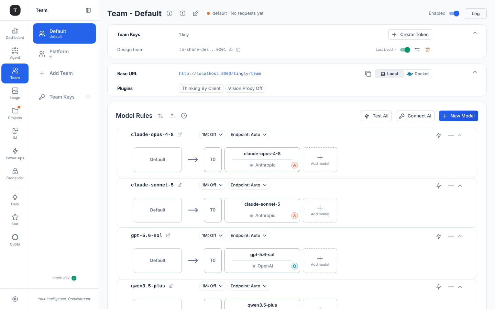
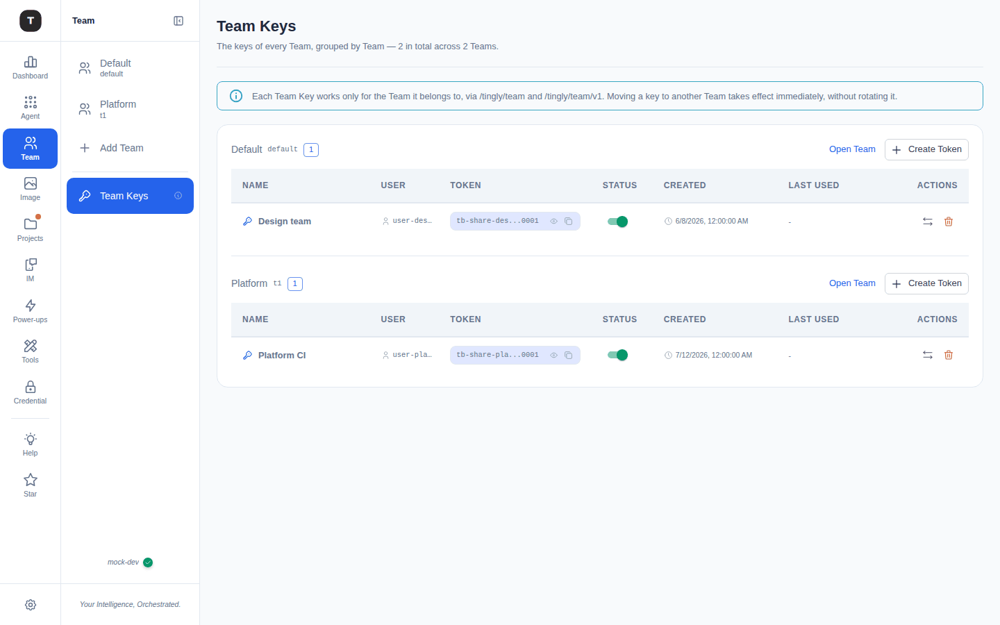

# Team（团队）

路径：`/agent/team`（默认团队）或 `/agent/team/:slug`（其他团队）；`/agent/team/keys`（Team Keys 总览）

**Team** 是左侧导航栏中独立的一级入口，拥有自己的工作区页面和密钥管理。默认显示；[Power-ups 菜单](./02-scenario-overview.md#power-ups齿轮背后的菜单)中的 **Team** 开关可以隐藏或显示这个导航项（各个 Team 管理的内容不会因此停止）。

---

## Team 是什么

多团队工作区让每个团队拥有各自独立的路由配置与 **Team Key**，使同一个 Tingly-Box 实例可以服务多个团队——客户、子团队、外部应用——而不会导致各团队的模型规则或 API Key 互相泄露。

- 一个 **Team Key**（`tb-share-…`）只属于一个 Team，且只能访问 `/tingly/team` 和 `/tingly/team/v1`——无法访问其他 Team、其他场景端点（Claude Code、Codex……）或管理 API。
- 实例级的 **Global Model Token** 是另一类不受 Team 范围限制的独立凭证，仍保留跨场景的完整访问权限，不受 Team 边界影响。
- 转移、停用或删除某个密钥或 Team 会立即生效。

> 旧版本把它们叫做「Sharing Keys」（以及独立的 *API Tokens* / *Sharing* 页面 `/tingly-box-token`，现已重定向到 Team Keys）。现在界面里统一称为 **Team Key**。

---

## 工作区导航

团队在侧边栏中拥有独立的 **Profile 式**区块，与 Claude Code 的 Profile 类似：

- 每个团队是一个导航项，以**名称**显示，副标题为 slug；内置的 **Default** 团队（slug 为 `default`）始终排在最前。
- **Add Team** 打开一个内联弹层，用于命名新团队——系统会自动分配编号（`t1`、`t2`……；已删除团队的编号可以被复用，但底层 Team ID 永不复用，因此旧的规则/密钥/审计记录不会被误关联到新团队）。
- 分隔线之后是 **Team Keys**（信息图标说明访问范围）——跨所有 Team 的密钥总览，排在最后，因为它汇总了上面整个列表。

---

## Team 工作区页面

标准的 Agent 页面（[Claude Code · 页面结构](./03-scenario-claude-code.md#页面结构)），页头为 Team 定制，Team 的密钥就在页头下方：

**页头**

- **标题** `Team - <名称>`，旁边四个小图标：**信息**（密钥的访问范围：只能用于 `/tingly/team` 和 `/tingly/team/v1`）、**?**（*How Team works* 引导，见下文）、**编辑**（*Team settings*：重命名），非默认 Team 还有**删除**（需先转移或删除其名下的密钥）
- **状态行**以 slug 开头：`default · No requests yet`
- **Enabled** 开关：关闭后该团队的密钥无法访问模型端点，但不会删除任何内容；关闭期间会显示警告
- **Requests / Usage / Log**，与每个 Agent 页面一致

**Team Keys 卡**——页头的一部分，紧接在页头下方。折叠时是一行 `Team Keys · 1 key`；点击展开（选择会记在本机，对所有 Team 通用）。展开后列出每个密钥——每个你交付该 Team 的人一把：

- **Create Token**（卡片右上角）：对话框 *Create Team Key*，填写显示名称，然后复制 `tb-share-…` 值——**只显示一次**。Team 被停用时该按钮仍显示但不可点击，悬停可看原因
- 每一行：名称、带**显示**和**复制**的打码密钥、**Last Used**、启用/停用**开关**、**Move to another team** 和 **Delete**（立即生效、不可撤销）

**连接卡**：Team 被使用过之后折叠为一行 `Base URL`（`/tingly/team`）。**没有 API Key 行**——那是本实例自己的密钥；Team 成员使用各自的 Team Key 连接。

**Plugins 卡**和 **Model Rules**：规则仅属于该 Team，与其他 Team 互相独立。**New Model**、**Connect AI**、**Test All** 的用法与其他页面相同。

---

## Team 引导弹窗

**?** 图标（也可从 **Help → How Team works** 进入）打开 4 步引导：

1. **What a Team is for**：实例中的一个隔离切片（独立的规则、Team Key、用量）；让一个群体获得模型访问权限，而无需共享你的主配置
2. **How it's separated**：一个 Team Key 只属于一个 Team，只能访问 `/tingly/team[/v1]`；转移或停用密钥/Team 立即生效；Global model token 不受 Team 限制
3. **Configure a Team Key**：在 Team Keys 卡里创建；复制 `tb-share-…` 值（只显示一次）；可随时转移到其他 Team，无需轮换
4. **How it's used**：客户端指向该 Team 的 Base URL，以其 Team Key 作为 API key；请求按下方规则路由——只有加到这里的模型才能访问

---

## Team Keys 总览

侧边栏的 **Team Keys**（`/agent/team/keys`）把所有 Team 的密钥放在一页，每个 Team 一个分区（空 Team 也包含在内，方便各自创建第一把密钥），便于集中查看或转移密钥而无需逐个打开工作区。顶部的提示条重申访问范围规则。每个分区的标题显示 Team 名称、slug、密钥数量标签、Team 被停用时的 **Inactive** 标签、**Open Team** 以及该 Team 自己的 **Create Token**。表格列：

| 列 | 说明 |
|----|------|
| Name | 创建时设置的显示名称 |
| User | 密钥的用户 id（截断显示） |
| Token | 打码值，可显示/隐藏、复制 |
| Status | 启用/停用开关 |
| Created | 创建时间 |
| Last Used | 最近使用时间，或短横线 |
| Actions | **Move**（转移到另一个**已启用**的 Team，无需轮换密钥）和 **Delete** |

同样的操作也可在每个 Team 自己的 Team Keys 卡中进行。

---

## 相关页面

- [场景总览](./02-scenario-overview.md)
- [Custom / Embed](./06-scenario-special.md)
- [用量面板](./11-dashboard.md)——**Team usage** 按 Team 和账号拆分用量
