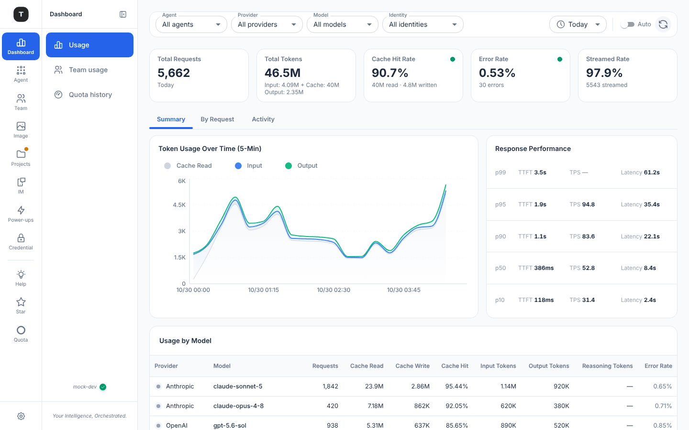
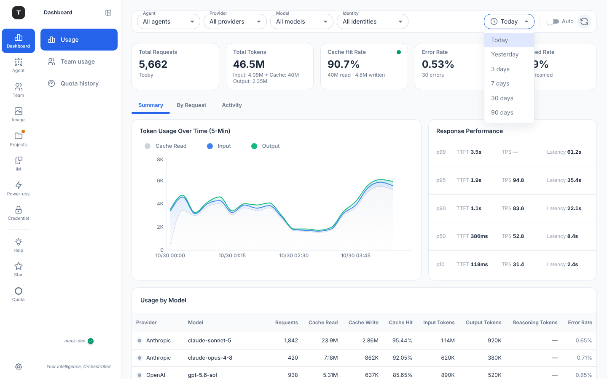
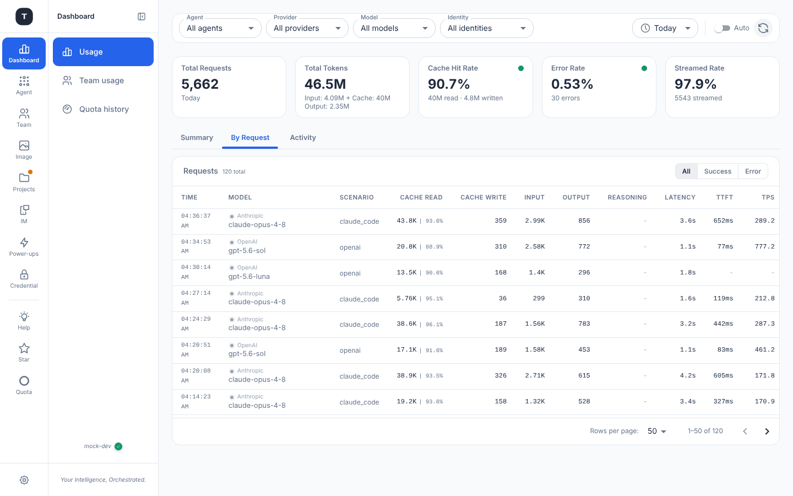
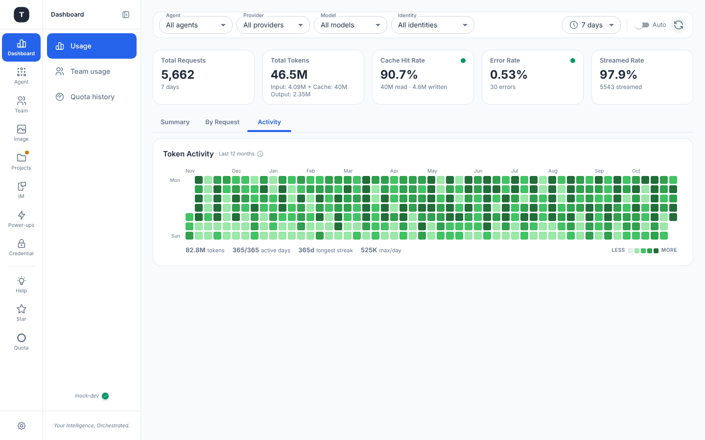
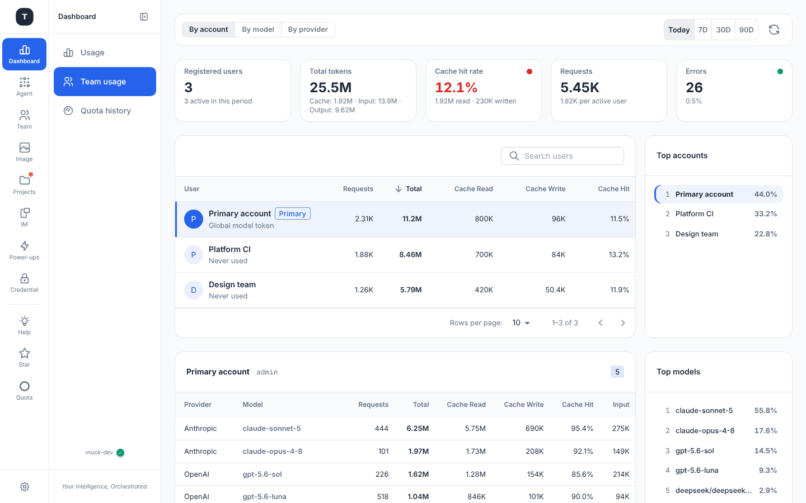
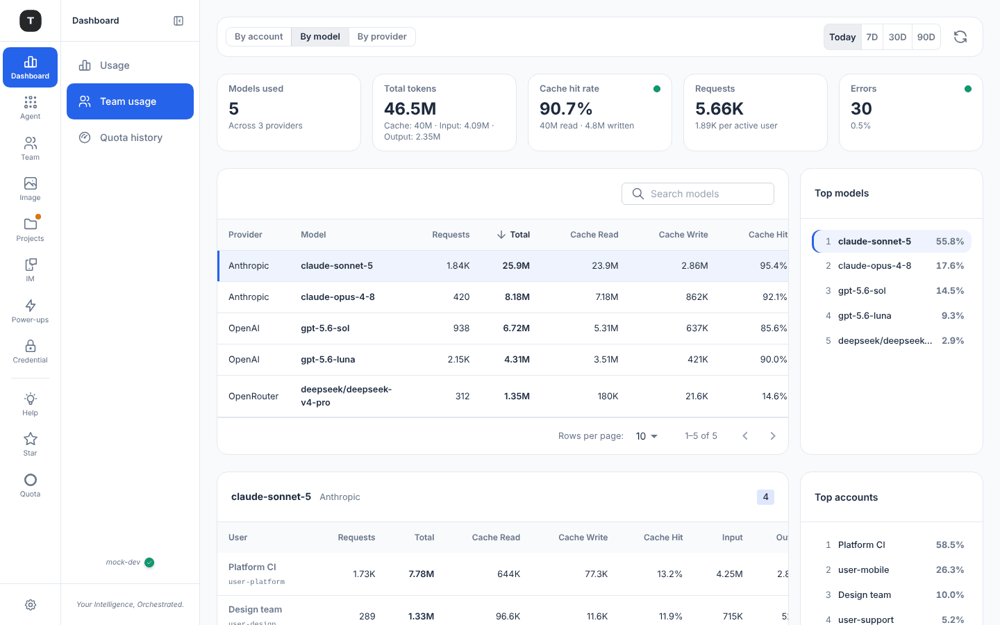
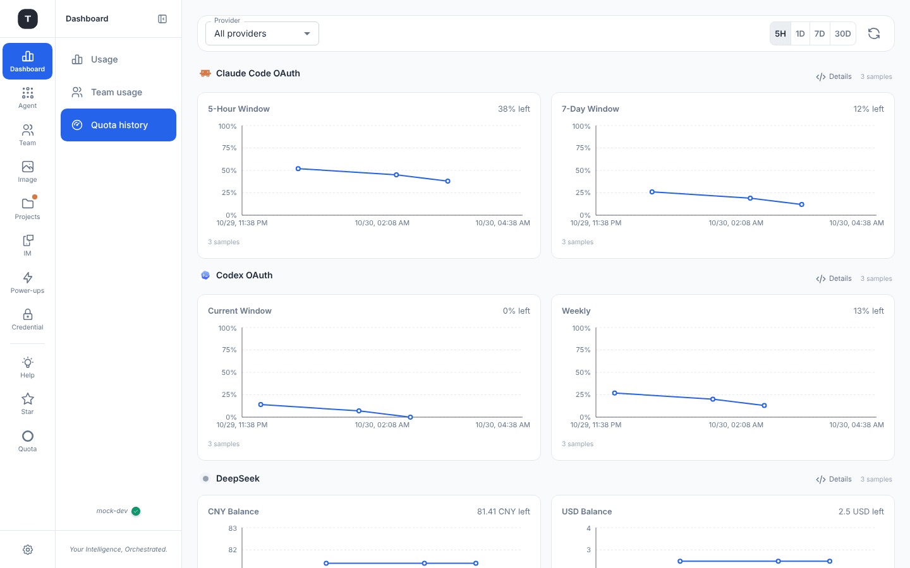

# 用量面板

路径：`/dashboard/:timeRange`（默认 `/dashboard/today`——点击 **Dashboard** 导航项即进入）· `/dashboard/users`（**Team usage**）· `/dashboard/quota-history`（**Quota history**）

Dashboard 导航项的侧边栏有三个页面：**Usage**、**Team usage** 和 **Quota history**。页面没有标题——侧边栏已经说明了你在哪——每个页面都以一条带边框的**工具栏**开头。

---

## Usage（用量）

AI 请求活动的统计与可视化：调用量、Token 消耗、缓存命中率、响应性能，可按 Agent、Provider 和模型查看。

### 工具栏

左侧是四个筛选器，右侧是时间范围和刷新控件。

| 控件 | 作用 |
|------|------|
| **Agent** | `All agents`，或某一个 Agent（Claude Code、Codex、某个 Claude Code Profile、某个 Team……）。Agent 页面上的 **Usage** 按钮会打开已按该 Agent 过滤的面板（`?scenario=<agent>`） |
| **Provider** | 按认证类型分组的 Provider（OAuth / API Key / Bearer Token / Basic Auth / Virtual Model），每个带自己的 Logo |
| **Model** | 当前范围内有数据的模型，按 Token 用量排序 |
| **Identity** | `All identities`、`Main account`（全局 Model Token），或某个具体的 **Team Key**（按所属 Team 分组） |
| *清除* | 任一筛选器有值时出现 **Clear all filters** 按钮 |
| **范围** | 带时钟图标的下拉框——**Today**、**Yesterday**、**3D**、**7D**、**30D**、**90D**。每个范围保留自己的 URL（`/dashboard/7d` 等）；以前它是侧边栏里的六行 |
| **Auto** | 自动刷新开关（每分钟） |
| 刷新 | 手动刷新 |

### 统计卡片

所选范围的五张卡片。其中两张属于健康度判断，带一个**状态圆点**（绿 / 黄 / 红）；体量类卡片保持中性。

| 指标 | 说明 |
|------|------|
| **Total Requests** | 请求总数 |
| **Total Tokens** | Token 总数（副标题：`Input: X + Cache: Y` / `Output: Z`） |
| **Cache Hit Rate** ● | 百分比（状态点：≥ 50 % 绿，≥ 20 % 黄，更低为红）；副标题把缓存拆成 **read** 与 **written**（例如 `40M read · 4.8M written`） |
| **Error Rate** ● | 请求失败率，附错误数 |
| **Streamed Rate** | 流式响应占比 |

### 标签页：Summary · By Request · Activity

标签页位于卡片下方面板的顶部：

- **Summary**：左侧是 **Response Performance**，右侧是 **Token Usage Over Time** 图。Today/Yesterday 显示 **5 分钟**粒度的曲线（Cache Read / Input / Output）；更长的范围显示按天的柱状图。

  | 列 | 说明 |
  |----|------|
  | TTFT | 首 Token 时间 |
  | TPS | 每秒 Token 数 |
  | Latency | 请求总延迟 |

  行是百分位——**P99、P95、P90、P50、P10**——每行带样本数（`n=…`）；短横线表示该百分位没有数据（例如在流式输出之前就报错的请求没有 TPS）。

- **By Request**：仅 **Today** / **Yesterday** 可用：`Requests · N total`，每个请求一行——**Time**、**Model**（带 Provider 的 Logo）、**Scenario**、**Cache Read**、**Cache Write**、**Input**、**Output**、**Reasoning**、**Latency**、**TTFT**、**TPS**——带 **All / Success / Error** 筛选和分页（每页 50 行）

  

- **Activity**：GitHub 风格的贡献热力图，见下文。

### Usage by Model 表

位于底部（分页），每个 Provider 名称旁带其 Logo：

| 列 | 说明 |
|----|------|
| Provider | Provider 名称 |
| Model | 模型名称 |
| Requests | 请求数 |
| Cache Read / Cache Write / Cache Hit | 缓存 Token 与命中率 |
| Input Tokens / Output Tokens | Token 数 |
| Reasoning Tokens | 推理/思考 Token（模型不上报时为 0 或空白） |
| Error Rate | 失败率（%） |

### Activity 热力图

**Activity** 标签页在面板内显示 GitHub 风格的贡献热力图，与其他视图共用 Agent / Provider / Model / Identity 筛选。

- **固定窗口**：始终是**最近 365 天**，不受所选范围影响（范围只影响 Summary 和 By Request）
- **网格**：横轴是月份，纵轴是星期几；格子越深表示当天 Token 越多
- **底部统计**：Token 总量、活跃天数 / 总天数、最长连续天数、单日最大用量

---

## Team usage（`/dashboard/users`）

按**注册账号**而不是模型/Provider 拆分用量——适合多个人通过共享的 Model Token 和 [Team Key](./07-team.md) 共用一个实例的场景。一条工具栏，带 **Today / 7D / 30D / 90D** 切换和刷新按钮。

### 统计卡片

第一张卡片随下方的视图变化，其余各视图相同：

| 卡片 | 说明 |
|------|------|
| **Registered users** / **Models used** / **Providers used** | 按账号 / 按模型 / 按 Provider；副标题：本期活跃账号数，或涉及多少个 Provider/模型 |
| **Total tokens** | 总和；副标题拆分 Cache / Input / Output |
| **Cache hit rate** ● | 带状态点；副标题显示缓存读取与写入量 |
| **Requests** | 总数；副标题显示每个活跃用户的平均值 |
| **Errors** ● | 错误数与错误率，状态点反映健康度 |

### By account / By model / By provider

表格上方的三选一切换改变它的分组方式（卡片会随之变化），搜索框按名称过滤。

**By account**（默认）：每个账号一行：

| 列 | 说明 |
|----|------|
| User | 名称，绑定全局 Model Token 的账号带 **Primary** 徽标，被停用的带 **Disabled** 徽标；副标题：最近使用时间或 `Never used` |
| Requests | 请求数 |
| Total | Token 总数（默认排序） |
| Cache Read / Cache Write / Cache Hit | 各账号的缓存明细 |
| Input / Output / Reasoning | Token 数 |
| Error Rate | 各账号的失败率 |

**By model** / **By provider** 把表格转为每个模型或 Provider 一行。选中某行会在下方展开详情面板，列出使用它的账号，副标题说明每个账号涉及多少个 Provider/模型。

表格旁边的 **Top 列表**（按占比排序的条形）按当前视图显示 **Top accounts**、**Top models** 或 **Top providers**——名称和百分比占比，其余合并为 **Others**。

---

## Quota history（`/dashboard/quota-history`）

每个 Provider 的**配额**随时间的变化——每次刷新配额时留下的快照（见[凭证管理](./08-credentials.md#quota-列)）。同样形态的工具栏：**Provider** 筛选、范围切换（**5H / 1D / 7D / 30D**）和刷新。

每个 Provider 一张卡片（Logo 和名称、`N samples`、以及指向最新原始配额响应的 **Details** 链接），里面每个配额窗口一条折线图——例如 Claude Code OAuth 的 *5-Hour Window* 和 *7-Day Window*，标题旁显示最新的 `38% left`。余额（金额或积分）使用单独的坐标轴。最近一次刷新失败的 Provider 会显示错误；还没有记录时页面显示 *No quota snapshots in this period*（受支持的 Provider 刷新配额后才会出现快照）。页面最多显示最近 1,000 个点——选择单个 Provider 或更短的范围可以看到更多。

---

## 相关页面

- [系统设置](./17-system-settings.md)
- [凭证管理](./08-credentials.md)
- [Team](./07-team.md)
