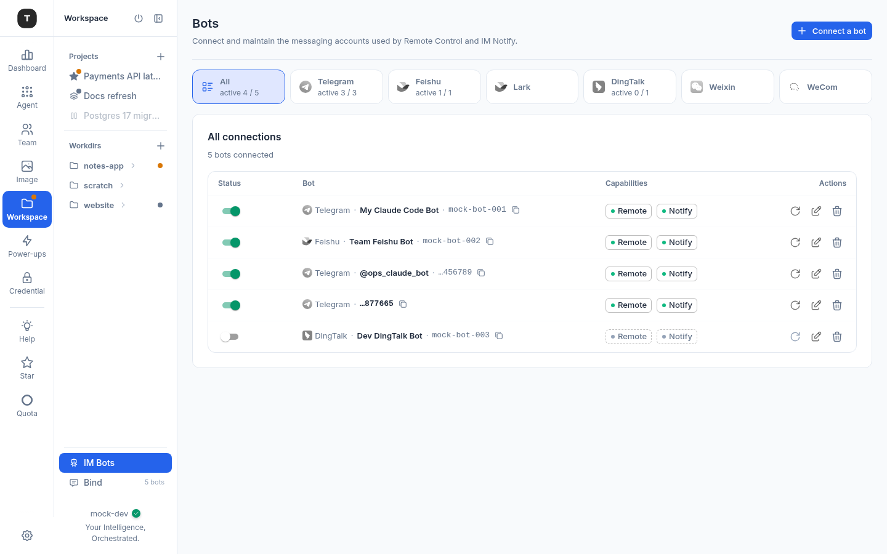
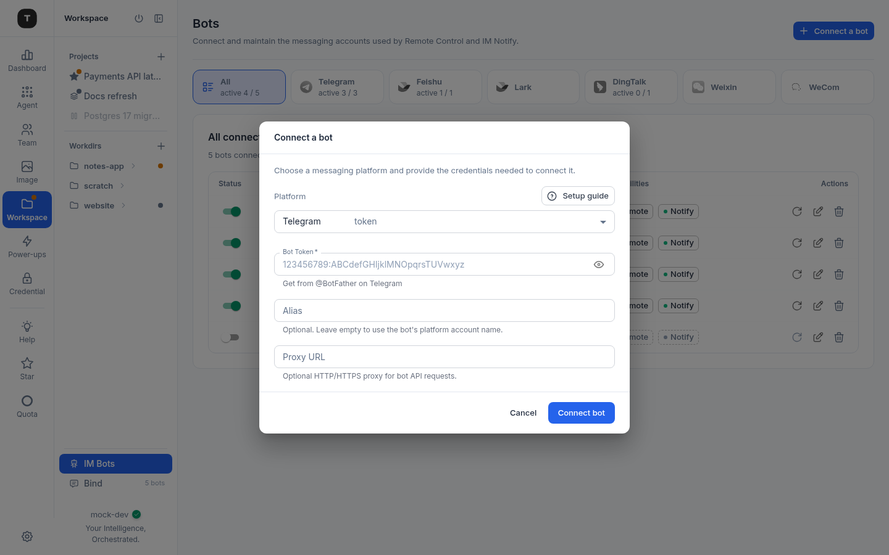
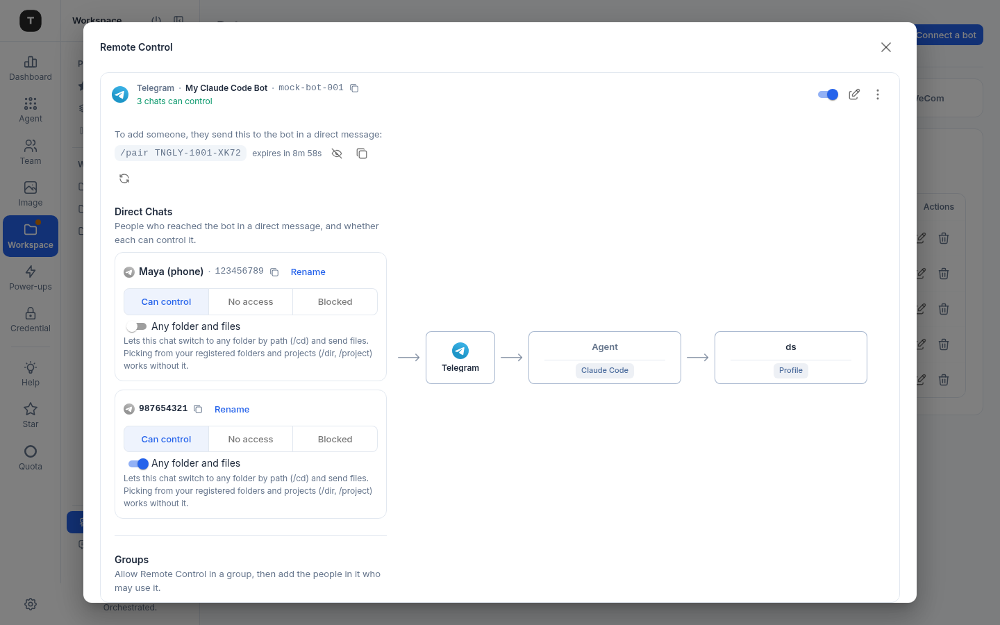
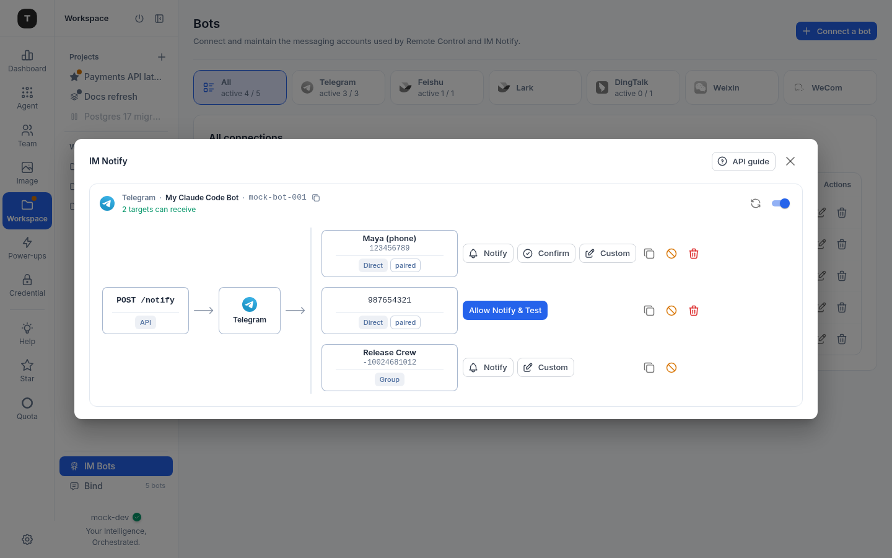
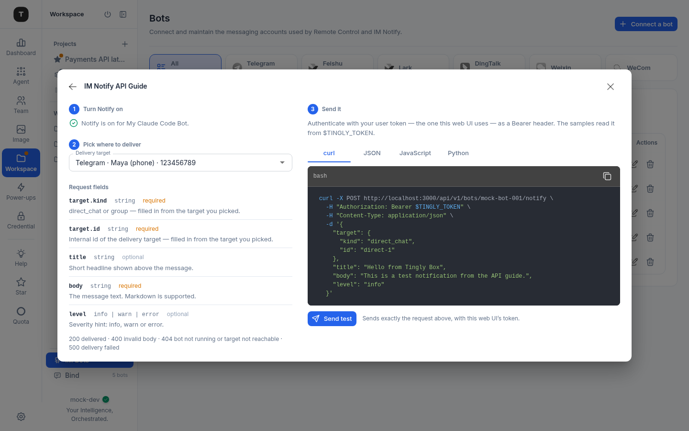

# IM Bots 与远程控制

路径 `/bots/overview`，从 **工作区 → IM Bots** 打开。

在 **IM Bots** 连接消息账号。机器人行的 **Remote** 和 **Notify** 分别打开远程控制和通知配置。

**聊天里发生什么。** 聊天通过 [Projects](../tingly-projects/zh/README.md) 与 Claude Code 对话。工作目录绑定会启动目录会话，项目绑定会将消息交给协调者。启用 **工作区** 后，可在工作区侧边栏的 **绑定**（Bind）管理聊天去向。

## 快速开始

在聊天软件里和 Claude Code 对话。这里以 Telegram 为例。**开始之前**：Claude Code 必须已经能通过 Tingly-Box 正常工作（[Claude Code 快速开始](./03-scenario-claude-code.md#快速开始)）。

1. 点**齿轮 → 扩展**（Power-ups），启用**工作区**（Workspace）。阅读界面上的主机访问提示。
2. 打开**工作区 → IM Bots → 连接机器人**。选择 Telegram，把从 `@BotFather` 获取的 token 填进 **Bot Token**，然后连接。
3. 点机器人行的**远程控制**（Remote），打开开关。若界面显示配对命令，先把 `/pair <code>` 原样发给机器人私聊，再在 **Direct Chats** 中确认该聊天已获准控制。
4. 在工作区侧边栏打开**绑定**（Bind，`/projects/im`），在该聊天行点**绑定**，再选已有项目或工作目录。已经绑定时用**改绑**（Move）。
5. 给机器人发一条消息。项目聊天由协调者接收，工作目录聊天进入该目录的 Claude Code 会话。

**验证**：**Remote** 显示有聊天可控制，**Bind** 页的 **Bound to** 显示所选目标。确认聊天里收到回复，再在工作区打开对应的对话。

---

## Bots（`/bots/overview`）

**IM Bots** 的 **All connections** 列出各平台的机器人。用顶部平台磁贴筛选。**Status** 控制整个机器人连接；**Bot** 列显示平台、名称和可复制的机器人 UUID；**Capabilities** 里的 **Remote** 和 **Notify** 分别打开该机器人的远程控制与通知配置。右侧操作可重启、编辑或删除连接。

总览支持 **Telegram、Feishu（飞书）、Lark、DingTalk（钉钉）、Weixin（微信）、WeCom（企业微信）**。已有的 `/bots/<platform>` 平台链接可从书签直接打开，对应的连接列表和指南仍可用。QQ 页面仍标记为开发中。

### 连接机器人

点击右上角的 **Connect a bot**：

1. 选择 **Platform**
2. 填写平台相应的凭证（如 Telegram 的 **Bot Token**，从 `@BotFather` 获取）
3. 可选：**Alias** 和 **Proxy URL**（机器人 API 请求使用的 HTTP/HTTPS 代理）
4. 点击 **Connect bot**

每个平台还有一个默认收起的 **Setup guide**，包含该平台的步骤和示例。Feishu 和 Lark 提供 **One-click (scan QR)** 扫码创建应用（自动创建应用、权限和事件）；Weixin 使用**二维码**绑定而不是令牌。

## Remote Control

在 **IM Bots** 的机器人行点 **Remote**。顶部开关控制该机器人的远程控制能力。配置集中在对话框内：

- **Direct Chats** 列出联系过机器人的私聊，可设为 **Can control**、**No access** 或 **Blocked**。配对命令在此对话框提供，须发给机器人私聊。
- **Groups** 可为群启用 **Remote Control**，并指定群内能用它的成员。群授权与成员授权分别配置。
- **Any folder and files** 允许聊天通过路径切换目录（`/cd`）及发送文件。普通私聊仍可用 `/dir` 或 `/project` 选择已登记的目标。
- 路由图展示聊天、平台、Claude Code 与 **Profile**。点 **Profile** 修改该机器人的默认配置。

### Claude Code Profile

**Profile** 节点（**Claude Code profile** 对话框）选择机器人的聊天运行在哪个 Claude Code 配置之下：*New sessions from this bot's chats run under this profile: its rules, model mapping and settings overrides.* **Default** 是主 `claude_code` 场景；否则选择你的某个 [Profile](./03-scenario-claude-code.md#profile-管理)（需先在 Claude Code 页面创建）。机器人的 Profile 作用于聊天的**第一次**会话；之后的会话沿用上一次会话的 Profile、模型和权限模式，Profile 被删除时回退到默认。

---

## 在聊天里与 Claude Code 对话

绑定到 [项目](../tingly-projects/zh/projects-and-threads.md) 的聊天默认与协调者对话。绑定到工作目录的聊天进入目录会话。绑定方法见 [IM 聊天绑定](../tingly-projects/zh/im.md)。回复、工具审批和提问会回到聊天；支持按钮的平台可直接点击，收到文本提示时按提示回复。

| 命令 | 用途 |
|---|---|
| `/help` | 查看此聊天可用的命令 |
| `/pair <code>` | 用界面提供的配对码在私聊中配对 |
| `/dir [N]`、`/project [N]` | 列出或选择已登记的工作目录、项目 |
| `/cd <path>` | 按路径切换工作目录，需要 **Any folder and files** |
| `/session [N]`、`/new [message]` | 选择会话或开始新会话 |
| `/stop [#N]`、`/clear` | 停止会话，或停止并在下条消息时开始新会话 |
| `/status`、`/compact [instructions]` | 查看当前会话状态，或压缩对话上下文 |
| `/verbose on\|off` | 显示或隐藏逐步执行消息 |
| `/yolo` | 切换免逐项审批的权限模式 |
| `@N <message>` | 向编号为 N 的会话发送一条消息 |

---

## IM Notify

在 **IM Bots** 的机器人行打开 **Notify**。 它让自动化把消息推到机器人见过的聊天里，与 Remote Control 无关。右上角的 **API guide** 按钮说明了通知 API：用你的用户令牌作为 Bearer 头认证，`POST /api/v1/bots/{bot}/notify`（路径里是机器人 UUID，返回 `200` 表示已送达），并从聊天节点复制目标 UUID。

### 投递目标

每个机器人的通知对话框有 **Notify 开关**和**刷新**按钮、一行状态（`N targets can receive` · `No target allowed yet` · `Notify off`），以及 `POST /notify (API)` → 平台 → **聊天节点** 的图。每个节点把平台 id（如 `telegram:123456789`，标记 **Direct** 或 **Group**，以及 `paired`）与行内操作配在一起：

- **Notify**：发送一条测试/手动消息
- **Confirm**：向支持回复的目标发送交互确认测试
- **Allow Notify & Test**：授权新目标并立即发送一条测试通知
- **Custom**：发送自定义内容（标题、级别、markdown 正文）
- 复制（API 需要的内部目标 UUID）、**Disable**（静默丢弃它的消息；**Show disabled (N)** / **Hide disabled** 可显示/隐藏）和删除（仅私聊；配对和绑定会被删除，会话历史保留）

新目标需要显式授权（**Allow Notify & Test**）后才会收到自动通知——机器人碰巧见到的聊天不会悄悄变成通知目标。

### API guide

在 **Notify** 对话框里点 **API guide**，从 **Delivery target** 选择已授权的聊天。界面会填入请求里的 `target.kind` 和内部 `target.id`，并提供可复制的示例。点 **Send test** 通过同一接口验证一次投递。

---

## 旧链接

`/remote-agent`（含平台后缀）、`/remote-control/*`、`/remote-coder/*` 和 `/notify` 都跳到 **IM Bots** 总览。从对应机器人行进入 **Remote** 或 **Notify**。

## 相关页面

- [Projects](../tingly-projects/zh/README.md)
- [实验性功能 · Projects](./19-experimental.md#projects)
- [Claude Code · Profile 管理](./03-scenario-claude-code.md#profile-管理)
- [场景总览](./02-scenario-overview.md)
