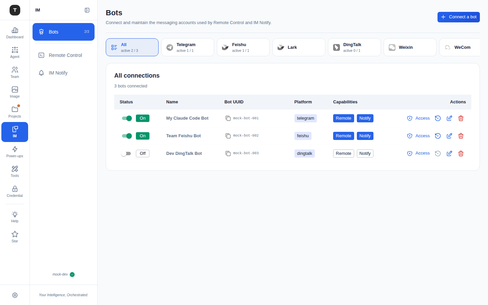
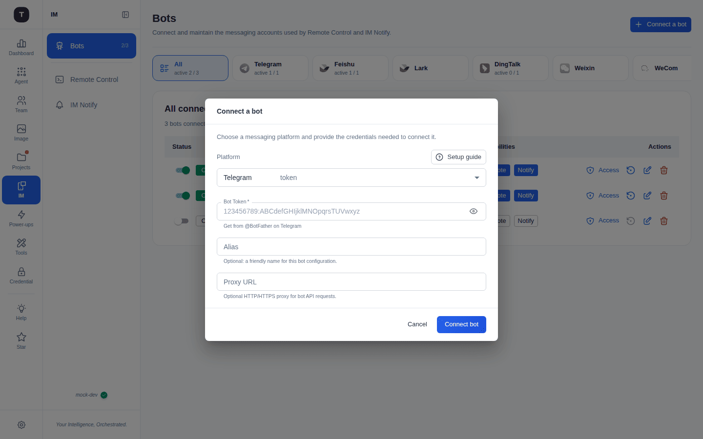
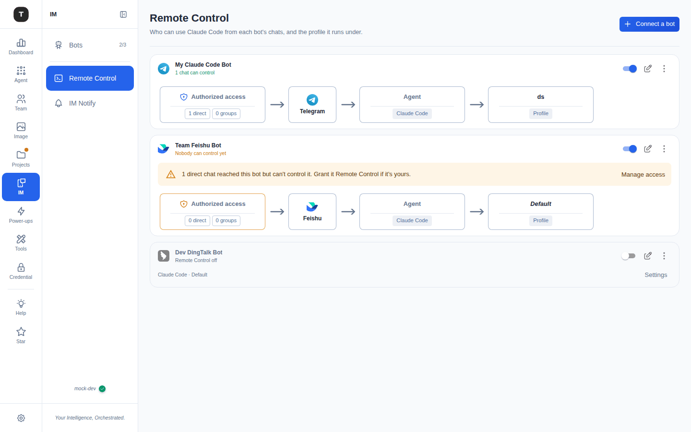
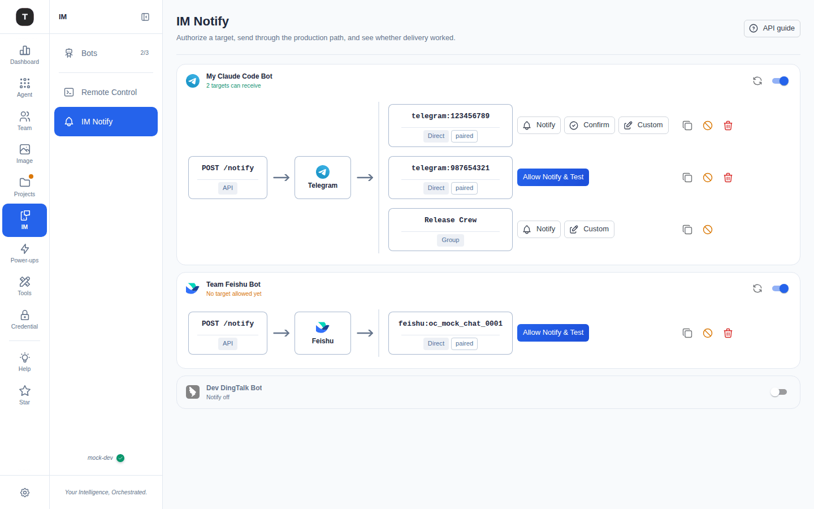

# Remote（远程控制）

路径：`/bots/*`、`/remote-agent`、`/notify`——**IM** 导航项

**IM** 导航项（原名 **Remote**）是聊天机器人所在的地方：连接消息账号，决定每个聊天里谁可以使用 Claude Code，并让自动化把消息推回聊天。它按关注点分成三个页面：**Bots**（账号）、**Remote Control**（每个机器人上谁可以控制 Claude Code，以及用哪个 Profile）和 **IM Notify**（出站通知）。

**聊天里发生什么。** 每个 IM 聊天都**通过 [Projects](./22-projects.md)** 与 Claude Code 对话：一条消息会变成工作文件夹里的一次 Claude Code 会话，这个会话和其他会话一样出现在 Projects 侧边栏里，审批、排队和回复在聊天和网页上是一致的。Remote 现在只负责*谁可以进来*——机器人连接、配对、访问控制和通知——进来之后的事交给 Projects。因此 IM 导航项随 **Projects** 开关一起出现（Power-ups → *Projects*）：一个开关同时打开两者。关闭后机器人仍然运行和发通知，但向 Claude Code 提问的聊天会被告知去打开 Projects（只有 `/bind` 和 `/join` 仍然可用）。

> 旧的 **@tb**（SmartGuide）路径、`@cc` / `@tb` 前缀、每个机器人的 SmartGuide 模型、常驻会话开关、bash 白名单和机器人级的 verbose 设置都已取消。行首的 `@cc` / `/cc` / `@tb` / `/tb` 会被直接丢弃，其余内容作为消息发送。

---

## Bots（`/bots/overview`）

资源层：连接并维护 Remote Control 和 IM Notify 共用的消息账号。副标题：*Connect and maintain the messaging accounts used by Remote Control and IM Notify.* 侧边栏的 **Bots** 一行带有 `active/total` 计数（`2/3`）。

支持的平台：**Telegram、Feishu、Lark、DingTalk、Weixin（微信）、WeCom**——可用磁贴行筛选（**All** 加每个平台一块，各带 `active N / N`）。QQ 暂不支持（它的页面 `/bots/qq` 显示*即将支持*）。

### 连接表

| 列 | 说明 |
|----|------|
| Status | 启用/禁用开关 + On/Off 徽标 |
| Name | 机器人别名 |
| Bot UUID | 唯一标识（带复制按钮） |
| Platform | 平台标识（如 `telegram`） |
| Capabilities | **Remote** / **Notify** 徽标——该机器人参与另外两个页面中的哪几个 |
| Actions | **Access**（见下）、恢复、编辑、删除；还有一个按钮用来查看机器人见过的聊天，方便复制 Chat ID |

### 连接机器人

点击右上角的 **Connect a bot**：

1. 选择 **Platform**
2. 填写平台相应的凭证（如 Telegram 的 **Bot Token**，从 `@BotFather` 获取）
3. 可选：**Alias** 和 **Proxy URL**（机器人 API 请求使用的 HTTP/HTTPS 代理）
4. 点击 **Connect bot**

每个平台还有一个默认收起的 **Setup guide**，包含该平台的步骤和示例。Feishu 和 Lark 提供 **One-click (scan QR)** 扫码创建应用（自动创建应用、权限和事件）；Weixin 使用**二维码**绑定而不是令牌。

### Access（访问）

机器人行上的 **Access** 打开 *`<bot>` access*——机器人可以为谁做什么：

- **Capabilities**：Remote Control 和 Notify。关掉最后一个会停止连接但不删除配置
- **Direct Chats**：所有在私聊里给机器人发过消息的人，附具体的平台 id。每个人是 **Paired person** / **Unpaired chat**，并有一个级别——**Can control**（Remote Control）、**Notify only**、**No access** 或 **Blocked**。未配对的聊天必须先配对；要添加某人，请让他在私聊里把显示的配对码发给机器人
- **Groups**：按群组开启 Remote Control，然后添加群里允许使用的人（actor）——群组访问和 actor 是两个独立的控制；新群组默认没有任何权限

---

## Remote Control（`/remote-agent`）

一个页面，**每个机器人一张卡片**。副标题：*Who can use Claude Code from each bot's chats, and the profile it runs under.* 平台只是每张卡片上的图标；右上角的 **Connect a bot** 打开上面同一个对话框。

### 每个机器人的卡片

- **头部**：平台图标 + 机器人名称、一行实时状态，以及 **Remote Control 开关**（关闭只卸载这个用途——机器人本身和 Notify 继续运行），还有 **Edit**（铅笔）和一个带 **Restart Bot**、**Delete** 的 ⋮ 菜单
- **状态行**：`Remote Control off`（灰）· `Checking access…` · `Couldn't check who can control` / `Nobody can control yet`（警告）· `N chats can control`（绿）
- **路由图**（开启的卡片）：**Authorized access**（`N direct · N groups`）→ **平台** → **Agent · Claude Code** → **Profile**。访问节点打开上面的 Access 编辑器；平台节点编辑机器人；Profile 节点打开 Profile 选择器
- **开启但不可用**的卡片会直接在卡片里告诉你下一步——要发给机器人的配对码（*Nobody can control this bot yet. Send this to the bot in a direct message:*），或者 *N direct chat(s) reached this bot but can't control it. Grant it Remote Control if it's yours.* 并带 **Manage access**
- **关闭**的卡片很安静：灰色的标识、一行（`Claude Code · Default`）和一个 **Settings** 链接，不显示完整路由图

### Claude Code Profile

**Profile** 节点（**Claude Code profile** 对话框）选择机器人的聊天运行在哪个 Claude Code 配置之下：*New sessions from this bot's chats run under this profile: its rules, model mapping and settings overrides.* **Default** 是主 `claude_code` 场景；否则选择你的某个 [Profile](./03-scenario-claude-code.md#profile-管理)（需先在 Claude Code 页面创建）。机器人的 Profile 作用于聊天的**第一次**会话；之后的会话沿用上一次会话的 Profile、模型和权限模式，Profile 被删除时回退到默认。

> 旧的按平台的 `/remote-agent/:platform` 书签以及拆分之前的 `/remote-control/*` 会重定向到这里。

---

## 在聊天里与 Claude Code 对话

直接发消息即可——第一条消息会在该聊天的工作文件夹（之前用过的文件夹，或机器人的默认目录）里开启一次会话。回复、工具调用的审批和提问都会回到聊天里；权限审批使用按钮（没有按钮的平台用文字 `y` / `n` / `always`），Claude Code 的提问则回复选项编号或你自己的话。会话忙碌时发的消息会排队，与网页上一致。命令：

| 命令 | 作用 |
|------|------|
| `/cd <path>` | 换到另一个文件夹工作（下一条消息会在那里开新会话）；目录浏览按钮效果相同 |
| `/dir [N]` | 列出这个聊天用过的文件夹，或切换到其中一个 |
| `/session [N]` | 列出当前位置的会话，或切换到 `#N` |
| `/new [message]` | 开始一个新会话 |
| `/stop` | 停止正在运行的会话 |
| `/clear` | 停止，并让下一条消息开始新会话 |
| `/status` | 这个聊天在哪里，以及它的会话运行情况 |
| `/verbose on\|off` | 同时看到每一步，而不只是回复 |
| `/yolo` | 不经询问使用所有工具，或切回 |
| `@N <message>` | 只对会话 `#N` 说一句话 |
| `/bind <code>`、`/join` | 配对和群组白名单（接入层；即使 Projects 关闭也能用） |
| `/help` | 以上列表，外加你的用户 id 和聊天 id |

绑定到某个[项目](./22-projects.md)而不是文件夹的聊天，对话对象是该项目的协调者——把聊天绑定到项目要在网页上完成（Projects → 项目的 **Bind chat**，或 **Projects → IM**），因为项目绑定只有这一个入口。

---

## IM Notify（`/notify`）

同样的页面形态：**每个机器人一个分组**。副标题：*Authorize a target, send through the production path, and see whether delivery worked.* 它让自动化把消息推到机器人见过的聊天里，与 Remote Control 无关。右上角的 **API guide** 按钮说明了通知 API：用你的用户令牌作为 Bearer 头认证，`POST /api/v1/bots/{bot}/notify`（路径里是机器人 UUID，返回 `200` 表示已送达），并从聊天节点复制目标 UUID。

### 每个机器人的分组

每个分组有自己的 **Notify 开关**和**刷新**按钮、一行状态（`N targets can receive` · `No target allowed yet` · `Notify off`），以及 `POST /notify (API)` → 平台 → **聊天节点** 的图。每个节点把平台 id（如 `telegram:123456789`，标记 **Direct** 或 **Group**，以及 `paired`）与行内操作配在一起：

- **Notify**：发送一条测试/手动消息
- **Confirm**：对尚未授权的目标显示为 **Allow Notify & Test**
- **Custom**：发送自定义内容（标题、级别、markdown 正文）
- 复制（API 需要的内部目标 UUID）、**Disable**（静默丢弃它的消息；**Show disabled (N)** / **Hide disabled** 可显示/隐藏）和删除（仅私聊；配对和绑定会被删除，会话历史保留）

新目标需要显式授权（**Allow Notify & Test**）后才会收到自动通知——机器人碰巧见到的聊天不会悄悄变成通知目标。

---

## 相关页面

- [Projects](./22-projects.md)
- [实验性功能 · Projects](./19-experimental.md#projects)
- [Claude Code · Profile 管理](./03-scenario-claude-code.md#profile-管理)
- [场景总览](./02-scenario-overview.md)
