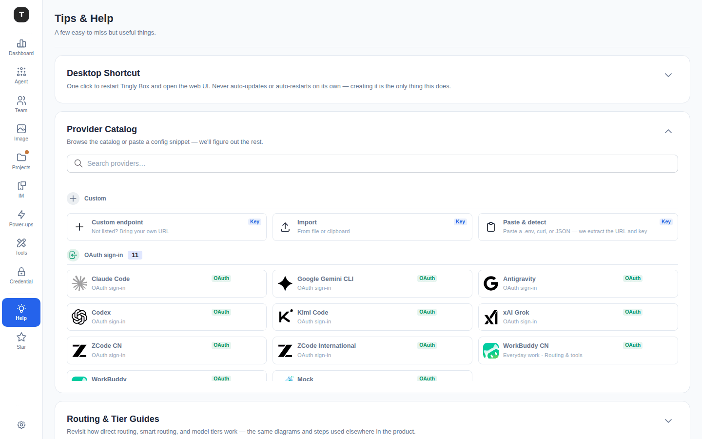
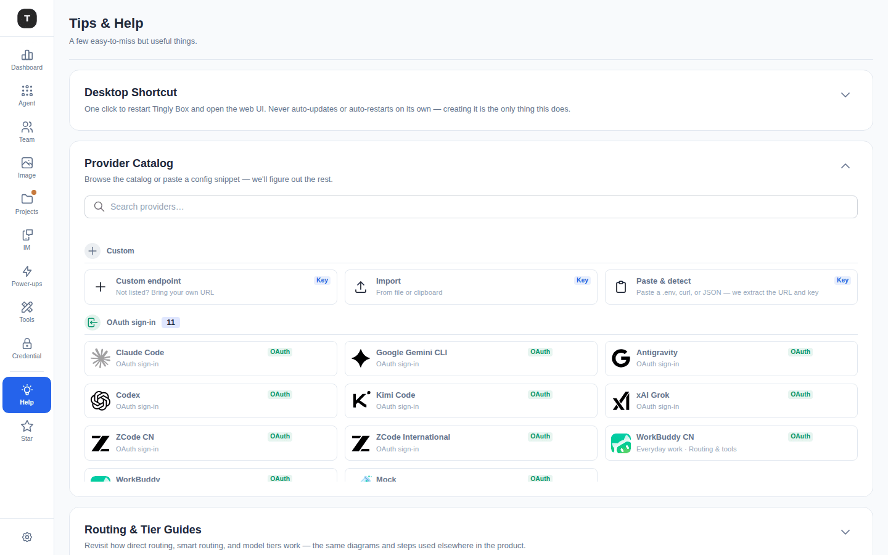

# 提示与帮助

路径：`/help`

导航栏里的 **Help** 灯泡，位于 **Star**（指向 GitHub 项目的链接——应用里唯一请求 star 的地方）上方。它不是首次使用的落点：全新安装会打开上次使用的 Agent 页面，由那里的 [Quick Start](./03-scenario-claude-code.md#4-quick-start) 带你完成 Provider → 模型 → 安装 → 配置。同样的内容之后仍可在 Help 里找到（旧的 `/onboarding` 地址会重定向到这里）。页面副标题：「A few easy-to-miss but useful things.」

四张可折叠的手风琴卡片，彼此都是独立操作，而非线性教程中的某一步——展开一张不会收起其他几张：

## Desktop Shortcut（桌面快捷方式）

在[桌面应用](./23-desktop-app.md)里隐藏（应用本身就是快捷方式）。在浏览器里，一键创建桌面快捷方式，用于重启 Tingly-Box 并打开 Web UI——它不会自动更新或自动重启服务，创建快捷方式是它唯一做的事。卡片内含 **Create Shortcut** / **Recreate** 按钮。

## Provider Catalog（Provider 目录）

默认展开。内嵌与 **Connect AI** 选择器相同的 Provider 目录（搜索框 + 按连接类型分组的卡片——Custom、OAuth sign-in、Self-hosted、API key providers）——完整的选择器说明详见 [凭证管理 · 添加 Provider](./08-credentials.md#添加-providerconnect-ai-流程)。卡片内容超过固定高度后会在内部滚动，避免把其他卡片挤出屏幕。

## Routing & Tier Guides（路由与 Tier 引导）

三个按钮重新打开产品中其他位置内嵌的同一套图解引导，因此只需维护一份图表，而不是多份重复内容：
- **Direct routing guide**：与任意场景页面上每位用户首次访问时自动弹出的 [首次访问引导](./20-routing-rules.md#首次使用引导) 是同一个
- **Smart routing guide**：Smart 模式下的对应引导
- **Tier guide**：解释基于 Tier 的故障转移（T0/T1/T2 优先级与熔断机制）

## Team Guide（Team 引导）

一个 **How Team works** 按钮，重新打开与任意 Team 工作区页面帮助图标相同的 [Team 引导弹窗](./07-team.md#team-引导弹窗)：Team 的用途、如何做到隔离，以及如何配置 Team Key。

---

## 相关页面

- [凭证管理](./08-credentials.md)
- [路由规则与插件](./20-routing-rules.md)
- [Team](./07-team.md)
