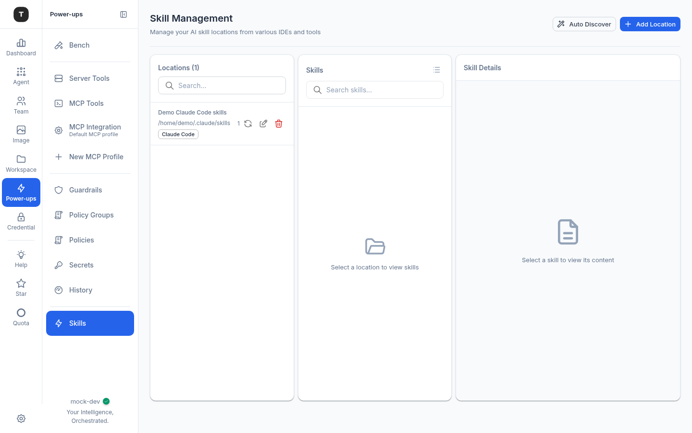

# Prompt 管理

路径 `/prompt/skill`

启用 **Skills** 后，可以在 **Power-ups** 下浏览和管理各 IDE 的技能。

## 快速开始

在一个地方浏览你各个 IDE 里已有的 Skills。

1. 先打开功能：**齿轮** → **Power-ups** → **Skills**。
2. 点导航栏的 **Power-ups** → **Skills**。
3. 点 **Auto Discover**，勾选你用的 IDE（Claude Code、OpenCode、VS Code、Cursor、Codex 等）并导入。扫描不到的目录？用 **Add Location** 填名称、路径和 IDE 来源。
4. 点一个位置，再点一个 Skill，以渲染后的 **Markdown** 或 **Raw** 查看，并可复制。

**验证**：位置列表显示了 Skill 数量，右侧显示 Skill 内容。

---

## Skills 管理

路径：`/prompt/skill`

### 功能说明

该页面（标题 **Skill Management**——*Manage your AI skill locations from various IDEs and tools*）管理从 IDE 配置（如 `.claude/skills/` 目录）同步的可复用 Prompt 片段，支持：
- 从多个 IDE 来源自动发现 Skills
- 分组浏览和搜索
- 查看 Skill 的 Markdown/原始内容

### 三列布局

**左列：Skill 位置（Locations）**

每个 Skill 位置（Location）对应一个目录来源：
- 位置名称
- 路径
- IDE 来源徽章（如 claude_code）
- Skill 数量
- 操作：刷新、编辑、删除

顶部按钮：
- **Add Location**：手动添加 Skill 目录（显示名称、路径和 IDE 来源）
- **Auto Discover**：扫描主目录里受支持的 IDE（Claude Code、OpenCode、VS Code、Cursor、Codex、Antigravity、Gemini CLI、GitHub Copilot、Windsurf 等）并导入它们的 Skills——在对话框里选择要导入哪些

**中列：Skills 列表**

选中位置后展示该位置下的所有 Skills：
- **分组/平铺** 视图切换（列标题里的图标）
- 搜索过滤

**右列：Skill 内容**

选中 Skill 后展示：
- 文件元数据（路径、大小、修改时间）
- **Markdown 渲染**视图（默认）
- **Raw** 原始文本视图
- 复制按钮

---

## 相关页面

- [实验性功能](./19-experimental.md)
- [Claude Code 场景](./03-scenario-claude-code.md)
