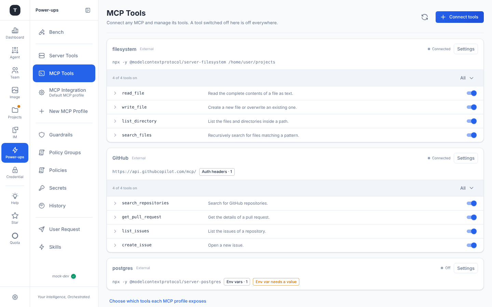
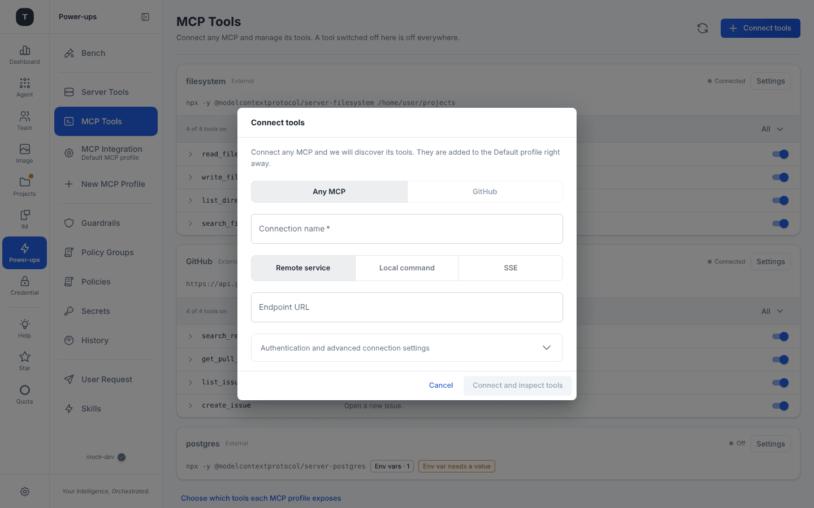
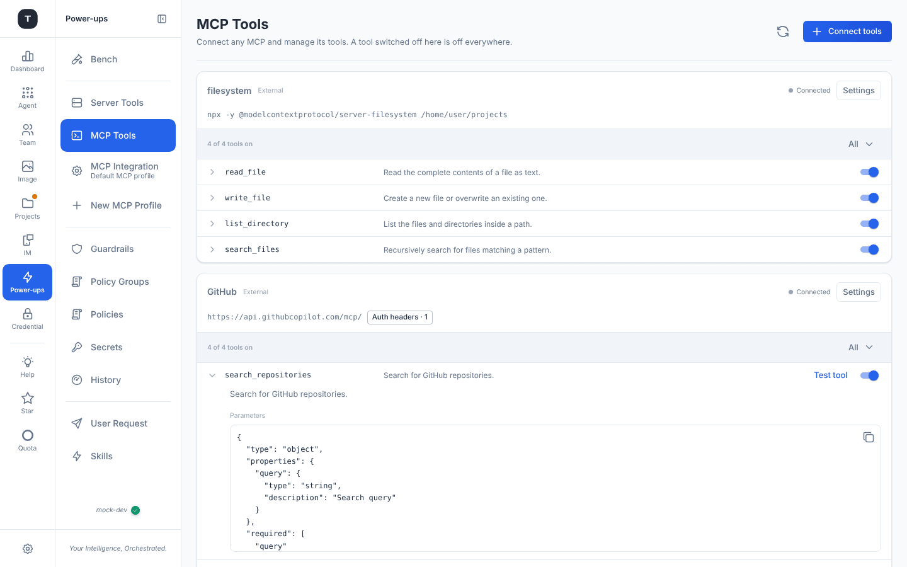
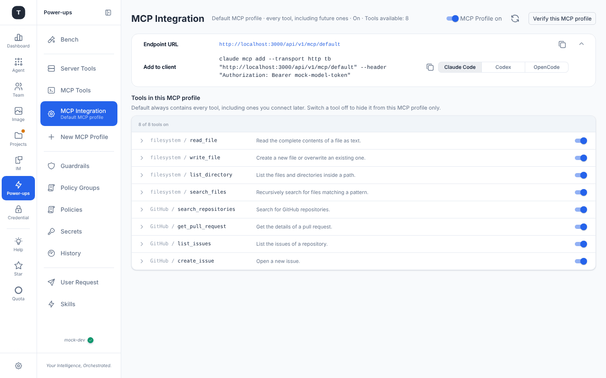
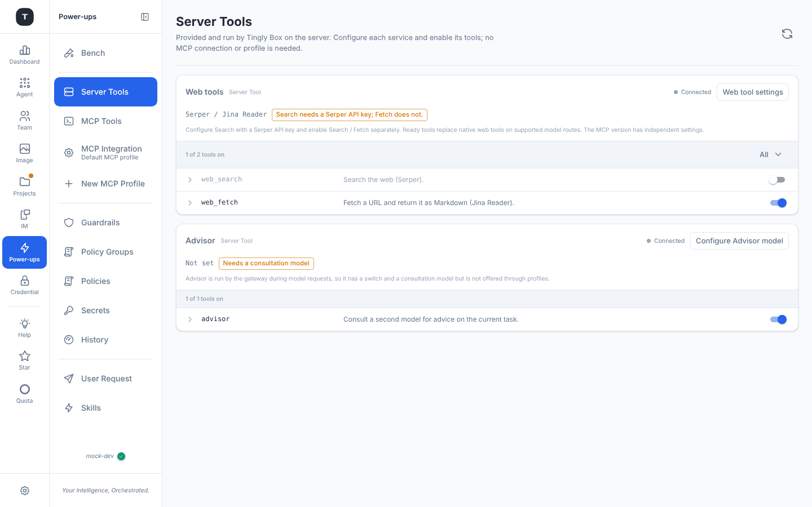

# MCP 与工具

路径：`/mcp/tools`（**MCP Tools**）· `/mcp/profile/:profileId`（**MCP Profile**；`/mcp/profile/default` 是主入口）· `/mcp/server-tools`（**Server Tools**）

MCP（Model Context Protocol）让你的编码 Agent 使用额外的工具——GitHub 连接、知识库、本地脚本等。Tingly-Box 把这些工具服务接入一次，再通过每个 Agent 专属的 MCP 端点把工具提供给它。另有少数工具直接运行在网关**内部**（联网搜索/抓取、Advisor），完全不需要 MCP。

> **入口在哪里。** 这些页面位于 **Power-ups**（界面显示「扩展」）导航项之下，始终可见。[Power-ups 菜单](./02-scenario-overview.md#power-ups齿轮背后的菜单)（或[实验性功能](./19-experimental.md)）里的 *MCP Tools* 开关控制 MCP **执行**是否开启；关闭时 MCP 页面会提示 *MCP 执行尚未开启。配置已保存，启用后即可使用。*，并提供 **启用 MCP**（Enable MCP）按钮。

## 快速开始

给你的编码 Agent 增加工具——接入一次 MCP 服务，再把它的工具交给 Claude Code、Codex 或 OpenCode。

1. 点导航栏 **Power-ups**（界面显示「扩展」）→ **MCP Tools**（`/mcp/tools`）。如果页面提示「MCP 执行尚未开启」，点 **启用 MCP**（Enable MCP）。
2. 点 **接入工具**（Connect tools）。在 **任意 MCP**（Any MCP）下填 **工具连接名称**，再填服务地址（**远程服务**）或启动命令（**本地命令**）；也可以选 **GitHub** 并粘贴个人访问令牌。点 **接入并查看工具**，发现的工具会立即加入 Default Profile。
3. 点 **Power-ups** → **MCP Integration**（默认 MCP Profile）。在 **添加到客户端** 里选 **Claude Code**、**Codex** 或 **OpenCode**，复制命令（里面已经带好你的端点和令牌）并运行——Claude Code 的命令形如 `claude mcp add --transport http tb "<Base URL>/api/v1/mcp/default" --header "Authorization: Bearer …"`。
4. 点 **验证此 MCP Profile**（Verify this profile）。

**验证**：出现绿色提示「已通过网关的真实初始化和工具发现」及工具数量，Agent 里也能看到名为 `tb` 的服务（Claude Code：`/mcp`）。联网搜索/抓取和 Advisor 不属于 MCP——它们运行在网关内部，在 [Server Tools](#server-toolsmcpserver-tools) 里配置。

---

## 各部分如何配合

| 部分 | 是什么 | 页面 |
|------|--------|------|
| **MCP Tools** | 与工具服务的连接，以及它们提供的工具；每个工具有一个全局开关 | `/mcp/tools` |
| **MCP Profile** | 给某个 Agent 的一个入口（一个端点 URL），包含该 Agent 可使用的工具集合 | `/mcp/profile/:profileId` |
| **Server Tools** | 网关在模型请求中自己执行的工具——无需 MCP 连接，也无需 Profile | `/mcp/server-tools` |

在 **MCP Tools** 里关掉的工具，在所有 Profile 里都不可用。**Power-ups** 侧边栏按顺序列出：**Server Tools**、**MCP Tools**、每个 Profile 一行（默认的是 **MCP Integration**，副标题「默认 MCP Profile」）以及 **新建 MCP Profile**。

---

## MCP Tools（`/mcp/tools`）

*接入任意 MCP，并管理它的工具。在这里关掉的工具在任何地方都不可用。*

右上角的 **接入工具**（Connect tools）会打开同名对话框，选 **任意 MCP**（Any MCP）或 **GitHub**：

- **任意 MCP**：填 **工具连接名称**，然后选 **远程服务**（HTTP **端点 URL**）、**本地命令**（STDIO 服务器：命令、环境变量、工作目录）或 **SSE**（SSE 地址）；认证、代理和允许列表（`*` 表示发现全部工具）在「认证与高级连接设置」里
- **GitHub**：官方 GitHub MCP server 的固定精选子集（读取仓库、issue、PR 和 Actions 日志，以及评论、issue 和 PR）。只需要一个 **GitHub 个人访问令牌**；建议使用只授权所需仓库的 fine-grained token

点 **接入并查看工具**（Connect and inspect tools）会自动发现工具，并立即加入 Default Profile。

每个连接是一张卡片：名称和来源（内置或外置）、状态——**连接正常**、**正在检查…**、**已关闭**、**需要处理**或**失败**——以及一个 **设置** 按钮（失败时是 **修复连接**），下面是地址或命令，旁边有小标签（认证 header、环境变量、代理；缺少的内容用琥珀色「需要填写…」标签提示）。再往下是该连接的工具，每个一行：

- 每个工具一个开关（「已开启 3 / 12 个工具」），一个**筛选工具…**输入框，以及对全部或匹配项的批量**全部开启** / **全部关闭**
- 工具参数以可复制的 JSON schema 展示，并可 **测试工具**——填入**参数（JSON）**后点**执行测试**
- 被连接允许列表排除的工具会注明原因，并指向连接设置

**设置** 会打开该连接的抽屉：启用或停用整个连接（关闭后其所有工具在每个 Profile 里都不可用）、修改地址或命令与认证，或移除连接。卡片下方的 **选择每个 Profile 开放哪些工具** 会跳到 Default Profile。

---

## MCP Profile（`/mcp/profile/:profileId`）

*MCP Profile 是工具的一个入口。Default 包含全部工具；也可以新建其他 Profile，只给某个 Agent 它需要的工具。*

- **页头**：Profile 名称（默认的是 **MCP Integration**）、自定义 Profile 的重命名和删除图标、**MCP Profile 已开启**（Profile on）开关、刷新按钮和 **验证此 MCP Profile**；自定义 Profile 还有 **添加工具**
- **连接**：**端点地址**（`<Base URL>/api/v1/mcp/<profile id>`，带复制按钮）和 **添加到客户端**：选 **Claude Code**、**Codex** 或 **OpenCode**，复制已经写好端点和令牌的注册内容：
  - Claude Code：`claude mcp add --transport http tb "<endpoint>" --header "Authorization: Bearer <token>"`（自定义 Profile 的服务器名是 `tb-<profile 名>`）
  - Codex：写入 `~/.codex/config.toml` 的 `[mcp_servers.tb]` 区块
  - OpenCode：写入 `~/.config/opencode/opencode.json` 的 `mcp` 条目
- **此 MCP Profile 里的工具**：每个工具有自己的开关（「已开启 N / M 个工具」）。**Default 始终包含所有工具，包括之后接入的**；关掉某个工具只会在此 Profile 中隐藏它。**自定义** Profile 只包含你用**添加工具**加进去的工具——新接入的工具不会自动加入。在 **MCP Tools** 页关闭的工具会显示「在 MCP Tools 页已关闭，所以这里也不可用」
- GitHub 连接可以按 Profile 限定 **GitHub 仓库**（`owner/repo`）；没有列表时，它的工具可访问令牌能访问的所有仓库

**验证此 MCP Profile** 会对网关做一次真实的初始化和工具发现，并报告工具数量。侧边栏的 **新建 MCP Profile** 会让你输入名称。删除 Profile 会让接入它的 Agent 失去访问；工具和其他 Profile 不受影响。

---

## Server Tools（`/mcp/server-tools`）

*由 Tingly Box 在服务端提供并执行。请先配置服务，再开启所需工具；无需 MCP 连接或 Profile。* 它们被注入到模型请求中，不会通过 MCP Profile 对外提供。

- **联网工具**：**Search** 使用 Serper，需要 **Serper API key**；**Fetch** 使用 Jina Reader，无需 Key。打开 **联网工具设置**，填入 Key，点 **保存联网工具设置**，再分别开启 Search 和 Fetch。就绪的工具会在受支持的模型路由上替代原生联网工具。搜索词会发送给 Serper，抓取的网址会发送给 Jina Reader，请只开启你希望网关执行的工具
- **Advisor（顾问）**（*实验性功能*）：网关调用第二个模型提供咨询意见，并返回给当前模型。点 **配置顾问模型** → **选择咨询模型**；未设置时卡片提示「需要选择咨询模型」

---

## 旧地址

下面这些旧地址依然可用，会自动跳转：`/mcp/sources` → `/mcp/tools`；`/tools/servertool` → `/mcp/server-tools`；`/mcp`、`/mcp/local-mode`、`/mcp/clients`、`/mcp/routes` 和 `/mcp/profiles` → `/mcp/profile/default`。

---

## 相关页面

- [实验性功能](./19-experimental.md)
- [防护栏](./15-guardrails.md)
- [Claude Code 场景](./03-scenario-claude-code.md)
