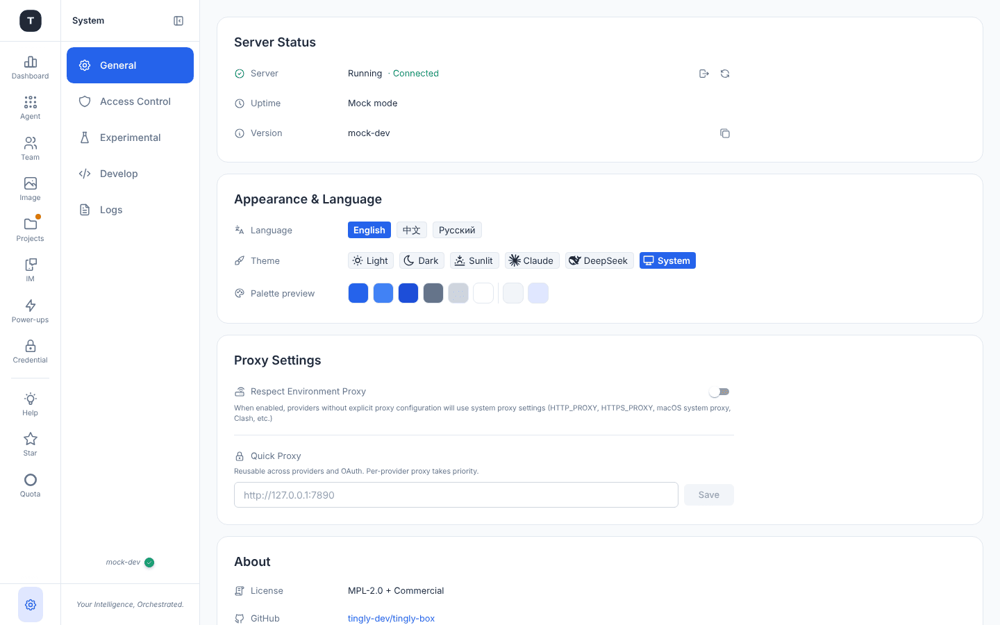
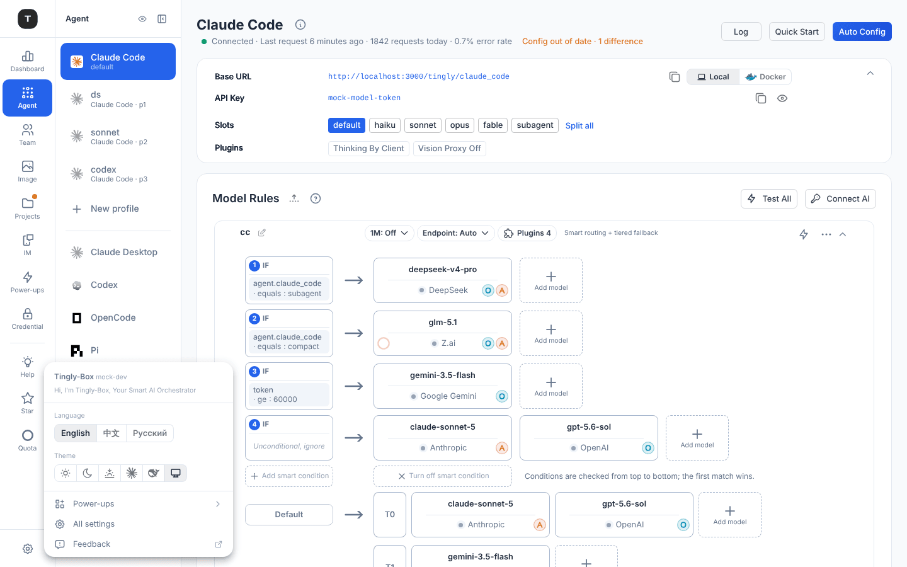
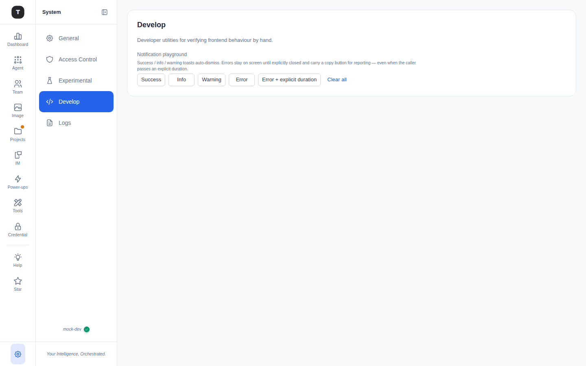
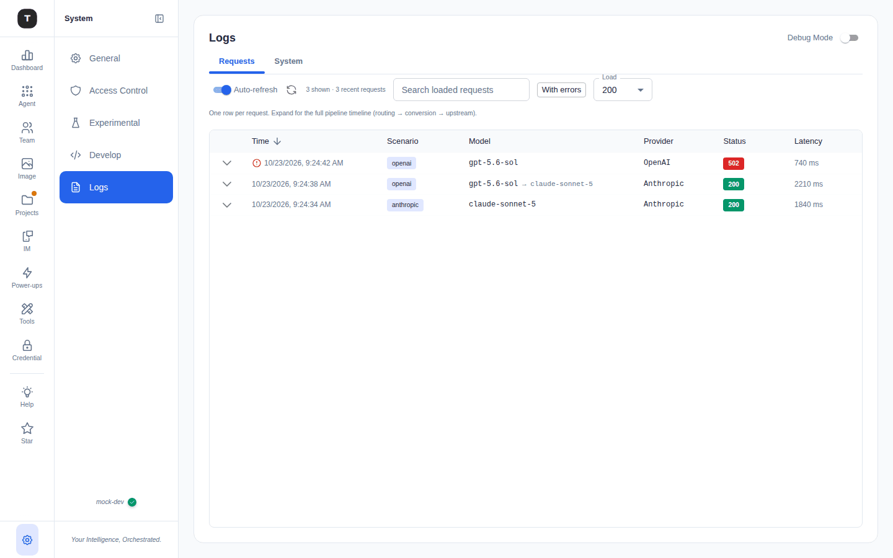

# 系统设置

路径：**General** `/system`、**Access Control** `/access-control`、**Experimental** `/system/experimental`、**Develop** `/system/develop`、**Logs** `/system/logs`

System **在左侧栏里没有自己的图标**。从**左侧栏底部的齿轮**进入：*Preferences* → **All settings**（处于 System 页面时齿轮会高亮）。它的侧边栏包含 **General**、**Access Control**（[单独章节](./18-access-control.md)）、**Experimental**（[单独章节](./19-experimental.md)）、**Develop** 和 **Logs**。

齿轮的 **Preferences** 弹层本身就带有常用控件——与 General 页面相同的语言和主题切换，外加 **Power-ups** 和 **Feedback**：

- 顶部：`Tingly-Box <版本>` 和一句标语
- **Language**：`English` · `中文` · `Русский`
- **Theme**：Light · Dark · Sunlit · Claude · DeepSeek · System
- **Power-ups**（悬停或点击）：[Power-ups 子菜单](./02-scenario-overview.md#power-ups齿轮背后的菜单)
- **All settings**：打开 System
- **Feedback**：打开 GitHub issue 选择页

---

## General（`/system`）

四张卡片：

### Server Status

| 字段 | 说明 |
|------|------|
| Server | Running / Stopped / Unavailable，外加 Connected/Disconnected 指示 |
| Uptime | 服务器已运行时长 |
| Version | 当前版本号，带复制按钮；有可用更新时会显示 `available → <版本>` |

整个界面里的复制按钮在通过纯 HTTP 打开 Tingly-Box 时同样可用（会回退到剪贴板兼容方案，对话框内也一样）。

**操作**（右侧图标）：**Force logout**（清除令牌并回到登录页）和 **Refresh status**。

点击版本号——在这里，或**每个侧边栏底部的版本行**（只有版本号，带一个小状态徽标：绿色对勾 = 已是最新，橙色箭头 = 有可用更新）——会打开 **Update** 对话框。顶部的渠道切换（`npm` / `npx` / `docker`）切换安装方式，每种都带一键复制。若能检测到当前实例的启动渠道（npm/npx），会默认选中它，否则选 `npm`：

| 渠道 | 命令 | 适用场景 |
|------|------|----------|
| `npm`（默认，推荐） | `npm install -g tingly-box@<version>` 然后 `tb restart` | 更新全局安装的 CLI，并用简写 `tb` 重启 |
| `npx` | `npx tingly-box@<version>` | 一次性更新——一条命令下载并重启 |
| `docker` | `docker pull ghcr.io/tingly-dev/tingly-box:v<version>` | 从 GitHub Container Registry 拉取新镜像 |

### Appearance & Language

- **Language**：`English` / `中文` / `Русский`（新增俄语）。首次访问且没有保存过选择时，界面跟随浏览器语言。
- **Theme**：`Light` / `Dark` / `Sunlit` / `Claude` / `DeepSeek` / `System`（跟随系统）
- **Palette preview**：当前主题的色板（悬停可看名称和取值）

### Proxy Settings

- **Respect Environment Proxy**：没有显式配置代理的 Provider 回退到系统环境代理（`HTTP_PROXY`、`HTTPS_PROXY`、macOS 系统代理、Clash 等）
- **Quick Proxy**：可复用的 HTTP/HTTPS 代理预设（如 `http://127.0.0.1:7890`），Provider 和 OAuth 可一键选用；单个 Provider 自己的代理仍优先。输入后点击 **Save**

> 只给某个 Provider 配代理，请在该 Provider 的编辑表单里设置——见[凭证管理](./08-credentials.md)。

### About

- **License**：MPL-2.0 + Commercial
- **GitHub**：项目仓库

> 桌面应用显示的页面与此完全相同——之前会隐藏部分页面的 *lite* 版本已不复存在。

---

## Develop（`/system/develop`）

用于手动验证前端行为的开发者工具——目前是一个 **Notification playground**：*Success / Info / Warning* 提示会自动消失，而 *Error* 提示会一直停留直到被关闭，并带复制按钮方便提交问题（即使传了 duration 也一样）。

---

## Logs（`/system/logs`）

服务器日志分两个标签页，右上角有 **Debug Mode** 开关（开 = 日志级别 `debug`，关 = `info`，默认）。

**Requests**：每个 AI 请求一行：**Time**、**Scenario**、**Model**（`请求的 → 路由到的`）、**Provider**、**Status**（带颜色）和 **Latency**；失败的请求带红色标记。控件：**Auto-refresh**、刷新按钮、`N shown · M recent requests`、**Search loaded requests**、**With errors** 标签和 **Load**（200 / 500 / 1000）。Agent 页面上的 **Log** 按钮会在对话框里打开同一个查看器，并按该 Agent 过滤（一个可清除的 `filter: <scenario>` 标签）。展开某一行可看完整的**请求旅程（journey）**，按时间排序的单一列表：路由 → 转换 → 上游，每行格式 `[kind] name · detail → result · duration`，带 `stage` / `log` 徽标——点击某行查看键/值面板；request id 和 trace id 在底部，方便提交问题时引用。

**System**：服务器自身的日志：**Time**、**Level**、**Status**、**Message**，带级别标签（**All**，然后每个级别）、搜索、**Load**、自动刷新和可排序的列。

---

## 相关页面

- [访问控制](./18-access-control.md)
- [实验性功能](./19-experimental.md)
- [凭证管理](./08-credentials.md)
