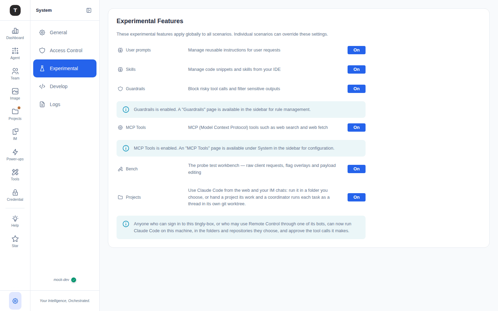
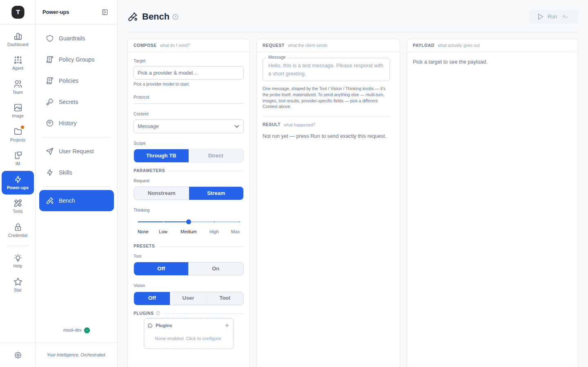

# 实验性功能

路径：`/system/experimental`（**System → Experimental**）

该页面列出仍在早期迭代中的功能，每项带一个 **On / Off** 芯片。打开后对应的导航项和页面就会出现；关闭只是把它们隐藏，**数据和配置都会保留**。同样的开关也在侧边栏齿轮的 **Preferences → Power-ups** 菜单里（那里还多了 Team、Image 和 Virtual Models，并给每一行标上 *Exp.* / *Beta*）——两处是同一组全局开关，哪个近用哪个。详见[场景总览 · Power-ups](./02-scenario-overview.md#power-ups齿轮背后的菜单)。

> 不再有版本拆分：桌面应用展示的功能与浏览器和 CLI 完全相同（原来的 *lite* 版本已取消），所以这里没有「仅 Full Edition 可用」的功能。

如果你打开了某个功能被关闭的页面——比如一个指向 `/guardrails` 的书签——会被带到这里，并显示提示 *`<feature> is off. Turn it on below to continue.`*；打开开关后会直接回到那个页面。

---

## 功能列表（按页面顺序）

### User prompts 与 Skills

**开关**：`skill_user`、`skill_ide`

- **User prompts**——*Manage reusable instructions for user requests*：**User Request** 页面（`/prompt/user`）
- **Skills**——*Manage code snippets and skills from your IDE*：**Skills** 页面（`/prompt/skill`）

两者都出现在 **Power-ups** 导航项下。详见[Prompt 管理](./14-prompt-management.md)。

### Guardrails

**开关**：`guardrails`——*Block risky tool calls and filter sensitive outputs*

在 **Power-ups** 下加入 **Guardrails** 分组（Overview、Policy Groups、Policies、Secrets、History）。开启后会显示一条提示：Guardrails 页面已可用。详见 [Guardrails](./15-guardrails.md)。

### MCP Tools

**开关**：`mcp`——*MCP (Model Context Protocol) tools such as web search and web fetch*

加入 **Tools** 导航项：**MCP**（已注册服务器、本地模式）和 **Servertool**。详见 [MCP 与工具](./16-mcp-tools.md)。

### Bench

**开关**：`bench`（在 Power-ups 中标为 *Beta*）——*The probe test workbench — raw client requests, flag overlays and payload editing*

在 **Power-ups** 下加入 **Bench**（`/bench`）——*把所有旋钮都摆在面前的一次探测请求*。三栏：**Compose**（*what do I send?*）→ **Request**（*what the client sends*）→ **Payload**（*what actually goes out*），请求下方是 **Result**（*what happened?*）。**Run**（⌘/Ctrl + Enter）会原样发出这个请求。

- **Target**：选择 Provider 和模型；**Protocol** 与 **Content**（单条的 *Message*、*Blank*、*Multi-turn*、*Tool round-trip*、*Image*、*Mid-conversation system*，或用该协议线上格式自己写的 *Custom* 请求体）
- **Scope**：*Through TB*（完整路由和中间件）或 *Direct*（绕过 Tingly-Box，用来区分是上游出错还是网关出错）
- **Parameters**：*Nonstream / Stream*、**Thinking** 滑块，以及 **Tool** / **Vision** 预设
- **Plugins**：仅为本次请求叠加规则标记（不会保存；标记属于 TB 中间件，所以在 *Direct* 范围下不生效）

它是单条规则[探测面板](./20-routing-rules.md#探测面板probe-panel)的宽敞版：同一套引擎，但你可以离开规则自由实验。

### Projects

**开关**：`projects`（标为 *Beta*）——*Use Claude Code from the web and your IM chats: run it in a folder you choose, or hand a project its work and a coordinator runs each task as a thread in its own git worktree.*

加入 **Projects** 和 **IM** 两个导航项。它**默认关闭**，因为它会让 Claude Code 在这台机器上运行：开启期间会显示警告 *Anyone who can sign in to this tingly-box, or who may use Remote Control through one of its bots, can now run Claude Code on this machine, in the folders and repositories they choose, and approve the tool calls it makes.* 之前已经通过 Remote 与机器人聊天的安装会被自动打开一次这个开关，保证那些聊天继续可用。详见 [Projects](./22-projects.md) 和 [Remote](./12-remote-control.md)。

---

## 如何开启

1. 打开**齿轮 → All settings → Experimental**（或 **Power-ups** 子菜单）
2. 点击该功能的 **Off** 芯片切换为 **On**
3. 导航立即更新；如果你是从被拦截的页面跳过来的，会回到那个页面

要关闭，把芯片切回 **Off** 即可。

---

## 相关页面

- [Guardrails](./15-guardrails.md)
- [MCP 与工具](./16-mcp-tools.md)
- [Prompt 管理](./14-prompt-management.md)
- [Projects](./22-projects.md)
- [系统设置](./17-system-settings.md)
