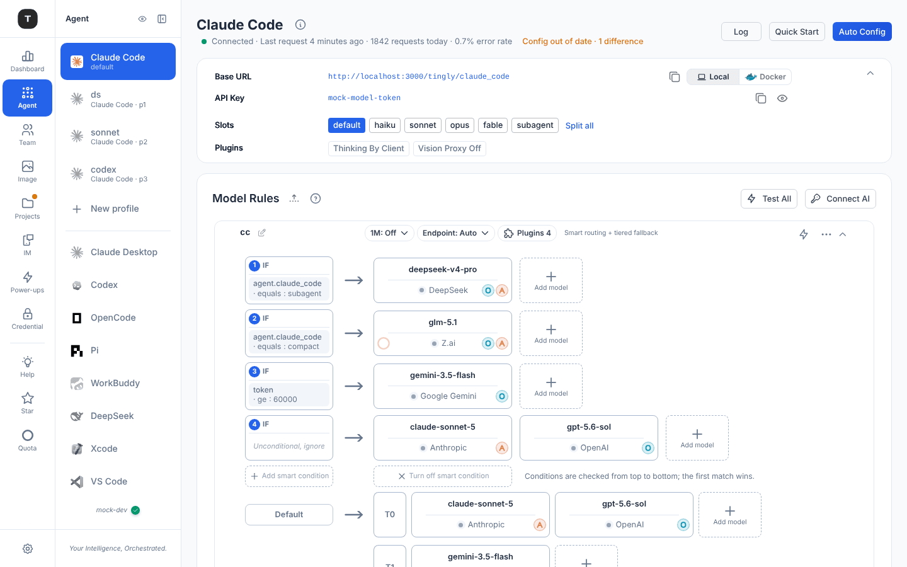
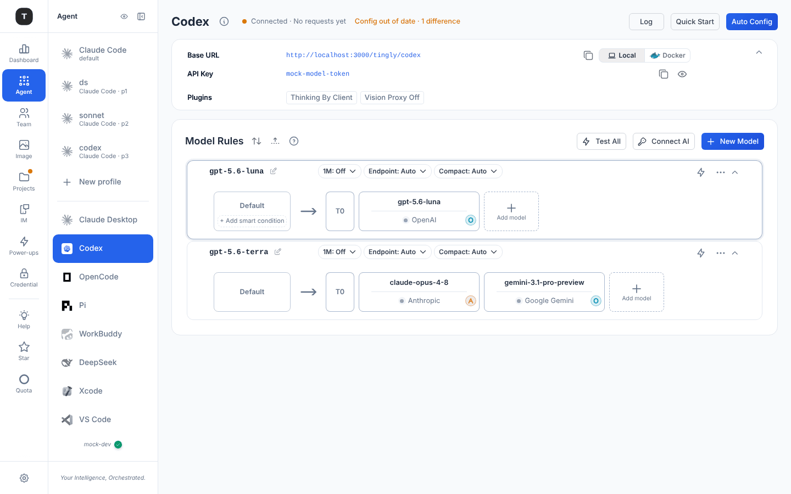
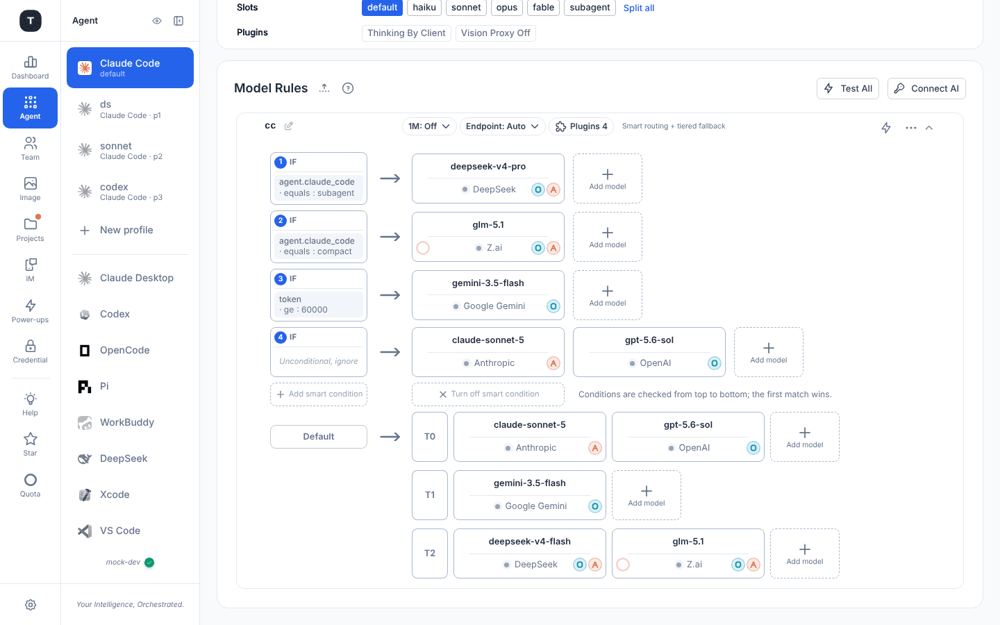
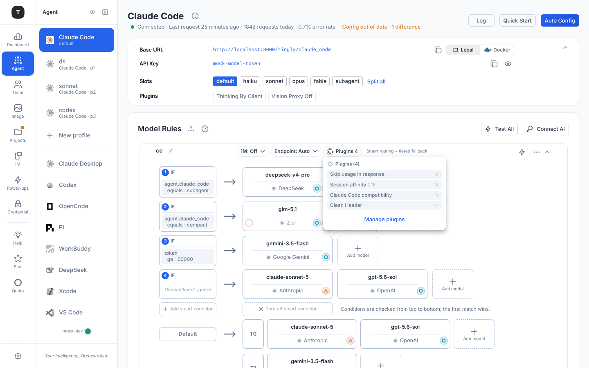
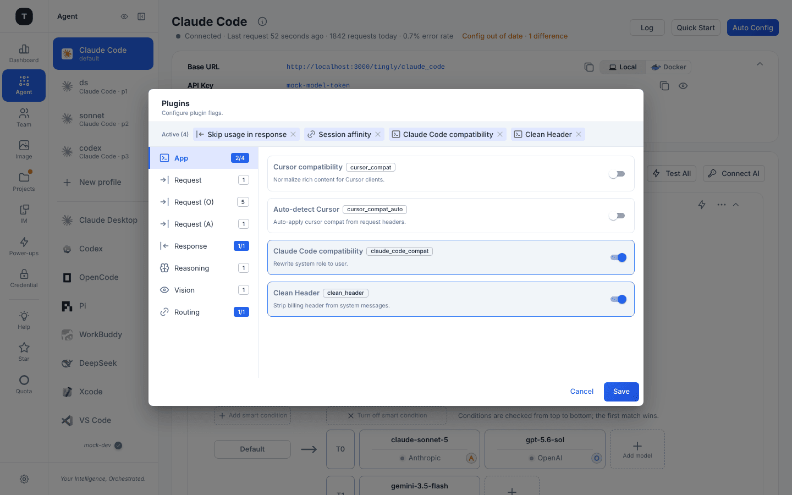
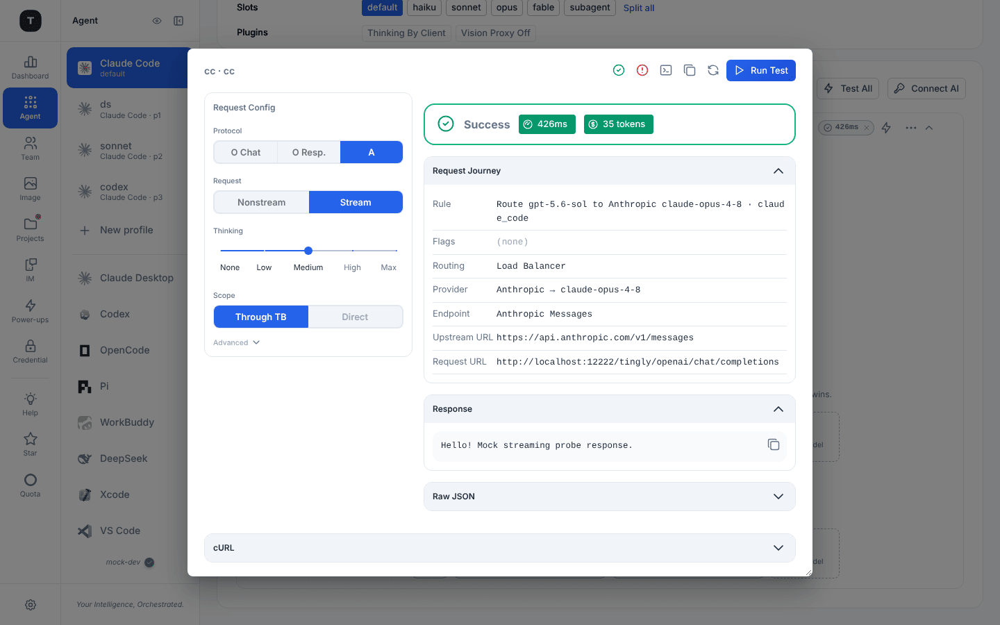

# 路由规则与插件标记

路径：各 Agent 页面的 **Model Rules** 区域（`/agent/*`、`/image/api`）

路由规则是 Tingly-Box 调度请求的核心机制。每条规则绑定一个请求模型（request_model），并决定如何将请求分发到一个或多个上游服务（Credential/Provider）。

---

## 首次使用引导



第一次在 Agent 页面看到路由图时，会**自动弹出一次**「Direct Routing Guide（直接路由引导）」，用图示分步讲解路由是怎么搭起来的——从零开始：**Connect AI 接入 Provider → ＋ Add model 加第一个模型 → 修改/删除模型 → 同层负载均衡 → 跨层熔断兜底**。

- 引导每位用户**只自动弹一次**，之后不再打扰
- 左侧是步骤导航，右侧是对应的路由图示意 + 文字说明；涉及工具栏按钮的步骤会显示一个高亮按钮的**模拟工具栏**（Test All · Connect AI · New Model），告诉你该点哪里
- 想再看时，点击 **Model Rules** 标题旁的 **?**（*How routing works*）按钮——或 Quick Start 卡片里、[提示与帮助](./13-help.md)页——即可随时重新打开
- 底部 **Previous / Next** 翻页，最后一步是 **Got it!** 关闭

> 智能路由也有独立的 Smart Routing Guide，切换到 Smart 模式后通过同一个 **?** 按钮查看。

---

## 路由图总览



规则卡片中内嵌路由图，直观展示请求的流转路径。路由图有两种模式，通过规则卡片内的切换按钮在 **直接路由**（Direct）和 **智能路由**（Smart）之间切换。

---

## 规则头部

每张规则卡片以它的**请求模型名**开头（例如 `cc`；点击铅笔可重命名——传入的 API 调用就是用它来匹配的，可以使用 `*` 之类的通配符），后面是一排标签：

| 标签 | 含义 |
|------|------|
| **`1M: Off ⌄`** | 规则是否加上 1M 上下文窗口。*Off* 只表示规则本身不添加；客户端自己请求 1M 时仍会生效。支持它的 Agent 才有（Claude Code、Claude Desktop、Codex） |
| **`Endpoint: Auto ⌄`** | 规则使用的上游 API 风格：**Auto**（先看模型 Catalog，再看 Provider 设置，默认 Chat；两者都支持时跟随客户端）、**Chat**（始终 Chat Completions）、**Responses**（始终 Responses；保存前会检查是否支持）或 **Anthropic**（*Force Anthropic style*——始终向上游发送 Anthropic Messages，转换 OpenAI 客户端；没有 Anthropic 端点的 Provider 回退到 Auto）。只对 OpenAI 兼容的上游有意义 |
| **`Compact: Auto ⌄`** | 仅 Codex：该模型的自动压缩触发点——见 [Codex](./04-scenario-codex.md#按模型设置自动压缩) |
| **`Plugins N`** | 规则开启了插件时出现——点击查看列表和 **Manage plugins**（见下） |

头部右侧：**闪电**图标（对该规则快速测试——见[探测面板](#探测面板probe-panel)）、⋮ **Rule actions** 菜单——**Plugins**、**Test Probe**、**Copy Base64** / **Copy JSONL**（导出）、**Activate / Deactivate Rule**、**Edit flag**、**Delete Rule**（页面允许时）——以及折叠箭头。规则列表上方的页面工具栏有**按名称排序**、**全部折叠/展开**、**?**，以及（允许时）**Test All**、**Connect AI** 和 **New Model**。

---

## 直接路由（Direct / Tier 模式）

直接路由是默认模式（`lbTactic: "tier"`）。服务节点按优先级分层排列：

```
请求入口
  │
  ├── T0（最高优先级）：多个服务共享负载
  ├── T1：T0 整体熔断后的备用层
  └── T2：T1 熔断后的最终兜底
```

### 层级行为

| 概念 | 说明 |
|------|------|
| 同层服务 | 轮询或加权共享流量（负载均衡） |
| 跨层 Fallback | 当前层所有服务均熔断时，请求自动路由到下一层 |
| 层号（T0/T1…） | 数字越小优先级越高；点击模型的层级标签来设置，或用模型卡片上的 ↑/↓ 操作在层之间移动（悬停卡片可见）。同一层内的模型负载均衡 |

### 熔断器（Circuit Breaker）

每个服务节点维护独立的熔断器，状态如下：

```
Closed（正常） ──── 连续 3 次失败 ──→ Open（熔断）
                                         │
                                    30 秒冷却期
                                         │
                                    HalfOpen（探针）
                                         │
                         ┌─── 成功 ───→ Closed（恢复）
                         └─── 失败 ───→ Open（重新熔断）
```

| 状态 | 含义 |
|------|------|
| **Closed** | 正常接收请求 |
| **Open** | 拒绝请求，等待冷却（默认 30 秒） |
| **HalfOpen** | 发送探针请求；成功则恢复，失败则重新熔断 |

### 请求中途 Failover（Mid-request Failover）

通过 `firstChunkGate` 缓冲机制（v2），在收到上游第一个响应块之前，若上游失败，请求可无缝切换到同层其他服务或下一层，对客户端透明。

---

## 智能路由（Smart Routing）



启用智能路由后（`smartEnabled: true`），规则链中的每条子规则（SmartOp）均可附带条件。请求按顺序匹配，**第一条所有条件均满足**的子规则生效。

```
请求入口
  │
  ├── SmartOp 1（条件 A AND 条件 B）── 满足 ──→ 路由到服务组 A
  ├── SmartOp 2（条件 C）           ── 满足 ──→ 路由到服务组 B
  └── SmartOp N（无条件，兜底）      ──────────→ 路由到默认服务组
```

### SmartOp 条件目录

按条件选择器中的分类展示：

| 条件 | 分类 | 可用算符 | 说明 |
|------|------|----------|------|
| Agent: Claude Code（`agent.claude_code`） | Agent | Equals：`main` / `subagent` / `compact` | Claude Code 请求类型 |
| System Prompt（`context_system`） | Context | Contains：`<文本>` | 请求的 system prompt 是否包含指定文本 |
| Latest User Message（`latest_user`） | Context | Contains：`<文本>` | 最新一条 user 消息是否包含指定文本 |
| Time range（`time`） | Time | 指定时区下的每日起止时间窗口 | 匹配落在（或落在之外的）某个每日循环时间段内的请求 |
| Thinking（`thinking`） | Request | `Enabled` / `Disabled` | 客户端是否开启了扩展思考 |
| Token Count（`token`） | Request | `≥ N` / `≤ N` | 输入 Token 数量 |
| Service TTFT（`service_ttft`） | Service | `Avg ≤/≥ N ms`、`P99 ≤/≥ N ms` | 该规则所有服务的首字节延迟（最优服务的均值或 P99） |
| Service Capacity（`service_capacity`） | Service | `Util ≤/≥/</> N%` | 该规则所有服务的席位/并发利用率 |
| Service Quota（`service_quota`） | Service | `Quota ≤/≥/</> N%` | 该规则所有服务对应 Provider 中**最紧张（最大）**的配额使用率——取最热的那个，而非平均值。缺失配额数据时该条件直接**放行**而非拦截，因此配额未知或数据陈旧不会影响正常路由 |

### 设计技巧

- 多个条件使用 **AND 逻辑**（同一 SmartOp 内所有条件均须满足）
- 最后一条子规则保持**无条件**（ops=[]），作为兜底默认路径
- 利用 Agent: Claude Code = `compact` 将 Compact 压缩请求路由到更便宜的模型
- 利用 Token Count `≥ 100000` 将超长上下文请求路由到支持大窗口的服务
- 利用 Service Quota `Quota ≥ 90%`，在某 Provider 配额真正耗尽之前就提前切换到备用服务组

---

## 规则插件标记（Rule Plugins）

插件是预制的附加标记（Flags），可在**规则层面**精调请求/响应行为，无需改动服务配置。规则头部的 **`Plugins N`** 标签会打开一个弹层，列出已开启的插件（名称和取值，点 **×** 移除；点击某一行可跳转到它）；**Manage plugins**——或 ⋮ → **Plugins**，这是添加第一个插件的唯一方式——打开 **Flag 目录**：分类侧边栏（**App**、**Request**、**Request (O)**（OpenAI）、**Request (A)**（Anthropic）、**Response**、**Reasoning**、**Vision**、**Observe**、**Routing**）加详情面板，每个标记在这里开关和配置。





场景级插件（Agent 页面上的 **Plugins** 卡——Thinking、Vision Proxy、Record）作用于每条规则；规则自己的取值会覆盖它们。目录由后端的标记注册表渲染，所以新增标记不需要发布前端——下表列出目前提供的内容。

### App 类

| 标记 | Key | 说明 |
|------|-----|------|
| Cursor compatibility | `cursor_compat` | 对 Cursor 客户端规范化富内容、封锁工具、去除 stream usage |
| Auto-detect Cursor | `cursor_compat_auto` | 根据请求头自动识别 Cursor 并应用兼容处理 |
| Claude Code compatibility | `claude_code_compat` | 转发前把 Claude Code 对话中间出现的 `system` 角色消息并入相邻的 user 轮次，兼容不支持这种非标准角色的第三方 Anthropic 兼容服务。内置 Claude Code 规则默认开启；需要原生 Anthropic 保真度时关闭 |
| Clean Header | `clean_header` | 剥离 system 消息中的 `x-anthropic-billing-header` 块，并中和 Claude Code 嵌在 system prompt 日期里的地理位置标记，避免泄露给第三方 Provider。内置 Claude Code 规则默认开启；当规则路由到 Claude OAuth Provider 时自动不生效 |

### Request（协议无关）类

| 标记 | Key | 类型 | 说明 |
|------|-----|------|------|
| Custom Headers | `extra_headers` | 请求头列表 | 为匹配该规则的请求追加自定义 HTTP 请求头。仅对 API Key 类 Provider 生效——OAuth/专属客户端 Provider（Claude Code、Codex、Kimi、Gemini、Antigravity）保留自身握手请求头，不受此影响。请求头会按配置原样发送，包括网关自身也会设置的字段（`Authorization`、`User-Agent` 等）——是否覆盖这些字段由你自行决定并承担相应责任 |

### Request (OpenAI) 类

| 标记 | Key | 类型 | 说明 |
|------|-----|------|------|
| Custom User-Agent | `custom_user_agent` | 字符串 | 覆盖出向请求的 User-Agent 头（仅对通用 OpenAI/Anthropic 客户端生效；专属客户端如 Claude Code OAuth 保留自身 UA） |
| OpenAI endpoint override | `openai_endpoint_override` | 枚举 | `Auto`（模型 Catalog，再 Provider 默认，最后 Chat）/ `Force Chat Completions` / `Force Responses API`。在头部显示为 **Endpoint** 标签。Anthropic/Google 类 Provider 会忽略它 |
| Use max_completion_tokens | `use_max_completion_tokens` | 开关 | 将 `max_tokens` 重写为 `max_completion_tokens`，适用于 o1/o3/gpt-5 系列 |
| Use max_tokens (legacy) | `use_max_tokens` | 开关 | 将 `max_completion_tokens` 重写为 `max_tokens`，兼容较旧的 OpenAI 兼容服务 |
| Block tools | `block_tools` | 字符串 | 逗号分隔的工具名列表，在转发前从请求中移除（跨 OpenAI Chat/Responses/Anthropic/Google） |

### Request (Anthropic) 类

| 标记 | Key | 类型 | 说明 |
|------|-----|------|------|
| Anthropic endpoint override | `anthropic_endpoint_override` | 枚举 | `Auto (follow inbound client)` / `Force Anthropic style`：始终以 Anthropic 形式发送请求——OpenAI 客户端的请求会被转换，双 URL Provider 使用它的 Anthropic URL。只有支持 Anthropic 风格的 Provider 才能强制，其他的回退到 Auto 并给出警告。规则头部的 **Endpoint → Anthropic** 就是设置它 |
| Claude organization ID | `claude_org_id` | 字符串 | 控制 Claude OAuth Provider 的 `anthropic-organization-id` 请求头。留空（默认）不发送；**Login organization (from OAuth)** 把请求归属到登录时捕获的组织（组织级权益需要）；或填写一个组织 UUID |
| Claude Code version | `claude_code_version` | 枚举 | Claude OAuth 链路对上游冒充哪个 Claude Code 版本：`Default`（Anthropic 接受的最新版，目前 2.1.280——原生客户端）/ `2.1.280` / `2.1.86`（旧版模拟）。仅 Claude OAuth Provider |
| 1M Context Window | `context_1m` | 开关 | 对支持的模型始终通过在上游加入 `context-1m-2025-08-07` beta 标记来请求 Anthropic 的 1M token 上下文；未设置则保持请求不变（客户端自己请求 1M 时仍会生效）。由头部的 **1M** 标签设置 |

### Response 类

| 标记 | Key | 类型 | 说明 |
|------|-----|------|------|
| Skip usage in response | `skip_usage` | 开关 | 从响应中剥离 `usage` 块（SSE 增量和最终 body 均处理） |

### Reasoning 类

| 标记 | Key | 类型 | 说明 |
|------|-----|------|------|
| Thinking | `thinking_effort` | 枚举 | 统一控制扩展思考：`By Client`（透传）/ `Off`（强制关闭）/ `Low`（~4K token）/ `Medium`（~10K）/ `High`（~20K）/ `Max`（~32K）。OpenAI 端以原生的 `reasoning_effort` 发送，Anthropic 端用 `output_config.effort`，基于预算的模型则回退为 `budget_tokens` |

### Vision 类

| 标记 | Key | 类型 | 说明 |
|------|-----|------|------|
| Vision Proxy | `vision_proxy_service` | 服务引用 | 通过视觉模型描述图片，使纯文本下游模型也能处理含图请求。优先级高于场景级视觉代理 |

### Observe 类

| 标记 | Key | 类型 | 说明 |
|------|-----|------|------|
| Recording | `recording` | 多选 | 在选定的采集点记录该规则的流量，用于调试和回放：**Client request (inbound)**——客户端发来的原样请求——和 **Upstream request (outbound)**——经过所有转换之后的最终请求。规则级的选择会覆盖场景的 Record 插件。记录写入配置目录下的 `record/` 文件夹，按场景分组。暂不提供响应侧的采集点 |

### Routing 类

| 标记 | Key | 类型 | 说明 |
|------|-----|------|------|
| Session affinity | `session_affinity` | 整数（秒） | 会话粘性 TTL（**规则级**）：同一会话在 TTL 内持续命中同一服务。0 表示禁用。内置 Claude Code、Claude Desktop、Codex 规则默认 1800 秒。通过 `metadata.user_id`、`X-Tingly-Session-ID` 请求头或客户端 IP 识别会话 |

---

## 探测面板（Probe Panel）

一个诊断面板，可以对某条规则（或直接对某个 Provider）发起一次真实的测试请求，并原地查看发生了什么——无需离开路由图。（它以前从工具栏的 **Troubleshoot** 按钮进入；这个按钮已取消——Agent 页面的 **Log** 按钮现在打开的是请求日志，见[系统设置 · Logs](./17-system-settings.md#logssystemlogs)。）

### 入口

- **Quick test（快速测试）**——每个规则头部的**闪电**图标一键对该规则发起流式测试；结果以一枚彩色小药丸（`2.6s`，或 `Success` / `Failed`）显示在图标旁。点击药丸即可打开完整面板，并预先载入该结果。
- **Test All**（工具栏，Model Rules 右上角）对所有**处于激活状态**的规则同时发起同样的快速测试——未激活的规则不会真正匹配流量，因此会被跳过。
- 规则的 **⋮ → Test Probe** 直接打开完整面板，不预先运行任何测试。
- 同一个面板对准单个模型时，可以从 [Model Select](./21-model-select.md) 里模型卡片上的闪电进入。

### 面板布局



左侧是**控制栏**（将要发送什么），右侧是**结果栏**（收到了什么），两者无需靠记忆对照。标题栏写明目标（`cc · cc`），并带最近一次的结论、**Copy cURL**、**Copy response**、**Re-run** 和实心的 **Run Test**。

**Request Config（左侧控制栏）**——彼此正交、可自由组合的维度：

| 维度 | 可选值 | 说明 |
|------|--------|------|
| Protocol | `O Chat` / `O Resp.` / `A` | 回环请求所使用的客户端侧协议（OpenAI Chat、OpenAI Responses、Anthropic）。规则目标锁定为该规则所属场景的协议；Provider 目标则收窄为该 Provider 实际支持的协议；Google 类 Provider 不可选（使用自有 SDK） |
| Request | `Nonstream` / `Stream` | 默认 Stream——最接近生产流量 |
| Thinking | `None` / `Low` / `Medium` / `High` / `Max`（分档滑块） | 扩展思考强度；映射到 Provider 原生参数（Anthropic 的 `budget_tokens`、OpenAI 的 `reasoning_effort`、Gemini 的 `thinking_budget`） |
| Scope | `Through TB` / `Direct` | Direct 完全跳过 Tingly-Box 的路由与中间件，用于判断故障出在上游还是 TB 内部。规则目标固定为 Through TB——这正是规则测试要验证的对象 |

一个默认收起的 **Advanced** 折叠区包含 **Content** 组：

| 维度 | 可选值 | 说明 |
|------|--------|------|
| Tool | `Off` / `On` | 附带一个工具定义，让探测请求也走一遍工具调用；与 stream/nonstream 均可组合 |
| Vision | `Off` / `User` / `Tool` | 附带一张红色测试图片——放在 user 消息中，或通过一次合成的工具调用返回（与 Agent 截图工具的形态一致）。具备视觉能力的链路会回答「red」，其他结果说明图片在链路中被丢弃或损坏 |
| Message | 自由文本 | 覆盖默认探测消息（工具探测与普通探测的默认消息不同） |

点击 **Run Test** 后，**结果栏（右侧）**显示：
- 一条 **Success**/**Failed** 状态栏，附延迟与 Token 数量徽章（失败时显示错误信息）
- **Request Journey**（可折叠）：命中的规则与已应用的标记、路由来源（会话粘性 / 智能路由 / 负载均衡 / 探测锁定）、最终解析出的 Provider → 模型、解析出的上游 API 类型、上游 URL，以及回环请求 URL——后端尚未返回的字段会以灰色占位显示
- **Response**（可折叠）：提取出的助手回复文本，自带复制按钮
- **Raw JSON**（可折叠）：完整的原始响应体
- **cURL**（底部，横跨整个面板宽度）：根据当前 Request Config 实时重新生成的 `curl` 命令——纯粹是构造出来的，不会真正执行——并提示你在自行运行前替换成自己的 Key

弹窗支持拖拽右下角调整大小，便于查看较长的 Journey 或流式响应。需要自由的工作台——自己写请求体、叠加标记——请看 [Bench](./19-experimental.md#bench)。

---

## 相关页面

- [场景总览](./02-scenario-overview.md)
- [Claude Code 场景](./03-scenario-claude-code.md)
- [凭证管理](./08-credentials.md)
- [实验性功能](./19-experimental.md)
