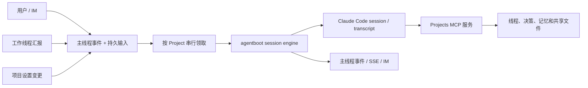
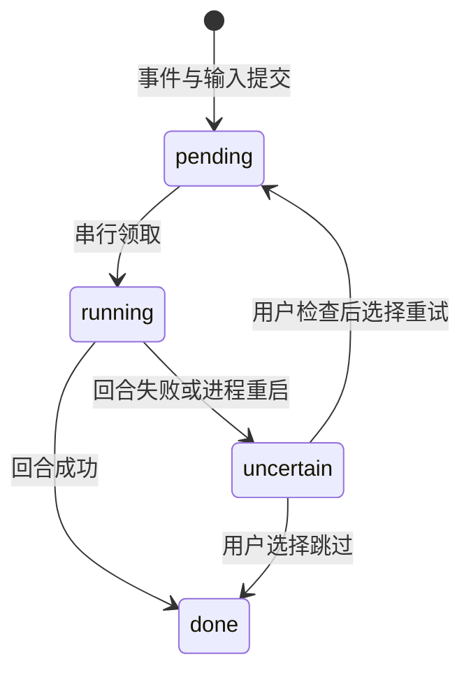

# Projects Coordinator：持久 Claude Code 会话

## 背景与目标

一个 Project 的主线程是用户与 Coordinator 的对话。Coordinator 接收用户消息、工作线程汇报和项目设置变更，负责回答、拆分工作、跟进线程以及汇总结果；工作线程各自运行 Claude Code，会话和工作目录互相独立。

原实现对每次触发都读取最近 40 条主线程事件，把展示事件拼成模型消息，再由 Projects 自己循环调用模型和工具。工具调用与结果只存在于当前回合；下一回合只能看到事件重建出来的摘要。模型上下文因此不等于真实执行历史，滚动窗口及变化的系统提示也不利于复用上游 prompt cache。

本设计让每个 Project 的 Coordinator 拥有一个可恢复的 Claude Code session：agentboot 和 Claude Code 负责模型请求、工具循环、原始 transcript 和上下文压缩；Projects 负责输入投递、业务工具、项目状态、用户可见事件和恢复交互。目标是连续且可追溯的协调过程，并为缓存复用创造条件。**持久 session 本身不保证任何供应商的缓存命中。**

不在范围内：将工作线程合并到 Coordinator 会话、让 Coordinator 直接修改仓库、保证跨 Claude transcript/SQLite/外部工具的恰好一次执行，或改变 Project 与 Folder 的产品语义。

## 结构与职责



| 边界 | 负责的事实 | 不负责 |
| --- | --- | --- |
| Claude Code session | 模型上下文、工具调用与结果、session 恢复和上下文管理 | Project 的业务状态、用户界面的权威事件 |
| Projects SQLite | Project、Thread、主线程可见事件、输入投递状态 | 重建完整 Claude 工具 transcript |
| Projects MCP | 对当前 Project 执行受控业务工具、读取受限共享文件 | 任意文件系统或 shell 访问 |
| agentboot | Claude Code 进程、常驻池、回合生命周期和事件转换 | 替 Projects 决定输入是否需要重试 |

一个 Project 的主线程有一个 Coordinator session；Folder 的普通会话和 Project 工作线程继续使用各自原有的 Claude Code session。Coordinator 的内存队列按 Project 串行唤醒；持久输入表决定待处理输入及其顺序。

## 工作目录与共享路径

Coordinator 的 cwd 优先取主线程已有的 `cwd`；为空时使用 `Layout.Dir(projectID)`，即 `<Projects 数据目录>/projects/<project-id>/`。独立版数据目录由 `--data-dir` 或 `TINGLY_PROJECT_HOME` 指定，默认是 `~/.tingly-project`；嵌入宿主时由宿主指定。旧项目保留已有主线程 cwd。这个目录是 session 的稳定锚点，**不是**某个仓库的工作树。

```text
<数据目录>/projects/<project-id>/
├── memory/       项目记忆与 MEMORY.md
├── library/      上传文件、共享资料和输出
└── threads/      项目线程设置及部分线程工作目录
```

Coordinator 通过 `read_shared_file` 和 `list_shared_files` 读取本 Project 的 `library/`、`memory/`，接受这两个目录下的相对路径以及附件事件中的绝对路径。服务端使用 `os.OpenRoot` 限定各自的共享根目录，拒绝路径穿越、逃逸的符号链接和非普通文件；单次列表最多 200 项。读取支持最多 256 KiB 的 UTF-8 文本，以及最多 5 MiB 的 PNG、JPEG、GIF、WebP 图片。超出限制或其他格式需要交给工作线程处理；这不是任意格式的文件浏览器。

工作线程可以按其自己的设置访问工作目录和共享资料。Coordinator 的 `Read`、`Glob`、`Grep`、`Bash`、`Write`、`Edit` 等内置工具被禁止；额外权限请求由 prompter 拒绝，Projects MCP 工具除外。可发布文件的 `send_file` 仍走原有服务端路径校验。

## 一个回合的生命周期

1. 用户消息或线程汇报写入主线程事件，并在同一数据库事务中创建 `pending` 输入；活跃项目的设置变更同事务保存设置、system 事件和输入。暂停或归档期间的汇报和设置变更仍记录事件，但不会作为输入投递。
2. 内存队列唤醒该 Project；每次领取该项目最早的未完成输入，将它标为 `running`。Project 暂停或归档时不领取新输入。
3. 首次运行时，主线程持久化新的 session ID 和 cwd。系统向新会话提供当前 Project 上下文，以及最近历史事件中发生在当前输入之前的部分，明确标记为历史；这只是一次性迁移，不是无损还原旧工具调用。新输入按用户、系统或线程来源保留信任信封。
4. 后续回合将当前输入追加到同一 session。设置变更回合还带当前项目上下文；工作线程状态可以通过 `list_threads`、`get_thread` 等工具按需读取。agentboot 有常驻进程时复用，进程被回收或重启后以保存的 session ID 恢复。Claude Code 的 init 事件记录 session 已启动，以便后续使用 resume。
5. Coordinator 的 MCP 配置文件指向仅监听 loopback 的随机 capability URL，按主线程作用域注册工具。启用 `ENABLE_TOOL_SEARCH=false`，让首个模型请求直接看到 Projects 工具；一次回合开始时记录项目配置快照和触发来源，结束后关闭该回合的工具权限。
6. MCP 调用序列化执行，并在执行前检查活动回合、项目暂停/归档状态及配置快照；配置变化时返回错误，要求模型根据新设置重新评估。用户确认仍通过 `message_thread` 的 `cite` 由系统原样引用，线程汇报和共享文件内容不能冒充用户授权。
7. 用户触发回合的文本投影到主线程事件，并向前端发布更新；报告和设置触发的文本在回合结束后决定是否发布。`no_update` 在用户消息回合被拒绝；其他回合调用后标记静默并拒绝后续工具调用，最终不发布该回合文本。它是 MCP 结果，不能假定会立即停止 Claude Code 进程。
8. 成功结束将输入标为 `done`；失败、中断或启动后结果无法确定时标为 `uncertain`，并显示错误。Project 的下一条输入不能越过尚未解决的较早输入。

工具定义与原 Coordinator 共用，包括 `start_thread`、`message_thread`、`get_thread`、`list_threads`、`read_conversation`、决策、记忆、指令更新和静默工具；MCP 层不接受模型传入的 Project ID。工作线程的 capability 不获得 Coordinator 工具。实现入口分别在 [coordinator_session.go](../internal/project/coordinator_session.go)、[coordinator.go](../internal/project/coordinator.go)、[coordinator_mcp.go](../internal/project/coordinator_mcp.go) 和 [session_tools_mcp.go](../internal/project/session_tools_mcp.go)。

更多 Projects 动作（停止/重开线程、设置、合并、diff 等）改为 MCP 工具的方案、统一的动作层、范围与风险分级见 [mcp-tools.md](./mcp-tools.md)（提案，未实现）。

## 投递、故障与恢复



输入表记录 Project ID、主线程事件 ID、状态和时间；同一事件只有一条输入。设置更新、用户输入及活跃线程报告各自按事务写入事件和输入，避免事件已经出现但投递记录没有保存。启动时将遗留 `running` 标为 `uncertain`，并唤醒有待处理或不确定输入的项目。

Claude transcript、SQLite 和工具副作用不共享事务。例如进程可能在启动线程之后、保存成功状态之前退出，所以系统不能知道该输入是否完整执行。`uncertain` 阻止自动重放和后续输入越过；页面提示用户检查已有线程和操作，再明确选择**重试消息**或**跳过消息**。重试可能重复已发生的操作，跳过可能留下未完成的请求；确认对话框说明相应后果。接口是 `POST /api/v1/projects/{id}/coordinator/recover`，提交 `input_id` 和 `action`（`retry` 或 `skip`）；Project 详情的 `coordinator_recovery` 提供待处理 ID。

这是一种保守恢复策略，不提供工具副作用的幂等或恰好一次保证。缺少 CLI、连接不兼容、进程失败或手动暂停造成的中断同样可能需要用户恢复。服务关闭时停止 session 并等待 Coordinator 队列收尾；暂停、归档会停止对应正在运行的 Coordinator，恢复后重新唤醒队列。

## 连接与兼容性

Coordinator 按项目的 profile、model、effort 启动。使用 profile 时由宿主的 `Launcher` 提供环境与设置；否则使用宿主提供的 Claude Code 环境和默认模型。嵌入 Tingly Box 时与工作线程一样通过宿主网关。独立版要求 Anthropic 兼容连接或可用 Claude Code profile；设置为 OpenAI 风格时明确报错，不静默改用本机的另一套登录。

模型与网关的缓存行为、TTL、断点、上下文压缩和成本仍由 Claude Code 及上游决定。这里保持 session 和历史连续，但首次请求、配置变化、压缩或缓存过期都可能产生 cache miss；不能以 session ID 判断是否命中。

已有 Project 首次进入新实现时保留主线程、显示历史和工作线程，创建独立的 Coordinator session 并一次性导入有限近期上下文；更早的内容存在时，导入文本会提示用 `read_conversation` 查询。早于导入窗口的对话仍保存在主线程；旧实现丢弃的工具调用和工具结果无法恢复。旧的自驱模型循环（`Coordinator.turn` / `LLMSource`）已删除，session 是唯一路径，不再支持回滚。

线程汇报和设置变更回合末尾附一个 system 信封（`kind="check-in"` / `kind="settings-changed"`），带 `replies_since_user` 和 `minutes_since_user`，即协调者提示词里的回复预算。

## 验证与已知边界

- [coordinator_session_test.go](../internal/project/coordinator_session_test.go)：连续两条消息使用相同 session ID，第二轮设置 resume。
- [coordinator_inputs_test.go](../internal/db/coordinator_inputs_test.go)：输入顺序、重启后的不确定状态、显式恢复和跨项目拒绝。
- [coordinator_mcp_test.go](../internal/project/coordinator_mcp_test.go)、[session_tools_mcp_test.go](../internal/project/session_tools_mcp_test.go)：工具发现、活动回合、项目和配置边界、静默规则。
- [coordinator_files_test.go](../internal/project/coordinator_files_test.go)：共享目录读取、跨项目路径和符号链接逃逸。
- [server_test.go](../internal/server/server_test.go)：Projects MCP 启动线程的端到端流程及恢复接口；前端 ProjectPage 测试覆盖重试确认。
- [coordinator_session_probe.py](../showcase/e2e-demo/coordinator_session_probe.py)：使用真实 Claude Code CLI 与本地脚本化 Anthropic 服务，验证 MCP 调用、共享记忆读取及第二轮保留上下文；不需要真实上游密钥。

上述探针不能验证生产网关或供应商的缓存命中率。共享读取目前不支持 PDF 等二进制文档，也没有大文件分页；应交由工作线程处理。全面的崩溃点注入、不同上游的缓存 token 指标和自动去重仍是后续工作。

留作以后：项目上下文（含记忆索引）只在首回合和设置变更回合注入，线程写入的新记忆要到下一次设置变更才会告诉 Coordinator（它可以随时用 `list_shared_files` 主动读）。将来补的话，只在索引变化时把增减的索引行追加在当回合输入末尾；不改系统提示词，也不改写历史，以免破坏前缀缓存。
