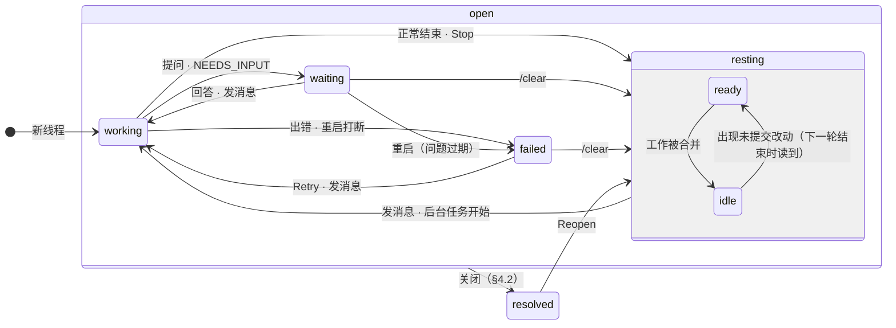

# 线程生命周期：顶层设计

状态：**设计（待确认）**，2026-11-21。取代同名文件的上一版提案。

这是线程状态机的**唯一权威**。改线程状态、加入口、加后台规则之前先改这里；`projects.md` §4.3 的表只是摘要。现状图（代码今天怎么做、实测的缺口 G1–G14）在 [thread-lifecycle.pencil.md](thread-lifecycle.pencil.md)。

**范围**：把已有的状态和入口合理化，让它们自洽、可测，**不加新功能**。不加新状态，不加新工具，不加 UI 入口，不加 IM 推送。只有一处数据改动（§6.3 的 `HeadSHA`）。

## 1 问题

状态是一个个入口各自加出来的，从没有一张总图：

- **同一个问题有四个答案。** “有没有待审阅的工作”在 settle、Stop、Reopen、`/clear` 里各算各的（`CommitsAhead`、`MergedAt`、什么都不看），于是同一个线程走不同的路会落到不同状态（G10、G11）。
- **waiting 混进了不能回答的东西。** 重启中断、过期的审批、建 worktree 失败都记成 waiting，用户看到“等你回答”，却没有问题可答（G7–G9）。
- **resolve 的六个入口做的事不一样。** 有的回收进程、收回工具 URL，有的不收（G14）；有的留记录，有的什么都不留。
- **“合并后自动 resolve”写在 `projects.md` 里，代码里不存在。** 只有 Merge 对话框会 resolve（G1、G2）；每周的自动清理反而会关掉没做完的活（G4）。
- **谁可以 resolve 只写在提示词里。** 协调者的工具不检查任何条件（G5）。

## 2 模型：三条轴，一个显示状态

线程有三件互相独立的事。今天它们挤在一个 `Status` 字段里，这是混乱的根源（原则 §4：一个旋钮管两件事，底层模型就错了）。

| 轴 | 取值 | 存在哪 | 谁改 |
|---|---|---|---|
| **A 结局**（持久） | open · resolved | `ResolvedAt` | 只有 §4 的关闭 / 重开 |
| **B 这一轮**（仅 open 时） | 在跑 · 在等回答 · 失败 · 歇着 | `Status` 的 working / waiting / failed | 轮次引擎、提问、重启 |
| **C 工作**（只读，算出来的） | 有待审阅的工作 · 没有 | `CommitsAhead`、`Uncommitted`、`MergedAt`、`Links` | git 和 GitHub 的事实，从不手写 |

另有 **归档**（`ArchivedAt`）：存储层面的“收起来”，与三条轴都正交，不在本文范围（`thread-cleanup.md`）。

**显示状态**由三条轴推出，`Status` 字段继续存它（不做迁移），但只能由一个函数写（§5）：

```
resolved                      ← A = resolved
working | waiting | failed    ← A = open，B 不是“歇着”
ready                         ← A = open，B = 歇着，C = 有待审阅的工作
idle                          ← A = open，B = 歇着，C = 没有
```

## 3 每个状态的含义（契约）

每个状态回答一个用户问题，并且只回答这一个：

| 状态 | 用户的问题 | 契约（不变量） | 用户能做的下一步 |
|---|---|---|---|
| `working` | 它在干活吗？ | 有一轮在跑，或在排队等槽位（`Queued`），或后台任务在跑 | 等 · Stop |
| `waiting` | **它在等我回答吗？** | 有一个**现在能回答**的问题：待答的审批 / 提问（进程活着），或上一轮以 `NEEDS_INPUT:` 结尾 | 回答 |
| `failed` | 它出事了吗？ | 上一轮没能正常结束：出错、启动失败、被重启打断、问题过期 | Retry · 发消息 |
| `ready` | 有东西等我审阅吗？ | 歇着，且有**待审阅的工作**（§3.1） | 看 diff · 开 PR · 合并 |
| `idle` | — | 歇着，没有待审阅的工作 | 发消息 · Resolve |
| `resolved` | 它结束了吗？ | `ResolvedAt` 有值；没有进程，工具 URL 已收回 | Reopen |

### 3.1 “待审阅的工作”只有一个定义

```
unreviewed(t) = t.Uncommitted
             || (t.CommitsAhead > 0 && !merged(t))

merged(t)     = t.MergedAt != nil
             || 线程有一个 merged 的 PR，head 是 t.Branch，
                且本地分支 tip 被这个 PR 合并时的 head 包含（§6.3）
```

`Uncommitted` 也算：没提交的改动只活在 worktree 里，比提交更需要用户看到。

### 3.2 waiting 与 failed 的分界

判断标准只有一个：**用户现在回答，线程能不能接着走？** 能就是 waiting，不能就是 failed。

| 情况 | 今天 | 设计 |
|---|---|---|
| 待答的审批 / 提问 | waiting | waiting |
| 报告末行 `NEEDS_INPUT:` | waiting | waiting |
| 轮次出错、profile 不可用、会话启动失败 | failed | failed |
| 重启时正在跑 | waiting “Interrupted…” | **failed** “Interrupted when tingly-project stopped” — Retry 续跑同一轮 |
| 重启时有待答的审批 / 提问（已过期） | waiting “Approve: …” | **failed** “The question expired when tingly-project stopped” |
| 建 worktree 失败 | waiting | **failed** |

不做超时：一个能回答的问题，等多久都还是能回答的，系统不替用户关掉它。

## 4 转移表（完整）

这张表之外没有别的转移。加一行要先改这里。



### 4.1 open 之内

| # | 从 | 到 | 触发 | 写状态的地方 |
|---|---|---|---|---|
| T1 | — | working | 新线程（start_thread、提议卡、用户新建、IM 新会话） | 创建 |
| T2 | working | waiting | 提问 / 审批挂起；或末行 `NEEDS_INPUT:` | prompter；settle |
| T3 | working | failed | 出错、启动失败、建 worktree 失败、重启时在跑 | settle；launch；Recover |
| T4 | working | 歇着 | 正常结束（后台任务也结束）；Stop | settle → `rest()` |
| T5 | waiting | working | 回答；发消息 | prompter；SetRunning |
| T6 | waiting | failed | 重启时问题过期 | Recover |
| T7 | failed | working | Retry；发消息 | Retry；SetRunning |
| T8 | 歇着 | working | 发消息；后台任务开始 | SetRunning；后台任务 |
| T9 | waiting · failed | 歇着 | `/clear` 开新会话 | session_rotation → `rest()` |
| T10 | ready | idle | 工作被合并（§6） | link 刷新 / settle → `rest()` |

“歇着”永远落到 `rest()`（§5），它按 §3.1 选 ready 或 idle。

### 4.2 关闭与重开

| # | 从 | 到 | 谁 | 条件 |
|---|---|---|---|---|
| C1 | 任何 open | resolved | **用户**（线程菜单、看板批量） | 无条件。可撤销，不删任何东西 |
| C2 | 任何 open | resolved | **用户** Archive（项目线程） | 同 Archive 的现有拦截（在跑、排队、未提交改动） |
| C3 | 不在跑的 open | resolved | **用户** Merge 对话框 squash 成功 | 合并本身就是用户的决定 |
| C4 | 任何 open | resolved | **协调者** `resolve_thread` | §7 |
| C5 | 歇着 | resolved | **系统**：工作已合并 | §6.1 |
| C6 | idle | resolved | **系统**：7 天没有活动 | §6.2 |
| O1 | resolved | 歇着 | **用户** Reopen | 无条件 |

线程自己**不能**关闭自己：做完是用户的验收，线程只知道自己交了什么。调研 / 回答类线程做完后是 idle，由 C1 或 C6 收尾。

## 5 实现约束：三个写入口

状态只经过三个函数写。今天的六处各写各的是 G10、G11、G14 的直接原因。

| 函数 | 做什么 | 取代 |
|---|---|---|
| `rest(t)` | 歇着时按 §3.1 写 ready / idle | `restingStatus(commits)`、Stop 的硬编码 idle、Reopen 和 `/clear` 各自的 `MergedAt` 判断 |
| `close(t, by, reason)` | 关闭：停轮次 → 回收进程 → 写 resolved（`MergedAt` 若适用）→ 收回工具 URL → 交还 IM 绑定 → 删 `.tmp` → **记一条系统事件**（谁、为什么） | `Resolve`、`resolveMerged`、Archive 里的 resolve 段 |
| `reopen(t, by)` | 清 `ResolvedAt` → `rest(t)` → 记事件 | `Reopen` 自己的判断 |

`close` 的事件文字固定为三种，用户在线程里总能看到它为什么关了：

- `Resolved by you.` / `Resolved by the coordinator.`
- `Resolved: PR #34 was merged into main.`
- `Resolved after 7 days without activity.`

轮次中的 working / waiting / failed 仍由引擎回调、prompter、Recover 写，它们只改 B 轴，不碰 A、C。

## 6 系统规则

系统只做两件事，并且只关掉**没有剩余工作**的线程。关闭可撤销、不删任何东西，所以系统可以不问用户；但它永远不关有剩余工作的线程。

**剩余工作**（三者任一即不关）：`unreviewed(t)`（§3.1）· 线程开的 PR 还有 open 的 · 在跑、排队或有后台任务。

### 6.1 C5 工作已合并 → resolved

`projects.md` 一直写着“合并后自动”，这里把它真正实现，覆盖三种合并（Merge 对话框已经会关，另两种今天不会）：

| 在哪合并 | 何时检查 |
|---|---|
| Merge 对话框 | 已有（C3） |
| 线程自己调 `merge` 工具 | 这一轮结束时（settle） |
| GitHub 网页 / 别人合并 | link 刷新读到 open → merged 时 |

条件：线程歇着 ∧ `merged(t)` ∧ 没有剩余工作。

### 6.2 C6 七天无活动 → resolved

保留，加两条限制：只对 **idle**（ready 有东西等审阅，不能静默关掉）；并且**没有剩余工作**（今天会关掉有 open PR、有未提交改动的线程，G4）。

### 6.3 唯一的数据改动：`ThreadLink.HeadSHA`

`merged(t)` 要回答“合并之后分支上还有没有新提交”。仓库用 squash 合并，祖先关系证明不了什么，只能拿合并时 PR 的 head commit 比：`git merge-base --is-ancestor <本地 tip> <HeadSHA>`。

- GitHub 读取时一并取 `headRefOid`（同一个 GraphQL 请求，不多花额度）；`create_pr` 和 `merge` 也填它。
- 老记录没有 `HeadSHA`：退回今天 `hasMergedPR` 的判断（head 分支名一致即算合并，Delete 的保护已经这样用）。最坏情况是一个合并后又有提交的老线程被关掉——它可 Reopen，分支和提交都在。

## 7 协调者

协调者替用户执行，不替用户决定。`resolve_thread` 在服务端检查：

| 线程 | 结果 |
|---|---|
| 没有剩余工作（§6） | 关闭，事件写 `Resolved by the coordinator.` |
| 有剩余工作 | **拒绝**，返回剩余的是什么（“PR #34 is still open”、“2 unmerged commits”），并说“只有用户能关它：请用户在线程里 Resolve” |

协调者的提示词随之简化为一句：线程做完、用户看过结果后可以 resolve；有剩余工作的工具会拒绝，转告用户。不再要求它自己从 `prs=` 推断是否合并。

不给协调者 `reopen_thread`：它只能关没有剩余工作的线程，关错的代价是用户点一次 Reopen。

## 8 不变量（harness 每个场景结束时检查）

已有三条保留，新增四条，都从 §3 的契约直接来：

| 名字 | 规则 | 状态 |
|---|---|---|
| `status.resolved-consistent` | resolved ⇔ `ResolvedAt` 有值 | 已有 |
| `wait.has-reason` | waiting 必有原因 | 已有 |
| `status.ready-has-commits` | ready 的线程有提交 | 已有，改为 `ready ⇒ unreviewed(t)` |
| `status.idle-has-nothing` | idle ⇒ `!unreviewed(t)` | 新 |
| `wait.answerable` | waiting ⇒ 有待答的请求，或原因来自 `NEEDS_INPUT:` | 新 |
| `close.releases` | resolved ⇒ 没有进程，工具 URL 已收回 | 新 |
| `close.never-loses-work` | 系统或协调者关掉的线程，关闭时没有剩余工作 | 新 |

## 9 其他线程种类

| | 项目线程 | 文件夹会话 | 项目主线程（协调者） |
|---|---|---|---|
| 状态机 | 本文 | 本文，但：没有 `NEEDS_INPUT`；没有 C5、C6（文件夹不是 Projects 的分支，用户自己收尾） | 不适用：显示状态由协调者队列推出（`coordinatorView`），从不 resolved |
| 关闭有后台任务的线程 | 不确认 | 确认“将停止 N 个任务” | — |

## 10 明确不做

- 不加状态（没有 `landing`、`done`、`suggested`）。
- 不给线程关闭自己的工具或标记。
- 不加“可解决”的 UI 提示、横幅、批量建议按钮；看板现有的多选 Resolve 够用。
- 不推 IM：关闭只在线程里留事件；协调者下一轮从线程列表看到。
- 不给协调者 `reopen_thread`。
- 不做 waiting 超时。

这些都可以以后再议，但每一项都要先在本文改模型，不能直接加入口。

## 11 缺口如何收口

| 缺口（pencil §11） | 收口于 |
|---|---|
| G1 GitHub 上合并，线程不变 | §6.1 |
| G2 `merge` 工具合并，线程不变 | §6.1 |
| G3 自动清理只看 idle | §6.1 处理已合并的 ready；其余 ready 有东西等审阅，按设计不自动关 |
| G4 自动清理关掉没做完的活 | §6.2 |
| G5 协调者 resolve 不检查 | §7 |
| G6 协调者无 reopen | 不做（§10），理由见 §7 |
| G7 重启中断记成 waiting | §3.2 |
| G8 过期的审批仍 waiting | §3.2 |
| G9 建 worktree 失败记成 waiting | §3.2 |
| G10 Stop 后有提交是 idle | §5 `rest()` |
| G11 Reopen 只看 `MergedAt` | §5 `reopen()` |
| G12 线程不能声明做完 | 不做（§4.2 末、§10） |
| G13 关闭不通知协调者和 IM | 不做推送（§10）；关闭在线程里留事件（§5） |
| G14 Merge 对话框的关闭不回收进程 | §5 `close()` |

## 12 落地（小 PR，每个带测试）

| PR | 内容 | 用户可见的变化 |
|---|---|---|
| 1 | `rest()`、`close()`、`reopen()` 三个写入口；关闭事件；不变量 `status.idle-has-nothing`、`close.releases` | Stop 后有提交显示 ready；重开已合并线程显示 idle；每次关闭在线程里说明原因 |
| 2 | §3.2：重启中断、过期问题、建 worktree 失败 → failed；不变量 `wait.answerable` | Waiting on you 里只剩真正能回答的问题；被打断的线程可直接 Retry |
| 3 | §6：`HeadSHA`；合并后自动关闭；七天规则加限制；不变量 `close.never-loses-work` | 合并后的线程自己关闭；未做完的不会被静默关掉 |
| 4 | §7：`resolve_thread` 服务端检查，提示词一句 | 协调者关不掉有剩余工作的线程 |

1 和 2 互不依赖；3、4 依赖 1。前端不改（状态值不变）。

## 13 需要用户决定

1. **协调者的边界**（§7）：有剩余工作时一律拒绝（推荐，最简单、不可能越权）；还是允许它带上用户那条消息的 `cite` 后关闭（用户在对话里说“关掉它”时更顺手，但多一条路径）？
2. **系统自动关闭已合并的线程**（§6.1）不问用户（推荐：可撤销、不删东西、`projects.md` 原本就这样写）；还是你希望保留人工？
3. **七天规则**（§6.2）保留并加限制（推荐），还是直接去掉、只留合并规则和人工？
