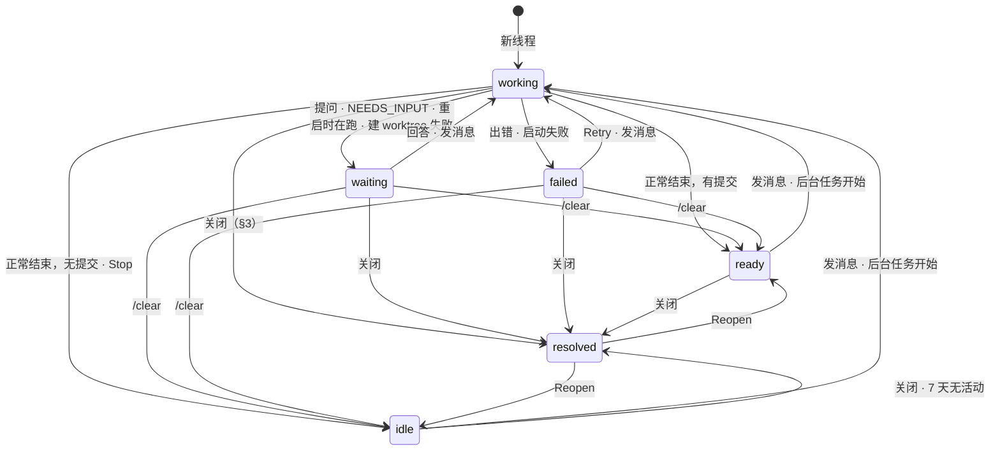

# 线程生命周期：顶层设计

状态：**设计（记录现状）**，2026-11-21，main @ 66a564d30。

线程的状态、转移、谁能关闭线程，以本文为准。本文只记录**已有的**状态和行为，给出它们的含义和规则，不新增状态和行为。合并相关的新需求（例如 PR 合并后自动关闭）本轮不做。以后要改状态、加入口、加后台规则，先改本文。

- 每条转移的代码位置、判定树、实测结果：[thread-lifecycle.pencil.md](thread-lifecycle.pencil.md)。
- `projects.md` §4.3 是本文的摘要。
- 归档和删除（释放 worktree、删分支）：[`../../.design/thread-cleanup.md`](../../.design/thread-cleanup.md)。

## 1 状态

只有一个状态字段 `Status`，取下面六个值之一。其余字段是附加信息，不决定状态（例外见 §1.2）。

| 状态 | 含义 | 进入方式 | Overview 分组 |
|---|---|---|---|
| `working` | 一轮在跑；或在排队等并发槽位（`Queued`）；或后台任务在跑 | 新线程、发消息、回答、Retry、后台任务开始 | Working |
| `waiting` | 需要用户才能继续，`WaitReason` 写明原因 | 待答的审批 / 提问；上一轮末行 `NEEDS_INPUT:`；重启时正在跑；建 worktree 失败 | Waiting on you |
| `failed` | 上一轮出错，`WaitReason` 以 `Failed` 开头 | 轮次出错、profile 不可用、会话启动失败 | Failed |
| `ready` | 歇着，分支上有领先 base 的提交 | 一轮正常结束且 `CommitsAhead > 0` | Ready for review |
| `idle` | 歇着，没有领先的提交；或被停下 | 一轮正常结束且无提交；Stop | Idle |
| `resolved` | 已关闭，`ResolvedAt` 有值；可重开 | §3 的关闭入口 | Resolved |

### 1.1 附加信息（不改变状态）

| 字段 | 含义 |
|---|---|
| `CommitsAhead` · `FilesChanged` · `Uncommitted` | 每轮结束时用 git 对本地 base 读一次 |
| `Links` | 线程用工具碰过的 PR / issue 及其 GitHub 状态；后台每分钟刷新，只更新记录本身 |
| `MergedAt` | 通过 Merge 对话框 squash 合并的时间 |
| `ArchivedAt` · `WorktreeFreedAt` | 归档；与状态正交（`thread-cleanup.md`） |
| `Queued` · `RunningTasks` | 排队等槽位；后台任务数 |

### 1.2 歇着时选 ready 还是 idle

一轮正常结束、后台任务也结束时，`CommitsAhead > 0` 选 ready，否则选 idle（`restingStatus`）。另有两处在此基础上还看 `MergedAt`，有合并时间的选 idle：Reopen 和 `/clear`。

## 2 生命周期

一条线程依次经过四个阶段：

1. **创建**：协调者 `start_thread`、用户采纳提议卡、用户新建、IM 新会话。线程从 working 开始。
2. **运行**：在 working 与 waiting / failed 之间往返，直到一轮正常结束。
3. **歇着**：ready 或 idle。发消息、后台任务开始都会回到 working。
4. **关闭**：resolved。发给它的消息一律拒绝（“reopen it first”），重开后回到歇着。

## 3 谁能关闭线程

| 谁 | 入口 | 条件 | 依据 |
|---|---|---|---|
| 用户 | 线程菜单 Resolve；看板多选批量 Resolve | 无 | 用户是线程的主人 |
| 用户 | 项目线程 Archive（关闭并释放 worktree） | 不在跑、不在排队、没有未提交改动 | `thread-cleanup.md` |
| 用户 | Merge 对话框 squash 合并成功 | 线程不在跑 | 合并本身就是用户的决定 |
| 协调者 | `resolve_thread` | 工具本身不检查；规则写在工具描述里：用户说了，或者工作已合并 | 协调者替用户执行，不替用户决定 |
| 系统 | 每小时检查 | 项目线程、`idle`、7 天没有更新 | 清理被遗忘的空闲线程 |

线程**不能**关闭自己：做完是用户的验收。线程用 `merge` 工具合并自己的 PR 后保持原状态，由用户关闭（`github-tools.md`）。

**重开**只有用户能做（线程菜单 Reopen）。协调者没有重开工具。

### 3.1 关闭做什么，不做什么

关闭**可撤销，不删工作**：worktree、分支、对话记录都保留，Reopen 即恢复。

| 入口 | 停当前一轮 | 回收进程 | 收回工具 URL | IM 绑定 | 删 `.tmp/<thread>` | 写 `MergedAt` |
|---|---|---|---|---|---|---|
| Resolve（用户、协调者、7 天） | 是 | 是 | 是 | 交还父线程 | 是 | 否 |
| Merge 对话框 | 不在跑才能合并 | 否 | 否 | 交还父线程 | 是 | 是 |
| Archive | 是 | 是 | 是 | 交还父线程 | 是 | 否（另释放 worktree） |

Reopen：清空 `ResolvedAt`，按 §1.2 回到 ready 或 idle，记一条 “Reopened.”。进程和工具 URL 在下一轮重新建立；IM 绑定不迁回，`@N` 仍可直达。

## 4 通知

| 转移 | 协调者 | IM 聊天 |
|---|---|---|
| 一轮正常结束 | 收到报告（finished） | 协调者在线时由它回复；离线时推 “Finished: …” |
| 进入 waiting（NEEDS_INPUT） | 收到报告（needs_input） | 推 “Needs you … Reply with @N” |
| 进入 waiting（审批 / 提问） | 不收 | 推审批 / 提问卡 |
| 进入 failed | 收到报告（failed） | 推 “Failed: …” |
| 20 分钟无活动 | 收到 stalled（状态不变） | 不推 |
| 关闭、重开 | 不收；下一轮从线程列表看到 | 不推 |

## 5 文件夹会话的差异

文件夹会话使用同一套状态，有三点不同：

- 没有 `NEEDS_INPUT`：一轮结束直接 ready 或 idle。
- 没有 7 天自动关闭，由用户收尾。
- Archive 只加标志、不关闭：working、waiting 变 idle（没有可回答的请求了），其余状态保留（failed 仍是 failed）。IM 给已关闭或已归档的会话发消息时，会在同一文件夹开一个新会话。

项目主线程（协调者）不走本状态机：它的显示状态由协调者队列推出（`coordinatorView`），永远不会 resolved。

## 6 已知的不一致

下面几处是现有行为和 §1 的含义对不上。这里只记录，不在本文里改；要修哪一处，由用户决定后另开 PR，修法只用已有的状态和规则。编号对应 pencil §11。

| # | 不一致 | 只用已有规则的修法 |
|---|---|---|
| G7 | 重启时正在跑的线程记成 waiting，但没有问题可答；Retry 只认 failed，用户只能另发一条消息 | 记成 failed |
| G8 | 重启后待答的审批已标过期，线程仍是 waiting “Approve: …”，这个问题已经答不了 | 记成 failed |
| G9 | 建 worktree 失败记成 waiting | 记成 failed |
| G10 | Stop 后一律 idle，有提交也不进 ready（与 §1.2 不同） | Stop 后也按 §1.2 选 |
| G11 | 选 ready 还是 idle 有两种算法：轮次结束只看提交，Reopen 和 `/clear` 还看 `MergedAt` | 统一成一个函数 |
| G14 | Merge 对话框的关闭不回收进程、不收回工具 URL，与其余关闭入口不同 | 和 Resolve 走同一段关闭代码 |
| G4 | 7 天自动关闭不看开着的 PR 和未提交改动，没做完的活会被关掉 | 跳过这两种线程 |

**本轮不处理（新需求，暂不引入）**：

- PR 在 GitHub 上合并，或线程用 `merge` 工具合并后，线程不会自动关闭（G1、G2，以及 ready 不参与 7 天规则的 G3）。
- 协调者的关闭条件只写在提示词里，工具不检查（G5）。
- 协调者没有重开工具（G6）。
- 线程无法声明“做完了”（G12）。
- 关闭不通知协调者和 IM（G13）。
