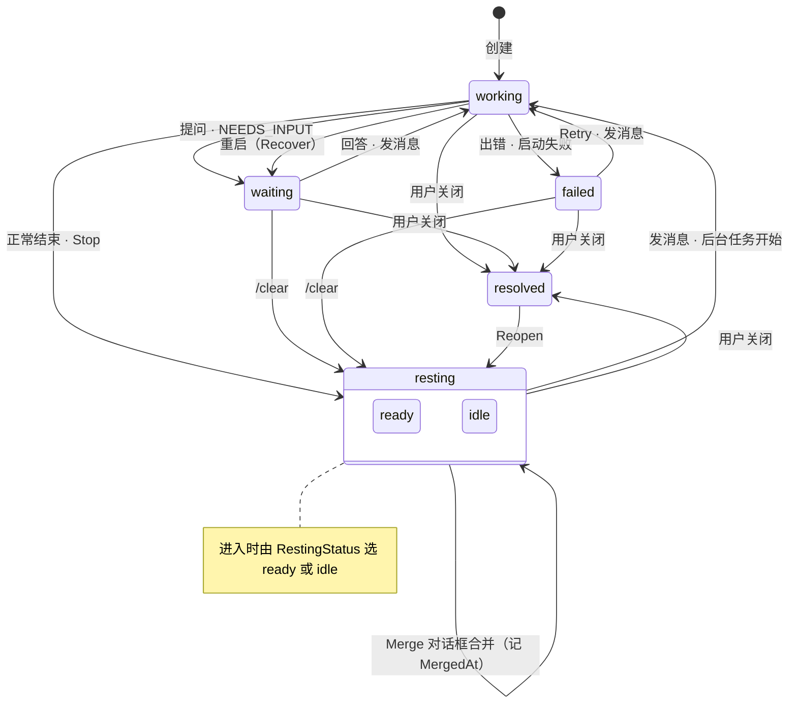

# 线程生命周期：状态机顶层设计

> 状态：**现行设计**（2026-11-21）。线程的状态、转移、谁能关闭线程，以本文为准。
> 改状态、加入口、加规则之前先改本文，再改代码；代码与本文不符时按缺陷处理。
>
> 相关文档：
> - [thread-events.md](thread-events.md)：哪些事件触发什么流程、传给谁（第一版：PR 合并、关闭、冲突；未实现）。
> - [thread-lifecycle.pencil.md](thread-lifecycle.pencil.md)：本设计落地前的代码现状图，含每条转移的行号、判定树、实测结果、缺口 G1–G14。
> - `projects.md` §4.3：本文的摘要。
> - [`../../.design/thread-cleanup.md`](../../.design/thread-cleanup.md)：归档和删除（释放 worktree、删分支）。
> - [`../../.design/chat-mode.md`](../../.design/chat-mode.md)：项目之外的纯聊天。它**不是**一种线程（无项目、无 cwd、无工具），见该文 §1、§6。
> - `mcp-tools.md`：工具 URL 的发放和收回；`github-tools.md`：PR 记录（Links）和合并。

## 1 目的与原则

一个线程是一段 Claude Code 会话加上它的工作区。用户在 Overview 上靠状态回答三个问题：**谁在干活、谁在等我、什么做完了等我看**。状态机只为回答这三个问题服务。

四条原则，后文每条规则都能追到其中一条：

1. **一个状态只回答一个用户问题。** 同一个状态不同时表示两件事；显示的状态只由记录下来的事实决定，不由“走了哪条路”决定。
2. **一个规则只写一处。** 同一个判断（例如“歇着时是 ready 还是 idle”）只有一个函数，所有路径都调用它。
3. **关闭可撤销，不删工作。** 关闭只收起会话；worktree、分支、对话记录都保留，Reopen 即恢复。
4. **只有用户能关闭线程。** 系统不自动关闭线程，合并也不关闭线程，线程不能关闭自己，协调者只在用户要求时关闭。做没做完要看工作的实际情况（还有没有未合并的提交、开着的 PR、未提交的改动、后续任务），这个判断属于用户。

## 2 模型

### 2.1 状态字段

线程只有一个状态字段 `Status`，取六个值之一：

| 值 | 一句话 |
|---|---|
| `working` | 在干活 |
| `waiting` | 在等用户 |
| `failed` | 上一轮出错了 |
| `ready` | 歇着，有提交等审阅 |
| `idle` | 歇着，没有要审阅的 |
| `resolved` | 已关闭 |

`ready` 和 `idle` 合称**歇着**：没有一轮在跑，也不在等用户。

### 2.2 事实（决定或解释状态，但不是状态）

| 字段 | 是什么 | 谁写 |
|---|---|---|
| `CommitsAhead` · `FilesChanged` · `Uncommitted` | 分支相对**本地** base 的提交数、改动文件数、是否有未提交改动 | 每轮结束时用 git 读（`Stats`） |
| `MergedAt` | 分支在 Overview 的 Merge 对话框里合并的时间；之后有了新提交就清空（§3.1） | Merge 对话框写；`settle` 清空 |
| `ResolvedAt` | 关闭时间 | 只有关闭（§6） |
| `WaitReason` | waiting / failed 的原因，给用户看 | 写 waiting / failed 的地方 |
| `Links` | 线程用工具碰过的 PR / issue，及其 GitHub 状态 | 只有 Links（后台每分钟刷新开着的） |
| `Queued` · `RunningTasks` | 在排队等并发槽位；后台任务数（从活进程读，不入库） | 线程调度 |

`ArchivedAt`（归档）与状态正交：它只表示“收起来不看”，不改状态，不在本文范围（见 `thread-cleanup.md`）。

## 3 状态契约

| 状态 | 回答的问题 | 契约 | 用户的下一步 | Overview 分组 |
|---|---|---|---|---|
| `working` | 它在干活吗？ | 一轮在跑；或在排队等槽位（`Queued`）；或后台任务在跑 | 等；Stop | Working |
| `waiting` | 它在等我吗？ | 需要用户才能继续；`WaitReason` 必须有内容，并说清用户该做什么 | 回答问题，或发一条消息 | Waiting on you |
| `failed` | 它出事了吗？ | 上一轮出错，`WaitReason` 以 `Failed` 开头 | Retry；或发一条消息 | Failed |
| `ready` | 有东西等我审阅吗？ | 歇着，且 `RestingStatus` 为 ready（§3.1） | 看 diff、开 PR、合并 | Ready for review |
| `idle` | — | 歇着，且 `RestingStatus` 为 idle | 发消息；判断做完后 Resolve | Idle |
| `resolved` | 它结束了吗？ | `ResolvedAt` 有值；没有进程，工具 URL 已收回 | Reopen | Resolved |

### 3.1 歇着规则（唯一）

```go
// db.RestingStatus
ready  ⇐ CommitsAhead > 0 && MergedAt == nil
idle   ⇐ 其余
```

分支上有还没合并的提交，就是有东西等审阅。所有让线程歇下来的路径都调用它：一轮正常结束、Stop、后台任务结束、Reopen、`/clear`、文件夹会话归档、Merge 对话框合并。

`MergedAt` 表示“分支**现在的样子**已经从 Overview 合并”。所以一轮结束时，如果提交数比合并时多了，`settle` 会清空 `MergedAt`：新提交没合并，线程回到 ready，Merge 按钮重新可用。

PR 在 GitHub 上合并、或线程自己用 `merge` 工具合并，都不写 `MergedAt`，线程照样是 ready。这类合并如何让线程和协调者知道，见 [thread-events.md](thread-events.md)。

### 3.2 waiting 与 failed 的分界

- **waiting**：线程停在“用户做一件事就能接着走”的地方。三种来源：
  - 待答的审批 / 提问（进程活着，用户回答即继续）；
  - 上一轮最后一行是 `NEEDS_INPUT: <问题>`；
  - 没有问题可答、但发一条消息就能继续：重启时这一轮正在跑；重启时待答的问题已过期；建 worktree 失败。这时 `WaitReason` 必须写明 “Send a message to continue”，不能留着一个答不了的问题。
- **failed**：上一轮以错误结束（轮次出错、profile 不可用、会话启动失败）。Retry 在原处重跑这一轮。重跑依赖本进程记得这次失败，重启后只能发消息继续（§11）。

不做超时：在等用户的线程，等多久都还在等用户。

## 4 状态图



一条线程依次经过四个阶段：

1. **创建**：协调者 `start_thread`、用户采纳提议卡、用户新建、IM 开新会话。从 working 开始。
2. **运行**：在 working 与 waiting / failed 之间往返，直到一轮正常结束或被停下。
3. **歇着**：ready 或 idle。发消息、后台任务开始都回到 working。合并只记录事实，不离开歇着。
4. **关闭**：resolved，只由用户决定。发给它的消息一律拒绝（`ErrResolved`：“reopen it first”）；Reopen 后回到歇着。

## 5 转移表（完整）

表外没有别的转移。加一行先改这里。

| # | 从 | 到 | 触发 | 写状态的函数 |
|---|---|---|---|---|
| T1 | — | working | 创建线程 | `Threads.Start`、`startFolderThread` |
| T2 | working | waiting | 审批 / 提问挂起 | `threadPrompter.wait` |
| T3 | working | waiting | 最后一行 `NEEDS_INPUT:`（项目线程） | `settle` |
| T4 | working | failed | 轮次出错；profile 不可用；会话启动失败 | `settle`、`turnLaunch`、`startFolderThread` |
| T5 | working | 歇着 | 一轮正常结束、后台任务也结束；Stop | `settle`、`stoppedBeforeTurn`、`release`（后台报告）→ `RestingStatus` |
| T6 | waiting | working | 回答审批 / 提问 | `threadPrompter.wait`（收到回答后） |
| T7 | waiting · failed · 歇着 | working | 发消息（网页、IM、协调者 `message_thread`）；Retry（只对 failed） | engine `SetRunning`；`Retry` |
| T8 | 歇着 ⇄ working | | 后台任务在歇着的线程里开始 / 全部结束 | `syncBackground` → `RestingStatus` |
| T9 | waiting · failed | 歇着 | `/clear` 开新会话 | `db.RotateThreadSession` → `RestingStatus` |
| T10 | working | waiting | 重启时这一轮正在跑 | `Recover` |
| T11 | waiting | waiting | 重启时待答的问题过期：原因改写为可继续的说明 | `Recover` |
| T12 | working | waiting | 创建时建 worktree 失败（这一轮还没开始） | `Threads.Start` |
| T13 | 歇着 | 歇着 | Merge 对话框合并：记 `MergedAt`，按 `RestingStatus` 重选（通常 idle）。waiting / failed 的线程状态不变 | `markMerged` |
| C1 · C2 · C3 | 任何非 resolved | resolved | 关闭（§6） | `close` |
| O1 | resolved | 歇着 | Reopen | `Reopen` → `RestingStatus` |

## 6 关闭与重开

### 6.1 谁能关闭

| # | 谁 | 入口 | 条件 |
|---|---|---|---|
| C1 | 用户 | 线程菜单 Resolve；看板多选批量 Resolve | 无 |
| C2 | 用户 | 项目线程 Archive（关闭并释放 worktree） | 不在跑、不在排队、没有未提交改动（`thread-cleanup.md`） |
| C3 | 协调者 | `resolve_thread` | 只在用户要求时（工具描述：“a merged PR alone does not mean the thread is done”）。工具本身不检查（§11） |

以下**都不**关闭线程：

- **系统**：没有任何定时或事件规则会关闭线程。（原先 idle 7 天自动关闭的规则已删除。）
- **合并**：Merge 对话框、线程的 `merge` 工具、GitHub 上的合并，都只记录事实（T13、Links）。合并有风险，合并之后还可能有未合并的提交、别的开着的 PR、未提交的改动、后续任务，要由用户看过再决定。
- **线程自己**：做完是用户的验收，线程只知道自己交了什么。

**重开**（O1）只有用户能做：线程菜单 Reopen。协调者没有重开工具。

### 6.2 关闭做什么（唯一路径）

所有关闭入口都经过同两个函数，副作用完全一致：

```
endProcess(t)   停当前一轮（等它收尾，最多 SessionCloseTimeout）→ 回收进程
close(t, mark)  写 resolved + ResolvedAt（已有则保留）+ mark 的附加字段，一次保存
                → IM 绑定交还父线程 → 删 library/.tmp/<thread> → 收回工具 URL
```

调用方持有线程的 lifecycle 锁，期间不会有新会话启动。各入口只在 `mark` 里加自己的字段：

| 入口 | mark | 额外 |
|---|---|---|
| Resolve（C1、C3） | — | — |
| Archive（C2） | `ArchivedAt`、`WorktreeFreedAt` | 保存前释放 worktree；记一条系统事件 |

不删的：worktree（Archive 除外）、分支、对话记录、Library 的上传和产出。

### 6.3 重开做什么

`Reopen`：只对 resolved 的线程生效（其他状态原样返回，不写任何东西）；清空 `ResolvedAt`，按 `RestingStatus` 回到 ready 或 idle，记一条 “Reopened.”。进程和工具 URL 在下一轮重新建立；IM 绑定不迁回，`#N` 仍可直达。项目主线程不能重开（`ErrNotWorker`）。

### 6.4 合并做什么（不关闭）

`Threads.Merge`（Merge 对话框）：

| 情况 | 做什么 |
|---|---|
| squash 成功 | PR 记为 merged；`markMerged` 记 `MergedAt`，歇着的线程按 `RestingStatus` 重选，记一条 “Squash-merged PR #N …”。进程、工具 URL、IM 绑定都不动：线程还能接着干活 |
| 线程已用 `merge` 工具合并过，且分支之后没动（没有开着的 PR、本地没有未推送的提交，`mergedAsPushed`） | 不再请求 GitHub，只 `markMerged` |
| 合并后又有新提交 | 走正常合并：推送、开新 PR、squash |
| merge request | 只开 PR，线程不变 |
| GitHub 拒绝 | 如实报错，PR 保持打开，线程不变 |

## 7 系统规则

系统只在启动时改状态（`Recover`），而且只改“这一轮”的部分，从不关闭线程：

- working → waiting，原因 “Interrupted when tingly-project stopped. Send a message to continue.”
- 待答的审批 / 提问标为 expired，线程原因改为 “The question expired when tingly-project stopped. Send a message to continue.”
- 排队中的消息丢弃。

另有每分钟的 `CheckStalled`：working 且 20 分钟无活动时报告协调者，**不改状态**。

## 8 通知

| 转移 | 协调者 | IM 聊天 |
|---|---|---|
| 一轮正常结束（T5） | 收到报告 finished | 协调者在线时由它回复；离线时推 “Finished: …” |
| NEEDS_INPUT（T3） | 收到报告 needs_input | 推 “Needs you … Reply with #N” |
| 审批 / 提问（T2） | 不收 | 推审批 / 提问卡 |
| 出错（T4） | 收到报告 failed | 推 “Failed: …” |
| 20 分钟无活动 | 收到 stalled | 不推 |
| Merge 对话框合并（T13）、关闭、重开、重启 | 不收；下一轮从线程列表看到 | 不推 |
| 线程开的 PR 在 GitHub 上被合并 / 被关闭（`merge` 工具合并也算）。**不改状态** | 收到 github 事件 pr_merged / pr_closed（线程已 resolved、项目暂停则只记录） | 不直接推；协调者在线时由它的回复到达 |
| 线程开的 PR 进入合并冲突。**不改状态** | 收到 pr_conflicts（`needs_user`，同一 PR 30 分钟内最多一次；离开冲突只记录） | 协调者发决策卡；离线、或它没发卡也没回复时推一行折叠消息 |

哪些事件值得送给线程、协调者或用户，见 [thread-events.md](thread-events.md)。

## 9 其他线程种类

| | 项目线程 | 文件夹会话 | 项目主线程（协调者） |
|---|---|---|---|
| 状态机 | 本文 | 本文，差异如下 | 不适用 |
| NEEDS_INPUT | 是 | 否：一轮结束直接歇着 | — |
| Archive | 关闭并释放 worktree | 只加标志，不关闭；working / waiting 改为歇着，其余保留（failed 仍 failed） | — |
| 给已关闭的线程发消息 | 拒绝 | IM 发来时在同一文件夹开新会话；网页拒绝 | — |

纯 Chat 不在本表：它没有 Project、线程行、cwd 或工具，状态只有“有/没有进行中的回复”；见 [`../../.design/chat-mode.md`](../../.design/chat-mode.md)。

项目主线程的显示状态由协调者队列推出（`coordinatorView`：忙时 working，有中断的输入待决定时 waiting，否则 idle），从不 resolved。

## 10 不变量与测试

harness 在每个场景结束时检查（`internal/harness/invariants.go`）：

| 名字 | 规则 |
|---|---|
| `status.resolved-consistent` | resolved ⇔ `ResolvedAt` 有值 |
| `status.rests-by-one-rule` | ready / idle 的线程，状态等于 `RestingStatus` |
| `status.ready-has-commits` | ready 的线程分支上有提交 |
| `wait.has-reason` | waiting 的线程有原因 |

单元测试覆盖本文的每条规则（`thread_rest_test.go`、`threads_test.go` 的 Merge 用例）：
- 歇着规则；
- Stop 后有提交是 ready；
- Merge 对话框合并过的线程，Reopen 和新一轮都是 idle；
- 合并不关闭线程、不收回工具；合并后的新提交回到 ready，再合并会开新 PR；
- 合并不改变 waiting 的线程；
- 线程用工具合并过后点 Merge，只记录、不再请求 GitHub；
- 重启后不留答不了的问题。

每条都做过变异检查：把对应改动退回，测试失败。

## 11 已知限制与暂缓

**已知限制**（现有行为，本文不改）：

- Retry 只认本进程记得的失败。重启后 failed 线程的 Retry 会报 “the thread has no failed turn to retry”，只能发消息继续。
- `CommitsAhead` 对本地 base 计算。GitHub 上 squash 合并后本地 base 不变，没走 Merge 对话框的合并不会让线程变成 idle。
- 协调者 `resolve_thread` 的“只在用户要求时”只写在工具描述里，工具本身不检查（G5）。

**暂缓**（新需求，本轮不引入；要做先改本文的模型）：

- 让 GitHub 上的合并、关闭、评审、CI 变化被线程和协调者感知（G1、G2、G13）：见 [thread-events.md](thread-events.md)。
- 协调者的重开工具（G6）。
- 建 worktree 失败改记 failed（G9）：要先让 Retry 对没跑过的轮次有意义。

**不做**（用户决定，2026-11-21）：

- 任何自动关闭：合并后自动关闭、空闲若干天自动关闭（G3、G4 的方向）。
- 线程声明“做完了”或关闭自己（G12）。

## 12 本次合理化（2026-11-21，PR #2733）

落地前的代码与上面的设计不一致的地方，已按设计改正，只用已有的状态和规则：

| 缺口 | 之前 | 现在 |
|---|---|---|
| G10 | Stop 后一律 idle，有提交也不进 ready | Stop 后按 `RestingStatus` |
| G11 | ready / idle 有两种算法：轮次结束只看提交，Reopen 和 `/clear` 还看 `MergedAt` | 一个 `db.RestingStatus`，所有路径调用 |
| G14 | 关闭路径各写各的；Merge 对话框关闭时不回收进程、不收回工具 URL | Resolve 和 Archive 共用 `endProcess` + `close`；合并不再关闭 |
| — | Merge 对话框合并后线程自动 resolved；idle 7 天自动 resolved（会关掉有开着的 PR 或未提交改动的线程，G4） | 都删除：只有用户能关闭线程 |
| — | `MergedAt` 一旦写上就不变，合并后的新提交显示 idle，Merge 只说 “already merged” | 合并后的新提交清空 `MergedAt`，回到 ready，可以再合并 |
| G8 | 重启后问题已过期，线程原因仍是 “Approve: …” | 原因改为可继续的说明 |
| — | 协调者工具描述：“用户说了，或工作已合并”时可以关闭 | “只在用户要求时”，合并本身不代表做完 |

G7（重启中断）保留 waiting：发一条消息即可继续，符合 §3.2；改成 failed 会出现一个重启后用不了的 Retry 按钮。
