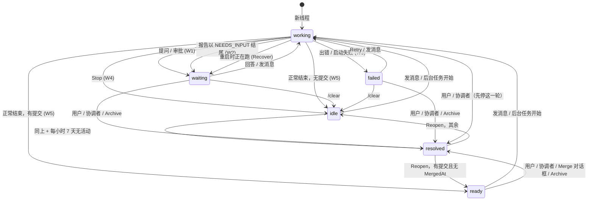

# 线程生命周期：现状 — Pencil Graph

**落地前**的现状图（2026-11-21，main @ 66a564d30），配合 [thread-lifecycle.md](thread-lifecycle.md)（顶层设计）看；其中多处已按设计处理（见设计 §12、§11），行号以那次提交为准。本文只画**代码当时怎么做**；标 ✗ 的是缺口。每条转移都注明代码位置；标 🧪 的已用一次性测试实测（测试未提交，见文末）。

目录：

- 0 一条线程的状态由哪些字段组成
- 1 总览（mermaid）
- 2 轮次内：working 怎么离开、怎么回来
- 3 轮次结束的判定树（settle）
- 4 轮次之外的转移（重启、/clear、归档）
- 5 进入 resolved 的全部入口
- 6 Resolve / Reopen / Archive 各做什么
- 7 PR 这条线和线程这条线：互不相连
- 8 后台循环与触发时机
- 9 谁会被告知（协调者、IM）
- 10 文件夹会话的差异
- 11 缺口汇总

## 0 一条线程的状态由哪些字段组成

```
db.Thread（models.go）
│
├─ Status ─────────── working │ waiting │ failed │ ready │ idle │ resolved
│                     一个字段里装了两件事：这一轮跑到哪（working/waiting/failed）
│                     和这条线程的结局（ready/idle/resolved）
├─ WaitReason ─────── waiting / failed 的原因（不变量 wait.has-reason）
├─ ResolvedAt ─────── 不变量 status.resolved-consistent：Status==resolved ⇔ ResolvedAt!=nil
├─ MergedAt ───────── 只有 Merge 对话框的 squash 写它；在 GitHub 上合并不写 ✗
├─ ArchivedAt ─────── 归档标志，与 Status 正交
├─ WorktreeFreedAt ── 项目线程归档时释放了 worktree
├─ CommitsAhead ┐
├─ FilesChanged ├──── 每轮结束时对**本地** base 用 git 算一次（Stats）
├─ Uncommitted  ┘     squash 合并后本地 base 不变 → CommitsAhead 仍 > 0
├─ Links[] ────────── 线程用工具碰过的 PR / issue：state open │ closed │ merged
│                     只有 Links 写（JSON 列，SaveThread 不碰）
├─ Queued ─────────── working 但在等并发槽位
└─ RunningTasks ───── 后台任务数，从活进程读，不入库
```

## 1 总览（mermaid）



## 2 轮次内：working 怎么离开、怎么回来

```
              新线程：start_thread · 采纳的提议卡 · 用户新建 · IM 新会话
              （threads.go:588 / sessions.go:144，Status=working）
                                  │
                                  ▼
  ┌─────────────────────────────────────────────────────────────────────────┐
  │ working     a turn runs  ·  or waits for a slot (Queued)  ·  or bg tasks │
  └──┬─────────────┬──────────────┬───────────────┬──────────────┬───────────┘
     │ W1          │ W2           │ W3            │ W4           │ W5
     │ ask /       │ NEEDS_INPUT: │ error /       │ Stop         │ ends normally
     │ approval    │              │ cannot launch │              │
     ▼             ▼              ▼               ▼              ▼
  ┌──────────────────────────┐ ┌──────────┐   ┌──────────┐   commits ahead?
  │ waiting                  │ │ failed   │   │ idle     │◀─ no ──┤
  └──────────────────────────┘ └──────────┘   └──────────┘        │ yes
                                                                  ▼
                                                             ┌──────────┐
                                                             │ ready    │
                                                             └──────────┘
```

| # | 离开 working | 代码 | 说明 |
|---|---|---|---|
| W1 | 提问 / 审批 → `waiting`，原因是问题本身（审批前缀 `Approve: `） | `threads.go:2072`（prompter） | 轮次仍在跑，只是挂起等回答 |
| W2 | 最后一行 `NEEDS_INPUT: …` → `waiting` | `settle`，`threads.go:1344` | 文件夹会话不适用 |
| W3 | 轮次出错 → `failed`（`Failed: …`）；profile 不可用、会话启动失败 → `failed` | `threads.go:1340`、`:915`、`sessions.go:157` | |
| W3′ | 建 worktree 失败 → `waiting`（`Could not create the worktree: …`） | `threads.go:650` | 其实是失败，却记成 waiting ✗ |
| W4 | Stop → `idle`（**有提交也是 idle**，不是 ready ✗，读代码所得） | `settle` `threads.go:1337`、`stoppedBeforeTurn` `:1211` | |
| W5 | 正常结束 → 有提交 `ready`，无提交 `idle`；后台任务还在跑则留 working，报告等任务结束 | `restingStatus`（`background.go:177`） | 见 §3 |

| # | 回到 working | 代码 | 从哪些状态 |
|---|---|---|---|
| B1 | 回答审批 / 提问 | `threads.go:2156` | waiting（W1） |
| B2 | 发消息（网页、IM、协调者 `message_thread`） | `SetRunning`，`transcript.go:21` | waiting · failed · ready · idle；**resolved 拒绝**（`ErrResolved`） |
| B3 | Retry | `Retry`，`threads.go:1419` | **只有 failed** |
| B4 | 后台任务在空闲线程里开始 / 全部结束 | `transcript.go:160` | idle · ready ⇄ working |

## 3 轮次结束的判定树（settle，threads.go:1288）

```
turn ends
 │  先用 git 读 CommitsAhead / FilesChanged / Uncommitted（对本地 base）
 │
 ├─ 期间已被 resolve / archive ────────────▶ 不动（那个决定作数）
 ├─ Stopped ──────────────────────────────▶ idle                       不报告，记 "Stopped."
 ├─ Err ──────────────────────────────────▶ failed "Failed: …"         report failed
 ├─ 末行 NEEDS_INPUT:（非文件夹）─────────▶ waiting <问题>              report needs_input
 ├─ 后台任务还在跑 ───────────────────────▶ working                    报告先扣住，任务结束再发
 └─ 其余 ─────────────────────────────────▶ CommitsAhead>0 ? ready : idle   report finished
```

注意：判定时**不看 PR**。线程这一轮用 `merge` 工具合并了自己的 PR，结束时照样是 `ready`。

## 4 轮次之外的转移

```
启动时 Recover（threads.go:1796）
 ├─ working ───────────────────────────▶ waiting "Interrupted when tingly-project stopped. Send a message to continue."
 │                                        不是在等回答，却进了 Waiting on you；Retry 只认 failed ✗
 ├─ waiting 且原因以 "Failed: " 开头 ──▶ failed（老数据迁移）
 └─ 待答的审批 / 提问事件 ─────────────▶ 事件标 expired，**线程仍是 waiting "Approve: …"** ✗ 🧪
                                          这个问题已经没法回答了，只能另发一条消息

/clear（新会话，db/session_rotation.go:22）
 └─ waiting │ failed ──────────────────▶ CommitsAhead>0 且无 MergedAt ? ready : idle

ArchiveSession（文件夹会话归档，threads.go:1588）
 └─ waiting │ working ─────────────────▶ idle（加 ArchivedAt）
```

## 5 进入 resolved 的全部入口

```
   waiting      failed       ready        idle        working
      │            │           │            │            │
      └────────────┴─────┬─────┴────────────┴────────────┘
                         │
   R1  用户  线程页 ⋯ → Resolve ............. 任何状态，不检查        POST /threads/:id/resolve
   R2  用户  看板多选 → 批量 Resolve ........ 任何状态，不检查        同上，逐个调用
   R3  用户  Archive（项目线程）............. 先 resolve 再释放 worktree；有未提交改动、在跑、排队则拒绝
   R4  协调者 resolve_thread ................ 任何状态，不检查        规则只写在工具描述里
                                              "Only when the user says so or its work is merged."
   R5  用户  Merge 对话框，squash 成功 ...... 不能在跑；同时写 MergedAt  Threads.Merge → resolveMerged
   R6  系统  每小时 AutoResolve ............. 只看 idle · UpdatedAt 超过 7 天 · 非文件夹
                         │
                         ▼
                  ┌──────────────┐
                  │  resolved    │── O1 用户 ⋯ → Reopen ──▶ CommitsAhead>0 且 MergedAt 空 ? ready : idle
                  └──────────────┘
```

AutoResolve 实测 🧪（`AutoResolve(-1h)`，即所有线程都“够旧”）：

| 线程 | 结果 | 该不该 |
|---|---|---|
| ready，PR 已 merged | **不动，仍 ready** | 应该关 ✗ |
| idle，PR 还开着、有未提交改动 | **resolved** | 不该关：这是被遗忘的活 ✗ |
| failed | 不动 | 对 |
| waiting（NEEDS_INPUT） | 不动 | 对 |
| waiting（重启后已过期的审批） | 不动 | 是个死等 ✗ |

协调者没有 `reopen_thread`（工具表里只有 `resolve_thread`）：它关掉一个线程后，`message_thread` 会得到 `ErrResolved` “reopen it first”，自己却打不开 ✗。

## 6 Resolve / Reopen / Archive 各做什么

| 动作 | 停轮次 | 回收进程 | 收回工具 URL | IM 绑定 | `.tmp/<thread>` | worktree | 分支 | 记录 | 撤销 |
|---|---|---|---|---|---|---|---|---|---|
| Resolve（R1 R2 R4 R6） | 是 | 是 | 是 | 交还父线程 | 删 | 留 | 留 | 留 | Reopen |
| resolveMerged（R5） | —（要求不在跑） | 否 | 否 | 交还父线程 | 删 | 留 | 留 | 留，写 MergedAt | Reopen |
| Archive（R3，项目线程） | 是 | 是 | 是 | 交还父线程 | 删 | **释放** | 留 | 留 | Restore（不改 Status，仍 resolved） |
| Reopen（O1） | — | 下一轮新开 | 下一轮新发 | **不迁回** | 下一轮重建 | — | — | 记 "Reopened." | Resolve |

Reopen 一个“在 GitHub 上已合并”的线程 → `ready` 🧪：因为它只看 `MergedAt`，不看 Links。

## 7 PR 这条线和线程这条线：互不相连

```
时间 ──────────────────────────────────────────────────────────────────────────────▶

线程   working ──轮次结束──▶ ready ············································ ready（一直）
                  │                                                     ✗ 没人改它
                  │ create_pr
                  ▼
PR            #34 open ── Sweep 每分钟一次，open 的每 5 分钟读一次 ──▶ GitHub 上被合并
                                                                          │
                                                            applyReading（links.go:870）
                                                            · link.state = merged
                                                            · 推送页面刷新
                                                            · ✗ 不改 Status / MergedAt / ResolvedAt
                                                            · ✗ 不告诉协调者，不告诉 IM
                                                            · 之后不再读它（merged 是终态）
```

🧪 实测：ready 线程、PR 在 GitHub 上合并、Sweep 读到 merged 之后：`link=merged status=ready merged_at=nil resolved_at=nil`。

三种“合并”的去向：

```
在哪合并                         PR 记录        线程状态         MergedAt
───────────────────────────      ──────────     ──────────────   ────────
Merge 对话框（squash）           merged         resolved         写
线程自己调 merge 工具            merged         ready（不变）✗   不写
GitHub 网页 / 别人合并           merged（Sweep）ready（不变）✗   不写
merge_request（只开 PR）         open           不变             —
```

## 8 后台循环与触发时机

```
service.go 启动
 ├─ 启动时一次   Recover ............ §4
 ├─ 每分钟       CheckStalled ....... working 且 20 分钟无活动 → report stalled（不改状态）
 ├─ 每分钟       Links.Sweep ........ 到期的 open link（5 分钟，失败退避到 1 小时，每次最多 20 个）
 │                                   只改 link，不改线程（§7）
 └─ 每小时       AutoResolve ........ idle ∧ 7 天 ∧ 非文件夹 → Resolve（§5 R6）

事件触发
 ├─ 轮次结束 ................ settle（§3）
 ├─ 提问 / 回答 ............. prompter（W1 / B1）
 ├─ 后台任务开始 / 结束 ..... transcript.go:160（B4）
 └─ 用户 / 协调者操作 ....... R1–R5、O1、Retry、Stop、/clear
```

## 9 谁会被告知

```
转移                               协调者（会被唤醒吗）          IM 聊天
──────────────────────────────     ─────────────────────────     ───────────────────────────
W1 提问 / 审批                     否                            推审批 / 提问卡（relay.NeedsUser）
W2 NEEDS_INPUT                     report needs_input → 唤醒     推 "Needs you … Reply with @N"
W3 failed                          report failed → 唤醒          推 "Failed: …"
W5 finished                        report finished → 唤醒        协调者在线：由它回复；离线：推 "Finished: …"
stalled                            report stalled → 唤醒         否
任何 → resolved                    ✗ 否                          ✗ 否（绑定悄悄交还父线程）
PR 在 GitHub 合并                  ✗ 否                          ✗ 否
Recover 中断                       ✗ 否                          ✗ 否
```

协调者每轮的系统提示里有线程列表（`status=ready … prs=#34(merged)`），所以它**能看到**合并，但没有任何事件让它在合并时醒来，它也只能自己从 `prs=` 推断“做完了”。

## 10 文件夹会话的差异

| | 项目线程 | 文件夹会话 |
|---|---|---|
| NEEDS_INPUT → waiting | 是 | 否（轮次结束直接 ready / idle） |
| AutoResolve | 7 天 idle | 从不 |
| Archive | resolve + 释放 worktree | 只加标志，状态原样保留（failed 仍 failed） |
| 给已 resolved 的发消息 | 网页 / 协调者：`ErrResolved` | IM：在同一文件夹开新会话，聊天绑过去；网页：`ErrResolved` |
| Resolve 有后台任务时 | 无确认 | 确认“将停止 N 个任务” |

## 11 缺口汇总

| # | 现象 | 后果 | 证据 |
|---|---|---|---|
| G1 | PR 在 GitHub 上合并，线程不变 | ready 永远不走，最大的积压来源 | 🧪 §7 |
| G2 | 线程用 `merge` 工具合并，线程不变 | 同上，要用户再点一次 Merge 才关 | 代码 + `github-tools.md` |
| G3 | AutoResolve 只看 idle | ready / failed / 过期的 waiting 永不清理 | 🧪 §5 |
| G4 | AutoResolve 不看未提交改动、开着的 PR | 未完成的活被静默关掉 | 🧪 §5 |
| G5 | `resolve_thread` 不检查任何条件 | 协调者可以关掉有未合并工作的线程，只靠提示词约束 | 代码 `coordinator_tools.go:251` |
| G6 | 协调者无 `reopen_thread` | 它关错了就自己打不开 | 工具表 |
| G7 | 重启：working → waiting “Interrupted…” | 冒充“等你回答”，Retry 不可用 | 代码 §4 |
| G8 | 重启：待答审批过期，线程仍 waiting “Approve: …” | 一个答不了的问题一直挂在 Waiting on you | 🧪 §4 |
| G9 | 建 worktree 失败记成 waiting | 失败混进“等你回答” | 代码 `threads.go:650` |
| G10 | Stop 后有提交也是 idle | 待审阅的提交不显示 ready；7 天后可能被自动关 | 代码 `threads.go:1337` |
| G11 | Reopen 只看 MergedAt | 已在 GitHub 合并的线程重开后是 ready | 🧪 §6 |
| G12 | 线程无法表示“做完了、无后续” | 调研 / 回答类线程停在 idle 七天 | 设计如此（见提案 §3.2） |
| G13 | 任何 resolve 都不告诉协调者和 IM | 用户在 IM 里不知道哪些已经收尾 | 代码 §9 |
| G14 | Merge 对话框的 resolve（`resolveMerged`）不回收进程、不收回工具 URL | 已 resolved 的线程进程留到空闲回收，工具 URL 一直有效，与 `mcp-tools.md`“resolve 即收回”的约定不符 | 代码：`Evict` / `revokeTools` 只在 Resolve、ArchiveSession、Archive、ReleaseProject 里调用 |

哪些是现有行为内部的不一致、哪些是本轮不引入的新需求，见 [thread-lifecycle.md](thread-lifecycle.md) §6。

---

🧪 实测方法：一次性测试 `internal/project/zz_probe_lifecycle_test.go`（未提交，跑完已删），用现有的 `newFixture` / `newLinksFixture` 与假 GitHub：建各状态线程 → `Recover()` / `AutoResolve(-time.Hour)` / `Resolve` + `Reopen` / 假 GitHub 把 PR 设为 merged 后 `Sweep`，打印状态。命令：`GOWORK=<树外 go.work> go test ./internal/project -run TestProbe -v`。
